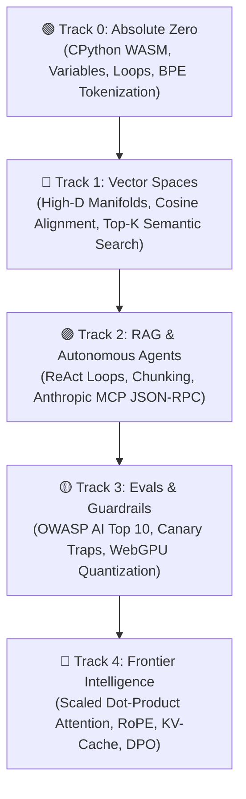

<div align="center">

# OpenGuide. ⚡
### THE SOVEREIGN IN-BROWSER AI ENGINEERING STUDIO
**From a cracked phone to a screen-reader user: Learn artificial intelligence from absolute first principles with zero dollar cloud bills, zero telemetry, and zero gatekeeping.**

[](LICENSE)
[](https://pyodide.org/)
[](#the-0-rule-hard-constraint)
[](#-the-master-curriculum-at-a-glance)
[](#-universal-accessibility--ergonomics)
[](#-a-message-from-the-creator--sponsorship)

---

### [🚀 Launch Live Studio](https://openguideai.org) • [📖 Read the Manifesto](#-why-openguide-exists) • [💡 Tips & Tricks](#-upfront-tips--power-tricks) • [💖 Support & Sponsor](#-a-message-from-the-creator--sponsorship)

</div>

---

## 🌟 Why OpenGuide Exists

Most AI education today is broken. It forces you through either:
1. **Superficial "Wrapper" Tutorials:** Teaching high-level black-box APIs that go obsolete in 6 months.
2. **Intimidating Math Walls:** Dense, gatekept academic papers with no interactive execution.
3. **Expensive Corporate Cloud Sandboxes:** Requiring credit cards, cloud accounts, Docker setups, or $30/month subscriptions.

**OpenGuide dismantles all three.**

We believe artificial intelligence is a fundamental literacy of human civilization. Whether you are coding on an **ultra-budget $100 Android smartphone**, an old Chromebook, or a high-end workstation; whether you navigate using **assistive screen readers** or a physical mouse: **OpenGuide gives you an elite, sovereign laboratory in your browser for free.**

> *"Every feature of OpenGuide is explainable by OpenGuide. You don't just study AI math; you watch tensors flow, dissect live attention heads, hear cosine distances through harmonic audio, and inspect the WebAssembly engine live using X-Ray mode (`Alt + X`)."*

---

## 🗺️ The Architecture Infogram: How It Works Without Servers

OpenGuide runs under the **$0 Rule**. There is **no backend server**. There is **no database tracking you**. 100% of the computation executes inside your local web browser:

```
┌────────────────────────────────────────────────────────────────────────┐
│                   YOUR LOCAL CLIENT BROWSER SANDBOX                    │
│                                                                        │
│  ┌─────────────────────────┐         ┌──────────────────────────────┐  │
│  │   UI & INTERACTION      │         │   BACKGROUND WEB WORKER      │  │
│  │   • React 18 + Vite     │         │   • CPython 3.12 (Pyodide)   │  │
│  │   • 24 Calibrated Themes│ ◄─────► │   • NumPy Vector Math        │  │
│  │   • Lenis Smooth Scroll │         │   • 15s Runaway Watchdog     │  │
│  │   • CodeMirror 6 Editor │         │   • Zero-Crash Standby Fallback││
│  └────────────┬────────────┘         └──────────────┬───────────────┘  │
│               │                                     │                  │
│  ┌────────────▼────────────┐         ┌──────────────▼───────────────┐  │
│  │   SPATIAL & NEURAL      │         │   SOVEREIGN PERSISTENCE      │  │
│  │   • Three.js WebGL / XR │         │   • IndexedDB via Dexie      │  │
│  │   • Harmonic Audio Synth│         │   • AES-GCM Encrypted Backup │  │
│  │   • In-Browser WebGPU   │         │   • W3C Verifiable Signature │  │
│  └─────────────────────────┘         └──────────────────────────────┘  │
└────────────────────────────────────────────────────────────────────────┘
```

---

## 📚 The Master Curriculum at a Glance

Five rigorous, production-grade tracks consisting of **45 interactive, runnable labs**:



| Track | Labs | Core Mental Model | Capstone Boss Project |
|:---|:---:|:---|:---|
| **Track 0: Absolute Zero** | 9 | Python syntax through warm real-world kitchen & map analogies | Byte-Pair Encoding (BPE) tokenizer from scratch |
| **Track 1: Vector Spaces** | 9 | Spatial geometry, dot products, and high-dimensional semantic density | In-memory `SemanticSearchEngine` indexing documents |
| **Track 2: RAG & Agents** | 9 | Thought $\rightarrow$ Action $\rightarrow$ Observation state machines & MCP tool schemas | Full Autonomous Research Agent with multi-hop reasoning |
| **Track 3: Evals & Guardrails** | 9 | Adversarial red-teaming, prompt injection defense, and metric rubrics | Synthetic eval harness paired with in-browser WebGPU inference |
| **Track 4: Frontier Systems** | 9 | $\text{Softmax}(QK^T/\sqrt{d_k})V$, KV-cache memory math, RoPE, and LoRA | Transformer Attention Head Dissection & DPO Loss Engine |

---

## 💡 Upfront Tips & Power Tricks

Master OpenGuide like a staff engineer from day one:

* **⚡ Lightning Execution:** Press `Ctrl + Enter` (or `Cmd + Enter` on macOS) anywhere in the editor to run Python code instantly.
* **🔬 The X-Ray Debug Lens:** Press `Alt + X` (or tap the floating lens icon on mobile) to inspect live Pyodide Abstract Syntax Trees (AST), active Web Worker memory heap, and local IndexedDB tables.
* **📱 Mobile 3-Tab Workspace:** On smartphones, switch effortlessly between `[ 📖 Study ]`, `[ 💻 Code ]`, and `[ 📟 Output ]`. Running code automatically switches you to the Output terminal!
* **🎹 Touchscreen Accessory Bar:** Typing Python syntax on mobile software keyboards is usually painful. OpenGuide provides a 20-button fast-input bar (`def`, `:`, `Tab`, `return`, `()`, `[]`, `==`) right above your keyboard.
* **👁️ Peek Live UI Mode:** Open Theme Settings and click the **"Peek Live UI"** eye icon to dim the modal to 5% opacity, letting you preview your typography and theme against the real studio in real time.
* **🎧 Harmonic Vector Sonification:** Turn on sound effects in settings. When you select nodes in the 3D Vector Space, OpenGuide synthesizes harmonic chords: high semantic similarity plays a consonant perfect fifth; orthogonal vectors sound a neutral tone.
* **🛡️ Zero-Loss Encrypted Gist Sync:** Never lose your streaks. Open your **Portfolio**, click **Encrypted Gist Sync**, and enter your personal GitHub PAT with a secret passphrase. OpenGuide encrypts your progress with **AES-GCM 256-bit cryptography** before saving it to a private Gist under your personal GitHub account.
* **🏅 GitHub Profile README Badge:** Completed your labs? Click **GitHub Badge** in your Portfolio to copy a live, markdown badge linking directly to your verified deterministic SHA-256 certificate!

---

## 🎨 Universal Accessibility & Ergonomics

OpenGuide is designed under strict **WCAG 2.2 AAA standards**:
* **24 Calibrated Scientific Themes:** 12 Dark and 12 Light themes engineered for circadian rhythm preservation, zero photopic glare, and high scotopic rod contrast (>13.8:1 up to 20.6:1 contrast ratios).
* **Screen Reader Certified:** Live ARIA status regions (`aria-live="polite"`), modal focus containment, semantic landmarks (`<main>`, `<nav>`), and skip-to-content links ensure blind and low-vision engineers can code seamlessly.
* **Universal RTL (Right-to-Left):** Fully mirrored interfaces in **Urdu** and **Arabic** with native cursive Nastaliq font ligatures and directional containment.
* **Air-Gapped PWA Capability:** Install OpenGuide as a Progressive Web App on Windows, macOS, Android, or iOS. After the initial load, the studio runs 100% disconnected from the internet.

---

## ❓ Frequently Asked Questions (FAQ)

<details>
<summary><strong>1. Is OpenGuide truly 100% free? Are there any hidden fees or paywalls?</strong></summary>
Yes. OpenGuide is 100% free and open-source under the MIT license. There are no subscriptions, no credit card prompts, no trial periods, and no locked "pro" tracks. It operates under the <strong>$0 Rule</strong>, meaning all computing happens directly in your browser.
</details>

<details>
<summary><strong>2. Do I need an expensive NVIDIA GPU or Mac Studio to learn?</strong></summary>
No! That is the core breakthrough of OpenGuide. Pyodide compiles CPython to WebAssembly, running on any standard CPU. Even a budget $100 smartphone or a library computer can execute every lab effortlessly. For frontier neural networks, we utilize client-side WebGPU or your own BYOK keys.
</details>

<details>
<summary><strong>3. Are my code, notes, and API keys safe?</strong></summary>
Completely. OpenGuide has zero telemetry, zero analytics tracking, and zero backend databases. If you enter an API key for optional frontier models, it stays in your browser's private memory and goes directly to provider endpoints (OpenAI, Anthropic, Gemini). It never touches our servers.
</details>

<details>
<summary><strong>4. How is OpenGuide different from Karpathy's "Zero to Hero" or Hugging Face?</strong></summary>
We revere Andrej Karpathy and Hugging Face—in fact, OpenGuide features all 8 full Karpathy lectures with runnable autograd playgrounds in our Curated Goldmines! Where OpenGuide differs is providing an interactive, structured, zero-setup studio with immediate automated test validation, 3D visual manifolds, MCP tool protocols, and gamified mastery paths.
</details>

<details>
<summary><strong>5. Can I use the certificate on my resume and LinkedIn?</strong></summary>
Yes! OpenGuide generates a <strong>Deterministic SHA-256 Document Integrity Signature</strong> and exports standard <strong>W3C Verifiable Credentials (JSON-LD)</strong>. You can print high-resolution vector certificates, export verifiable JSON ledgers, and embed live verified badges into your GitHub profile README.
</details>

---

## 💖 A Message from the Creator & Sponsorship

OpenGuide was envisioned, architected, and built by **Adil Rafiq Dar (ARD)**.

```
                  A NOTE ON SOVEREIGNTY & SUSTAINABILITY
"I built OpenGuide because I was tired of seeing brilliant minds locked out of artificial
intelligence by paywalled bootcamps, high-cost cloud subscriptions, and elitist gatekeeping.

Every line of this studio was crafted through countless sleepless nights, rigorous mathematical
testing, and an uncompromising dedication to visual craft. OpenGuide is my gift to the world.

To keep this studio 100% free, forever independent, and continuously updated with the latest
frontier AI protocols without ever adding ads or investor paywalls, I rely on the generosity
of learners and sponsors who believe in democratized education."
```

If OpenGuide has helped you understand AI, saved you money, or empowered your engineering career, please consider becoming a patron:

<div align="center">

[](https://www.paypal.com/paypalme/buymegoodcoffee/sponsor)
[](https://ko-fi.com/buymegoodcoffee)
[](https://github.com/sponsors/Adilrafiq001)

*Every sponsorship directly sustains open-source domain hosting, automated CI verification suites, and future curriculum tracks.*

</div>

---

## 🚀 Quickstart: Local Development

Want to run OpenGuide locally or contribute to the open-source studio?

### Prerequisites
* **Node.js**: v18.0.0 or higher
* **Yarn** (v4.x) or **npm**

### 1. Clone & Install
```bash
# Clone the repository
git clone https://github.com/openguideforai/OpenGuideForAI.git
cd OpenGuideForAI

# Install workspace dependencies
yarn install
```

### 2. Launch Dev Studio
```bash
# Start local Vite development server
yarn dev
```
Open [http://localhost:5173](http://localhost:5173) in your browser. The Pyodide WebAssembly runtime will initialize locally in < 800ms.

### 3. The 5-Point Quality Assurance Gate
Before any code is committed, it must pass our strict 5-point verification suite:
```bash
# 1. Dev server responds HTTP 200 OK
# 2. Zero console errors
# 3. Lint verification
yarn lint

# 4. 100% Playwright E2E regression pass
npx playwright test

# 5. Production static build compilation
yarn --cwd apps/web build
```

---

## 🔒 Security, Privacy & Integrity

* **Zero Tracking:** 0 cookies, 0 telemetry beacons, 0 analytics pings.
* **Local Cryptography:** Cryptographic hashes calculated client-side via W3C Web Cryptography API (`window.crypto.subtle`).
* **Environment Safeguards:** Example configuration provided in [`.env.example`](file:///.env.example). Real deployment tokens are strictly untracked.

---

## 👥 Creator & Architect

* **Architect & Lead Engineer:** Adil Rafiq Dar (ARD)
* **Organization:** OpenGuide AI Studio
* **Primary Target:** [https://github.com/openguideforai/OpenGuideForAI](https://github.com/openguideforai/OpenGuideForAI)
* **Archive Mirror:** [https://github.com/Adilrafiq001/OpenGuideForAI](https://github.com/Adilrafiq001/OpenGuideForAI)
* **License:** [MIT License](LICENSE) — Sovereign, Free, and Open to Humanity Forever.

<div align="center">
  <sub>Architected with ❤️ by Adil Rafiq Dar (ARD). If you love this project, star the repo on GitHub! ⭐</sub>
</div>
