<div align="center">

<a href="https://openguideforai.dpdns.org">
  
</a>

# OpenGuide.
### Understand the mind behind the machine.

> **A sovereign, browser-native studio engineered to demystify artificial intelligence—turning complex black boxes into intuitive, hands-on understanding through pure code execution.**  
> **Crafted for every curious human on Earth—from a cracked phone glowing under a single late-night lightbulb to an engineering workstation with a screen reader. 100% Free • Zero Cloud Invoices • Sovereign in Your Browser.**

<p align="center">
  <a href="https://openguideforai.dpdns.org">
    
  </a>
</p>

[](LICENSE)
[](https://pyodide.org/)
[](explainer.md)
[](#curriculum-tracks)
[](#universal-design--accessibility)
[](#install-as-desktop--mobile-app)

<p align="center">
  <b>Translations / Multilingual Editions:</b>&nbsp;
  <a href="README.md"><b>English</b></a> &nbsp;•&nbsp;
  <a href="docs/translations/README_es.md">Español</a> &nbsp;•&nbsp;
  <a href="docs/translations/README_zh.md">简体中文</a> &nbsp;•&nbsp;
  <a href="docs/translations/README_ur.md">اردو</a> &nbsp;•&nbsp;
  <a href="docs/translations/README_ar.md">العربية</a> &nbsp;•&nbsp;
  <a href="docs/translations/README_hi.md">हिन्दी</a> &nbsp;•&nbsp;
  <a href="docs/translations/README_fr.md">Français</a> &nbsp;•&nbsp;
  <a href="docs/translations/README_de.md">Deutsch</a> &nbsp;•&nbsp;
  <a href="docs/translations/README_ja.md">日本語</a> &nbsp;•&nbsp;
  <a href="docs/translations/README_pt.md">Português</a> &nbsp;•&nbsp;
  <a href="docs/translations/README_ru.md">Русский</a> &nbsp;•&nbsp;
  <a href="docs/translations/README_it.md">Italiano</a>
</p>

---

### [Launch Studio Online](https://openguideforai.dpdns.org) &nbsp;•&nbsp; [The Experience](#what-you-experience) &nbsp;•&nbsp; [Curriculum](#curriculum-tracks) &nbsp;•&nbsp; [Technical Explainer](explainer.md) &nbsp;•&nbsp; [Quickstart](#get-started-in-60-seconds) &nbsp;•&nbsp; [Shortcuts](#power-shortcuts)

</div>

---

## What You Experience

OpenGuide is not a cloud service or a toy tutorial. It is a browser-native laboratory where you deconstruct, examine, and understand artificial intelligence through real code execution.

| Pillar | What Happens Inside | Why It Matters |
|---|---|---|
| **Pure Education** | Learn the true mathematics: write Byte-Pair tokenizers, vector dot products, and self-attention heads from scratch. | You gain permanent conceptual understanding instead of memorizing temporary library wrappers. |
| **Instant Execution** | Real CPython 3.12 executes in your browser via WebAssembly (Pyodide v0.26) inside a dedicated Web Worker. | Zero setup. No Python, Anaconda, or Docker environment required on your machine. |
| **3D Spatial Manifolds** | An interactive Three.js WebGL visualizer maps high-dimensional vector spaces into physical coordinates with harmonic audio feedback. | You see and hear how language models cluster words and calculate semantic distance. |
| **Sovereign & Private** | 100% client-side computing. Data persists locally in browser IndexedDB. Zero telemetry. | Complete data privacy. Zero subscription fees. Zero unexpected cloud invoices. |
| **Offline PWA & Knowledge** | Progressive Web App caches the curriculum, CPython engine, and 250 frontier AI and everyday trade knowledge topics with runnable Python code on your device. | Code, experiment, and learn seamlessly anywhere on Earth with zero internet connection. |

> 📖 **Deep Engineering Specification:** For the complete system architecture, execution pipeline, 15-second watchdog supervisor, and progressive disclosure design, read the [ASD-STE100 Technical Explainer](explainer.md).

---

## Sovereign Offline Knowledge Bank

OpenGuide features an embedded, client-side engineering knowledge base with zero external cloud dependencies ($0 Rule):
- **250 Core Frontier & Everyday Topics:** Comprehensive coverage spanning Transformer Attention Mechanics (FlashAttention-2/3, PagedAttention/vLLM, MLA), Alignment & Optimization (DPO, KTO, ORPO, LoRA, QLoRA), Vector Geometries (HNSW, ColBERT, Cosine Skip-Lists), Constrained Decoding (Pushdown Automata, JSON Schema), Quantization (FP8, INT8, AWQ, BitNet b1.58), Multimodal Architectures (ViT, CLIP), and universal everyday trade fluencies across 17+ vocations.
- **Okapi BM25 Retrieval Engine:** Probabilistic ranking ($k_1=1.2, b=0.75$) with smoothed inverse document frequency, document length normalization, and multi-field weighting (Title, Keywords, Summary, Explanation).
- **Multilingual Cross-Lingual Bridge:** Instant query resolution across 11 world languages (English, Spanish, Hindi, Chinese, French, German, Arabic, Russian, Japanese, Urdu, Portuguese).
- **Interactive Visual Explainables:** Zero-dependency client-side micro-widgets (Softmax Temperature slider, PagedAttention block allocation, Cosine Similarity angular dial, RoPE phasor rotation) mounted directly into knowledge cards.
- **Executable Python / NumPy Snippets:** Every technical topic includes a self-contained, runnable Python code example executing locally in the Pyodide WebAssembly runtime.

---

## Universal Human AI Continuum

OpenGuide does not cater to an insular elite. It is engineered for the complete human spectrum—from someone who has never touched a line of code in their life to active frontier AI researchers and model architects:

| Stage & Profile | Real-World Context | What OpenGuide Delivers |
|---|---|---|
| **Stage 0: Curious Non-Coder & Everyday Human** | First encounter with AI. Overwhelmed by jargon and subscription paywalls. | Plain-English mental models ("You Are an LLM"), the 3 Golden Rules of Prompting (Role + Context + Format), and $0 budget clarity. |
| **Stage 1: Real-World Trades & Crafts** | Auto mechanics, cobblers, carpenters, stylists, chefs, plumbers. | Everyday AI in Action: practical diagnostics, customer estimate generators, material calculators, and workshop workflows. |
| **Stage 2: Knowledge & Services Practitioner** | Clinicians, teachers, accountants, legal researchers, farmers. | Structured prompt blueprints, tabular data extraction, synthetic study guides, and zero-leak client privacy. |
| **Stage 3: Applied Systems Developer** | Software engineers building applications with LLMs and agents. | Real in-browser Python execution, tokenization, JSON-RPC schemas, and Model Context Protocol (MCP) tool dispatch. |
| **Stage 4: AI Safety & Evals Architect** | Security and reliability engineers hardening production models. | OWASP AI Top 10 defense, prompt injection delimiter sandboxes, PII scrubbers, and automated evaluation harnesses. |
| **Stage 5: Frontier AI Researcher & Builder** | Practitioners transitioning to deep generative architecture. | Scaled dot-product attention from scratch, KV-cache kinematics, INT8 uniform quantization, and DPO closed-form loss. |

---

## Ungameable Dual-Phase Autograders

Every single one of OpenGuide's **57 curriculum laboratories** is guarded by a dual-phase autograding harness:
1. **Phase 1 (Visible Challenge):** Validates function return types, shapes, and structural syntax against baseline examples.
2. **Phase 2 (Hidden Mathematical Invariants):** Evaluates student implementations against five hidden invariants per lab—probing Cauchy-Schwarz bounds, variance scaling, metric symmetry, dynamic test vectors, and edge cases.
3. **Mutation Testing Kill Rate:** Subjected to an automated mutation testing suite across 135 adversarial mutants, achieving a **100.0% Kill Rate (135/135 mutants killed)** with zero false-positive passes.

---

## Get Started in 60 Seconds

### Launch in Browser (No Installation)
Visit **[https://openguideforai.dpdns.org](https://openguideforai.dpdns.org)** and click **Launch Track 0**. The CPython WebAssembly runtime initializes locally in under a second.

### Run Locally via Git
```bash
# 1. Enable Corepack and clone the repository
corepack enable
git clone https://github.com/openguideforai/OpenGuideForAI.git
cd OpenGuideForAI

# 2. Install dependencies and start development server
yarn install
yarn dev
```
Open `http://localhost:5173` in your browser.

#### Mobile LAN Testing
To test on a physical smartphone or tablet connected to your local network:
```bash
yarn dev --host
```

---

## Install as Desktop & Mobile App

OpenGuide functions as an **Installable Progressive Web App (PWA)** with native window controls:

* **Windows:** In Chrome or Edge, click the **Install** computer icon in the address bar. A native shortcut is added to your Desktop and Start Menu.
* **macOS:** In Safari, click **File** $\rightarrow$ **Add to Dock**. In Chrome/Edge, click **Install** in the omnibox.
* **Linux:** Click **Install** in Chromium or Chrome. An OpenGuide `.desktop` entry is created automatically in your application drawer.
* **iOS / Android:** Tap **Share** $\rightarrow$ **Add to Home Screen** (iOS) or **Install app** (Android) for full-screen touch execution.
* **Air-Gapped Offline Mode:** The Service Worker stores all lessons, visualizers, and the CPython WebAssembly engine locally. You can study on flights, trains, or off-grid locations with zero connectivity.

---

## Power Shortcuts

| Shortcut | Tool Activated | Action Performed |
|---|:---:|---|
| **`Cmd + K` / `Ctrl + K`** | Command Palette | Fuzzy search across all 57 labs, 24 themes, 12 languages, and studio tools. |
| **`Ctrl + Enter`** | Code Runner | Instantly compiles and executes active Python code in the Web Worker. |
| **`Alt + X`** | X-Ray Debug Lens | Inspects real-time WebAssembly memory heap, AST nodes, and IndexedDB tables. |
| **Touch Ribbon** | Mobile Editor | Single-tap access to syntax keys (`Tab`, `:`, `( )`, `[ ]`, `def`, `assert`). |
| **`.ipynb` Export** | Notebook Creator | Downloads verified lab solutions as standard Jupyter Notebooks (nbformat 4.5). |
| **Harmonic Audio** | 3D Holodeck | Synthesizes harmonic chord frequencies proportional to vector cosine similarity. |

---

## Universal Design & Accessibility

* **24 Calibrated Contrast Themes:** 12 Dark themes and 12 Light themes engineered under **WCAG 2.2 AAA standards** (>7:1 up to 20:1 contrast ratios).
* **Screen Reader Certified:** Live ARIA notification regions (`aria-live="polite"`), modal focus containment, and accessible element landmarks ensure complete non-visual navigation.
* **Native RTL Bidirectional Support:** Fully mirrored user interface for **Urdu** and **Arabic**, preserving left-to-right alignment for programming code blocks.
* **Script-Safe Typography:** Dynamic line-height adjustments prevent vertical text collisions in Devanagari, Nastaliq, and East Asian scripts.

---

## Curriculum Tracks

Eight sequential learning tracks comprising **57 interactive, runnable laboratories**:

```mermaid
graph LR
    T0["Track 0: Foundations<br/>(CPython WASM, Loops, BPE)"]
    T1["Track 1: Vector Spaces<br/>(Embeddings, Cosine Search)"]
    T2["Track 2: Agents & RAG<br/>(ReAct Loops, FastMCP)"]
    T3["Track 3: Evals & Security<br/>(OWASP AI Top 10, WebGPU)"]
    T4["Track 4: Frontier Systems<br/>(Self-Attention, RoPE, DPO)"]
    T5["Track 5: Fine-Tuning<br/>(LoRA, SVD, NF4 Bins)"]
    T6["Track 6: Inference Engines<br/>(KV Paging, Speculative)"]
    T7["Track 7: Generative Models<br/>(Diffusion, CFG, ViT)"]

    T0 --> T1 --> T2 --> T3 --> T4 --> T5 --> T6 --> T7
```



| Track | Labs | Core Principle | Capstone Boss Project |
|:---|:---:|:---|:---|
| **Track 0: Absolute Zero** | 9 | Python syntax taught through intuitive real-world metaphors | Build a Byte-Pair Encoding (BPE) tokenizer from scratch |
| **Track 1: Vector Spaces** | 9 | High-dimensional geometry, dot products, and semantic density | In-memory `SemanticSearchEngine` indexing documents |
| **Track 2: RAG & Agents** | 9 | Thought $\rightarrow$ Action $\rightarrow$ Observation state machines | Autonomous Research Agent with multi-hop reasoning |
| **Track 3: Evals & Guardrails** | 9 | Adversarial testing, prompt injection, and safety rules | Synthetic evaluation harness with WebGPU inference |
| **Track 4: Frontier Systems** | 9 | Scaled dot-product attention, KV-cache math, and RoPE | Transformer Attention Dissection & DPO Loss Engine |
| **Track 5: Fine-Tuning & LoRA** | 6 | Parameter-efficient low-rank adaptation and NF4 quantization | Zero-Overhead LoRA Weight Merging Engine |
| **Track 6: Inference Engines** | 3 | High-throughput serving, KV paging, and speculative decoding | PagedAttention Virtual Paging Simulator |
| **Track 7: Multimodal & Diffusion** | 3 | Forward diffusion noising, CFG vectors, and ViT patches | Vision Transformer Patch Linear Projector |

---

## Quality Assurance Gate

Every contribution must pass the five-point quality assurance check before merge:
```bash
# 1. Linter verification (0 warnings, 0 errors across codebase)
yarn lint

# 2. Automated Playwright regression test suite (100% pass rate, 0 skips)
yarn --cwd apps/web test:e2e

# 3. Production static compilation (0 TypeScript/Vite errors)
yarn --cwd apps/web build
```

---

## Authorship & Stewardship

OpenGuide was envisioned, architected, and built by **Adil Rafiq Dar (ARD)**.

```
                   A STATEMENT ON SOVEREIGN EDUCATION
"I built OpenGuide because I believe knowledge of artificial intelligence
must belong to all humanity. It should not be restricted by expensive cloud
subscriptions, corporate toll gates, or elitist academic barriers.

Every component of this studio was created through rigorous testing, mathematical
precision, and uncompromising interface craft. OpenGuide is a public gift.

To keep this studio 100% free, independent, and continuously aligned with frontier
developments without advertising or private investment, I welcome the support of
learners and sponsors who share this vision."
```

Support ongoing independent development:

<div align="center">

[](https://github.com/sponsors/openguideforai)
&nbsp;&nbsp;
[](https://ko-fi.com/buymegoodcoffee)
&nbsp;&nbsp;
[](https://paypal.me/buymegoodcoffee)

<br/>

<sub>Contributions sustain domain hosting, continuous integration infrastructure, and open curriculum expansion.</sub>

</div>

---

## Technical Documentation & References

* **[Release Changelog](CHANGELOG.md):** Chronological milestone releases and system evolution.
* **[ASD-STE100 System Explainer](explainer.md):** Comprehensive technical specification covering Web Worker communication, memory limits, and progressive disclosure architecture.
* **[System Architecture](ARCHITECTURE.md):** Deep analysis of reactive stores, Web Worker communications, and WebGPU compute pipelines.
* **[Curriculum Specifications](docs/CURRICULUM.md):** Complete syllabus and technical outcomes across all 45 modules.
* **[External Technical Audit & QA Dossier](docs/EXTERNAL-AUDIT-QA-DOSSIER.md):** Architectural grounding, mathematical invariant matrices, and independent verification instructions.
* **[Third-Party Quality Audit](docs/AUDIT_QA.md):** Independent multi-layer cross-platform audit report.

<div align="center">
  <sub>Architected and built by Adil Rafiq Dar (ARD). Licensed under AGPL-3.0 & CC BY-NC-SA 4.0.</sub>
</div>
