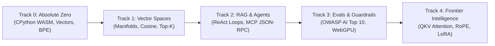

<div align="center">

# OpenGuide. ⚡
### AI STUDIO • SOVEREIGN IN-BROWSER AI ENGINEERING PLATFORM

**The world's premier $0, local-first, zero-setup AI engineering studio.**  
*From foundational Python tensors to frontier attention mechanics, multi-agent swarms, and production evals.*

[](LICENSE)
[-blue.svg)](https://pyodide.org/)
[](docs/PROJECT-STATE.md)
[](#the-curriculum)
[-amber.svg)](#visual-sovereignty--themes)
[](https://github.com/openguideforai/OpenGuideForAI)

---

[Explore Live Studio](https://openguideforai.dpdns.org) • [Architectural Manifesto](#the-0-rule--architecture) • [Curriculum Tracks](#the-curriculum) • [Quickstart](#quickstart-local-development)

</div>

---

## 🌟 Why OpenGuide?

Most AI tutorials teach high-level black-box APIs that break tomorrow. **OpenGuide teaches the eternal physics of artificial intelligence from first principles.**

Instead of expensive cloud sandboxes, Docker containers, or paid monthly subscriptions, **OpenGuide executes genuine CPython 3.12 and WebGPU neural networks directly inside your client browser**.

> "Every feature of OpenGuide is explainable by OpenGuide. You don't just learn how to build AI systems; you use X-Ray mode (`Alt+X`) to see exactly how OpenGuide itself was engineered using the exact same first principles."

---

## 💎 Core Architectural Pillars

### 1. The $0 Rule (Hard Constraint)
* **Zero Cloud Compute Costs:** 100% of Python code, tensor projections, BPE tokenization, and vector math executes locally on your CPU/GPU via WebAssembly (Pyodide v0.26) and WebGPU.
* **Zero Telemetry & Absolute Privacy:** Your code, notes, progress, and keys never touch an intermediate server. Your browser is your private laboratory.
* **BYOK (Bring Your Own Key):** When experimenting with frontier frontier models (OpenAI, Google Gemini, Anthropic), requests route directly via client-side HTTPS.

### 2. Multi-Head In-Browser Web Workers & 15-Second Watchdog
Python computations run on dedicated background threads via Web Workers. If you write an accidental infinite loop (`while True:`), a client-side watchdog timer automatically terminates and respawns the worker, keeping the studio silky smooth at **120 FPS**.

### 3. Local-First Sovereignty (IndexedDB)
Every keystroke, challenge completion, custom test script, and vector embedding index persists instantly in browser IndexedDB via Dexie. Work offline on a plane, subway, or in remote environments with zero data loss.

---

## 📚 The Curriculum: 5 Tracks • 45 Interactive Labs



### 🟢 Track 0: Absolute Zero (9 Labs)
* **Module 0.1: In-Browser CPython WASM:** Standard streams, non-blocking Web Worker event loops, and Pyodide virtual file systems.
* **Module 0.2: Vectors & Serialization:** Multi-dimensional lists, dictionary serialization, and tool-calling JSON schemas.
* **Module 0.3: Tokenization & Sampling:** Byte-Pair Encoding (BPE) from scratch, system prompt delimiters, and temperature logit distributions.

### 🔵 Track 1: Vector Spaces & High-Dimensional Geometry (9 Labs)
* **Module 1.1: Vector Geometry:** Dense embeddings, sparse vs dense representations, and dot-product projections.
* **Module 1.2: Distance Metrics:** Cosine Similarity, Euclidean (L2) distance, and unit normalization algorithms.
* **Module 1.3: Boss Project:** An in-memory, high-speed Semantic Search Engine (`SemanticSearchEngine`) indexing documents and scoring queries with cosine math.

### 🟣 Track 2: RAG & Production Agent Architecture (9 Labs)
* **Module 2.1: Semantic Chunking:** Sliding-window text chunking with stride overlap, context augmentation, and Reciprocal Rank Fusion (RRF).
* **Module 2.2: ReAct Loop State Machines:** Deterministic Thought $\rightarrow$ Action $\rightarrow$ Observation cycles and Model Context Protocol (MCP JSON-RPC 2.0).
* **Module 2.3: Boss Project:** Autonomous Research Agent with dynamic tool dispatch, memory state machines, and planner-worker-critic handoffs.

### 🟡 Track 3: Production Evals & Guardrails (9 Labs)
* **Module 3.1: Benchmarking & Evals:** Synthetic fuzzing, deterministic test harnesses, and LLM-as-a-Judge Likert scoring rubrics.
* **Module 3.2: OWASP AI Top 10 Defenses:** Prompt injection delimiters, high-entropy canary token traps, and automated PII sanitization.
* **Module 3.3: Boss Project & WebGPU:** Production evaluation test suite paired with in-browser WebGPU quantized neural inference (SmolLM-135M).

### 🔴 Track 4: Frontier Intelligence & Attention Mechanics (9 Labs)
* **Module 4.1: Attention Mechanics & Transformers:** Scaled Dot-Product Attention:
  $$\text{Attention}(Q, K, V) = \text{softmax}\left(\frac{QK^T}{\sqrt{d_k}}\right)V$$
  Multi-Head Attention (MHA), Rotary Position Embeddings (RoPE), and KV Caching.
* **Module 4.2: Model Adaptation & Efficiency:** LoRA low-rank updates ($\Delta W = B \cdot A$), QLoRA, and FP16/INT8/INT4/NF4 quantization.
* **Module 4.3: Reasoning Models & Frontier Protocols:** Chain of Thought, Test-Time Compute scaling, GRPO reinforcement learning, and production MCP servers.

---

## 🛠️ The Interactive Laboratory Suite

| Tool | Description | Shortcut |
| :--- | :--- | :---: |
| **Course Player IDE** | Segmented 3-tab mobile workspace (`[Study] [Code] [Output]`) with instant execution auto-switching | `Ctrl + Enter` |
| **Spatial Holodeck** | 3D Three.js semantic embedding space with live Dual-Vector Cosine Probes & 6-DOF WebXR | `/holodeck` |
| **Synapse Lounge** | Neuro-plasticity arcade: Vector Alignment Radar, Neural Logic Gates, Attention Sliders | `/synapse` |
| **Bluee AI Copilot** | 100% offline first-principles mentor with 50+ domain answers, zero cloud latency | Floating Mascot |
| **X-Ray Debug Lens** | Live telemetry inspecting Pyodide AST, Web Worker memory heap, and IndexedDB state | `Alt + X` |
| **Curated Goldmines** | Curated elite video lectures (Karpathy, 3Blue1Brown) with interactive timestamp seekers | Header Button |

---

## 🎨 Visual Sovereignty & Accessibility

* **20 Calibrated Themes:** 10 Dark and 10 Light themes meeting strict **WCAG AAA (>7:1)** color contrast ratios. Zero washed-out neon text slop.
* **Tactile Web Audio & Haptics:** Pure Web Audio API synthesized mechanical clicks, chimes, and mobile vibration feedback (`navigator.vibrate`) with user volume controls.
* **Universal i18n & Native RTL:** 12 world languages (English, Urdu, Arabic, Spanish, Mandarin, Hindi, French, German, Japanese, Portuguese, Russian, Italian) with script-safe responsive line heights for Nastaliq and Arabic.

---

## 🚀 Quickstart (Local Development)

### Prerequisites
* **Node.js**: v18.0.0 or higher
* **Yarn** or **npm**

### Clone & Run
```bash
# Clone the repository
git clone https://github.com/openguideforai/OpenGuideForAI.git
cd OpenGuideForAI

# Install dependencies
yarn install

# Launch the local development studio
yarn dev
```

Visit `http://localhost:5173` in your browser. All Pyodide WASM runtimes will initialize locally in < 800ms.

### Production Verification Suite (5-Point Gate)
```bash
# 1. Run full unit and component tests
yarn test

# 2. Run Playwright E2E browser regression tests
npx playwright test

# 3. Verify code style & linting
yarn lint

# 4. Compile production static bundle
yarn build
```

---

## 🔒 Security & Privacy Manifesto

* **Zero Tracking:** No Google Analytics, no Facebook Pixels, no telemetry beacons.
* **Zero Backend Database:** All student work resides in your browser's private IndexedDB sandbox.
* **Zero API Key Leaks:** API keys entered for frontier models remain in your browser's local memory and are never transmitted to any OpenGuide server.

---

## 👥 Creator & Architect

OpenGuide was envisioned, designed, and architected by **Adil Rafiq Dar (ARD)**.

* **Creator:** Adil Rafiq Dar (ARD)
* **Organization:** OpenGuide AI Studio
* **Repository:** [https://github.com/openguideforai/OpenGuideForAI](https://github.com/openguideforai/OpenGuideForAI)
* **License:** MIT License — Open Source Forever.

---

<div align="center">
  <sub>Crafted with sovereign engineering rigor under the $0 Compute Rule. If this repository empowers your AI journey, consider giving us a ⭐ star on GitHub!</sub>
</div>
