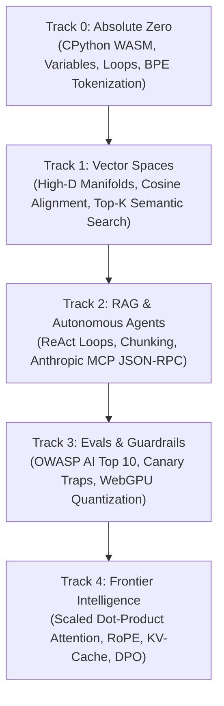

<div align="center">

<a href="https://openguideforai.dpdns.org">
  
</a>

# OpenGuide.
### SOVEREIGN IN-BROWSER AI ENGINEERING STUDIO

> **Education empowers humanity, and human knowledge must remain free. Intelligence should never be gatekept behind a $300 cloud invoice, an elitist paywall, or closed corporate silos.**  
> **From a cracked $40 smartphone under a dim bulb to a multi-monitor engineering rig with an assistive screen reader: OpenGuide places a sovereign, production-grade AI engineering laboratory directly inside your browser.**  
> **100% Free. In-Browser Python WebAssembly. Zero Setup. Zero Telemetry. Sovereign Forever.**

<p align="center">
  <a href="https://openguideforai.dpdns.org">
    
  </a>
</p>

[](LICENSE)
[](https://pyodide.org/)
[](#sovereign-client-side-architecture)
[](#curriculum-overview)
[](#universal-accessibility--standards)
[](#desktop--progressive-web-application-installation)

<p align="center">
  <b>Translations:</b>&nbsp;
  <a href="README.md"><b>English</b></a> &nbsp;•&nbsp;
  <a href="docs/translations/README_es.md">Español</a> &nbsp;•&nbsp;
  <a href="docs/translations/README_zh.md">简体中文</a> &nbsp;•&nbsp;
  <a href="docs/translations/README_ur.md">اردو</a> &nbsp;•&nbsp;
  <a href="docs/translations/README_ar.md">العربية</a> &nbsp;•&nbsp;
  <a href="docs/translations/README_hi.md">हिन्दी</a> &nbsp;•&nbsp;
  <a href="docs/translations/README_fr.md">Français</a> &nbsp;•&nbsp;
  <a href="docs/translations/README_de.md">Deutsch</a> &nbsp;•&nbsp;
  <a href="docs/translations/README_ja.md">日本語</a> &nbsp;•&nbsp;
  <a href="docs/translations/README_pt.md">Português</a> &nbsp;•&nbsp;
  <a href="docs/translations/README_ru.md">Русский</a> &nbsp;•&nbsp;
  <a href="docs/translations/README_it.md">Italiano</a>
</p>

---

### [Launch Studio](https://openguideforai.dpdns.org) &nbsp;•&nbsp; [Architecture](#sovereign-client-side-architecture) &nbsp;•&nbsp; [Curriculum](#curriculum-overview) &nbsp;•&nbsp; [Explainer (STE)](explainer.md) &nbsp;•&nbsp; [Desktop App](#desktop--progressive-web-application-installation) &nbsp;•&nbsp; [Power Shortcuts](#ergonomics--power-shortcuts) &nbsp;•&nbsp; [Quickstart](#local-development-quickstart)

</div>

---

## Philosophy & Purpose

Most AI education today is broken. It forces you through either:
1. **Superficial "Wrapper" Tutorials:** Teaching high-level black-box APIs that go obsolete in 6 months.
2. **Intimidating Math Walls:** Dense, gatekept academic papers with no interactive execution.
3. **Expensive Corporate Cloud Sandboxes:** Requiring credit cards, cloud accounts, Docker setups, or $30/month subscriptions.

**OpenGuide dismantles all three.**

We believe artificial intelligence is a fundamental literacy of human civilization. Whether you are coding on an **ultra-budget $100 Android smartphone**, an old Chromebook, or a high-end workstation; whether you navigate using **assistive screen readers** or a physical mouse: **OpenGuide gives you an elite, sovereign laboratory in your browser for free.**

> *"Every feature of OpenGuide is explainable by OpenGuide. You don't just study AI math; you watch tensors flow, dissect live attention heads, hear cosine distances through harmonic audio, and inspect the WebAssembly engine live using X-Ray mode (`Alt + X`)."*

---

<a id="sovereign-client-side-architecture"></a>
## Sovereign Client-Side Architecture

OpenGuide runs under the **$0 Rule**. There is **no backend server**. There is **no database tracking you**. 100% of computation executes inside the local web browser:

```
┌────────────────────────────────────────────────────────────────────────┐
│                   YOUR LOCAL CLIENT BROWSER SANDBOX                    │
│                                                                        │
│  ┌─────────────────────────┐         ┌──────────────────────────────┐  │
│  │   UI & INTERACTION      │         │   BACKGROUND WEB WORKER      │  │
│  │   • React 18 + Vite     │         │   • CPython 3.12 (Pyodide)   │  │
│  │   • 24 Calibrated Themes│ ◄─────► │   • NumPy Vector Math        │  │
│  │   • Lenis Smooth Scroll │         │   • 15s Runaway Watchdog     │  │
│  │   • CodeMirror 6 Editor │         │   • Zero-Crash Standby Fallback││
│  └────────────┬────────────┘         └──────────────┬───────────────┘  │
│               │                                     │                  │
│  ┌────────────▼────────────┐         ┌──────────────▼───────────────┐  │
│  │   SPATIAL & NEURAL      │         │   SOVEREIGN PERSISTENCE      │  │
│  │   • Three.js WebGL / XR │         │   • IndexedDB via Dexie      │  │
│  │   • Harmonic Audio Synth│         │   • AES-GCM Encrypted Backup │  │
│  │   • In-Browser WebGPU   │         │   • W3C Verifiable Signature │  │
│  └─────────────────────────┘         └──────────────────────────────┘  │
└────────────────────────────────────────────────────────────────────────┘
```

---

<a id="curriculum-overview"></a>
## Curriculum Overview

Five rigorous, production-grade tracks consisting of **45 interactive, runnable labs**:



| Track | Labs | Core Mental Model | Capstone Boss Project |
|:---|:---:|:---|:---|
| **Track 0: Absolute Zero** | 9 | Python syntax through warm real-world kitchen & map analogies | Byte-Pair Encoding (BPE) tokenizer from scratch |
| **Track 1: Vector Spaces** | 9 | Spatial geometry, dot products, and high-dimensional semantic density | In-memory `SemanticSearchEngine` indexing documents |
| **Track 2: RAG & Agents** | 9 | Thought $\rightarrow$ Action $\rightarrow$ Observation state machines & MCP tool schemas | Full Autonomous Research Agent with multi-hop reasoning |
| **Track 3: Evals & Guardrails** | 9 | Adversarial red-teaming, prompt injection defense, and metric rubrics | Synthetic eval harness paired with in-browser WebGPU inference |
| **Track 4: Frontier Systems** | 9 | $\text{Softmax}(QK^T/\sqrt{d_k})V$, KV-cache memory math, RoPE, and LoRA | Transformer Attention Head Dissection & DPO Loss Engine |

---

<a id="desktop--progressive-web-application-installation"></a>
## Desktop & Progressive Web Application Installation

OpenGuide is engineered as an **Installable Progressive Web App (PWA)** with native OS window integration. You never have to install Python, Node.js, or Docker on your host operating system to build neural architectures:

### Windows (10 / 11)
1. Open **[https://openguideforai.dpdns.org](https://openguideforai.dpdns.org)** in Google Chrome, Microsoft Edge, or Brave.
2. In the right side of the address bar, click the **Install OpenGuide** computer icon (or click the three dots `⋮` → **Install OpenGuide**).
3. Click **Install**.
4. **Automatic Desktop Shortcut:** Windows automatically generates an **OpenGuide shortcut directly on your Desktop**, adds it to your **Start Menu**, and lets you pin it to your **Taskbar**.
5. When launched, OpenGuide opens in a clean, standalone OS window with native titlebar controls and no browser tabs or URL bars.

### macOS (Sonoma / Ventura / Monterey)
1. **Chrome / Brave / Edge:** Visit **[https://openguideforai.dpdns.org](https://openguideforai.dpdns.org)**, click the **Install** button in the omnibox, and confirm. OpenGuide is added to `/Applications`, your **Dock**, and indexed in **Spotlight Search** (`Cmd + Space`).
2. **Safari (macOS Sonoma+):** Click **File** in the top menu bar → **Add to Dock**. OpenGuide operates as a standalone Mac application with full `Cmd + Tab` app switcher support.

### Linux (Ubuntu, Debian, Fedora, Arch)
1. Open **[https://openguideforai.dpdns.org](https://openguideforai.dpdns.org)** in Chromium, Chrome, or Brave.
2. Click **Install OpenGuide** from the address bar or app menu.
3. Your desktop environment (GNOME, KDE Plasma, XFCE) automatically creates an OpenGuide `.desktop` launcher under `~/.local/share/applications/` and places an icon on your desktop with full system tray and application drawer integration.

### Mobile (Android & iOS / iPadOS)
* **Android (Chrome / Brave / Samsung Internet):** Tap the **Add to Home screen** or **Install app** banner. An app tile is placed on your home screen with a custom splash screen and standalone display.
* **iOS / iPadOS (Safari):** Tap the **Share** button (square with arrow) → tap **Add to Home Screen** → tap **Add**. Launches full-screen with native iOS touch gestures.

### Air-Gapped Offline Execution
Thanks to our Service Worker cache (`sw.js`), all curriculum content, the Pyodide WebAssembly engine, and visualizer modules are stored locally on your device. You can disconnect from Wi-Fi entirely, board a plane, or work in remote locations: OpenGuide boots and executes Python labs seamlessly offline.

---

<a id="ergonomics--power-shortcuts"></a>
## Ergonomics & Power Shortcuts

Master OpenGuide with native shortcuts and diagnostic lenses:

* **Studio Command Palette (`Cmd + K` / `Ctrl + K`):** Quick-launch anywhere in the studio to fuzzy-search across all curriculum labs, trigger modal lenses, switch themes, navigate pathways, or open developer tools via keyboard navigation (`↑`/`↓` and `Enter`).
* **Instant Execution:** Press `Ctrl + Enter` (or `Cmd + Enter` on macOS) anywhere in the editor to run Python code instantly.
* **Beginner-Friendly Python Syntax Doctor:** Intelligent static diagnostic analysis immediately translates cryptic Python compiler tracebacks (`SyntaxError`, `IndentationError`, `NameError`) into warm plain-English advice and concrete code remedies.
* **Portable Proof-of-Work Jupyter Export (`.ipynb`):** Download verified lab solutions and whole track portfolios directly as standard Jupyter Notebooks (nbformat 4.5) for local execution in VS Code or JupyterLab.
* **X-Ray Debug Lens (`Alt + X`):** Press `Alt + X` (or tap the floating lens icon on mobile) to inspect live Pyodide Abstract Syntax Trees (AST), active Web Worker memory heap, and local IndexedDB tables.
* **Mobile Segmented Workspace:** On smartphones, switch effortlessly between `[ Study ]`, `[ Code ]`, and `[ Output ]`. Running code automatically switches to the Output terminal.
* **Touchscreen Accessory Bar:** Fast-input syntax bar (`def`, `:`, `Tab`, `return`, `()`, `[]`, `==`) anchored directly above mobile keyboards.
* **Live UI Transparency Peek:** Open Theme Settings and click the eye icon to dim the dialog to 5% opacity, previewing typography and theme against the real studio in real time.
* **Harmonic Vector Sonification:** Turn on sound effects in settings to synthesize harmonic chords when selecting nodes in 3D Vector Space: high cosine similarity plays a consonant fifth; orthogonal vectors sound a neutral tone.
* **Encrypted Gist Synchronization:** Export progress with **AES-GCM 256-bit cryptography** to private GitHub Gists under your personal account.
* **Verifiable GitHub Profile Badge:** Embed live markdown badges in your profile linking directly to verified deterministic SHA-256 certificate signatures.

---

<a id="universal-accessibility--standards"></a>
## Universal Accessibility & Standards

OpenGuide is engineered under strict **WCAG 2.2 AAA standards**:
* **24 Calibrated Scientific Themes:** 12 Dark and 12 Light themes engineered for circadian rhythm preservation, zero photopic glare, and high scotopic rod contrast (>13.8:1 up to 20.6:1 contrast ratios).
* **Screen Reader Certified:** Live ARIA status regions (`aria-live="polite"`), modal focus containment, semantic landmarks (`<main>`, `<nav>`), and skip-to-content links ensure non-visual access across all lessons.
* **Universal RTL (Right-to-Left):** Fully mirrored interfaces in **Urdu** and **Arabic** with native cursive Nastaliq typography and directional isolation.
* **Air-Gapped PWA Capability:** Install OpenGuide as a Progressive Web App on Windows, macOS, Android, or iOS for 100% offline access.

---

## Frequently Asked Questions

<details>
<summary><strong>1. Is OpenGuide truly free? Are there any hidden fees or paywalls?</strong></summary>
Yes. OpenGuide is free and open-source. There are no subscriptions, no credit card prompts, no trial periods, and no locked tracks. It operates under the <strong>$0 Rule</strong>, meaning all computing happens directly in your browser.
</details>

<details>
<summary><strong>2. Do I need a dedicated GPU or Mac Studio to run OpenGuide?</strong></summary>
No. Pyodide compiles CPython to WebAssembly, running on any standard CPU. A budget smartphone or a library computer can execute every lab. For frontier neural networks, we utilize client-side WebGPU or learner BYOK keys.
</details>

<details>
<summary><strong>3. Are code, notes, and API keys private?</strong></summary>
Completely. OpenGuide has zero telemetry, zero analytics tracking, and zero backend databases. If you enter an API key for optional frontier models, it stays in browser memory and goes directly to official provider endpoints (OpenAI, Anthropic, Google). It never touches intermediary servers.
</details>

<details>
<summary><strong>4. How is OpenGuide different from Karpathy's "Zero to Hero" or Hugging Face?</strong></summary>
OpenGuide includes curated references to Karpathy's lectures and open materials. Where OpenGuide differs is providing an interactive, structured, zero-setup studio with immediate automated test validation, 3D visual manifolds, MCP tool protocols, and gamified mastery paths.
</details>

<details>
<summary><strong>5. Can I use the certificate on my resume and portfolio?</strong></summary>
Yes. OpenGuide generates a <strong>Deterministic SHA-256 Document Integrity Signature</strong> and exports standard <strong>W3C Verifiable Credentials (JSON-LD)</strong>. You can print vector certificates, export verifiable JSON ledgers, and embed verified badges into your GitHub profile.
</details>

---

<a id="sponsorship"></a>
## Authorship & Sponsorship

OpenGuide was envisioned, architected, and built by **Adil Rafiq Dar (ARD)**.

```
                  A NOTE ON SOVEREIGNTY & SUSTAINABILITY
"I built OpenGuide because I was tired of seeing brilliant minds locked out of artificial
intelligence by paywalled bootcamps, high-cost cloud subscriptions, and elitist gatekeeping.

Every line of this studio was crafted through countless sleepless nights, rigorous mathematical
testing, and an uncompromising dedication to visual craft. OpenGuide is my gift to the world.

To keep this studio 100% free, forever independent, and continuously updated with the latest
frontier AI protocols without ever adding ads or investor paywalls, I rely on the generosity
of learners and sponsors who believe in democratized education."
```

If OpenGuide has helped you understand AI, saved you money, or empowered your engineering career, consider supporting ongoing independent development:

<div align="center">

[](https://www.paypal.com/paypalme/buymegoodcoffee/sponsor)
&nbsp;&nbsp;
[](https://ko-fi.com/buymegoodcoffee)

<br/>

<sub>Every sponsorship directly sustains open-source domain hosting, automated CI verification suites, and future curriculum tracks.</sub>

</div>

---

<a id="local-development-quickstart"></a>
## Local Development Quickstart

To run OpenGuide locally or contribute to the open-source studio:

[](https://codespaces.new/openguideforai/OpenGuideForAI)

### Prerequisites & Supported Environments
* **Node.js**: `v18.18.0` or higher (`node -v`). LTS Recommended (`v20.x` or `v22.x`).
* **Package Manager**: Yarn Berry `v4.x` (managed via Node.js Corepack) or `npm` / `pnpm`.
* **Hardware & Browser Requirements**: Chrome 113+, Microsoft Edge 113+, Safari 16.4+, or Firefox 115+ (with WebAssembly & WebGL hardware acceleration enabled).

### Platform-Specific Setup

<details open>
<summary><strong>Windows (10 / 11) Setup & PowerShell Policy</strong></summary>

1. **PowerShell Script Policy:** If Windows blocks script execution (`PSSecurityException`), run:
   ```powershell
   Set-ExecutionPolicy -Scope Process -ExecutionPolicy Bypass
   ```
2. **Enable Corepack:** Activate Yarn Berry v4 without installing global packages:
   ```powershell
   corepack enable
   ```
3. **Line Endings (LF Preservation):** Prevent Git from mutating Unix LF line endings in WebAssembly workers:
   ```powershell
   git config --global core.autocrlf false
   ```
4. **Clone & Install:**
   ```powershell
   git clone https://github.com/openguideforai/OpenGuideForAI.git
   cd OpenGuideForAI
   yarn install
   ```
</details>

<details>
<summary><strong>macOS (Apple Silicon & Intel)</strong></summary>

1. **Node Environment (via nvm or fnm):**
   ```bash
   nvm use || fnm use
   ```
2. **Enable Corepack & Install:**
   ```bash
   corepack enable
   git clone https://github.com/openguideforai/OpenGuideForAI.git
   cd OpenGuideForAI
   yarn install
   ```
</details>

<details>
<summary><strong>Linux (Ubuntu, Debian, Fedora, Arch, WSL2)</strong></summary>

1. Ensure standard build toolchain is installed:
   ```bash
   # Debian / Ubuntu / WSL2:
   sudo apt update && sudo apt install -y git curl
   ```
2. Enable Corepack and clone:
   ```bash
   corepack enable
   git clone https://github.com/openguideforai/OpenGuideForAI.git
   cd OpenGuideForAI
   yarn install
   ```
</details>

<details>
<summary><strong>Cloud Development (GitHub Codespaces)</strong></summary>

Launch a full, zero-setup developer environment directly in your browser:
* Click **[Open in GitHub Codespaces](https://codespaces.new/openguideforai/OpenGuideForAI)**.
* Visual Studio Code for Web boots with all Node dependencies and ports pre-configured.
</details>

---

### Development Commands

```bash
# Start local Vite development server on http://localhost:5173
yarn dev
```

Open [http://localhost:5173](http://localhost:5173) in your browser. The Pyodide WebAssembly runtime will initialize locally in < 800ms.

#### Multi-Device & Mobile LAN Testing
To test OpenGuide on a physical Android phone, iPhone, or iPad connected to your local network:
```bash
# Expose dev server to local network (0.0.0.0):
yarn dev --host
```
Vite will output a local network address (`http://192.168.x.x:5173`). Open that URL in your mobile browser to test touch gestures, the touchscreen accessory bar, haptics, and responsive layouts live on real hardware.

### Quality Assurance Verification
Before code is committed or merged, verify all 5 pre-flight checks:
```bash
# 1. Dev server responds HTTP 200 OK
# 2. Zero console errors via Playwright inspection
# 3. Lint verification (0 errors)
yarn lint

# 4. 100% Playwright E2E regression pass (all test suites)
npx playwright test

# 5. Production static build compilation
yarn --cwd apps/web build
```

---

## Technical Documentation

* **[ASD-STE100 System Explainer](explainer.md):** Complete technical breakdown in Simplified Technical English (~80% conformance) covering the client-side architecture, Web Worker execution sandbox, 5-track curriculum, and privacy guarantees.
* **[System Architecture](ARCHITECTURE.md):** Deep dive into reactive stores, Pyodide WebAssembly runner, and WebGPU pipelines.
* **[Curriculum Specifications](docs/CURRICULUM.md):** Detailed syllabus and lab outcomes across all 45 hands-on modules.
* **[Project State & Audit](docs/PROJECT-STATE.md):** Operational status, compliance metrics, and test coverage ledger.

---

## Security, Privacy & Data Integrity

* **Zero Tracking:** 0 cookies, 0 telemetry beacons, 0 analytics pings.
* **Local Cryptography:** Cryptographic hashes calculated client-side via W3C Web Cryptography API (`window.crypto.subtle`).
* **Environment Safeguards:** Example configuration provided in [`.env.example`](file:///.env.example). Real deployment tokens are strictly untracked.

---

## Creator & Architect

* **Architect & Lead Engineer:** Adil Rafiq Dar (ARD)
* **Organization:** OpenGuide AI Studio
* **Primary Target:** [https://github.com/openguideforai/OpenGuideForAI](https://github.com/openguideforai/OpenGuideForAI)
* **Archive Mirror:** [https://github.com/Adilrafiq001/OpenGuideForAI](https://github.com/Adilrafiq001/OpenGuideForAI)
* **License:** [Dual License (AGPL-3.0 & CC BY-NC-SA 4.0)](LICENSE) — Sovereign, Free, Copyleft & Non-Commercial with Adil Rafiq Dar (ARD) Attribution.

<div align="center">
  <sub>Architected and built by Adil Rafiq Dar (ARD). All rights reserved.</sub>
</div>
