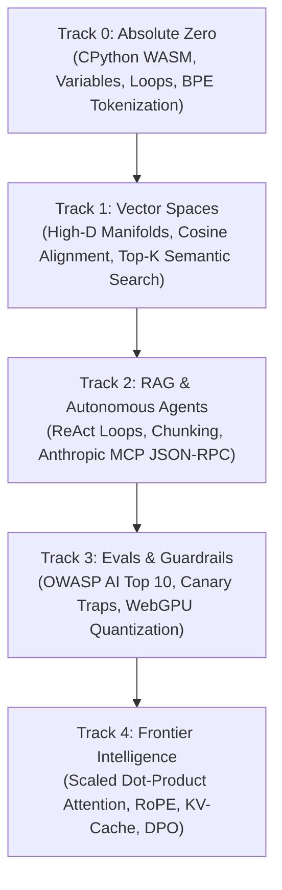

<div align="center">

<a href="https://openguideforai.dpdns.org">
  
</a>

# OpenGuide.
### SOVEREIGN IN-BROWSER AI ENGINEERING STUDIO

> **Education empowers humanity. Human knowledge must remain free. Intelligence must never be locked behind a cloud invoice, a commercial paywall, or closed corporate silos.**  
> **From an entry-level smartphone under a single lightbulb to a multi-monitor engineering station with an assistive screen reader: OpenGuide places a sovereign, production-grade AI engineering laboratory directly inside your web browser.**  
> **100% Free • In-Browser Python WebAssembly • Zero Setup • Zero Telemetry • Sovereign Forever.**

<p align="center">
  <a href="https://openguideforai.dpdns.org">
    
  </a>
</p>

[](LICENSE)
[](https://pyodide.org/)
[](#3-sovereign-client-side-architecture)
[](#5-curriculum-specification)
[](#8-universal-accessibility--standards)
[](#6-desktop--pwa-installation)

<p align="center">
  <b>Translations / Multilingual Editions:</b>&nbsp;
  <a href="README.md"><b>English</b></a> &nbsp;•&nbsp;
  <a href="docs/translations/README_es.md">Español</a> &nbsp;•&nbsp;
  <a href="docs/translations/README_zh.md">简体中文</a> &nbsp;•&nbsp;
  <a href="docs/translations/README_ur.md">اردو</a> &nbsp;•&nbsp;
  <a href="docs/translations/README_ar.md">العربية</a> &nbsp;•&nbsp;
  <a href="docs/translations/README_hi.md">हिन्दी</a> &nbsp;•&nbsp;
  <a href="docs/translations/README_fr.md">Français</a> &nbsp;•&nbsp;
  <a href="docs/translations/README_de.md">Deutsch</a> &nbsp;•&nbsp;
  <a href="docs/translations/README_ja.md">日本語</a> &nbsp;•&nbsp;
  <a href="docs/translations/README_pt.md">Português</a> &nbsp;•&nbsp;
  <a href="docs/translations/README_ru.md">Русский</a> &nbsp;•&nbsp;
  <a href="docs/translations/README_it.md">Italiano</a>
</p>

---

### [Launch Studio](https://openguideforai.dpdns.org) &nbsp;•&nbsp; [System Scope](#1-system-purpose--scope-definition) &nbsp;•&nbsp; [Architectural Profiles](#2-who-openguide-serves-architectural-profiles) &nbsp;•&nbsp; [Architecture](#3-sovereign-client-side-architecture) &nbsp;•&nbsp; [Progressive Disclosure](#4-managing-information-density-progressive-disclosure) &nbsp;•&nbsp; [Curriculum](#5-curriculum-specification) &nbsp;•&nbsp; [Explainer (STE)](explainer.md) &nbsp;•&nbsp; [Desktop App](#6-desktop--pwa-installation) &nbsp;•&nbsp; [Quickstart](#10-local-development-quickstart)

</div>

---

## 1. System Purpose & Scope Definition

### 1.1 The Educational Problem
Traditional education in artificial intelligence exhibits three critical points of failure:
1. **Superficial Library Wrappers:** Instruction focuses on commercial application programming interfaces (APIs). Learners do not understand the underlying mathematical mechanisms. These tutorials become obsolete when vendor libraries change.
2. **Abstract Theory Without Execution:** Mathematical formulas remain on static pages without interactive execution or immediate feedback loops.
3. **Financial and Infrastructure Barriers:** Most learning platforms require paid cloud accounts, credit cards, or complex local toolchain installations (such as CUDA, Docker, or Python virtual environments).

### 1.2 The OpenGuide Solution
OpenGuide removes these barriers through sovereign in-browser execution:
* **First-Principles Implementation:** Learners construct foundational components (tokenizers, vector similarity metrics, self-attention matrices, and agent loops) directly from raw mathematical definitions.
* **Immediate Local Execution:** Real CPython 3.12 code executes inside the browser tab via WebAssembly (WASM). Output validation occurs in real time.
* **Zero Infrastructure Cost ($0 Rule):** The software runs without backend servers, subscription paywalls, or remote database dependencies.

### 1.3 System Scope & Boundaries
To maintain clarity of engineering purpose, OpenGuide defines clear operational boundaries:

```
┌────────────────────────────────────────────────────────────────────────┐
│                      OPENGUIDE SYSTEM BOUNDARY                         │
│                                                                        │
│  IN-SCOPE: Conceptual Foundry & Foundational Engineering              │
│  ─────────────────────────────────────────────────────────────         │
│  ✔ In-browser CPython 3.12 WebAssembly compilation                    │
│  ✔ Pure NumPy linear algebra & tensor broadcasting                    │
│  ✔ Algorithmic tokenization (Byte-Pair Encoding from scratch)          │
│  ✔ Scaled dot-product self-attention & KV-cache mechanics              │
│  ✔ Client-side quantized small language model inference (135M–360M)    │
│  ✔ Model Context Protocol (MCP) tool schemas & ReAct state machines    │
│  ✔ Local-first cryptographic credential verification (SHA-256)         │
│                                                                        │
│  OUT-OF-SCOPE: Industrial Multi-Node Cluster Workloads                 │
│  ─────────────────────────────────────────────────────────────         │
│  ✖ Multi-GPU distributed training clusters (8x H100 / InfiniBand)      │
│  ✖ Multi-billion parameter base model pre-training (70B+ weights)      │
│  ✖ Enterprise data warehouse ETL pipelines                             │
└────────────────────────────────────────────────────────────────────────┘
```

> **Design Principle:** OpenGuide does not attempt to be a commercial cloud computing cluster. It is an algorithmic laboratory. It teaches the foundational mechanics of artificial intelligence with zero latency and zero financial barrier.

---

## 2. Who OpenGuide Serves (Architectural Profiles)

OpenGuide is engineered to support four universal profiles. Each profile represents a set of hardware realities, operational constraints, and learning goals:

```
                  THE FOUR ARCHITECTURAL PROFILES
                  
      The Resource-Constrained             The Systems & Software
             Learner                              Engineer
     ┌───────────────────────┐            ┌───────────────────────┐
     │ • Entry-level device  │            │ • Deep programming    │
     │ • Metered connectivity│            │ • Needs math clarity  │
     │ • Zero financial risk │            │ • Rejects black boxes │
     └───────────┬───────────┘            └───────────┬───────────┘
                 │                                    │
                 ▼                                    ▼
       ==========================================================
                      OPENGUIDE SOVEREIGN STUDIO
       ==========================================================
                 ▲                                    ▲
                 │                                    │
     ┌───────────┴───────────┐            ┌───────────┴───────────┐
     │ • Independent study   │            │ • Restricted networks │
     │ • Verifiable skills   │            │ • Zero telemetry need │
     │ • Portable artifacts  │            │ • BYOK external keys  │
     └───────────────────────┘            └───────────────────────┘
       The Academic & Career                The Privacy-Critical
             Candidate                          Practitioner
```

### Profile 1: The Resource-Constrained Learner
* **Operational Reality:** Operates on entry-level hardware, shared devices, or metered internet connections. Cannot afford ongoing subscription fees or cloud computing invoices.
* **How OpenGuide Solves This:** Implements the **$0 Rule**. The entire curriculum, CPython WebAssembly runtime, and exercises store locally in browser cache. After initial load, the system operates completely air-gapped without active internet access.

### Profile 2: The Systems & Software Engineer
* **Operational Reality:** Possesses strong proficiency in traditional software engineering (such as Go, TypeScript, Rust, or Java). Seeks to master modern artificial intelligence without superficial abstractions.
* **How OpenGuide Solves This:** Bypasses third-party framework wrappers. Provides transparent code implementations for vector manifolds, cosine distance projections, self-attention matrices ($QK^T/\sqrt{d_k}$), and Model Context Protocol (MCP) clients.

### Profile 3: The Academic & Career Candidate
* **Operational Reality:** Requires verifiable proof of competency for employment evaluation, university admissions, or portfolio demonstration.
* **How OpenGuide Solves This:** Each completed lab generates verifiable evidence. The student exports standard Jupyter Notebook files (`.ipynb`), JSON competency ledgers, and W3C Verifiable Credentials signed with deterministic client-side SHA-256 cryptographic digests.

### Profile 4: The Privacy-Critical Practitioner
* **Operational Reality:** Subject to strict data security policies. Cannot send code, experimental data, or intellectual property to remote cloud servers.
* **How OpenGuide Solves This:** OpenGuide contains **zero telemetry**, **zero analytics tracking**, and **zero remote databases**. All calculations occur in local memory. External frontier model inference utilizes optional user-supplied keys (Bring Your Own Key — BYOK) transmitted directly to official endpoints.

---

## 3. Sovereign Client-Side Architecture

The application operates as a Local-First Single Page Application (SPA). All computation runs inside the client browser sandbox:

```
┌────────────────────────────────────────────────────────────────────────┐
│                   LOCAL CLIENT BROWSER SANDBOX                         │
│                                                                        │
│  ┌─────────────────────────┐         ┌──────────────────────────────┐  │
│  │   UI & INTERACTION      │         │   BACKGROUND WEB WORKER      │  │
│  │   • React 19 + Vite     │         │   • CPython 3.12 (Pyodide)   │  │
│  │   • 24 Calibrated Themes│ ◄─────► │   • NumPy Vector Math        │  │
│  │   • CodeMirror 6 Editor │         │   • 15s Runaway Watchdog     │  │
│  │   • Responsive Layouts  │         │   • Standby Safe Fallback    │  │
│  └────────────┬────────────┘         └──────────────┬───────────────┘  │
│               │                                     │                  │
│  ┌────────────▼────────────┐         ┌──────────────▼───────────────┐  │
│  │   SPATIAL & NEURAL      │         │   SOVEREIGN PERSISTENCE      │  │
│  │   • Three.js WebGL / XR │         │   • Native IndexedDB (Dexie) │  │
│  │   • WebGPU Local Tensor │         │   • AES-GCM Encrypted Backup │  │
│  │   • Harmonic Audio Synth│         │   • W3C Verifiable Signature │  │
│  └─────────────────────────┘         └──────────────────────────────┘  │
└────────────────────────────────────────────────────────────────────────┘
```

### Component Breakdown
1. **User Interface Layer:** React 19 single-page application with responsive layouts. Features CodeMirror 6 for syntax editing and Lenis for smooth scrolling.
2. **Execution Worker:** A dedicated Web Worker isolates the CPython 3.12 engine from the main thread. A 15-second watchdog timer terminates infinite execution loops to protect client hardware memory.
3. **Visualization Subsystem:** Three.js and WebGL project high-dimensional semantic vectors into three-dimensional space. An automated fallback provides 2D SVG rendering for low-specification hardware.
4. **Local Persistence Layer:** Client progress, solved code, and preference tokens persist in IndexedDB. Data synchronizes across browser tabs using native `BroadcastChannel` events.

---

## 4. Managing Information Density (Progressive Disclosure)

OpenGuide contains extensive technical depth: 45 interactive labs, 3D vector spaces, attention matrix inspectors, and real-time AST debuggers. To prevent cognitive fatigue, the platform implements a three-tier **Progressive Disclosure Architecture**:

```
                 PROGRESSIVE DISCLOSURE ARCHITECTURE
                 
   [ TIER 1: FOCUS VIEW ]        Default View for All Users
   ┌───────────────────────┐     • Clean single-column layout
   │  Plain-English Lesson │     • Step-by-step code task
   │  & Interactive Editor │     • Clear execution button
   └───────────┬───────────┘
               │
               ▼ (On Demand / When Stuck)
   [ TIER 2: GUIDANCE ]          Contextual Assistance Layer
   ┌───────────────────────┐     • Friendly Syntax Doctor diagnosis
   │ Progressive Clue Box  │     • 1-Click "Load into Editor"
   │ & Invariant Scaffolds │     • Mobile touchscreen accessory bar
   └───────────┬───────────┘
               │
               ▼ (Advanced Summoning via Cmd+K / Alt+X)
   [ TIER 3: DEEP FOUNDRY ]      Full Laboratory Power
   ┌───────────────────────┐     • 3D Spatial Holodeck Manifold
   │  Advanced Instrument  │     • Attention Head Matrix Explorer
   │  Lenses & Diagnostics │     • Web Worker AST & Memory Inspector
   └───────────────────────┘
```

* **Calm Default Presentation:** When opening a lab, non-essential controls remain docked. The learner sees only the plain-language lesson concept, the code editor, and the output console.
* **On-Demand Assistance:** If an error occurs, the **Syntax Doctor** translates complex tracebacks into friendly advice. If stuck, learners can expand progressive clues or click **"Load into Editor"** to examine the canonical solution.
* **Summonable Deep Instruments:** Advanced telemetry tools—such as the X-Ray Debug Lens (`Alt + X`), the Command Palette (`Ctrl + K`), and the 3D Holodeck—remain easily accessible through shortcuts without cluttering the primary learning workspace.

---

## 5. Curriculum Specification

The curriculum contains five sequential tracks and **45 interactive laboratories**:



| Track Identifier | Module Count | Core Mental Model | Capstone Boss Project |
|:---|:---:|:---|:---|
| **Track 0: Absolute Zero** | 9 Labs | Python syntax through intuitive real-world analogies | Byte-Pair Encoding (BPE) tokenizer from scratch |
| **Track 1: Vector Spaces** | 9 Labs | Spatial geometry, dot products, and semantic distance | In-memory `SemanticSearchEngine` indexing documents |
| **Track 2: RAG & Agents** | 9 Labs | Thought $\rightarrow$ Action $\rightarrow$ Observation state machines | Autonomous Research Agent with multi-hop reasoning |
| **Track 3: Evals & Guardrails** | 9 Labs | Adversarial testing, prompt injection, and security rules | Synthetic evaluation harness with WebGPU inference |
| **Track 4: Frontier Systems** | 9 Labs | Scaled dot-product attention, KV-cache math, and RoPE | Transformer Attention Dissection & DPO Loss Engine |

---

## 6. Desktop & PWA Installation

OpenGuide functions as an **Installable Progressive Web App (PWA)** with native window controls:

### Operating System Installation Procedures
* **Windows (10 / 11):** Navigate to `https://openguideforai.dpdns.org` in Google Chrome or Microsoft Edge. Click the **Install** computer icon in the address bar. An application shortcut is added to your Desktop and Start Menu.
* **macOS (Sonoma / Ventura / Monterey):** In Chrome or Edge, click **Install** in the omnibox. In Safari, select **File** $\rightarrow$ **Add to Dock**. OpenGuide operates as a standalone application supporting `Cmd + Tab` switching.
* **Linux (Ubuntu, Debian, Fedora, Arch):** Click **Install** in Chromium or Chrome. The desktop environment generates a `.desktop` launcher under `~/.local/share/applications/`.
* **Mobile (Android & iOS):** On Android, tap **Install app** or **Add to Home screen**. On iOS Safari, tap **Share** $\rightarrow$ **Add to Home Screen**. Launches in full-screen mode with native touch gestures.

### Air-Gapped Offline Operation
The Service Worker (`sw.js`) caches all curriculum modules, 3D graphics assets, and the Pyodide WebAssembly runtime. Once cached, the user can disconnect from the network completely and execute all Python exercises offline.

---

## 7. Ergonomics & Power Shortcuts

| Shortcut / Control | Operational Target | Functional Output |
|---|:---:|---|
| **`Cmd + K` / `Ctrl + K`** | Studio Command Palette | Instant fuzzy search across 45 labs, 24 themes, 12 languages, and modal tools. |
| **`Ctrl + Enter` / `Cmd + Enter`** | Code Editor | Executes the active Python script in the Web Worker sandbox. |
| **`Alt + X`** | X-Ray Debug Lens | Inspects live Web Worker memory allocation, AST nodes, and IndexedDB state. |
| **Touch Accessory Ribbon** | Mobile Keyboard Header | Provides single-tap access to syntax keys (`Tab`, `:`, `( )`, `[ ]`, `def`, `assert`). |
| **`.ipynb` Export Button** | Editor Header | Downloads the current verified lab solution as an official Jupyter Notebook. |
| **Harmonic Audio Chimes** | 3D Vector Space | Plays harmonic audio frequencies proportional to cosine similarity between vectors. |
| **Encrypted Gist Sync** | Portfolio Dashboard | Encrypts student ledger data using client-side **AES-GCM 256-bit** cryptography. |

---

## 8. Universal Accessibility & Standards

OpenGuide complies with **W3C WCAG 2.2 Level AAA** specifications:
* **24 Calibrated Contrast Themes:** 12 Dark themes and 12 Light themes engineered to provide high visual contrast (>7:1 up to 20:1) while preventing optical fatigue.
* **Screen Reader Optimization:** Live ARIA notification regions (`aria-live="polite"`), modal focus traps, and accessible element labels ensure complete navigation without visual input.
* **Full Bidirectional RTL Support:** Native right-to-left layout mirroring for **Urdu** and **Arabic**, preserving left-to-right alignment for programming code blocks.
* **Script-Safe Typography:** Dynamic line-height adjustments prevent vertical text collisions in Devanagari, Nastaliq, and East Asian scripts.

---

## 9. Frequently Answered Questions

<details>
<summary><strong>1. Does OpenGuide require payment or an account?</strong></summary>
No. OpenGuide is free and open-source under the AGPL-3.0 and CC BY-NC-SA 4.0 licenses. It does not require user accounts, subscription fees, or payment credentials.
</details>

<details>
<summary><strong>2. Can a computer without a dedicated GPU run this software?</strong></summary>
Yes. The Python WebAssembly environment executes on standard device CPUs. For three-dimensional visualizations, an automated hardware sensor switches between 3D WebGL and 2D SVG modes to support older hardware.
</details>

<details>
<summary><strong>3. Are personal notes and code private?</strong></summary>
Yes. OpenGuide operates locally in the browser. It sends zero telemetry or usage analytics to remote servers. All work remains in local device storage.
</details>

<details>
<summary><strong>4. Can I use the completion certificate professionally?</strong></summary>
Yes. OpenGuide generates a cryptographic SHA-256 integrity signature and exports standardized W3C Verifiable Credentials (JSON-LD) suitable for resume and portfolio integration.
</details>

---

## 10. Local Development Quickstart

To run the open-source studio locally:

[](https://codespaces.new/openguideforai/OpenGuideForAI)

### System Requirements
* **Node.js:** `v20.x` or `v22.x` LTS.
* **Package Manager:** Yarn Berry `v4.x` (enabled via Node.js Corepack).
* **Supported Browsers:** Chrome 113+, Edge 113+, Safari 16.4+, Firefox 115+.

### Installation Commands
```bash
# 1. Enable Corepack and clone the repository
corepack enable
git clone https://github.com/openguideforai/OpenGuideForAI.git
cd OpenGuideForAI

# 2. Install workspace dependencies
yarn install

# 3. Start local development server
yarn dev
```
Open `http://localhost:5173` in your browser.

#### Multi-Device LAN Testing
To test mobile touch gestures and responsive layouts on a smartphone connected to your local network:
```bash
yarn dev --host
```

### Pre-Flight Verification Gate
Run the standard five-point quality assurance check before submitting contributions:
```bash
# 1. Linter verification (0 errors required)
yarn lint

# 2. Complete Playwright automated test suite (97 tests)
npx playwright test

# 3. Static production build compilation
yarn --cwd apps/web build
```

---

## 11. Authorship, Stewardship & Support

OpenGuide was envisioned, architected, and built by **Adil Rafiq Dar (ARD)**.

```
                   A STATEMENT ON EDUCATIONAL SOVEREIGNTY
"I built OpenGuide because I believe that knowledge of artificial intelligence
must belong to all humanity. It should not be restricted by expensive cloud
subscriptions, corporate toll gates, or elitist academic barriers.

Every component of this studio was created through rigorous testing, mathematical
precision, and uncompromising interface craft. OpenGuide is a public gift.

To keep this studio 100% free, independent, and continuously aligned with frontier
developments without advertising or private investment, I welcome the support of
learners and sponsors who share this vision."
```

If OpenGuide has assisted your education or engineering work, you can support independent development:

<div align="center">

[](https://www.paypal.com/paypalme/buymegoodcoffee/sponsor)
&nbsp;&nbsp;
[](https://ko-fi.com/buymegoodcoffee)

<br/>

<sub>Contributions sustain domain hosting, continuous integration infrastructure, and open curriculum expansion.</sub>

</div>

---

## 12. Technical References & Governance

* **[ASD-STE100 System Explainer](explainer.md):** Complete technical breakdown in Simplified Technical English covering client architecture and WebAssembly execution.
* **[System Architecture](ARCHITECTURE.md):** Detailed analysis of reactive stores, Web Worker communications, and WebGPU compute pipelines.
* **[Curriculum Specifications](docs/CURRICULUM.md):** Full syllabus and technical outcomes across all 45 modules.
* **[Independent Quality Audit](docs/AUDIT_QA.md):** Third-party cross-platform audit report and multi-layer verification ledger.
* **[Repository Mirrors]:**
  * Primary Target: [https://github.com/openguideforai/OpenGuideForAI](https://github.com/openguideforai/OpenGuideForAI)
  * Personal Archive Mirror: [https://github.com/Adilrafiq001/OpenGuideForAI](https://github.com/Adilrafiq001/OpenGuideForAI)

<div align="center">
  <sub>Architected and built by Adil Rafiq Dar (ARD). Licensed under AGPL-3.0 & CC BY-NC-SA 4.0.</sub>
</div>
