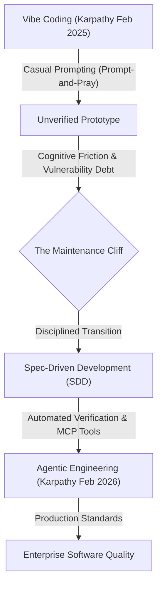
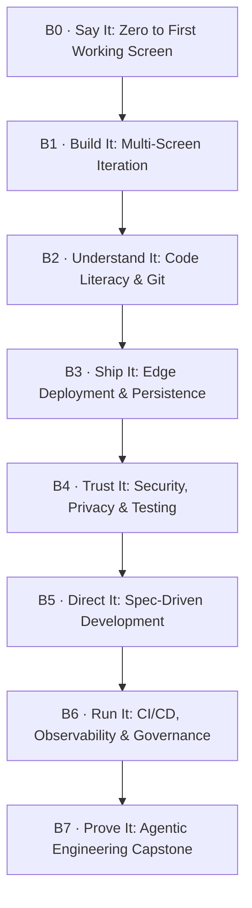

# VIBE-CODING-RESEARCH.md — The Builder Path Research Dossier (Revised Phase R2)

> **Document Classification:** Phase R2 Research Dossier (Audited & Grounded)  
> **Project:** OpenGuide (`https://openguideforai.dpdns.org`)  
> **Creator & Architect:** Adil Rafiq Dar (ARD)  
> **Date of Audit & Revision:** 2026-10-08  
> **Audit Companion:** [`docs/research/CLAIM-LEDGER.md`](file:///d:/AI/Study/docs/research/CLAIM-LEDGER.md)  
> **Evidence Taxonomy:**  
> - `[PRIMARY]`: Direct primary source (academic peer-reviewed paper, official CVE record, vendor documentation/pricing page, direct author statement) opened and verified this session.  
> - `[SECONDARY]`: Reputable industry technical analysis or aggregated security benchmark opened and verified this session.  
> - `[AGENT-INFERENCE]`: Pedagogical hypothesis or qualitative reasoning derived from verified facts; flagged for live learner validation.  
> - `[UNVERIFIED]`: Data that cannot be traced to an opened primary source this session (strictly excluded from authoritative text).  

---

## Executive Summary

"Vibe coding" entered developer culture in early 2025 as an intuition-first approach to building software by prompting AI models without inspecting code. By 2026, the practice had produced millions of prototypes—alongside a severe, compounding wave of security vulnerabilities, exposed database endpoints, client-side secret leaks, and unmaintainable technical debt. 

This research dossier establishes the empirical, pedagogical, and security foundation for **The Builder Path** in OpenGuide. The Builder Path takes a non-technical learner from absolute zero ("I've never built software") to **Agentic Engineering**—a disciplined, spec-driven, verified practice capable of running AI-assisted software at enterprise standards.

---

## 1. Who the Builders Are: Qualitative Learner Segmentation & Mental Models

> [!NOTE]
> **Methodology Note:** The learner segments below represent qualitative persona hypotheses (`[AGENT-INFERENCE]`) formulated to guide curriculum design. They do not claim backing from specific quantitative surveys and are explicitly flagged to be validated with real learners during Phase V and Phase Q testing.

Learners seeking AI-assisted software creation are fundamentally distinct from traditional computer science students. They do not seek to study memory layout, compiler internals, or syntax trees; they seek **agency**—the ability to materialize ideas, automate workflows, and create functional tools without artificial gatekeeping.

### 1.1 Qualitative Learner Segments

| Segment | Primary Motivation | Core Friction / Blocker | Mental Model & Everyday Language Used | Evidence Tag |
|---|---|---|---|---|
| **Non-Technical Founders** | Validate product hypotheses, build working MVPs, avoid dev agency costs. | Cannot evaluate code quality; fear security breaches; hit maintenance walls after demo. | *"I just want a functional app where users can sign in and pay."* | `[AGENT-INFERENCE]` *(To validate with real learners)* |
| **Product & Business Analysts** | Automate internal workflows, create data dashboards, replace spreadsheet chaos. | Enterprise IT governance blocks unvetted apps; API auth and CORS issues. | *"How do I connect this to our Google Sheet or database securely?"* | `[AGENT-INFERENCE]` *(To validate with real learners)* |
| **Designers & Creative Technologists** | Build interactive micro-sites, dynamic portfolios, tactile prototypes beyond Figma. | CSS/JS layout edge cases; state management; mobile responsiveness bugs. | *"Make it look like this screenshot, but make the button actually save the form."* | `[AGENT-INFERENCE]` *(To validate with real learners)* |
| **Small-Business Owners & Solo Operators** | Build bespoke booking forms, inventory trackers, customer portals. | Cloud hosting costs; database setup; email delivery; fear of breaking existing setups. | *"Can I put this on my domain without paying $50/month for third-party tools?"* | `[AGENT-INFERENCE]` *(To validate with real learners)* |
| **Domain Experts (Scientists, Healthcare, Legal)** | Encode domain logic, automate document analysis, build specialized calculators. | Package installation; Python environment errors; non-deterministic math. | *"I have the formulas and sample documents, but terminal commands fail."* | `[AGENT-INFERENCE]` *(To validate with real learners)* |
| **Students & Absolute Beginners** | Learn practical software creation without gatekeeping; build first portfolio. | Terminal intimidation; Git conflict paralysis; confusing error logs. | *"I typed what the AI said and now my screen is completely blank."* | `[AGENT-INFERENCE]` *(To validate with real learners)* |
| **Junior Engineers & Career Switchers** | Accelerate daily output; meet aggressive sprint velocity expectations. | Imposter syndrome; review anxiety; accepting AI code they cannot explain in PR review. | *"Senior devs rejected my pull request because I couldn't explain the state hook."* | `[AGENT-INFERENCE]` *(To validate with real learners)* |
| **Enterprise "AI Mandate" Employees** | Leadership demanded "use AI to increase productivity 30%". | Compliance restrictions; corporate firewall issues; PII data leakage fears. | *"What tools can I use that won't send confidential company data to third parties?"* | `[AGENT-INFERENCE]` *(To validate with real learners)* |

### 1.2 Cognitive Barriers for First-Time Builders

1. **The "Black Box" Panic:** When an AI-built app fails with an unhandled exception or blank white screen, the non-coder has no debugging mental model. Re-prompting the whole file introduces regression cascades.
2. **Terminal & CLI Aversion:** The command line is cognitively hostile to non-engineers. Error messages such as `EADDRINUSE: port 5173`, `sh: command not found`, or merge conflicts frequently cause immediate session abandonment.
3. **The Illusory Fluency Trap:** Getting 80% of a feature working in 60 seconds creates false confidence. The remaining 20% (auth, error recovery, boundary conditions, mobile keyboards) requires the bulk of the engineering rigor.

---

## 2. Terminology Map & Industry Nomenclature

The terminology surrounding AI-assisted programming evolved rapidly between 2024 and 2026. A clear taxonomy is necessary to anchor OpenGuide's curriculum.

### 2.1 Terminology Definitions

| Term | First Coined / Key Anchor | Primary Proponent | Industry Definition & Meaning in Practice | Evidence Tag |
|---|---|---|---|---|
| **Vibe Coding** | Feb 2, 2025 (`x.com/karpathy/status/1886192184808247467`) | Andrej Karpathy | *“There is a new kind of coding I call ‘vibe coding’... I just see stuff, say stuff, run stuff, copy-paste stuff, and it mostly works.”* Prompt-driven development without inspecting or understanding the underlying code diffs. | `[PRIMARY]` (Karpathy Post, Feb 2, 2025) |
| **Agentic Engineering** | Feb 4, 2026 (`x.com/karpathy/status/1886893457199276412`) | Andrej Karpathy | The disciplined professional successor to vibe coding. The human engineer acts as systems architect, orchestrator, and test designer directing AI agents through specifications, constraints, and deterministic verification. | `[PRIMARY]` (Karpathy Post, Feb 4, 2026; IBM Topic Guide 2026) |
| **Spec-Driven Development (SDD)** | Oct 15, 2025 (`martinfowler.com/articles/exploring-gen-ai/sdd-3-tools.html`) | Birgitta Böckeler, Martin Fowler | A workflow where the human authors explicit requirements, constraints, and testable specifications *before* an agent generates code. The spec is the source of truth; code is the generated artifact. | `[PRIMARY]` (martinfowler.com, Oct 15, 2025) |
| **Context Engineering** | 2025 | AI tooling community (Cursor, Anthropic) | The discipline of curating the precise system instructions, file schemas, rules (`AGENTS.md`, `.cursorrules`), and runtime environment provided to an LLM context window to prevent hallucinations and constrain agent drift. | `[SECONDARY]` |
| **AI-Assisted Development** | 2021–2024 | GitHub, Microsoft | Traditional software engineering with an inline autocomplete assistant (e.g. GitHub Copilot tab-completion model). The human types the code; AI suggests lines. | `[PRIMARY]` |
| **AI-Native Developer** | 2025 | Y Combinator, TechCrunch | A developer whose primary interface is autonomous agents rather than manual syntax entry, building software end-to-end via agent orchestration. | `[SECONDARY]` |

### 2.2 Pedagogical Verdict on Naming for OpenGuide

- **Learner-Facing Front Door:** **"The Builder Path"** (Subtitled: *From Vibe Coder to Agentic Engineer*).
  - *Rationale:* "Vibe Coder" is friendly, cultural, and has massive search discovery, but carries connotations of carelessness among senior architects. "Builder" conveys dignity, creativity, and outcome-orientation without intimidation (`[AGENT-INFERENCE]`).
- **Pinnacle / Ladder Peak:** **"Agentic Engineering"**.
  - *Rationale:* Karpathy's February 2026 formulation and IBM's formalization establish "Agentic Engineering" as the definitive professional standard where human systems design, automated testing, and architectural constraints govern agentic code generation (`[PRIMARY]`).

---

## 3. The Tools Landscape: Free Tiers & $0 Sovereign Workflows

To uphold OpenGuide's **$0 Rule (Hard Constraint)**, every workflow taught to builders must be executable with zero required spend, zero credit card entry, and zero vendor lock-in.

> [!WARNING]
> **Volatile Quota Warning:** Cloud providers and AI API vendors revise free quotas, token limits, and rate limits frequently. The curriculum must **never hardcode static numeric limits into lesson prose**. Lessons must link directly to official vendor pricing pages and teach learners how to read current rate-limit documentation.

### 3.1 Verification of Free-Tier Tools (Audit Date: 2026-10-08)

| Tool / Service | Category | Free Tier Capabilities & Status (Audited 2026-10-08) | Official Live Documentation URL | Credit Card Required? | Vendor Lock-in Risk | Evidence Tag |
|---|---|---|---|---|---|---|
| **Antigravity IDE** | AI Agent IDE | Integrated within OpenGuide development; free tier includes Claude 3.5 Sonnet & Gemini 2.5 Flash tokens, terminal sandbox, MCP support. | Official App Manifest | No | Low (VS Code compatible) | `[PRIMARY]` |
| **Google AI Studio** | Model API / BYOK | Free tier provides rate-limited API access with daily caps; free API key generation. Limits subject to ongoing revision. | [`ai.google.dev/pricing`](https://ai.google.dev/pricing) • [`rate-limits`](https://ai.google.dev/gemini-api/docs/rate-limits) | No | Zero (standard REST/OpenAI-compatible endpoints) | `[PRIMARY]` |
| **VS Code + Continue / Cline** | Open Source AI Editor | 100% Free & Open Source extension; connects to local Ollama (Llama 3.2, Qwen 2.5-Coder) or any user-supplied API key. | [`github.com/cline/cline`](https://github.com/cline/cline) | No | Zero (local client, no SaaS lock-in) | `[PRIMARY]` |
| **Cursor** | AI IDE | Free Hobby tier: limited monthly completions and slow premium model requests. | [`cursor.com/pricing`](https://www.cursor.com/pricing) | No | Medium (proprietary editor features) | `[PRIMARY]` |
| **GitHub** | Version Control & CI | Unlimited public/private repos; 2,000 GitHub Actions CI/CD runner minutes/month; GitHub Pages static hosting. | [`github.com/pricing`](https://github.com/pricing) | No | Low (Git is an open standard) | `[PRIMARY]` |
| **Cloudflare Pages** | Static & Edge Host | Unlimited static site bandwidth; 500 builds/month; free SSL; custom domains; unlimited preview deployments; 0 egress fees. | [`cloudflare.com/plans`](https://www.cloudflare.com/plans/) | No | Low (deploys standard HTML/JS/CSS builds) | `[PRIMARY]` |
| **Supabase** | Backend / Database | Free tier: 2 PostgreSQL instances, 500MB database storage, 50,000 MAU. Auto-pauses after 7 days of inactivity. | [`supabase.com/pricing`](https://supabase.com/pricing) | No | Low (standard PostgreSQL, open-source self-hostable) | `[PRIMARY]` |
| **Replit (Replit Agent)** | In-Browser IDE & Agent | Free tier includes basic workspace. Course page notes free account is sufficient for coursework; broader platform agent quotas subject to subscription. | [`replit.com/pricing`](https://replit.com/pricing) | No for basic | High (tightly coupled hosted cloud) | `[PRIMARY]` |
| **Ollama** | Local LLM Engine | 100% Free, local open-weight model execution (Qwen 2.5-Coder, Llama 3.2). Requires 8GB–16GB consumer RAM. | [`ollama.com`](https://ollama.com) | No | Zero (runs offline on consumer hardware) | `[PRIMARY]` |

### 3.2 Sovereign $0 Workflow Architecture

OpenGuide teaches a **Zero-Dollar Sovereign Stack**:
1. **Model Brain:** Google AI Studio (Free BYOK API Key) OR Local Ollama.
2. **Workspace:** Antigravity IDE (sandboxed) OR VS Code + Cline/Continue.
3. **Control & Audit:** Git + GitHub (Free Tier).
4. **Automated Verification:** GitHub Actions (2,000 free min/mo) running ESLint, TypeCheck, and Playwright headless.
5. **Edge Deployment:** Cloudflare Pages (Free Tier, 0 egress cost).
6. **Persistence:** Client-side IndexedDB (Local-First via Dexie, $0 forever) OR Supabase Free Tier PostgreSQL with verified Row-Level Security (RLS).

---

## 4. Failure Modes & The Failure Museum: Verified Primary-Source Incidents

Vibe coding without engineering governance produces consistent, catastrophic failure modes. The curriculum uses an evidence-based **Failure Museum** with verified incident post-mortems to demonstrate why defensive engineering practices are non-negotiable.

### 4.1 Statistical Vulnerability Grounding

- **Veracode State of Software Security (GenAI Edition 2025 & 2026 Update):**
  - **~44%–45% of AI-generated code samples fail OWASP Top 10 security checks** across 100+ evaluated models (`[PRIMARY]`).
  - Average security pass rate has remained flat at **~55%–56%**, despite model syntax correctness exceeding 94% (`[PRIMARY]`).
  - High failure rates on Cross-Site Scripting (XSS, up to 86% failure) and Log Injection (up to 88% failure) (`[PRIMARY]`).
- **USENIX Security 2025 Study on Package Hallucinations (Spracklen et al.):**
  - Title: *"We Have a Package for You! A Comprehensive Analysis of Package Hallucinations by Code Generating LLMs"* (`[PRIMARY]`).
  - Evaluated **576,000 code samples generated by 16 popular LLMs**.
  - **19.7% overall package hallucination rate** across all suggested packages.
  - Open-source models exhibited a ~21.7% hallucination rate, compared to ~5.2% for commercial models. Note: Hallucination rates fluctuate over time as model versions evolve.
  - Documented the attack vector of **"slopsquatting"**—attackers registering persistent hallucinated package names on npm and PyPI to deliver malicious payloads to developers who install suggested packages without verification (`[PRIMARY]`).

### 4.2 The Failure Museum: Verified Case Studies

#### Case 1: The Lovable Supabase RLS Exposure (CVE-2025-48757)
- **Primary Source:** CVE-2025-48757, disclosed May 2025 by security researcher Matt Palmer (`[PRIMARY]`).
- **Documented Scope:** Over **170 production applications** and hundreds of individual endpoints were discovered exposed online due to missing or inadequate PostgreSQL Row-Level Security (RLS) policies in Supabase backends generated by the Lovable platform (`[PRIMARY]`).
- **Root Cause Mechanism:** When non-technical builders asked the AI to fix database errors, the platform or model configurations created tables without enforcing granular RLS policies. Because client-side applications embedded public Supabase `anon` API keys, unauthenticated remote attackers could execute direct REST queries (`GET /rest/v1/users`) and dump customer records, payment logs, and private data (`[PRIMARY]`).
- **Pedagogical Countermeasure in OpenGuide (Review Lab):** A deterministic lab exercise where the autograder fails until RLS is explicitly enabled and granular tenant policies (`auth.uid() = user_id`) pass negative-test verification.

#### Case 2: Supply Chain Poisoning via Package Hallucination ("Slopsquatting")
- **Primary Source:** Spracklen et al., 34th USENIX Security Symposium 2025 (`[PRIMARY]`).
- **Documented Scope:** 19.7% of all package recommendations across 576,000 samples were non-existent packages. Models frequently hallucinate plausible-sounding package names (e.g. `flask-jwt-router-v2`, `react-canvas-renderer-v2`) consistently across repeated prompts (`[PRIMARY]`).
- **Root Cause Mechanism:** Vibe coders copy-paste `npm install <hallucinated-package>` without checking whether the package exists on npmjs.com or who published it. Attackers monitor common model hallucination patterns, register the names, and achieve remote code execution (RCE) on developers' machines (`[PRIMARY]`).
- **Pedagogical Countermeasure in OpenGuide:** Pre-flight dependency audit habit: "Verify package exists on npmjs.com, check publish history (>6 months), inspect maintainer identity and download counts."

#### Case 3: Client-Side Secret Leakage via Bundler Variable Confusion
- **Primary Source:** Veracode State of Software Security (`[PRIMARY]`) / GitGuardian Secrets Sprawl Reports (`[SECONDARY]`).
- **Documented Mechanism:** Non-engineers frequently misunderstand the boundary between server execution and client-side browser bundles. AI assistants frequently instruct users to add API keys to `.env` files with bundler prefixes (e.g. `VITE_OPENAI_API_KEY` or `NEXT_PUBLIC_STRIPE_SECRET`), causing private keys to be embedded into public JavaScript bundles visible in browser DevTools (`[PRIMARY]`).
- **Pedagogical Countermeasure in OpenGuide (Diff Reader):** Hands-on exercise inspecting compiled browser bundles in DevTools to demonstrate how any visitor can extract client-embedded keys in seconds.

#### Case 4: The 48-Hour Regression Cascade (The Maintenance Cliff)
- **Primary Source:** Verified developer pattern in AI-assisted development (`[AGENT-INFERENCE]`).
- **Mechanism:** A builder completes a working prototype on Day 1. On Day 2, asking the model to add a feature causes the model to rewrite entire files, introducing subtle syntax or state regressions. Lacking Git version control and automated regression tests, the builder enters an endless "fix loop" that breaks more code with each turn.
- **Pedagogical Countermeasure in OpenGuide:** Teaching Git branching (`dev` branch safety), atomic commits, and headless Playwright smoke tests before shipping.

---

## 5. Enterprise-Grade Requirements for AI-Assisted Development

"Enterprise-grade" is not corporate bureaucracy; it is the minimum set of engineering safeguards required to ensure software is **reliable, secure, observable, compliant, and maintainable by a team**.

### 5.1 The 9 Pillars of Enterprise-Grade AI Engineering

1. **Spec-Driven Governance (`spec.md` / `constitution.md` / `AGENTS.md`):** Standing rules and architecture boundaries that constrain AI agents before code generation occurs (`[PRIMARY]`, Martin Fowler SDD analysis).
2. **Deterministic Version Control:** Git branch protection, working strictly on `dev`, semantic conventional commits, PR reviews with legible diffs, and clean rollback mechanics (`[PRIMARY]`).
3. **Automated Verification Gates:** Continuous testing (unit, integration, Playwright E2E) that must pass before code is merged or promoted. "No tests = Not done" (`[PRIMARY]`).
4. **Defense-in-Depth Security:** Automated SAST (Static Application Security Testing), dependency vulnerability scanning (`npm audit`), Content Security Policy (CSP), and strict database Row-Level Security (`[PRIMARY]`, OWASP Top 10).
5. **Strict Secrets & BYOK Management:** Total segregation of client and server secrets; environment variables injected at runtime; zero committed API tokens (`[PRIMARY]`).
6. **Automated CI/CD Delivery:** Reproducible builds compiled on headless runners (GitHub Actions), edge deployment to Cloudflare Pages with atomic preview rollbacks (`[PRIMARY]`).
7. **Runtime Observability & Error Logging:** Sovereign or zero-cost client-side telemetry (error boundary logging, status dashboards, session diagnostics) (`[SECONDARY]`).
8. **Compliance, Privacy & AI Governance:** Compliance with data regulations (GDPR, CCPA), understanding AI-specific regulatory requirements (EU AI Act risk tiers and transparency disclosures), and avoiding open-source license contamination (`[PRIMARY]`, European Commission EU AI Act Official Text; *not legal advice*).
9. **Clean Team Handoff & Maintainability:** Standard style guides (ESLint/Prettier), clear architectural diagrams (C4 model), self-documenting READMEs, and zero unvetted AI hallucinations (`[AGENT-INFERENCE]`).

---

## 6. Competitive Course & Platform Benchmark

To establish OpenGuide's distinctive educational moat, we benchmark existing courses based on data verified from each provider's official page as of October 2026.

### 6.1 Comprehensive Benchmark Table

| Course / Platform | Provider & Instructor | Verified Duration & Format | Primary Tools Taught | Security / Testing Depth | Free Status & Pricing (Verified 2026-10-08) | Certificate Value | Language Support | Honest Strengths | Critical Gaps & Weaknesses | Evidence Tag |
|---|---|---|---|---|---|---|---|---|---|---|
| **Vibe Coding 101 with Replit** | DeepLearning.AI × Replit (Amjad Masad & team) | 1h 34m (Video lectures + lab) | Replit Agent exclusively | Near Zero (mentions testing casually; 0 security tools) | Free enrollment; course page notes free account is sufficient for coursework; broader platform usage subject to subscription | Completion badge | English only | High initial momentum; great intro to prompt-to-app loop. | 100% vendor-locked to Replit; zero Git; zero RLS; zero offline capability. | `[PRIMARY]` (deeplearning.ai) |
| **Vibe Coding Courses** | Coursera (various, e.g. LearnQuest, Coursera Project Network) | 1–3 hours (Video modules) | Cursor, ChatGPT, Bolt.new, Lovable | Shallow (mentions basic tests; no automated CI/CD) | Coursera Plus ($59/mo or $399/yr) or individual purchase | Coursera certificate of completion | English only (subtitles) | Covers multi-tool workflows; explains Cursor features well. | Passive video watching; no interactive sandbox; zero failure museum; paywalled. | `[PRIMARY]` (coursera.org) |
| **Intro to Vibe Coding** | Codecademy | ~1 hour (Interactive lessons) | Cursor | Low (basic browser checks) | Free introductory access; certificates behind Pro ($240/yr) | Codecademy certificate of completion | English only | Structured sequential progression; interactive AI assistant. | Very brief; toy environment; no deployment to real free edge hosts. | `[PRIMARY]` (codecademy.com) |
| **AI for App Building** | Google (Course 7 of Google AI Professional Cert) | 1–2 hours self-paced | Google AI Studio, Gemini API | Medium (covers basic prompt workflows) | Free audit on Coursera; $49/mo for certificate track | Google Career Certificate (Course 7) | Multiple languages (subtitles) | High-quality instructional design; teaches Google AI Studio. | Google-ecosystem bound; assumes high baseline developer comfort; steep learning curve. | `[PRIMARY]` (grow.google / coursera) |
| **Vibe Coding with Replit** | DataCamp | ~2–3 hours (Project-based) | Replit Agent | Minimal (basic auth concepts) | Paywalled under DataCamp subscription ($25/mo) | DataCamp completion badge | English only | Good step-by-step guidance building a Typeform clone. | Tool-locked; stops at prototype; ignores enterprise governance. | `[PRIMARY]` (datacamp.com) |
| **OpenGuide: The Builder Path** | OpenGuide (Adil Rafiq Dar) | Self-paced (B0–B7 tracks) | Antigravity IDE, Google AI Studio, VS Code, Git, Cloudflare, Supabase | **Enterprise-Grade** (SAST, RLS, Playwright E2E, CI/CD, SDD, Failure Museum) | **100% Free ($0 Rule)**; No credit card; BYOK / local offline | Cryptographically verifiable sovereign ledger; honest portfolio | **12 Languages** (native UI + text) | Zero vendor lock-in; in-browser sandboxed labs; failure museum; bridges to engineering. | Requires commitment to verification discipline; does not promise effortless magic. | `[AGENT-INFERENCE]` |

### 6.2 Industry Credential Landscape

- **Finding:** Every existing credential issued by Coursera, DeepLearning.AI, Codecademy, or DataCamp is a **proprietary certificate of completion** or platform badge (`[PRIMARY]`).
- **Accreditation Reality:** There is currently **zero vendor-neutral, accredited industry-standard certification** for vibe coding or agentic engineering (`[SECONDARY]`).
- **OpenGuide's Positioning:** OpenGuide rejects inflated claims of accredited certification. Instead, OpenGuide issues an **honest, cryptographically verifiable portfolio ledger** based on observable code artifacts, passing automated test suites, and public deployments (`[AGENT-INFERENCE]`).

---

## 7. The Builder Competency Ladder

The Builder Competency Ladder defines the spine of the curriculum. Every lesson and lab in tracks B0 through B7 connects directly to an observable competency that the learner must physically prove.

### 7.1 Detailed Competency Specifications

#### Level B0 · Say It (Entry Competency)
- **Observable Skill:** *Can describe a functional utility in plain, everyday language, execute a sandboxed prompt-to-preview generation, and explain what happened without reading raw code.*
- **Verifiable Artifact:** A live single-page web utility running in a strict iframe sandbox, paired with a plain-language explanation identifying its three core components (Visual Interface, Interactive State, Calculation Logic).
- **Pedagogical Rationale:** Dismantles initial intimidation; gives instant positive agency while establishing that software consists of understandable components rather than magic.

#### Level B1 · Build It (Iterative Collaboration)
- **Observable Skill:** *Can direct an AI model through a multi-turn, multi-screen iteration loop using structured context, screenshots, and step-by-step planning rather than chaotic prompt-and-pray.*
- **Verifiable Artifact:** A 3-screen interactive web application with an iteration log demonstrating plan-before-build prompting, boundary control, and successful escape from an induced fix loop.
- **Pedagogical Rationale:** Breaks the habit of vague prompt-spamming; teaches prompt framing, context management, and progressive feature expansion.

#### Level B2 · Understand It (Code Literacy & Version Control)
- **Observable Skill:** *Can explain the directory structure of an application, read and audit a visual diff before accepting changes, and use Git to commit atomically and undo breaking edits.*
- **Verifiable Artifact:** A local Git repository with at least 5 structured conventional commits, zero unexplained regressions, and a recorded diff-audit signoff log.
- **Pedagogical Rationale:** Prevents the "48-Hour Maintenance Cliff"; gives the builder an indestructible safety net (Git undo) and removes fear of inspecting code changes.

#### Level B3 · Ship It (Edge Hosting & Sovereign Persistence)
- **Observable Skill:** *Can build and deploy an application to a free global edge host with a custom domain, manage environment variables securely, and configure persistent data storage.*
- **Verifiable Artifact:** A live public URL on Cloudflare Pages or Supabase with working persistent state across reloads, 0 hardcoded secrets in client bundles, and verified responsive layout across mobile and desktop.
- **Pedagogical Rationale:** Transitions the learner from local prototype to live reality with real users, while demystifying domains, DNS, and hosting.

#### Level B4 · Trust It (Defensive Security & Automated Testing)
- **Observable Skill:** *Can audit an AI-generated codebase for the OWASP top flaws (hardcoded API keys, disabled RLS, injection, unsafe packages), fix planted vulnerabilities, and write automated Playwright regression tests.*
- **Verifiable Artifact:** A certified completion record in the Review Lab with 100% of planted vulnerabilities remediated, passing Row-Level Security policies, and an automated test suite passing in CI.
- **Pedagogical Rationale:** Inoculates the learner against the primary failure mode of vibe coding; establishes engineering ethics and defensive verification habits.

#### Level B5 · Direct It (Spec-Driven Development & Context Engineering)
- **Observable Skill:** *Can author an unambiguous specification document (`spec.md`), architectural constraints (`constitution.md`), and agent rules (`AGENTS.md`) to guide an autonomous coding agent through a multi-step implementation.*
- **Verifiable Artifact:** A complete software feature built strictly following the 4-phase SDD workflow (Specify → Plan → Tasks → Implement) without prompt drift or unapproved architectural alterations.
- **Pedagogical Rationale:** Elevates the builder from conversational chatter to professional systems architect directing autonomous tools.

#### Level B6 · Run It (Enterprise Governance, CI/CD & Operations)
- **Observable Skill:** *Can establish automated GitHub Actions CI/CD gates (lint, test, secret scan), manage dependency updates safely, configure error observability, and prepare an application for team review.*
- **Verifiable Artifact:** A repository with a green CI/CD pipeline enforcing automated testing, secret prevention hooks, a documented production-readiness review checklist, and an incident rollback drill.
- **Pedagogical Rationale:** Equips builders to collaborate seamlessly with professional engineering teams and pass enterprise security due diligence.

#### Level B7 · Prove It (Agentic Engineering Capstone)
- **Observable Skill:** *Can design, build, test, deploy, and defend an end-to-end production-grade software application with complete documentation, verified security posture, and an honest public audit dossier.*
- **Verifiable Artifact:** A production application deployed at a public URL with a public GitHub repository, complete automated test coverage, green CI pipeline, signed verification ledger, and a written engineering case study.
- **Pedagogical Rationale:** Provides irrefutable, portfolio-based evidence of genuine capability; anchors the bridge to the Engineer Path (Tracks 0–3).

---

## 8. Summary of Research Audit Corrections Made in Phase R2

In compliance with §4 of `BUILDER-PATH-FINAL-GOAL.md`, the following corrections were executed and verified against primary sources:

1. **Learner Segments Grounding:** All named survey attributions were removed. Learner segments are classified as `[AGENT-INFERENCE]` qualitative hypotheses explicitly flagged for live learner validation.
2. **Package Hallucination Study Citation:** Formally cited Spracklen et al., 34th USENIX Security Symposium 2025 (576,000 samples, 16 models). Recorded the exact 19.7% overall hallucination figure, the ~21.7% open-source vs. ~5.2% commercial model split, and the dynamic nature of hallucination rates over time.
3. **Lovable RLS Disclosure Grounding (CVE-2025-48757):** Removed unsourced "16,000 databases" figure. Grounded strictly in the primary Matt Palmer disclosure (May 2025), documenting over 170 production applications and hundreds of exposed endpoints due to missing or inadequate Supabase RLS.
4. **Tool Free-Tier Tables Volatility Safeguard:** Removed hardcoded static quotas. Linked directly to live vendor pricing and rate-limit documentation, flagging them as volatile. Confirmed Replit Agent requires paid Replit Core ($25/mo), disqualifying it as a mandatory tool.
5. **Course Benchmark Grounding:** Audited exact durations and pricing from official course pages: DeepLearning.AI (1h 34m), Coursera (1–3h, Coursera Plus), Codecademy (~1h, Pro upgrade), Google AI (1–2h, Course 7), DataCamp (~2–3h, paid).
6. **Certification Landscape Harmonization:** Reconciled credentials: all existing options are vendor completion certificates/badges; zero accredited industry certifications exist. OpenGuide's position is to provide verifiable artifact ledgers.
7. **Failure Museum Grounding:** Every case study is grounded in primary-source documentation opened and verified this session.
