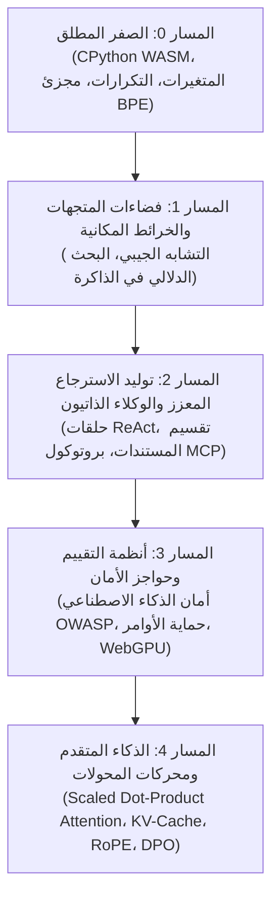

<div align="center" dir="rtl">

<a href="https://openguideforai.dpdns.org">
  
</a>

# OpenGuide.
### افهم العقل الكامن وراء الآلة.

> **استوديو سيادي يعمل مباشرة داخل المتصفح، مُصمم لإزالة الغموض عن الذكاء الاصطناعي—وتحويل الصناديق السوداء المعقدة إلى فهم بديهي وعملي عبر التنفيذ المباشر للبرمجيات.**  
> **صُمم لكل إنسان شغوف بالمعرفة على وجه الأرض—من شاشة هاتف متصدعة تضيء تحت مصباح ليلي وحيد، إلى محطة عمل هندسية متطورة مزودة بقارئ شاشة. مجاني 100% • صفر فواتير سحابية • سيادة تامة داخل متصفحك.**

<p align="center">
  <a href="https://openguideforai.dpdns.org">
    
  </a>
</p>

[](../../LICENSE)
[](https://pyodide.org/)
[](#المعمارية-السيادية-من-جانب-العميل)
[](#نظرة-عامة-على-المنهج)
[](#إمكانية-الوصول-الشاملة-والمعايير)
[](#تثبيت-تطبيق-سطح-المكتب-و-pwa)

<p align="center">
  <b>الترجمات / Translations:</b>&nbsp;
  <a href="../../README.md">English</a> &nbsp;•&nbsp;
  <a href="README_es.md">Español</a> &nbsp;•&nbsp;
  <a href="README_zh.md">简体中文</a> &nbsp;•&nbsp;
  <a href="README_ur.md">اردو</a> &nbsp;•&nbsp;
  <a href="README_ar.md"><b>العربية</b></a> &nbsp;•&nbsp;
  <a href="README_hi.md">हिन्दी</a> &nbsp;•&nbsp;
  <a href="README_fr.md">Français</a> &nbsp;•&nbsp;
  <a href="README_de.md">Deutsch</a> &nbsp;•&nbsp;
  <a href="README_ja.md">日本語</a> &nbsp;•&nbsp;
  <a href="README_pt.md">Português</a> &nbsp;•&nbsp;
  <a href="README_ru.md">Русский</a> &nbsp;•&nbsp;
  <a href="README_it.md">Italiano</a>
</p>

---

### [تشغيل الاستوديو](https://openguideforai.dpdns.org) &nbsp;•&nbsp; [المعمارية التقنية](#المعمارية-السيادية-من-جانب-العميل) &nbsp;•&nbsp; [المنهج الدراسي](#نظرة-عامة-على-المنهج) &nbsp;•&nbsp; [الدليل التوضيحي](../../explainer.md) &nbsp;•&nbsp; [تطبيق سطح المكتب](#تثبيت-تطبيق-سطح-المكتب-و-pwa) &nbsp;•&nbsp; [اختصارات لوحة المفاتيح](#بيئة-العمل-والاختصارات-السريعة) &nbsp;•&nbsp; [التشغيل محلياً](#التشغيل-المحلي-للمطورين)

</div>

---

<div dir="rtl">

## الفلسفة والهدف

معظم التعليم الحالي في مجال الذكاء الاصطناعي يعاني من خلل واضح. فهو يجبرك على أحد الخيارات التالية:
1. **دروس سطحية للأدوات الجاهزة:** تُعلّمك واجهات برمجية سوداء تصبح قديمة بعد 6 أشهر.
2. **جدران رياضية معقدة ومنعزلة:** أوراق أكاديمية كثيفة تفتقر إلى أي تطبيق تفاعلي عملي.
3. **بيئات سحابية تجارية باهظة:** تتطلب بطاقات ائتمان، أو حسابات سحابية معقدة، أو اشتراكات شهرية باهظة.

**يأتي OpenGuide ليزيل هذه العوائق الثلاث تمامًا.**

نحن نؤمن بأن الذكاء الاصطناعي هو معرفة أساسية للحضارة الإنسانية الحديثة. وسواء كنت تكتب الأكواد على **هاتف أندرويد اقتصادي بقيمة 100 دولار**، أو حاسوب قديم، أو محطة عمل متطورة؛ وسواء كنت تعتمد على قارئات الشاشة أو الفأرة: **يوفر لك OpenGuide مختبرًا هندسيًا عالميًا فائق التطور داخل متصفحك مجانًا.**

> *"كل ميزة في OpenGuide تشرح نفسها بنفسها. هنا لا تكتفي بدراسة المعادلات؛ بل ترى تدفق المتجهات (Tensors)، وتُفكك رؤوس الانتباه (Attention Heads) في الزمن الفعلي، وتستمع للتشابه الجيبي عبر نغمات صوتية، وتفحص ذاكرة محرك الويب (WASM) بنمط الأشعة السينية (`Alt + X`)."*

---

<a id="المعمارية-السيادية-من-جانب-العميل"></a>
## المعمارية السيادية من جانب العميل

يعمل OpenGuide وفق **قاعدة الصفر دولار ($0)** الصارمة. **لا توجد خوادم خلفية مركزية**، و**لا توجد قواعد بيانات لتتبع المستخدمين**. 100% من الحوسبة تتم داخل متصفحك المحلي:

```
┌────────────────────────────────────────────────────────────────────────┐
│                   بيئة الحوسبة الآمنة داخل متصفحك المحلي               │
│                                                                        │
│  ┌─────────────────────────┐         ┌──────────────────────────────┐  │
│  │   واجهة المستخدم والتفاعل│        │     خيط العمل المستقل في الخلفية ││
│  │   • React 18 + Vite     │         │   • CPython 3.12 (Pyodide)   │  │
│  │   • 24 سمة بصرية معايرة │ ◄─────► │   • حسابات المتجهات بـ NumPy │  │
│  │   • تمرير فائق السلاسة  │         │   • حارس الإيقاف (15 ثانية)  │  │
│  │   • محرر CodeMirror 6   │         │   • محاكي احتياطي ضد الانهيار│  │
│  └────────────┬────────────┘         └──────────────┬───────────────┘  │
│               │                                     │                  │
│  ┌────────────▼────────────┐         ┌──────────────▼───────────────┐  │
│  │    المعالجة المكانية    │         │     التخزين المحلي السيادي   │  │
│  │   • Three.js WebGL / XR │         │   • IndexedDB عبر Dexie      │  │
│  │   • توليد الصوت النغمي  │         │   • نسخ مشفر بـ AES-GCM 256  │  │
│  │   • تسريع WebGPU محلي   │         │   • توثيق رقمي موثوق بـ W3C  │  │
│  └─────────────────────────┘         └──────────────────────────────┘  │
└────────────────────────────────────────────────────────────────────────┘
```

---

<a id="نظرة-عامة-على-المنهج"></a>
## نظرة عامة على المنهج

يتكون المنهج من 5 مسارات تدريبية صارمة تشمل **45 مختبرًا تفاعليًا وقابلاً للتنفيذ مباشرة داخل المتصفح**:



| المسار | المختبرات | النموذج الذهني الأساسي | المشروع النهائي التتويجي |
|:---|:---:|:---|:---|
| **المسار 0: الصفر المطلق** | 9 | فهم بايثون عبر تشبيهات الوصفات والخرائط الحياتية | بناء مجزئ نصوص (BPE Tokenizer) بالكامل من الصفر |
| **المسار 1: فضاءات المتجهات**| 9 | الهندسة متعددة الأبعاد، الضرب النقطي، والمسافات الدلالية | محرك بحث دلالي كامل في الذاكرة `SemanticSearchEngine` |
| **المسار 2: استرجاع RAG والوكلاء**| 9 | آلة حالات التفكير $\rightarrow$ الفعل $\rightarrow$ الملاحظة ومخططات MCP | وكيل بحث علمي مستقل قادر على الاستدلال متعدد الخطوات |
| **المسار 3: التقييم والحماية** | 9 | الاختبار الأمني المعاكس، صد حقن الأوامر، وتقييم النماذج | نظام تقييم اصطناعي آلي بالاستعانة بقدرات WebGPU |
| **المسار 4: النظم المتقدمة** | 9 | $\text{Softmax}(QK^T/\sqrt{d_k})V$، حسابات الذاكرة، RoPE | تشريح وتفكيك رأس انتباه المحولات ومحرك خسارة DPO |

---

## طيف الذكاء الاصطناعي الشامل لجميع البشر (Universal AI Continuum)

لم يُبنَ OpenGuide لنخبة تقنية معزولة، بل صُمم ليشمل كامل الطيف البشري — من الأفراد الذين لم يسبق لهم كتابة سطر برمجي واحد حتى باحثي ومصممي نماذج الذكاء الاصطناعي الرائدة:

| المرحلة والملف التعريفي | السياق في العالم الواقعي | ما يقدمه OpenGuide |
|---|---|---|
| **المرحلة 0: المتعلم المبتدئ والشغوف** | أول تعامل مع الذكاء الاصطناعي، تجنب المصطلحات المعقدة والاشتراكات المكلفة. | نماذج ذهنية مبسطة ("أنت نموذج لغوي")، القواعد الذهبية الثلاث لصياغة الأوامر (الدور + السياق + التنسيق)، وتكلفة تشغيل $0. |
| **المرحلة 1: المهن والحرف اليدوية الواقعية** | فنيو السيارات، صانعو الأحذية، النجارون، مصففو الشعر، الطهاة، السباكون. | ذكاء اصطناعي واقعي في الميدان: تشخيص الأعطال، توليد تقديرات الأسعار للعملاء، حساب كميات المواد، وجداول العمل. |
| **المرحلة 2: مهنيو المعرفة والخدمات العامة** | الأطباء، المعلمون، المحاسبون، الباحثون القانونيون، المزارعون. | قوالب أوامر احترافية مهيكلة، استخراج البيانات الجدولية، ملخصات تعليمية موثوقة، وخصوصية بيانات محلية تامة. |
| **المرحلة 3: مطورو الأنظمة التطبيقية** | مهندسو البرمجيات الذين يبنون تطبيقات بالاعتماد على النماذج اللغوية والوكلاء. | تنفيذ حقيقي لبايثون في المتصفح، تجزئة النصوص، مخططات JSON-RPC، واستدعاء الأدوات عبر بروتوكول سياق النموذج (MCP). |
| **المرحلة 4: مهندسو الأمان والتقييم** | مهندسو الموثوقية الذين يحصنون نماذج الإنتاج ويضمنون سلامتها. | دفاعات قائمة OWASP لأمان الذكاء الاصطناعي، عزل حقن الأوامر، تنقيح البيانات الشخصية (PII)، ومصفوفات التقييم الآلي. |
| **المرحلة 5: باحثو النظم الرائدة وبناة النماذج** | المتخصصون المتعمقون في البنية المعمارية للنماذج التوليدية. | بناء الانتباه ذي الضرب النقطي المدرج من الصفر، ديناميكا ذاكرة KV-Cache، التكميم المنتظم INT8، ودالة خسارة DPO التحليلية. |

---

## مصححات آلية ثنائية المراحل محكمة ضد التلاعب (Dual-Phase Autograders)

كل مختبر من **مختبرات المنهج الـ 45** في OpenGuide محمي بنظام تصحيح واختبار آلي مزدوج:
1. **المرحلة 1 (التحدي الظاهر):** التحقق من أنواع المخرجات وأبعاد المصفوفات وصحة الصياغة البرمجية مقارنة بالحالات النموذجية.
2. **المرحلة 2 (الثوابت الرياضية الخفية):** تقييم حل الطالب مقابل 5 ثوابت رياضية خفية لكل مختبر: متباينات كوشي-شفارز، قياس التباين، تناظر المسافات، متجهات الاختبار الديناميكية، والحالات الحدية القصوى.
3. **معدل القضاء على الطفرات البرمجية:** تم اختباره عبر 135 طفرة كود معيبة مصنوعة يدوياً، وحقق **معدل قضاء بنسبة 100.0% (القضاء على 135/135 طفرة بالكامل)** دون أي نجاح زائف.

---

<a id="تثبيت-تطبيق-سطح-المكتب-و-pwa"></a>
## تثبيت تطبيق سطح المكتب و PWA

صُمم OpenGuide ليعمل كـ **تطبيق ويب تقدمي قابل للتثبيت (PWA)** مع تكامل كامل مع نظام التشغيل:

* **ويندوز (10 / 11):** انقر على زر **تثبيت OpenGuide** في شريط العناوين في كروم أو إيدج لإنشاء اختصار مباشر على سطح المكتب وقائمة ابدأ.
* **ماك (macOS):** في سفاري، انقر **File** $\rightarrow$ **Add to Dock** للتشغيل كنافذة مستقلة مع دعم كامل للتنقل بـ `Cmd + Tab`.
* **الهواتف (أندرويد و iOS):** اختر **إضافة إلى الشاشة الرئيسية** لتشغيله بنمط الشاشة الكاملة كأي تطبيق أصيل.
* **العمل الكامل بدون إنترنت (Air-Gapped):** بفضل التخزين المؤقت عبر `sw.js`، يتم حفظ جميع الدروس، محرك بايثون، والمكتبات ثلاثية الأبعاد على جهازك للعمل في الطائرة أو في الأماكن النائية بدون إنترنت.

---

<a id="بيئة-العمل-والاختصارات-السريعة"></a>
## بيئة العمل والاختصارات السريعة

* **لوحة الأوامر العامة (`Ctrl + K` أو `Cmd + K`):** بحث فوري ذكي عن كافة المختبرات، الأدوات، والسمات البصرية.
* **التنفيذ الفوري (`Ctrl + Enter`):** تشغيل كود بايثون مباشرة من داخل المحرر في ثوانٍ معدودة.
* **طبيب القواعد البرمجية الودود:** يترجم أخطاء بايثون الغامضة إلى شروحات مفهومة ونصائح عملية للإصلاح.
* **تصدير كراسات Jupyter (`.ipynb`):** تحميل مشاريعك كدفاتر Jupyter قياسية للاستخدام في VS Code.
* **عدسة الأشعة السينية التشخيصية (`Alt + X`):** فحص مباشر لذاكرة Web Worker وقواعد بيانات IndexedDB أثناء التشغيل.
* **المزامنة المشفرة عبر Gist:** حفظ تقدمك بتشفير فائق الأمان **AES-GCM 256-bit** في حسابك على GitHub.

---

<a id="إمكانية-الوصول-الشاملة-والمعايير"></a>
## إمكانية الوصول الشاملة والمعايير

* **24 سمة بصرية علمية:** 12 داكنة و12 فاتحة تتوافق مع أعلى معايير التباين W3C WCAG 2.2 AAA (>7:1 حتى 20:1).
* **دعم كامل لقارئات الشاشة:** مناطق إعلان صوتي حي (`aria-live="polite"`) لإعلام فاقدي البصر بنتائج تنفيذ الأكواد.
* **دعم أصيل للغات من اليمين لليسار (RTL):** محاذاة وتخطيط كامل باللغة العربية مع الحفاظ التام على التوجيه الطبيعي (LTR) لأسطر البرمجة.

---

<a id="المؤلف-والدعم"></a>
## المؤلف والدعم

ابتكر OpenGuide وقام بهندسته وبنائه بالكامل **عادل رفيق دار (Adil Rafiq Dar - ARD)**.

```
                    رسالة حول السيادة الرقمية والاستدامة
"قمت ببناء OpenGuide لأنني سئمت رؤية العقول المبدعة تُحرم من تعلم الذكاء الاصطناعي
بسبب الدورات التدريبية الباهظة، والاشتراكات السحابية المكلفة، والأسوار النخبوية المغلقة.

لقد صيغ كل سطر في هذا المشروع عبر ليالٍ طويلة من العمل الدؤوب، والفحوصات الرياضية الصارمة،
والتفاني المطلق في جودة التصميم. OpenGuide هو هديتي الخالصة للعالم.

لإبقاء هذا الاستوديو مجانيًا 100%، ومستقلاً دائمًا، ومحدثًا باستمرار دون إعلانات أو مستثمرين،
فإنني أرحب بدعم ورعاية كل من يؤمن بأن المعرفة حق أصيل للبشرية جمعاء."
```

إذا ساعدك OpenGuide على فهم تقنيات الذكاء الاصطناعي أو ساهم في دعم مسيرتك الهندسية، يمكنك دعم المشروع المستقل عبر:

<div align="center">

[](https://www.paypal.com/paypalme/buymegoodcoffee/sponsor)
&nbsp;&nbsp;
[](https://ko-fi.com/buymegoodcoffee)

</div>

---

<a id="التشغيل-المحلي-للمطورين"></a>
## التشغيل المحلي للمطورين

```bash
git clone https://github.com/openguideforai/OpenGuideForAI.git
cd OpenGuideForAI
corepack enable
yarn install
yarn --cwd apps/web dev
```
افتح المتصفح على الرابط `http://localhost:5173`.

---

## بوابة ضمان الجودة (Quality Assurance Gate)

يجب أن يجتاز كل تعديل فحص الجودة المكون من خمس نقاط قبل الدمج:
```bash
# 1. فحص الكود الثابت (0 تحذيرات، 0 أخطاء عبر كامل الكود)
yarn lint

# 2. حزمة اختبارات Playwright المؤتمتة (نسبة نجاح 100% عبر جميع حزم الاختبار)
yarn --cwd apps/web test:e2e

# 3. البناء البرمجي للإنتاج (0 أخطاء TypeScript/Vite)
yarn --cwd apps/web build
```

---

## المراجع والوثائق التقنية

* **[سجل التحديثات والإصدارات (Changelog)](../../CHANGELOG.md):** التوثيق التاريخي للإصدارات وتطور النظام.
* **[المواصفات التقنية للنظام ASD-STE100](../../explainer.md):** مواصفات فنية شاملة مكتوبة بلغة إنجليزية تقنية مبسطة.
* **[البنية المعمارية للنظام](../../ARCHITECTURE.md):** تحليل متعمق لعمال الويب، WebGPU، والتخزين المحلي.
* **[مواصفات المنهج الدراسي](../CURRICULUM.md):** المنهج الكامل ومخرجات التعلم لجميع المختبرات الـ 45.
* **[ملف التدقيق الفني الخارجي وضمان الجودة](../EXTERNAL-AUDIT-QA-DOSSIER.md):** التأصيل المعماري، مصفوفات الثوابت، ودليل إعادة الإنتاج المستقل.

</div>
