<div align="center" dir="rtl">

<a href="https://openguideforai.dpdns.org">
  
</a>

# OpenGuide.
### افهم العقل الكامن وراء الآلة.

> **استوديو سيادي يعمل مباشرة داخل المتصفح، مُصمم لإزالة الغموض عن الذكاء الاصطناعي—وتحويل الصناديق السوداء المعقدة إلى فهم بديهي وعملي عبر التنفيذ المباشر للبرمجيات.**  
> **صُمم لكل إنسان شغوف بالمعرفة على وجه الأرض—من شاشة هاتف متصدعة تضيء تحت مصباح ليلي وحيد، إلى محطة عمل هندسية متطورة مزودة بقارئ شاشة. مجاني 100% • صفر فواتير سحابية • سيادة تامة داخل متصفحك.**

<p align="center">
  <a href="https://openguideforai.dpdns.org">
    
  </a>
</p>

[](../../LICENSE)
[](https://pyodide.org/)
[](../../explainer.md)
[](#مسارات-التعلم-المزدوجة)
[](#التصميم-الشامل-وإمكانية-الوصول)
[](#تثبيت-تطبيق-سطح-المكتب-والهاتف-pwa)

<p align="center">
  <b>الترجمات / Translations:</b>&nbsp;
  <a href="../../README.md">English</a> &nbsp;•&nbsp;
  <a href="README_es.md">Español</a> &nbsp;•&nbsp;
  <a href="README_zh.md">简体中文</a> &nbsp;•&nbsp;
  <a href="README_ur.md">اردو</a> &nbsp;•&nbsp;
  <a href="README_ar.md"><b>العربية</b></a> &nbsp;•&nbsp;
  <a href="README_hi.md">हिन्दी</a> &nbsp;•&nbsp;
  <a href="README_fr.md">Français</a> &nbsp;•&nbsp;
  <a href="README_de.md">Deutsch</a> &nbsp;•&nbsp;
  <a href="README_ja.md">日本語</a> &nbsp;•&nbsp;
  <a href="README_pt.md">Português</a> &nbsp;•&nbsp;
  <a href="README_ru.md">Русский</a> &nbsp;•&nbsp;
  <a href="README_it.md">Italiano</a>
</p>

---

### [تشغيل الاستوديو](https://openguideforai.dpdns.org) &nbsp;•&nbsp; [التجربة الجوهرية](#ما-تختبره-في-الاستوديو) &nbsp;•&nbsp; [المسارات المزدوجة](#مسارات-التعلم-المزدوجة) &nbsp;•&nbsp; [المصححات الآلية](#المصححات-الآلية-المزدوجة-المحمية-ضد-التلاعب) &nbsp;•&nbsp; [بنك المعرفة](#بنك-المعرفة-السيادي-المستقل-ومرشد-bluee) &nbsp;•&nbsp; [إمكانية الوصول](#التصميم-الشامل-وإمكانية-الوصول) &nbsp;•&nbsp; [الدليل التوضيحي](../../explainer.md) &nbsp;•&nbsp; [البدء السريع](#ابدأ-في-60-ثانية)

</div>

---

<div dir="rtl">

## ما تختبره في الاستوديو

OpenGuide ليس مجرد خدمة سحابية عادية أو دروس سطحية سريعة. إنه مختبر هندسي سيادي أصيل يعمل داخل متصفحك مباشرةً، حيث تُفكك وتفحص وتفهم أنظمة الذكاء الاصطناعي عبر تنفيذ الأكواد البرمجية الحقيقية.

| الركيزة الأساسية | ماذا يحدث في الداخل | لماذا يُعد هذا جوهرياً |
|---|---|---|
| **التعليم الخالص من الأساس** | تعلم الرياضيات الحقيقية: اكتب مجزئات BPE، والجداء القياسي للمتجهات، ورؤوس الانتباه الذاتي من الصفر. | تكتسب فهماً مفاهيمياً راسخاً لا يتلاشى مع الزمن، بدلاً من حفظ مكتبات مؤقتة تتغير كل بضعة أشهر. |
| **التنفيذ الفوري اللحظي** | يعمل محرك CPython 3.12 الحقيقي داخل متصفحك عبر WebAssembly (Pyodide v0.26) وخيط عمل مستقل. | صفر متطلبات إعداد. لا تحتاج لتثبيت بايثون أو أناكوندا أو حاويات دوكر على جهازك. |
| **مسارات تعلم مزدوجة** | تنقل بسلاسة بين الهندسة الرياضية العميقة للنماذج وبناء التطبيقات البرمجية الحقيقية المتكاملة. | يخدم الباحثين الأكاديميين والمطورين على حد سواء مع الحفاظ التام على تقدمك في كل مسار. |
| **السيادة التامة والخصوصية** | حوسبة كاملة 100% على جانب العميل. تحفظ البيانات بأمان في قاعدة IndexedDB المحلية لمتصفحك. صفر تتبع. | خصوصية بيانات مطلقة. صفر اشتراكات شهرية. صفر فواتير سحابية مفاجئة (قاعدة الصفر دولار $0). |
| **التطبيق والتشغيل بدون إنترنت** | تطبيق ويب تقدمي (PWA) يخزن المنهج بالكامل، ومحرك بايثون، و 250 موضوعاً تخصصياً مع أكواد بايثون قابلة للتنفيذ. | برمج، وجرب، وتعلم في أي مكان على كوكب الأرض حتى في حال انقطاع الاتصال التام بالإنترنت. |
| **عروض بصرية مكانية تفاعلية** | مجسمات ثلاثية الأبعاد مسرعة بالعتاد بـ Three.js و WebXR تحول المصفوفات المجردة إلى إحداثيات فيزيائية ملموسة. | شاهد وتفاعل واستوعب فراغات التضمين متعددة الأبعاد والشبكات العصبية بحواسك مباشرة. |

> 📖 **المواصفات الهندسية التفصيلية:** للاطلاع على البنية الكاملة للنظام، وقنوات الاتصال، وحارس الأمان لمنع التعليق (15 ثانية)، راجع [الدليل التوضيحي ASD-STE100](../../explainer.md).

---

## مسارات التعلم المزدوجة

يقدم OpenGuide مسارين تعليميين متزامنين وفق أرقى المعايير العالمية، مصممين لمرافقتك من أي مستوى تبدأ منه. يمكنك التبديل بينهما بحرية في أي وقت من شريط التنقل العلوي:

### المسار (أ): مهندس الذكاء الاصطناعي العميق (المسارات 0–7 • 57 مختبرًا)
*استيعاب رياضي عميق، وتنفيذ حقيقي لـ CPython 3.12 WebAssembly في المتصفح، وميكانيكا نماذج الواجهة المتقدمة من الصفر المطلق.*

```mermaid
graph LR
    T0["المسار 0: الأساسيات<br/>(CPython WASM, Loops, BPE)"]
    T1["المسار 1: الفضاءات المتجهية<br/>(Embeddings, Cosine Search)"]
    T2["المسار 2: الوكلاء و RAG<br/>(ReAct Loops, FastMCP)"]
    T3["المسار 3: التقييم والأمان<br/>(OWASP AI Top 10, WebGPU)"]
    T4["المسار 4: النماذج الرائدة<br/>(Self-Attention, RoPE, DPO)"]
    T5["المسار 5: الضبط الدقيق<br/>(LoRA, SVD, NF4 Bins)"]
    T6["المسار 6: محركات الاستنتاج<br/>(KV Paging, Speculative)"]
    T7["المسار 7: النماذج التوليدية<br/>(Diffusion, CFG, ViT)"]

    T0 --> T1 --> T2 --> T3 --> T4 --> T5 --> T6 --> T7
```



| المسار | المختبرات | المبدأ الجوهري | المشروع النهائي البارز |
|:---|:---:|:---|:---|
| **المسار 0: نقطة الصفر** | 9 | شرح قواعد بايثون عبر استعارات واقعية وبديهية من الحياة والمطبخ | بناء مجزئ الكلمات Byte-Pair Encoding (BPE) من الصفر |
| **المسار 1: الفضاءات المتجهية** | 9 | الهندسة متعددة الأبعاد، الجداء القياسي، والكثافة الدلالية | محرك بحث دلالي في الذاكرة `SemanticSearchEngine` لفهرسة الوثائق |
| **المسار 2: الاسترجاع المعزز والوكلاء** | 9 | آلات الحالة "تفكير $\rightarrow$ فعل $\rightarrow$ ملاحظة" وبروتوكول MCP | وكيل أبحاث ذاتي القيادة قادر على الاستدلال متعدد الخطوات |
| **المسار 3: التقييمات وجدران الحماية** | 9 | الاختبار العدائي (Red-Teaming)، واختراق الأوامر، وقواعد الأمان | منصة تقييم اصطناعية آلية تعمل باستنتاج WebGPU داخل المتصفح |
| **المسار 4: النماذج الرائدة** | 9 | آلية انتباه الجداء القياسي، وفيزياء ذاكرة KV-cache، و RoPE | تشريح رؤوس انتباه المحولات ومحرك خسارة DPO التحليلي |
| **المسار 5: الضبط الدقيق و LoRA** | 6 | التكييف منخفض الرتبة عالي الكفاءة، وتفكيك SVD، وتكميم NF4 | محرك دمج أوزان LoRA ديناميكي بدون أي عبء حسابي إضافي |
| **المسار 6: محركات الاستنتاج** | 3 | خدمات الاستنتاج عالية التدفق، وترقيم الذاكرة، والتوليد التخميني | محاكي الترقيم الافتراضي لذاكرة الانتباه PagedAttention |
| **المسار 7: النماذج التوليدية والمتعددة الوسائط** | 3 | التوليد بالانتشار التدريجي، ومتجهات توجيه CFG، وشرائح ViT | جهاز الإسقاط الخطي لشرائح الصور في Vision Transformer |

---

### المسار (ب): درب البناة التطبيقي (المسارات B0–B7 • 24 وحدة / 48 محطة)
*هندسة الذكاء الاصطناعي الميدانية (Forward Deployed AI Engineering): بناء برمجيات حقيقية للإنتاج الفعلي باستخدام المواصفات الدقيقة، وبيئات العزل، وسير عمل الوكلاء.*

```mermaid
graph LR
    B0["المسار B0: عبّر عنه<br/>(Instant Utility Studio)"]
    B1["المسار B1: حدد مواصفاته<br/>(Rubrics & Test Cases)"]
    B2["المسار B2: تحقق منه<br/>(Diff Reading & Hazards)"]
    B3["المسار B3: اربطه<br/>(IndexedDB & APIs)"]
    B4["المسار B4: رسّخه<br/>(Context & Evals)"]
    B5["المسار B5: أطلقه<br/>($0 Sovereign Cloud)"]
    B6["المسار B6: حصّنه<br/>(Red-Teaming & Secrets)"]
    B7["المسار B7: أثبته<br/>(Capstone Defense)"]

    B0 --> B1 --> B2 --> B3 --> B4 --> B5 --> B6 --> B7
```



| مسار البناة | الوحدات | المبدأ الهندسي | المختبر التفاعلي |
|:---|:---:|:---|:---|
| **المسار B0: عبّر عنه (Say It)** | 3 | من الصفر إلى أول شاشة تفاعلية تعمل عبر مخطط من 3 جمل فقط | **مختبر التحويل الفوري:** توليد الواجهات في إطار معزول |
| **المسار B1: حدد مواصفاته (Spec It)** | 3 | كتابة مواصفات تقنية دقيقة لا تقبل اللبس ولا تترك مجالاً للهلاوس | **مختبر صياغة المواصفات:** مصحح آلي يعتمد 5 قواعد ذهبية |
| **المسار B2: تحقق منه (Verify It)** | 3 | قراءة الفروق البرمجية (Diffs) باحترافية وكشف الثغرات الأمنية | **مختبر قارئ الفروق:** تدقيق الفروق البصرية ومخاطر الأمان |
| **المسار B3: اربطه (Connect It)** | 3 | حفظ البيانات محلياً (Dexie IndexedDB) وبناء نقاط النهاية | **منصة التخزين:** تصميم مخططات قواعد البيانات المحلية أولاً |
| **المسار B4: رسّخه (Ground It)** | 3 | دساتير السياق (`AGENTS.md`)، والضوابط، والمقيمات الآلية | **مختبر أنظمة التقييم:** تقييم أداء المهام البرمجية الشاملة |
| **المسار B5: أطلقه (Ship It)** | 3 | النشر السحابي السيادي بصفر دولار: GitHub Actions و Cloudflare | **محرر خطوط النشر:** إعداد النشر المستمر وخدمات الحوسبة |
| **المسار B6: حصّنه (Harden It)** | 3 | نمذجة التهديدات العدائية، وحماية المفاتيح السرية، والفحص المبكر | **بيئة الأمان المعزولة:** وقاية تامة من تسريب المفاتيح |
| **المسار B7: أثبته (Prove It)** | 3 | الدفاع المعماري، وتوثيق المشاريع، واعتماد شهادة الكابستون | **جلسة الدفاع المعماري:** توثيق مشفر بتوقيع SHA-256 |

---

## المصححات الآلية المزدوجة المحمية ضد التلاعب

تخضع **جميع مختبرات OpenGuide البالغ عددها 57 مختبراً** لنظام تصحيح وتقييم آلي مزدوج فائق الصرامة:
1. **المرحلة الأولى (التحدي الظاهر):** التحقق من نوع القيمة المعادة، وشكل المصفوفات، وصحة البنية البرمجية مع الأمثلة المعيارية.
2. **المرحلة الثانية (الثوابت الرياضية الخفية):** اختبار الحلول ضد 5 ثوابت رياضية خفية لكل مختبر—تشمل متباينات كوشي-شوارز، ومقاييس التباين، والتماثل الرياضي، وحالات الحدود الحرجة.
3. **معدل إبادة الطفرات البرمجية:** اجتاز بنجاح مجموعة اختبارات الطفرات المؤتمتة ضد 171 طفرة عدائية محققة **نسبة إبادة مثالية بلغت 100.0% (171/171 mutants killed)** بدون أي حالات نجاح زائفة.

---

## بنك المعرفة السيادي المستقل ومرشد Bluee

يتضمن OpenGuide قاعدة معارف هندسية متكاملة تعمل على جانب العميل بدون أي اعتماد على سحابة خارجية (قاعدة $0):
- **250 موضوعاً أساسياً في الذكاء الاصطناعي والمهن:** تغطية شاملة لآليات الانتباه (FlashAttention-2/3, PagedAttention/vLLM, MLA)، والمحاذاة والتحسين (DPO, KTO, ORPO, LoRA, QLoRA)، وهندسة المتجهات (HNSW, ColBERT)، والفك المنظم للرموز، والتكميم (FP8, INT8, AWQ, BitNet b1.58)، والنماذج متعددة الوسائط (ViT, CLIP)، وحلول واقعية لأكثر من 17 مهنة واقعية.
- **محرك البحث الاحتمالي Okapi BM25:** محرك تصنيف متطور ($k_1=1.2, b=0.75$) مع تردد الوثيقة العكسي المنعم وأوزان متعددة الحقول.
- **جسر فوري متعدد اللغات:** استرجاع لحظي متطابق عبر 12 لغة عالمية (العربية، الإنجليزية، الصينية، الهندية، الإسبانية، الفرنسية، الألمانية، الروسية، اليابانية، الأردية، البرتغالية، الإيطالية).
- **بطاقات تفسيرية بصرية تفاعلية:** أدوات مصغرة مدمجة بدون أي مكتبات خارجية (شريط حرارة Softmax، توزيع كتل ذاكرة PagedAttention، قرص زاوية التشابه الجيبي، دوران طور RoPE) تعمل داخل البطاقات المعرفية مباشرة.
- **أكواد بايثون / نمباي قابلة للتنفيذ الفوري:** يشتمل كل موضوع تقني على كود برمجي مستقل يعمل بالكامل داخل بيئة المتصفح عبر WebAssembly.

---

## الطيف البشري الشامل للذكاء الاصطناعي

لم يُصمم OpenGuide لنخبة محددة؛ بل هو مهندس لخدمة الطيف الإنساني المعرفي بأكمله—من المبتدئ الذي لم يكتب سطراً برمجياً من قبل، إلى كبار الباحثين ومعماريي النماذج الرائدة:

| المرحلة والشريحة | سياق الواقع والاحتياج | ما يقدمه OpenGuide |
|---|---|---|
| **المرحلة 0: المتعلم المبتدئ وغير المبرمج** | أول احتكاك بالذكاء الاصطناعي. شعور بالحيرة من المصطلحات وجدران الدفع. | نماذج عقلية مبسطة ("أنت النموذج اللغوي")، القواعد الذهبية الثلاث لصياغة الأوامر (الدور + السياق + التنسيق)، وتكلفة صفرية تامة. |
| **المرحلة 1: المهن والحرف اليدوية الواقعية** | فنيو السيارات، صانعو الأحذية، النجارون، مصففو الشعر، الطهاة، السباكون. | الذكاء الاصطناعي العملي في الميدان: مساعدو التشخيص الفوري، مولدات عروض الأسعار، وحساب المواد وسير عمل الورش. |
| **المرحلة 2: مقدمو المعرفة والخدمات المهنية** | الأطباء، المعلمون، المحاسبون، الباحثون القانونيون، المزارعون. | قوالب أوامر متخصصة، واستخراج البيانات المجدولة، وتلخيص المناهج، مع خصوصية تامة محلياً. |
| **المرحلة 3: مطورو الأنظمة والبرمجيات التطبيقية** | مهندسو البرمجيات الذين يبنون تطبيقات تعتمد على النماذج اللغوية والوكلاء. | تنفيذ حقيقي لبايثون داخل المتصفح، وتجزئة النصوص، ومخططات JSON-RPC، واستدعاء الأدوات عبر بروتوكول MCP. |
| **المرحلة 4: معماريو الأمان وتقييم النماذج** | مهندسو الموثوقية المكلفون بحماية النماذج واختبار متانتها في الإنتاج. | الحماية من مخاطر OWASP AI Top 10، وعزل الأوامر الخبيثة، وفلاتر البيانات الحساسة (PII)، وحزم التقييم المؤتمتة. |
| **المرحلة 5: باحثو ومعماريو نماذج الواجهة الرائدة** | المتخصصون الذين يتعمقون في الأسس الرياضية للتعلم العميق التوليدي. | حساب الانتباه من الصفر، وديناميكا ذاكرة KV-cache، والتكميم المنتظم INT8، وخسارة DPO التحليلية. |

---

## التصميم الشامل وإمكانية الوصول

* **24 سمة بصرية عالية التباين:** 12 سمة داكنة و 12 سمة فاتحة مصممة وفق **معايير WCAG 2.2 AAA العالمية** (نسب تباين تفوق 7:1 وتصل إلى 20:1) لراحة البصر ودقة القراءة.
* **دعم أصيل لـ 12 لغة عالمية:** خطوط نقية مع اتصال الحروف النستعليقية (**الأردية**)، والخط العربي، والديوناغاري (**الهندية**)، والرموز الصينية واليابانية، والأبجديات اللاتينية والسيريلية (**الإنجليزية**، **الإسبانية**، **الفرنسية**، **الألمانية**، **البرتغالية**، **الروسية**، **الإيطالية**).
* **توافق كامل مع قارئات الشاشة:** مناطق إشعارات ARIA حية (`aria-live="polite"`)، وتقييد التركيز داخل النوافذ المنبثقة، وتحديد المعالم التنظيمية لسهولة التصفح الصوتي.
* **دعم كامل للاتجاه من اليمين إلى اليسار (RTL):** تصميم معكوس بالكامل باللغتين العربية والأردية مع الحفاظ الذكي على الاتجاه الأصلي من اليسار إلى اليمين لأكواد البرمجة.
* **نظام حماية النصوص والخطوط:** تعديل ديناميكي لارتفاع الأسطر يمنع أي تداخل رأسي في الخطوط والتشكيلات المعقدة.

---

## مخطط هندسة الذكاء الاصطناعي الميدانية (FDE)

يتضمن OpenGuide دليلاً تفاعلياً لـ **مخطط هندسة الذكاء الاصطناعي الميدانية** يمكن فتحه مباشرة من الشريط العلوي أو عبر لوحة الأوامر (`Cmd + K` / `Ctrl + K`):
- **مصفوفة مقارنة الأدوار والأنظمة:** مقارنة موضوعية بين المبرمج الهاوي، ومهندس البرمجيات التقليدي، وباحث الذكاء الاصطناعي، ومهندس الذكاء الاصطناعي الميداني عبر 6 أبعاد تشغيلية.
- **إعدادات بيئات التطوير الذكية المستقلة:** إرشادات عملية وأوامر طرفية لتهيئة Google Antigravity IDE، و Anthropic Claude Code CLI، و OpenAI Codex & Cursor.
- **البنية التقنية السيادية بصفر دولار:** خطة متكاملة توظف GitHub Actions CI، ونقاط Cloudflare Pages الطرفية، وقواعد بيانات Neon، ومحرك CPython WASM، و Hugging Face Spaces.
- **إجراءات الأمان المانعة لتسريب المفاتيح:** عزل المفاتيح في الذاكرة (BYOK)، وفلاتر الفحص التلقائي قبل الالتزام بالكود، وقوالب `.env.example` الآمنة.
- **حوكمة المستودعات البرمجية الموحدة:** دساتير عمل متزامنة (`AGENTS.md`, `CLAUDE.md`, `ARCHITECTURE.md`, `CHANGELOG.md`).

---

## المعمارية السيادية من جانب العميل (قاعدة $0)

يعمل OpenGuide وفق **قاعدة الصفر دولار ($0)** الصارمة. **لا توجد خوادم خلفية مركزية**، و**لا توجد قواعد بيانات لتتبع المستخدمين**. 100% من الحوسبة تتم داخل متصفحك المحلي:

```
┌────────────────────────────────────────────────────────────────────────┐
│                   بيئة الحوسبة الآمنة داخل متصفحك المحلي               │
│                                                                        │
│  ┌─────────────────────────┐         ┌──────────────────────────────┐  │
│  │   واجهة المستخدم والتفاعل│        │     خيط العمل المستقل في الخلفية ││
│  │   • React 18 + Vite     │         │   • CPython 3.12 (Pyodide)   │  │
│  │   • 24 سمة بصرية معايرة │ ◄─────► │   • حسابات المتجهات بـ NumPy │  │
│  │   • تمرير فائق السلاسة  │         │   • حارس الإيقاف (15 ثانية)  │  │
│  │   • محرر CodeMirror 6   │         │   • محاكي احتياطي ضد الانهيار│  │
│  └────────────┬────────────┘         └──────────────┬───────────────┘  │
│               │                                     │                  │
│  ┌────────────▼────────────┐         ┌──────────────▼───────────────┐  │
│  │    المعالجة المكانية    │         │     التخزين المحلي السيادي   │  │
│  │   • Three.js WebGL / XR │         │   • IndexedDB عبر Dexie      │  │
│  │   • توليد الصوت النغمي  │         │   • نسخ مشفر بـ AES-GCM 256  │  │
│  │   • تسريع WebGPU محلي   │         │   • توثيق رقمي موثوق بـ W3C  │  │
│  └─────────────────────────┘         └──────────────────────────────┘  │
└────────────────────────────────────────────────────────────────────────┘
```

---

## هولوديك الحوسبة المكانية ثلاثية الأبعاد وامتدادات العتاد

كقدرة تعليمية تفاعلية متقدمة، يشتمل OpenGuide على هولوديك حوسبة مكانية ثلاثية الأبعاد WebXR / WebGL (`/holodeck`) وتسريع عتادي:

* **فضاءات متجهية مستقرة بمعدل 60 إطاراً في الثانية:** محاكاة فورية بـ Three.js للمساحات المتجهية ثلاثية الأبعاد، والتجمعات الدلالية، ومخططات التشابك العصبي مع تخصيص مسبق لذاكرة الإحداثيات وإيقاف تلقائي للرسم خارج الشاشة.
* **صوت مكاني تناغمي ثنائي الأذن:** محرك صوتي بمكتبة Web Audio API يولد نغمات هارمونية موسيقية تتناسب طردياً مع درجة التشابه المتجهي.
* **وضع نظارات الواقع المعزز الذكية:** نمط العبور البصري الأسود التام `#000000` الذي يطفئ بكسلات OLED لعرض واجهات هولوجرافية نقية على نظارات Viture و Xreal و RayNeo و Rokid و Meta Quest و Apple Vision Pro.
* **لوحة مفاتيح مكانية افتراضية:** إمكانية التثبيت في الهواء أو فوق سطح المكتب لاستكشاف تفاعلي غامر ومستقل.

---

## ابدأ في 60 ثانية

### التشغيل الفوري في المتصفح (بدون أي تثبيت)
تفضل بزيارة **[https://openguideforai.dpdns.org](https://openguideforai.dpdns.org)** واضغط على **بدء المسار 0** أو **ابدأ كبانٍ ومطور**. ستبدأ بيئة بايثون داخل متصفحك في أقل من ثانية واحدة.

### التشغيل المحلي عبر Git
```bash
# 1. تفعيل Corepack واستنساخ المستودع
corepack enable
git clone https://github.com/openguideforai/OpenGuideForAI.git
cd OpenGuideForAI

# 2. تثبيت الحزم وتشغيل خادم التطوير
yarn install
yarn dev
```
افتح الرابط `http://localhost:5173` في متصفحك.

#### الاختبار عبر الشبكة المحلية على الهواتف والأجهزة اللوحية
للتجربة على هاتف ذكي أو جهاز لوحي متصل بنفس شبكة الـ Wi-Fi المحلية:
```bash
yarn dev --host
```

---

## تثبيت تطبيق سطح المكتب والهاتف (PWA)

يعمل OpenGuide كـ **تطبيق ويب تقدمي قابل للتثبيت (PWA)** مع تحكم كامل بنوافذ النظام:

* **ويندوز (10 / 11):** في كروم أو إيدج، اضغط على أيقونة التثبيت في شريط العناوين لإنشاء اختصار مباشر على سطح المكتب وقائمة ابدأ.
* **ماك (macOS):** في سفاري، اختر **File** $\rightarrow$ **Add to Dock**؛ أو اضغط على تثبيت في شريط المتصفح.
* **لينكس (Linux):** اضغط على تثبيت في كروميوم أو كروم لإنشاء ملف تشغيل `.desktop` تلقائياً في قائمة التطبيقات.
* **الهواتف الذكية (أندرويد و iOS):** في سفاري آيفون اضغط على **مشاركة** $\rightarrow$ **إضافة إلى الشاشة الرئيسية**؛ وفي أندرويد اضغط على **تثبيت التطبيق**.
* **العمل بدون اتصال بالإنترنت (Air-Gapped):** يقوم عامل الخدمة (Service Worker) بحفظ جميع الدروس والمجسمات ومحرك بايثون محلياً على جهازك لتتمكن من التعلم والبرمجة أثناء السفر وبدون إنترنت.

---

## بيئة العمل والاختصارات السريعة

| الاختصار | الأداة المفعلة | الإجراء المنفذ |
|---|:---:|---|
| **`Cmd + K` / `Ctrl + K`** | لوحة الأوامر الشاملة | بحث فوري وسريع عبر جميع المختبرات (57)، والسمات (24)، واللغات (12)، وأدوات الاستوديو. |
| **`Ctrl + Enter`** | مشغل الأكواد | ترجمة وتنفيذ كود بايثون النشط فوراً داخل خيط العمل المستقل في المتصفح. |
| **`Alt + X`** | عدسة الأشعة السينية | فحص حي ومباشر لذاكرة WebAssembly ومخطط الشجرة البرمجية (AST) وجداول التخزين المحلي. |
| **`Alt + S`** | واجهة HUD المكانية | تفعيل أو إيقاف الواجهة الفضائية ثلاثية الأبعاد ووضع السواد التام للشاشات المدمجة. |
| **الشريط اللمسي** | محرر الهواتف الذكية | وصول سريع بلمسة واحدة لرموز البرمجة الشائعة (`Tab`, `:`, `( )`, `[ ]`, `def`, `assert`). |
| **تصدير بصيغة `.ipynb`** | صانع الدفاتر البرمجية | تنزيل حلول المختبرات المعتمدة كدفاتر عمل معيارية بصيغة Jupyter Notebook (nbformat 4.5). |
| **الصوت الهارموني** | هولوديك الفضاء ثلاثي الأبعاد | تحويل درجة التشابه المتجهي إلى ترددات ونغمات موسيقية متناسقة. |

---

## بوابة ضمان الجودة الصارمة (فحص ما قبل الإقلاع المكون من 5 نقاط)

يجب أن يجتاز كل تعديل برمجياً فحص الجودة الإلزامي المكون من 5 مراحل قبل دمجه في الفرع الرئيسي:
```bash
# 1. فحص عمل الخادم المحلي (HTTP 200 OK)
(Invoke-WebRequest http://localhost:5173).StatusCode == 200

# 2. التحقق الفعلي بالمتصفح غير المرئي (0 أخطاء في الكونسول)
# يتم الفحص آلياً عبر محرك Playwright للمتصفحات الخفية

# 3. التدقيق اللغوي البرمجي الثابت (0 أخطاء برمجية)
yarn lint

# 4. حزمة اختبارات الانحدار الآلية الشاملة (نجاح 100% عبر 20 ملف فحص)
npx playwright test --config apps/web/playwright.config.ts

# 5. بناء التجميعة الإنتاجية المستقرة (0 أخطاء في TypeScript أو Vite)
yarn --cwd apps/web build
```

---

## التأليف والرعاية

تم ابتكار وتصميم وبناء منصة OpenGuide بالكامل بواسطة **عادل رفيق دار (Adil Rafiq Dar / ARD)**.

```
                   رسالة حول التعليم السيادي وحرية المعرفة
"قمت ببناء OpenGuide لأنني أؤمن بعمق أن علوم الذكاء الاصطناعي يجب أن تكون حقاً متاحاً للبشرية جمعاء.
لا ينبغي أن تُحتكر خلف اشتراكات سحابية تجارية باهظة، أو بوابات الشركات، أو الحواجز الأكاديمية النخبوية.

كل سطر في هذا الاستوديو، وكل معادلة رياضية، وكل تفصيل في الواجهات صُنعت عبر ليالٍ لا تُحصى من العمل،
والتدقيق الرياضي الصارم، والحرص البالغ على الإتقان. OpenGuide هي هديتي المفتوحة للعالم.

ولكي يظل هذا الاستوديو مجانياً بنسبة 100%، ومستقلاً تماماً، ومواكباً لأحدث ما يتوصل إليه العلم بدون إعلانات
أو استثمارات خاصة مشروطة، يسعدني دائماً دعم ومساندة المتعلمين والشركاء الذين يشاركونني هذه الرؤية."
```

ساهم في دعم التطوير المستقل المستمر للمشروع:

<div align="center">

[](https://github.com/sponsors/openguideforai)
&nbsp;&nbsp;
[](https://ko-fi.com/buymegoodcoffee)
&nbsp;&nbsp;
[](https://paypal.me/buymegoodcoffee)

<br/>

<sub>تُخصص المساهمات لتغطية تكاليف النطاق، وخوادم النشر التلقائي، وتوسيع وتحديث المناهج العلمية المفتوحة.</sub>

</div>

---

## الوثائق والمراجع التقنية

* **[سجل التحديثات والإصدارات (Changelog)](../../CHANGELOG.md):** التوثيق التاريخي لإصدارات النظام وتطوره المعماري.
* **[الدليل التوضيحي وفق معيار ASD-STE100](../../explainer.md):** وثيقة فنية شاملة تشرح التواصل مع خيوط العمل، وإدارة الذاكرة، والتصميم التفاعلي التدريجي.
* **[المعمارية الهندسية للنظام](../../ARCHITECTURE.md):** تحليل معماري عميق لمخازن الحالة التفاعلية، ومعالجة Web Workers، ومسارات WebGPU.
* **[المواصفات التفصيلية للمنهج](../CURRICULUM.md):** الخطط والمخرجات التعليمية والتقنية لجميع المختبرات الـ 57 (عبر 8 مسارات).
* **[ملف التدقيق الفني الخارجي وضمان الجودة](../EXTERNAL-AUDIT-QA-DOSSIER.md):** وثائق التحقق الواقعي، ومصفوفات الثوابت الرياضية، وطرق الفحص المستقل.
* **[تقرير الجودة المستقل](../AUDIT_QA.md):** تقرير تدقيق الجودة الشامل متعدد المنصات والطبقات.

<div align="center">
  <sub>صُمم وبُني بواسطة عادل رفيق دار (ARD). مرخص بموجب AGPL-3.0 و CC BY-NC-SA 4.0.</sub>
</div>

</div>
