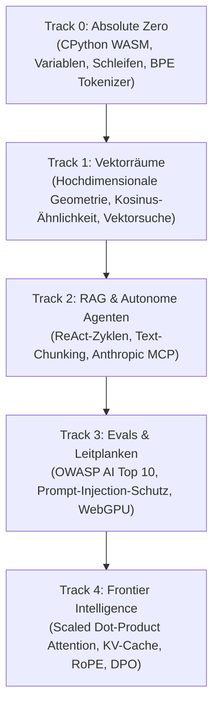

<div align="center">

<a href="https://openguideforai.dpdns.org">
  
</a>

# OpenGuide.
### Verstehe den Geist hinter der Maschine.

> **Ein souveränes, browsernatives Studio zur Entmystifizierung künstlicher Intelligenz – es verwandelt komplexe Blackboxes durch direkte Codeausführung in intuitives, greifbares Verständnis.**  
> **Geschaffen für jeden neugierigen Menschen auf der Erde – vom rissigen Smartphone-Bildschirm unter einer einsamen Glühbirne bis zur barrierefreien Ingenieur-Workstation mit Screenreader. 100% Kostenlos • Keine Cloud-Rechnungen • Souverän in Deinem Browser.**

<p align="center">
  <a href="https://openguideforai.dpdns.org">
    
  </a>
</p>

[](../../LICENSE)
[](https://pyodide.org/)
[](#souveräne-client-seitige-architektur)
[](#lehrplan-%C3%BCbersicht)
[](#barrierefreiheit-und-standards)
[](#desktop--und-pwa-installation)

<p align="center">
  <b>Sprachauswahl / Translations:</b>&nbsp;
  <a href="../../README.md">English</a> &nbsp;•&nbsp;
  <a href="README_es.md">Español</a> &nbsp;•&nbsp;
  <a href="README_zh.md">简体中文</a> &nbsp;•&nbsp;
  <a href="README_ur.md">اردو</a> &nbsp;•&nbsp;
  <a href="README_ar.md">العربية</a> &nbsp;•&nbsp;
  <a href="README_hi.md">हिन्दी</a> &nbsp;•&nbsp;
  <a href="README_fr.md">Français</a> &nbsp;•&nbsp;
  <a href="README_de.md"><b>Deutsch</b></a> &nbsp;•&nbsp;
  <a href="README_ja.md">日本語</a> &nbsp;•&nbsp;
  <a href="README_pt.md">Português</a> &nbsp;•&nbsp;
  <a href="README_ru.md">Русский</a> &nbsp;•&nbsp;
  <a href="README_it.md">Italiano</a>
</p>

---

### [Studio Starten](https://openguideforai.dpdns.org) &nbsp;•&nbsp; [Architektur](#souveräne-client-seitige-architektur) &nbsp;•&nbsp; [Lehrplan](#lehrplan-%C3%BCbersicht) &nbsp;•&nbsp; [Erklärung (STE)](../../explainer.md) &nbsp;•&nbsp; [Desktop-App](#desktop--und-pwa-installation) &nbsp;•&nbsp; [Tastatur-Shortcuts](#ergonomie-und-shortcuts) &nbsp;•&nbsp; [Lokaler Schnellstart](#lokale-entwicklung)

</div>

---

## Philosophie und Mission

Die herkömmliche KI-Ausbildung leidet unter drei großen Problemen:
1. **Oberflächliche API-Tutorials:** Es werden Blackbox-Funktionen vermittelt, die in 6 Monaten veraltet sind.
2. **Einschüchternde mathematische Hürden:** Dichte akademische Abhandlungen ohne praktische Programmiermöglichkeiten.
3. **Teure Cloud-Sandboxes:** Erfordern Kreditkarten, Cloud-Konten, Docker-Setups oder 30 $/Monat Abonnements.

**OpenGuide überwindet alle drei Barrieren.**

Wir glauben, dass Künstliche Intelligenz eine Grundfertigkeit der modernen Zivilisation ist. Ganz gleich, ob Sie auf einem **100-Dollar-Android-Smartphone**, einem alten Laptop oder einer High-End-Workstation arbeiten; ob Sie Screenreader oder eine Maus nutzen: **OpenGuide bietet Ihnen ein erstklassiges Labor direkt in Ihrem Browser – völlig kostenlos.**

> *"Jedes Feature in OpenGuide wird durch OpenGuide selbst erklärt. Sie studieren nicht nur mathematische Formeln; Sie sehen Tensoren fließen, zerlegen Attention Heads in Echtzeit, hören Kosinus-Distanzen über harmonische Töne und untersuchen den WebAssembly-Speicher mit dem Röntgenmodus (`Alt + X`)."*

---

<a id="souveräne-client-seitige-architektur"></a>
## Souveräne Client-Seitige Architektur

OpenGuide arbeitet strikt nach der **0-Dollar-Regel**. **Es gibt keinen Backend-Server**. **Keine Datenbank sammelt Ihre Daten**. 100 % der Berechnungen finden lokal in Ihrem Webbrowser statt:

```
┌────────────────────────────────────────────────────────────────────────┐
│                   IHRE LOKALE BROWSER-SANDBOX                          │
│                                                                        │
│  ┌─────────────────────────┐         ┌──────────────────────────────┐  │
│  │   OBERFLÄCHE & DESIGN   │         │     HINTERGRUND WEB WORKER   │  │
│  │   • React 18 + Vite     │         │   • CPython 3.12 (Pyodide)   │  │
│  │   • 24 Kalibrierte Theme│ ◄─────► │   • NumPy Vektorrechnung     │  │
│  │   • Lenis Smooth Scroll │         │   • 15s Watchdog-Wächter     │  │
│  │   • CodeMirror 6 Editor │         │   • Absturzsichere Reserve   │  │
│  └────────────┬────────────┘         └──────────────┬───────────────┘  │
│               │                                     │                  │
│  ┌────────────▼────────────┐         ┌──────────────▼───────────────┐  │
│  │   SPATIAL & NEURONAL    │         │     LOKALE PERSISTENZ        │  │
│  │   • Three.js WebGL / XR │         │   • IndexedDB via Dexie      │  │
│  │   • Harmonische Audios  │         │   • AES-GCM 256 Verschlüssel.│  │
│  │   • In-Browser WebGPU   │         │   • W3C Verifizierte Signatur│  │
│  └─────────────────────────┘         └──────────────────────────────┘  │
└────────────────────────────────────────────────────────────────────────┘
```

---

<a id="lehrplan-%C3%BCbersicht"></a>
## Lehrplan-Übersicht

Fünf anspruchsvolle Lernpfade mit insgesamt **45 interaktiven, direkt ausführbaren Labs**:



| Track | Labs | Mentales Kernmodell | Abschluss-Projekt |
|:---|:---:|:---|:---|
| **Track 0: Absolute Zero** | 9 | Python-Syntax über intuitive Küchen- und Karten-Analogien | Eigenständiger Byte-Pair Encoding (BPE) Tokenizer |
| **Track 1: Vektorräume** | 9 | Räumliche Geometrie, Skalarprodukte und semantische Dichte | Vollständige `SemanticSearchEngine` im Arbeitsspeicher |
| **Track 2: RAG & Agenten** | 9 | Gedanken $\rightarrow$ Aktion $\rightarrow$ Beobachtung Zustandsmaschinen | Autonomer Forschungs-Agent mit mehrstufiger Logik |
| **Track 3: Evals & Sicherheit**| 9 | Rote-Team-Tests, Abwehr von Prompt Injections und Metriken | Automatisiertes Testsystem mit lokaler WebGPU-Inferenz |
| **Track 4: Frontier Systeme** | 9 | $\text{Softmax}(QK^T/\sqrt{d_k})V$, KV-Cache-Speicher, RoPE | Transformer-Attention-Head-Analyse und DPO-Loss-Engine |

---

## Universelles KI-Kontinuum für die Gesamte Menschheit

OpenGuide richtet sich nicht an eine abgeschottete Elite. Es ist für das gesamte Spektrum menschlicher Bildung konzipiert — von Menschen ohne Programmiererfahrung bis hin zu KI-Forschern und Modellarchitekten an vorderster Front:

| Stufe & Profil | Reale Lebens- & Arbeitswelt | Der Mehrwert von OpenGuide |
|---|---|---|
| **Stufe 0: Neugierige Einsteiger & Ohne Vorkenntnisse** | Erste Berührung mit KI. Überwältigt von Fachjargon und Bezahlgrenzen. | Anschauliche Denkmodelle („Du bist ein LLM“), die 3 Goldenen Prompting-Regeln (Rolle + Kontext + Format) und 0-Euro-Klarheit. |
| **Stufe 1: Praktisches Handwerk & Gewerbe** | Kfz-Mechaniker, Schuhmacher, Schreiner, Friseure, Köche, Installateure. | Alltags-KI in der Praxis: konkrete Fehlerdiagnosen, automatische Kostenvoranschläge, Materialberechnungen und Werkstattabläufe. |
| **Stufe 2: Wissens- & Dienstleistungsberufe** | Ärztinnen, Lehrkräfte, Steuerberater, Juristen, Landwirte. | Strukturierte Prompt-Vorlagen, tabellarische Datenextraktion, Lernleitfäden und vollständiger lokaler Datenschutz. |
| **Stufe 3: Angewandte System-Entwickler** | Programmierer, die Softwareanwendungen mit LLMs und Agenten entwickeln. | Echtes Python im Browser, Tokenisierung, JSON-RPC-Schemata und Werkzeugaufrufe per Model Context Protocol (MCP). |
| **Stufe 4: KI-Sicherheits- & Eval-Architekten** | Reliability Engineers, die produktive KI-Systeme abhärten. | OWASP AI Top 10 Abwehr, Delimiter-Sandboxes gegen Prompt-Injections, PII-Bereinigung und automatisierte Test-Suites. |
| **Stufe 5: Frontier-Forscher & Modellbauer** | Spezialisten für grundlegende generative Modellarchitekturen. | Skalierte Dot-Product-Attention von Grund auf, KV-Cache-Speicherkinematik, INT8-Gleichverteilungsquantisierung und DPO-Loss-Mathematik. |

---

## Manipulationssichere Zwei-Phasen-Autograder

Jedes einzelne der **45 Kurs-Labore** von OpenGuide wird durch ein rigides Zwei-Phasen-Prüfsystem geschützt:
1. **Phase 1 (Sichtbare Challenge):** Validiert Rückgabetypen, Tensor-Dimensionen und Grundsyntax anhand von Referenzfällen.
2. **Phase 2 (Verborgene mathematische Invarianten):** Prüft die Lösung gegen fünf verborgene mathematische Invarianten pro Labor: Cauchy-Schwarz-Ungleichungen, Varianzskalierung, Metriksymmetrie, dynamische Testvektoren und Randwertgrenzen.
3. **Mutations-Test-Eliminierungsrate:** Geprüft durch eine Test-Suite mit 135 bösartigen Test-Mutanten, die eine **Eliminierungsrate von 100,0 % (135/135 Mutanten eliminiert)** ohne Fehlalarme erzielt.

---

<a id="desktop--und-pwa-installation"></a>
## Desktop- und PWA-Installation

OpenGuide ist als **Installierbare Progressive Web App (PWA)** konzipiert:

* **Windows (10 / 11):** In Chrome oder Edge auf das **OpenGuide installieren**-Symbol in der Adressleiste klicken. Erstellt automatisch ein Desktop-Icon und einen Eintrag im Startmenü.
* **macOS:** In Safari auf **Ablage** $\rightarrow$ **Zum Dock hinzufügen** klicken, oder über Chrome/Edge installieren.
* **Mobilgeräte (Android & iOS):** Über das Browsermenü **Zum Startbildschirm hinzufügen** wählen.
* **Vollständige Offline-Fähigkeit:** Dank Service-Worker-Caching (`sw.js`) werden alle Kursinhalte und die Pyodide-WASM-Engine auf Ihrem Gerät gespeichert. Sie können im Zug oder Flugzeug ohne Internetverbindung programmieren.

---

<a id="ergonomie-und-shortcuts"></a>
## Ergonomie und Shortcuts

* **Befehlspalette (`Cmd + K` / `Ctrl + K`):** Blitzschnelle Volltextsuche über alle Übungen, Werkzeuge und Farbschemata.
* **Sofortige Ausführung (`Ctrl + Enter`):** Führt Ihren Python-Code direkt im Editor aus.
* **Verständlicher Syntax-Doktor:** Übersetzt unklare Compiler-Fehlermeldungen in einfache Erklärungen und Lösungsvorschläge.
* **Jupyter Notebook Export (`.ipynb`):** Laden Sie gelöste Aufgaben als standardisierte Jupyter Notebooks herunter.
* **Röntgen-Diagnosemodus (`Alt + X`):** Prüfen Sie Web-Worker-Speicher und lokale Datenbanken live.
* **Verschlüsselte Gist-Synchronisation:** Speichern Sie Ihren Lernfortschritt mit **AES-GCM 256-Bit-Verschlüsselung** in privaten GitHub Gists.

---

<a id="barrierefreiheit-und-standards"></a>
## Barrierefreiheit und Standards

* **24 Wissenschaftliche Themes:** 12 dunkle und 12 helle Designs, die den W3C WCAG 2.2 AAA Kontraststandard (>7:1 bis 20:1) einhalten.
* **Screenreader-Zertifiziert:** Dynamische Sprachausgabe-Bereiche (`aria-live="polite"`).
* **Vollständige RTL-Unterstützung:** Spiegelbildliches Layout für Arabisch und Urdu bei gleichzeitig sauberer LTR-Formatierung für Codezeilen.

---

<a id="urheberschaft-und-f%C3%B6rderung"></a>
## Urheberschaft und Förderung

OpenGuide wurde von **Adil Rafiq Dar (ARD)** konzipiert, entwickelt und gestaltet.

```
                    EINE BOTSCHAFT ZUR DIGITALEN SOUVERÄNITÄT
"Ich habe OpenGuide gebaut, weil ich es leid war zu sehen, wie talentierte Menschen
durch teure Bootcamps, hohe Cloud-Gebühren und elitäre Barrieren vom Erlernen der
Künstlichen Intelligenz ausgeschlossen wurden.

Jede Zeile dieses Studios entstand in unzähligen Nächten intensiver Arbeit und mit
höchstem Anspruch an mathematische Präzision und Ästhetik. OpenGuide ist mein Geschenk an die Welt.

Damit dieses Studio dauerhaft 100 % kostenlos, unabhängig und werbefrei bleibt,
freue ich mich über jede Unterstützung von Menschen, die an freie Bildung glauben."
```

Wenn Ihnen OpenGuide geholfen hat, können Sie die unabhängige Weiterentwicklung unterstützen:

<div align="center">

[](https://www.paypal.com/paypalme/buymegoodcoffee/sponsor)
&nbsp;&nbsp;
[](https://ko-fi.com/buymegoodcoffee)

</div>

---

<a id="lokale-entwicklung"></a>
## Lokale Entwicklung

```bash
git clone https://github.com/openguideforai/OpenGuideForAI.git
cd OpenGuideForAI
corepack enable
yarn install
yarn --cwd apps/web dev
```
Rufen Sie `http://localhost:5173` in Ihrem Browser auf.

---

## Qualitätssicherungs-Gate

Jeder Beitrag muss die 5-Punkte-Qualitätsprüfung vor dem Zusammenführen bestehen:
```bash
# 1. Linter-Prüfung (0 Warnungen, 0 Fehler in 108 Dateien)
yarn lint

# 2. Automatisierte Playwright-Test-Suite (128 / 128 Tests bestanden, 100% Erfolgsquote)
npx playwright test

# 3. Statische Produktions-Kompilierung (0 TypeScript/Vite-Fehler)
yarn --cwd apps/web build
```

---

## Technische Dokumentation & Referenzen

* **[Versions-Changelog](../../CHANGELOG.md):** Chronologische Meilenstein-Releases und Systemevolution.
* **[ASD-STE100 System-Spezifikation](../../explainer.md):** Umfassende Spezifikation in vereinfachtem technischem Englisch.
* **[System-Architektur](../../ARCHITECTURE.md):** Tiefgehende Analyse von Web Workern, WebGPU und lokaler Persistenz.
* **[Lehrplan-Spezifikationen](../CURRICULUM.md):** Vollständiges Curriculum und Lernziele aller 45 Labore.
* **[Externes Audit- & QS-Dossier](../EXTERNAL-AUDIT-QA-DOSSIER.md):** Architektur-Grundlegung, Invarianten-Matrizen und Reproduktionsanleitung.

