<div align="center">

<a href="https://openguideforai.dpdns.org">
  
</a>

# OpenGuide.
### Verstehe den Geist hinter der Maschine.

> **Ein souveränes, browsernatives Studio zur Entmystifizierung künstlicher Intelligenz – es verwandelt komplexe Blackboxes durch direkte Codeausführung in intuitives, greifbares Verständnis.**  
> **Geschaffen für jeden neugierigen Menschen auf der Erde – vom rissigen Smartphone-Bildschirm unter einer einsamen Glühbirne bis zur barrierefreien Ingenieur-Workstation mit Screenreader. 100% Kostenlos • Keine Cloud-Rechnungen • Souverän in Deinem Browser.**

<p align="center">
  <a href="https://openguideforai.dpdns.org">
    
  </a>
</p>

[](../../LICENSE)
[](https://pyodide.org/)
[](../../explainer.md)
[](#duale-lernpfade)
[](#universelles-design-und-barrierefreiheit)
[](#desktop--und-pwa-installation)

<p align="center">
  <b>Sprachauswahl / Translations:</b>&nbsp;
  <a href="../../README.md">English</a> &nbsp;•&nbsp;
  <a href="README_es.md">Español</a> &nbsp;•&nbsp;
  <a href="README_zh.md">简体中文</a> &nbsp;•&nbsp;
  <a href="README_ur.md">اردو</a> &nbsp;•&nbsp;
  <a href="README_ar.md">العربية</a> &nbsp;•&nbsp;
  <a href="README_hi.md">हिन्दी</a> &nbsp;•&nbsp;
  <a href="README_fr.md">Français</a> &nbsp;•&nbsp;
  <a href="README_de.md"><b>Deutsch</b></a> &nbsp;•&nbsp;
  <a href="README_ja.md">日本語</a> &nbsp;•&nbsp;
  <a href="README_pt.md">Português</a> &nbsp;•&nbsp;
  <a href="README_ru.md">Русский</a> &nbsp;•&nbsp;
  <a href="README_it.md">Italiano</a>
</p>

---

### [Studio Starten](https://openguideforai.dpdns.org) &nbsp;•&nbsp; [Das Erlebnis](#was-sie-erleben) &nbsp;•&nbsp; [Duale Lernpfade](#duale-lernpfade) &nbsp;•&nbsp; [Auto-Grading](#unmanipulierbare-zwei-phasen-autograder) &nbsp;•&nbsp; [Wissensdatenbank](#souver%C3%A4ne-offline-wissensdatenbank-und-bluee-mentor) &nbsp;•&nbsp; [Barrierefreiheit](#universelles-design-und-barrierefreiheit) &nbsp;•&nbsp; [Erklärung STE](../../explainer.md) &nbsp;•&nbsp; [Schnellstart](#in-60-sekunden-starten)

</div>

---

## Was Sie Erleben

OpenGuide ist kein gewöhnlicher Cloud-Dienst oder oberflächliches Tutorial. Es ist ein browsernatives, souveränes Labor, in dem Sie Systeme der künstlichen Intelligenz durch reale Codeausführung zerlegen, analysieren und grundlegend verstehen.

| Grundpfeiler | Was im Inneren geschieht | Warum es entscheidend ist |
|---|---|---|
| **Reine Grundlagenbildung** | Lernen Sie echte Mathematik: Schreiben Sie BPE-Tokenizer, Vektor-Skalarprodukte und Self-Attention von Grund auf neu. | Sie erlangen ein dauerhaftes konzeptionelles Verständnis statt kurzlebiger Bibliotheks-Wrapper. |
| **Sofortige Ausführung** | Echtes CPython 3.12 läuft lokal in Ihrem Browser via WebAssembly (Pyodide v0.26) in einem dedizierten Web Worker. | Null Einrichtung. Keine Installation von Python, Anaconda oder Docker auf Ihrem Rechner erforderlich. |
| **Duale Lernpfade** | Wechseln Sie nahtlos zwischen tiefer mathematischer Modellarchitektur und vollwertiger Software-Entwicklung. | Perfekt für theoretische Forscher wie auch praktische Entwickler – ohne jeden Fortschrittsverlust. |
| **Souverän und Privat** | 100 % clientseitige Berechnung. Daten werden lokal in der IndexedDB Ihres Browsers gespeichert. Null Telemetrie. | Vollständige Privatsphäre. Keine Abonnements. Keine unerwarteten Cloud-Rechnungen (0-Dollar-Regel). |
| **PWA & Offline-Wissen** | Die Progressive Web App speichert den gesamten Lehrplan, die Python-Engine und 250 KI-Themen mit ausführbarem Code lokal. | Coden, experimentieren und lernen Sie überall auf der Welt – selbst völlig ohne Internetverbindung. |
| **Interaktive Raumvisualisierungen** | GPU-beschleunigte Three.js-3D-Mannigfaltigkeiten und WebXR-Projektionen machen Tensoren physisch greifbar. | Sie sehen, manipulieren und verstehen hochdimensionale Embeddings und neuronale Graphen intuitiv. |

> 📖 **Detaillierte Technologiespezifikation:** Für die vollständige Systemarchitektur, Datenkanäle, den 15-Sekunden-Watchdog-Wächter und das Progressive-Disclosure-Design lesen Sie bitte den [ASD-STE100 Leitfaden](../../explainer.md).

---

## Duale Lernpfade

OpenGuide bietet zwei synchronisierte Lernpfade auf Weltklasseniveau. Über die obere Navigationsleiste können Sie jederzeit frei zwischen ihnen wechseln:

### Pfad A: Deep AI Engineer (Tracks 0–7 • 57 Laboratorien)
*Tiefe mathematische Intuition, reale CPython 3.12 WebAssembly-Ausführung im Browser und Pionier-Modelle von Grund auf.*

```mermaid
graph LR
    T0["Track 0: Fundamente<br/>(CPython WASM, Schleifen, BPE)"]
    T1["Track 1: Vektorräume<br/>(Embeddings, Kosinus-Suche)"]
    T2["Track 2: Agenten & RAG<br/>(ReAct-Loops, FastMCP)"]
    T3["Track 3: Evals & Sicherheit<br/>(OWASP AI Top 10, WebGPU)"]
    T4["Track 4: Frontier-Systeme<br/>(Self-Attention, RoPE, DPO)"]
    T5["Track 5: Fine-Tuning<br/>(LoRA, SVD, NF4-Bins)"]
    T6["Track 6: Inferenz-Engines<br/>(KV-Paging, Spekulativ)"]
    T7["Track 7: Generative Modelle<br/>(Diffusion, CFG, ViT)"]

    T0 --> T1 --> T2 --> T3 --> T4 --> T5 --> T6 --> T7
```



| Track | Labs | Leitprinzip | Abschlussprojekt |
|:---|:---:|:---|:---|
| **Track 0: Absoluter Nullpunkt** | 9 | Python-Syntax über anschauliche Alltags- und Küchenmetaphern | Byte-Pair Encoding (BPE) Tokenizer von Grund auf neu |
| **Track 1: Vektorräume** | 9 | Hochdimensionale Geometrie, Skalarprodukte und semantische Dichte | `SemanticSearchEngine` im Arbeitsspeicher zur Dokumentenindizierung |
| **Track 2: RAG & Agenten** | 9 | Zustandsmaschinen aus Denken $\rightarrow$ Handeln $\rightarrow$ Beobachten | Autonomer Forschungsagent mit mehrstufigem logischem Schließen |
| **Track 3: Evals & Leitplanken** | 9 | Adversarial Testing, Prompt Injection und Sicherheitsregeln | Synthetischer Evaluierungsprüfstand mit WebGPU-Inferenz |
| **Track 4: Frontier-Systeme** | 9 | Scaled Dot-Product Attention, KV-Cache-Physik und RoPE | Zerlegung von Transformer-Aufmerksamkeitsköpfen & DPO-Loss |
| **Track 5: Fine-Tuning & LoRA** | 6 | Parametereffiziente Low-Rank-Adaption und NF4-Quantisierung | Dynamische LoRA-Gewichtsfusions-Engine ohne Rechenüberhang |
| **Track 6: Inferenz-Engines** | 3 | Hochdurchsatz-Serving, virtuelles Paging und spekulative Dekodierung | Virtueller PagedAttention-Paging-Simulator |
| **Track 7: Multimodal & Diffusion** | 3 | Vorwärtsdiffusions-Rauschen, CFG-Vektoren und ViT-Patches | Linearer Patch-Projektor für Vision Transformer |

---

### Pfad B: The Builder Path (Tracks B0–B7 • 24 Module / 48 Meilensteine)
*Forward Deployed AI Engineering (FDE): Erstellen Sie produktionsreife Softwaresysteme mithilfe präziser Spezifikationen, Sandkästen und agentenbasierter Workflows.*

```mermaid
graph LR
    B0["Track B0: Formulieren<br/>(Instant Utility Studio)"]
    B1["Track B1: Spezifizieren<br/>(Rubriken & Testfälle)"]
    B2["Track B2: Prüfen<br/>(Diff-Lesen & Risiken)"]
    B3["Track B3: Verbinden<br/>(IndexedDB & APIs)"]
    B4["Track B4: Verankern<br/>(Kontext & Evals)"]
    B5["Track B5: Ausliefern<br/>($0 Sovereign Cloud)"]
    B6["Track B6: Härten<br/>(Red-Teaming & Secrets)"]
    B7["Track B7: Beweisen<br/>(Capstone-Verteidigung)"]

    B0 --> B1 --> B2 --> B3 --> B4 --> B5 --> B6 --> B7
```



| Builder-Track | Module | Kernprinzip | Interaktives Labor |
|:---|:---:|:---|:---|
| **Track B0: Formulieren (Say It)** | 3 | Von Null zum ersten funktionierenden Interface in 3 Sätzen | **Prompt-to-Preview Lab:** Isolierte Iframe-Generierung |
| **Track B1: Spezifizieren (Spec It)** | 3 | Eindeutige technische Spezifikationen ohne Modell-Missverständnisse | **Spec Studio Lab:** Autograder mit 5-Regeln-Rubrik |
| **Track B2: Prüfen (Verify It)** | 3 | Professionelles Lesen von Code-Diffs und Erkennen von Sicherheitsrisiken | **Diff Reader Lab:** Visuelles Diff- & Sicherheitsrisiko-Audit |
| **Track B3: Verbinden (Connect It)** | 3 | Clientseitige Persistenz (Dexie IndexedDB) und Mock-Endpunkte | **Storage Workbench:** Local-First Datenbankschema-Modellierung |
| **Track B4: Verankern (Ground It)** | 3 | Kontext-Konstitutionen (`AGENTS.md`), Leitplanken und Evaluatoren | **Harness Studio Lab:** Durchgängige Aufgaben-Evaluierung |
| **Track B5: Ausliefern (Ship It)** | 3 | 0-Dollar-Sovereign-Stack-Bereitstellung: GitHub Actions & Cloudflare | **Pipeline Deployer:** Konfiguration kontinuierlicher Auslieferung |
| **Track B6: Härten (Harden It)** | 3 | Bedrohungsmodellierung, Secret-Hygiene und Pre-Commit-Scanner | **Sicherheits-Sandbox:** Null-Schlüssel-Leckage-Prävention |
| **Track B7: Beweisen (Prove It)** | 3 | Architektur-Verteidigung, Portfolio-Nachweise und Capstone | **Capstone Defense:** Kryptografische SHA-256-Verifikation |

---

## Unmanipulierbare Zwei-Phasen-Autograder

Jedes der **57 Lehrplan-Labore** von OpenGuide ist durch ein manipulationssicheres Zwei-Phasen-Prüfsystem geschützt:
1. **Phase 1 (Sichtbare Herausforderung):** Überprüft Rückgabetypen, Matrixformen und Codesyntax anhand von Baseline-Beispielen.
2. **Phase 2 (Verborgene mathematische Invarianten):** Testet Lösungen gegen fünf geheime mathematische Invarianten pro Labor – einschließlich Cauchy-Schwarz-Ungleichung, Varianzskalierung, Metriksymmetrie und Grenzfälle.
3. **Mutationstest-Eliminierungsrate:** Vollautomatisch gegen 171 feindliche Mutanten getestet, mit einer **Eliminierungsrate von 100,0 % (171/171 Mutanten zerstört)** ohne falsch-positive Durchläufe.

---

## Souveräne Offline-Wissensdatenbank und Bluee-Mentor

OpenGuide verfügt über eine integrierte clientseitige Wissensdatenbank ohne jegliche externe Cloud-Abhängigkeiten (0-Dollar-Regel):
- **250 Kern- und Alltagsthemen:** Vollständige Abdeckung von Transformer Attention (FlashAttention-2/3, PagedAttention/vLLM, MLA), Alignment & Optimierung (DPO, KTO, ORPO, LoRA, QLoRA), Vektorgeometrie (HNSW, ColBERT), strukturierter Dekodierung, Quantisierung (FP8, INT8, AWQ, BitNet b1.58), multimodalen Modellen (ViT, CLIP) und praxisnahen Lösungen für über 17 Berufsfelder.
- **Okapi BM25 Retrieval Engine:** Probabilistisches Ranking-Modell ($k_1=1.2, b=0.75$) mit geglätteter inverser Dokumenthäufigkeit und Mehrfeld-Gewichtung.
- **Mehrsprachige Brücke:** Sofortige Suchtreffer über 12 Weltsprachen (Deutsch, Englisch, Spanisch, Hindi, Chinesisch, Französisch, Arabisch, Russisch, Japanisch, Urdu, Portugiesisch, Italienisch).
- **Interaktive visuelle Erklärungen:** Reine JavaScript-Mikro-Widgets (Softmax-Temperaturschieberegler, PagedAttention-Blockzuteilung, Kosinus-Winkelskala, RoPE-Phasor) direkt in den Wissenskarten.
- **Ausführbare Python-Code-Snippets:** Jeder technische Eintrag enthält ein eigenständiges, ausführbares Python-Skript, das lokal in der Pyodide-WASM-Umgebung läuft.

---

## Universelles Mensch-KI-Kontinuum

OpenGuide richtet sich an das gesamte Spektrum menschlicher Neugier – von Personen ohne Programmiererfahrung bis hin zu führenden KI-Forschern:

| Stufe & Profil | Realer Kontext | Was OpenGuide bietet |
|---|---|---|
| **Stufe 0: Neugierige Einsteiger ohne Vorkenntnisse** | Erste Berührung mit KI. Überfordert von Fachbegriffen und Bezahlschranken. | Einfache mentale Modelle („Du bist ein LLM“), die 3 goldenen Prompting-Regeln (Rolle + Kontext + Format) und 0 $ Kosten. |
| **Stufe 1: Praktische Berufe & Handwerk** | Kfz-Mechaniker, Schuster, Schreiner, Stylisten, Köche, Klempner. | Angewandte KI: Fehlerdiagnosen, Kostenvoranschlags-Generatoren, Materialrechner und Werkstatt-Workflows. |
| **Stufe 2: Wissens- & Dienstleistungsberufe** | Mediziner, Lehrkräfte, Buchhalter, Juristen, Landwirte. | Strukturierte Prompt-Vorlagen, Tabellendaten-Extraktion, Studienleitfäden und absolute lokale Privatsphäre. |
| **Stufe 3: Angewandte Systementwickler** | Software-Ingenieure, die Anwendungen mit LLMs und Agenten entwickeln. | Reale Python-Ausführung im Browser, Tokenisierung, JSON-RPC-Schemas und Werkzeugaufrufe via Model Context Protocol (MCP). |
| **Stufe 4: Sicherheits- & Evaluierungsarchitekten** | Zuverlässigkeitsingenieure zur Absicherung von Produktionsmodellen. | OWASP AI Top 10-Abwehr, Sandboxes gegen Prompt-Injektionen, PII-Filter und automatisierte Testumgebungen. |
| **Stufe 5: Frontier-KI-Forscher & Modellbauer** | Spezialisten, die tief in generative mathematische Architekturen eintauchen. | Scaled Dot-Product Attention von Grund auf, KV-Cache-Dynamik, INT8-Quantisierung und geschlossener DPO-Verlust. |

---

## Universelles Design und Barrierefreiheit

* **24 Wissenschaftlich Kalibrierte Themes:** 12 dunkle und 12 helle Themes, zertifiziert nach **WCAG 2.2 AAA Standards** (Kontrastverhältnisse von über 7:1 bis 20:1) für Augenschonung und klares Lesen.
* **12 Unterstützte Weltsprachen:** Native Typografie mit echten Nastaliq-Ligaturen (**Urdu**), arabischer Schrift, Devanagari (**Hindi**), ostasiatischen Zeichen (**Chinesisch**, **Japanisch**) sowie lateinischen und kyrillischen Alphabeten (**Deutsch**, **Englisch**, **Spanisch**, **Französisch**, **Portugiesisch**, **Russisch**, **Italienisch**).
* **Vollständig Screenreader-Kompatibel:** ARIA-Live-Regionen (`aria-live="polite"`), barrierefreie Fokusfallen in Modalfenstern und semantische Orientierungspunkte.
* **Vollständige RTL-Unterstützung:** Spiegelbildliches Layout für Urdu und Arabisch bei gleichzeitig erhaltener Links-nach-Rechts-Ausrichtung für Programmcode.
* **Schriftsichere Zeilenhöhe:** Dynamische Zeilenhöhenanpassung verhindert vertikale Textkollisionen in Devanagari und komplexen Schriftsystemen.

---

## Forward Deployed AI Engineering (FDE) Leitfaden

OpenGuide enthält einen interaktiven **FDE-Leitfaden**, der direkt über die obere Navigationsleiste oder die Befehlspalette (`Cmd + K` / `Ctrl + K`) aufgerufen werden kann:
- **Rollen- und Systemvergleich:** Vergleicht Gelegenheits-Programmierer, traditionelle Software-Entwickler, KI-Forscher und FDE-Ingenieure anhand von 6 Dimensionen.
- **Agenten-IDE-Einrichtungsanleitungen:** Praxiserprobte Anleitungen, Terminalbefehle und Konfigurationen für Google Antigravity IDE, Anthropic Claude Code CLI und OpenAI Codex & Cursor.
- **0-Dollar-Souveränitäts-Stack:** Umfassender Architekturplan für GitHub Actions CI, Cloudflare Pages Edge-Netzwerk, Neon Serverless Postgres, CPython WebAssembly und Hugging Face Spaces.
- **Secret-Hygiene ohne Lecks:** Schlüssel-Isolation im Arbeitsspeicher (BYOK), Pre-Commit-Sicherheitsscanner und geschützte `.env.example`-Vorlagen.
- **Repository-Governance-Standards:** Synchronisierte Regelwerke (`AGENTS.md`, `CLAUDE.md`, `ARCHITECTURE.md`, `CHANGELOG.md`).

---

## Souveräne Client-Seitige Architektur (0-Dollar-Regel)

OpenGuide arbeitet strikt nach der **0-Dollar-Regel**. **Es gibt keinen Backend-Server**. **Keine Datenbank sammelt Ihre Daten**. 100 % der Berechnungen finden lokal in Ihrem Webbrowser statt:

```
┌────────────────────────────────────────────────────────────────────────┐
│                   IHRE LOKALE BROWSER-SANDBOX                          │
│                                                                        │
│  ┌─────────────────────────┐         ┌──────────────────────────────┐  │
│  │   OBERFLÄCHE & DESIGN   │         │     HINTERGRUND WEB WORKER   │  │
│  │   • React 18 + Vite     │         │   • CPython 3.12 (Pyodide)   │  │
│  │   • 24 Kalibrierte Theme│ ◄─────► │   • NumPy Vektorrechnung     │  │
│  │   • Lenis Smooth Scroll │         │   • 15s Watchdog-Wächter     │  │
│  │   • CodeMirror 6 Editor │         │   • Absturzsichere Reserve   │  │
│  └────────────┬────────────┘         └──────────────┬───────────────┘  │
│               │                                     │                  │
│  ┌────────────▼────────────┐         ┌──────────────▼───────────────┐  │
│  │   SPATIAL & NEURONAL    │         │     LOKALE PERSISTENZ        │  │
│  │   • Three.js WebGL / XR │         │   • IndexedDB via Dexie      │  │
│  │   • Harmonische Audios  │         │   • AES-GCM 256 Verschlüssel.│  │
│  │   • In-Browser WebGPU   │         │   • W3C Verifizierte Signatur│  │
│  └─────────────────────────┘         └──────────────────────────────┘  │
└────────────────────────────────────────────────────────────────────────┘
```

---

## 3D Spatial Holodeck und Hardware-Erweiterungen

Als fortschrittliche interaktive Lernfunktion bietet OpenGuide ein browsernatives WebXR / WebGL 3D Spatial Computing Holodeck (`/holodeck`) und Hardwarebeschleunigung:

* **Stabile 60FPS Vektormannigfaltigkeiten:** Three.js-Echtzeitvisualisierung von 3D-Vektorräumen, semantischen Clustern und neuronalen Synapsengraphen mit vorab zugewiesenem Speicher und automatischer Pause außerhalb des Bildschirms.
* **Binaurales Harmonisches Spatial Audio:** Web Audio API-Sound-Engine, die harmonische Quintenakkorde proportional zur Vektor-Kosinus-Ähnlichkeit erzeugt.
* **Smart-AR-Brillen True-Black-Modus:** `#000000` Abschaltmodus, der OLED-Pixel ausschaltet, um ein klares HUD auf Viture, Xreal, RayNeo, Rokid, Meta Quest und Apple Vision Pro anzuzeigen.
* **Virtuelle Spatial-Tastatur:** Freischwebend im Raum oder auf der Schreibtischebene verankerbar für immersive Erkundung.

---

## In 60 Sekunden Starten

### Direkt im Browser Starten (Keine Installation)
Besuchen Sie **[https://openguideforai.dpdns.org](https://openguideforai.dpdns.org)** und klicken Sie auf **Track 0 starten** oder **Als Builder beginnen**. Die WebAssembly-Laufzeitumgebung startet in unter einer Sekunde.

### Lokal über Git Ausführen
```bash
# 1. Corepack aktivieren und Repository klonen
corepack enable
git clone https://github.com/openguideforai/OpenGuideForAI.git
cd OpenGuideForAI

# 2. Abhängigkeiten installieren und Entwicklungsserver starten
yarn install
yarn dev
```
Öffnen Sie `http://localhost:5173` in Ihrem Browser.

#### Lokales Netzwerk-Testing (Smartphones / Tablets)
Zum Testen auf einem Smartphone oder Tablet in Ihrem lokalen WLAN:
```bash
yarn dev --host
```

---

## Desktop- und PWA-Installation

OpenGuide funktioniert als vollwertige **Installierbare Progressive Web App (PWA)**:

* **Windows (10 / 11):** Klicken Sie in Chrome oder Edge auf das Installationssymbol in der Adressleiste, um eine Desktop- und Startmenü-Verknüpfung zu erstellen.
* **macOS:** In Safari auf **Ablage** $\rightarrow$ **Zum Dock hinzufügen** klicken; oder in Chrome/Edge auf **Installieren**.
* **Linux:** Klicken Sie in Chromium oder Chrome auf Installieren. Ein `.desktop`-Starter wird automatisch in Ihrer Anwendungsübersicht angelegt.
* **Smartphones (Android & iOS):** In iOS Safari auf **Teilen** $\rightarrow$ **Zum Home-Bildschirm** tippen; unter Android auf **App installieren**.
* **Vollständiger Offline-Modus (Air-Gapped):** Der Service Worker speichert alle Lektionen, Visualisierungen und die Python-Engine lokal, sodass Sie unterwegs völlig ohne Internet lernen können.

---

## Ergonomie und Shortcuts

| Tastenkombination | Aktiviertes Werkzeug | Ausgeführte Aktion |
|---|:---:|---|
| **`Cmd + K` / `Ctrl + K`** | Befehlspalette | Blitzschnelle Fuzzy-Suche über alle 57 Labs, 24 Themes, 12 Sprachen und Werkzeuge. |
| **`Ctrl + Enter`** | Code-Ausführer | Kompiliert und startet den aktiven Python-Code sofort im Web Worker. |
| **`Alt + X`** | Röntgen-Debug-Linse | Echtzeit-Inspektion des WebAssembly-Speichers, AST-Baums und der lokalen Datenbank. |
| **`Alt + S`** | Spatial-HUD | Schaltet das schwebende 3-DoF-Headset-HUD und den True-Black-Modus für AR-Brillen um. |
| **Touch-Leiste** | Mobiler Editor | Schneller Zugriff auf häufige Programmiersymbole (`Tab`, `:`, `( )`, `[ ]`, `def`, `assert`). |
| **`.ipynb` Export** | Notebook-Generator | Lädt verifizierte Labor-Lösungen als standardisierte Jupyter Notebooks herunter. |
| **Harmonisches Audio** | 3D-Holodeck | Wandelt Vektor-Kosinus-Ähnlichkeit in harmonische Akkorde um. |

---

## Qualitätssicherungs-Gate (5-Punkte Pre-Flight Suite)

Jeder Beitrag muss vor dem Zusammenführen den strengen 5-Punkte-Qualitätstest bestehen:
```bash
# 1. Lokaler Server-Live-Check (HTTP 200 OK)
(Invoke-WebRequest http://localhost:5173).StatusCode == 200

# 2. Automatisierte Headless-Browser-Prüfung (0 Konsolenfehler)
# Vollautomatisch geprüft via Playwright

# 3. Statische Linter-Prüfung (0 Codefehler)
yarn lint

# 4. Automatisierte Regressionstest-Suite (100% Erfolg über 20 Testdateien)
npx playwright test --config apps/web/playwright.config.ts

# 5. Statischer Produktions-Build (0 TypeScript/Vite-Fehler)
yarn --cwd apps/web build
```

---

## Urheberschaft und Verantwortung

OpenGuide wurde von **Adil Rafiq Dar (ARD)** konzipiert, architektonisch gestaltet und erbaut.

```
                   EIN STATEMENT ZU SOUVERÄNER BILDUNG
"Ich habe OpenGuide geschaffen, weil ich fest davon überzeugt bin, dass das Wissen
über künstliche Intelligenz der gesamten Menschheit gehören muss. Es darf nicht hinter
teuren Cloud-Abonnements, Konzernmonopolen oder akademischem Elitismus eingesperrt sein.

Jede Zeile dieses Studios entstand durch unzählige Arbeitsstunden, strenge mathematische
Prüfungen und kompromisslose Hingabe an erstklassiges Design. OpenGuide ist ein Geschenk an die Welt.

Um dieses Studio 100% kostenlos, unabhängig und frei von Werbung oder fremdbestimmten
Investoren zu halten, begrüße ich die Unterstützung von Lernenden und Förderern,
die diese Vision teilen."
```

Unterstützen Sie die unabhängige Weiterentwicklung:

<div align="center">

[](https://github.com/sponsors/openguideforai)
&nbsp;&nbsp;
[](https://ko-fi.com/buymegoodcoffee)
&nbsp;&nbsp;
[](https://paypal.me/buymegoodcoffee)

<br/>

<sub>Ihre Unterstützung sichert Domain-Hosting, Continuous-Integration-Infrastruktur und die Erweiterung offener Lerninhalte.</sub>

</div>

---

## Technische Dokumentation und Referenzen

* **[Versionsverlauf (Changelog)](../../CHANGELOG.md):** Chronologische Auflistung aller Meilensteine und Systemupgrades.
* **[ASD-STE100 Technische Spezifikation](../../explainer.md):** Umfassendes Dokument über Web-Worker-Kommunikation, Speichergrenzen und Progressive Disclosure.
* **[Systemarchitektur](../../ARCHITECTURE.md):** Tiefgehende Analyse reaktiver Stores, Web Worker und WebGPU-Pipelines.
* **[Lehrplan-Spezifikationen](../CURRICULUM.md):** Vollständiger Lehrplan aller 57 Labore (8 Lernpfade).
* **[Externes Audit- & Qualitätssicherungs-Dossier](../EXTERNAL-AUDIT-QA-DOSSIER.md):** Architektur-Grundlegung, mathematische Invarianten und Verifizierungsanweisungen.
* **[Unabhängiger Qualitätsprüfbericht](../AUDIT_QA.md):** Umfassender Cross-Platform-Qualitätsbericht.

<div align="center">
  <sub>Architektur und Entwicklung von Adil Rafiq Dar (ARD). Lizenziert unter AGPL-3.0 und CC BY-NC-SA 4.0.</sub>
</div>
