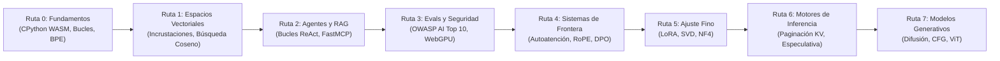
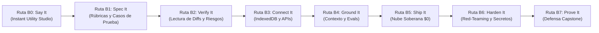

<div align="center">

<a href="https://openguideforai.dpdns.org">
  
</a>

# OpenGuide.
### Comprende la mente detrás de la máquina.

> **Un estudio soberano y nativo del navegador diseñado para desmitificar la inteligencia artificial: transformando complejas cajas negras en comprensión intuitiva y práctica mediante la ejecución directa de código.**  
> **Diseñado para cada ser curioso de la Tierra: desde un teléfono con la pantalla rota iluminado bajo una solitaria bombilla nocturna, hasta una estación de ingeniería con lector de pantalla. 100% Gratuito • Cero Facturas en la Nube • Soberano en tu Navegador.**

<p align="center">
  <a href="https://openguideforai.dpdns.org">
    
  </a>
</p>

[](../../LICENSE)
[](https://pyodide.org/)
[](../../explainer.md)
[](#rutas-de-aprendizaje-duales)
[](#dise%C3%B1o-universal-y-accesibilidad)
[](#instalaci%C3%B3n-como-aplicaci%C3%B3n-de-escritorio-y-pwa)

<p align="center">
  <b>Ediciones Multilingües:</b>&nbsp;
  <a href="../../README.md">English</a> &nbsp;•&nbsp;
  <a href="README_es.md"><b>Español</b></a> &nbsp;•&nbsp;
  <a href="README_zh.md">简体中文</a> &nbsp;•&nbsp;
  <a href="README_ur.md">اردو</a> &nbsp;•&nbsp;
  <a href="README_ar.md">العربية</a> &nbsp;•&nbsp;
  <a href="README_hi.md">हिन्दी</a> &nbsp;•&nbsp;
  <a href="README_fr.md">Français</a> &nbsp;•&nbsp;
  <a href="README_de.md">Deutsch</a> &nbsp;•&nbsp;
  <a href="README_ja.md">日本語</a> &nbsp;•&nbsp;
  <a href="README_pt.md">Português</a> &nbsp;•&nbsp;
  <a href="README_ru.md">Русский</a> &nbsp;•&nbsp;
  <a href="README_it.md">Italiano</a>
</p>

---

### [Iniciar Estudio](https://openguideforai.dpdns.org) &nbsp;•&nbsp; [La Experiencia](#lo-que-experimentas) &nbsp;•&nbsp; [Rutas Duales](#rutas-de-aprendizaje-duales) &nbsp;•&nbsp; [Autocalificadores](#autocalificadores-inmanipulables-de-doble-fase) &nbsp;•&nbsp; [Banco de Conocimiento](#banco-de-conocimiento-soberano-fuera-de-l%C3%ADnea) &nbsp;•&nbsp; [Accesibilidad](#dise%C3%B1o-universal-y-accesibilidad) &nbsp;•&nbsp; [Explicación STE](../../explainer.md) &nbsp;•&nbsp; [Inicio Rápido](#comienza-en-60-segundos)

</div>

---

## Lo que Experimentas

OpenGuide no es un servicio en la nube ni un tutorial simplista. Es un laboratorio soberano nativo en el navegador donde deconstruyes, examinas y comprendes la inteligencia artificial a través de la ejecución real de código.

| Pilar | Lo que Ocurre por Dentro | Por Qué es Importante |
|---|---|---|
| **Educación Pura** | Aprende las matemáticas auténticas: programa tokenizadores BPE, productos punto y cabezales de autoatención desde cero. | Obtienes comprensión conceptual permanente en lugar de memorizar envoltorios temporales de librerías. |
| **Ejecución Instantánea** | CPython 3.12 real ejecutándose en tu navegador mediante WebAssembly (Pyodide v0.26) en un Web Worker dedicado. | Cero configuración. No necesitas instalar Python, Anaconda ni Docker en tu máquina. |
| **Rutas de Aprendizaje Duales** | Alterna fluidamente entre ingeniería profunda de modelos y construcción práctica de aplicaciones completas. | Sirve tanto a investigadores matemáticos como a desarrolladores de producto sin perder el progreso. |
| **Soberano y Privado** | Cómputo 100% del lado del cliente. Persistencia local en IndexedDB del navegador. Cero telemetría. | Privacidad absoluta. Cero suscripciones. Cero facturas inesperadas en la nube (Regla de $0). |
| **PWA y Conocimiento Desconectado** | Aplicación Web Progresiva que almacena en caché el currículo, el motor CPython y 250 temas de frontera con código Python ejecutable. | Programa, experimenta y aprende en cualquier lugar del planeta sin conexión a Internet. |
| **Visuales Espaciales Interactivos** | Variedades 3D aceleradas por GPU en Three.js y representaciones WebXR traducen tensores abstractos a coordenadas físicas. | Visualiza, manipula y comprende intuitivamente incrustaciones de alta dimensión y grafos neuronales. |

> 📖 **Especificación de Ingeniería Profunda:** Para conocer la arquitectura completa del sistema, el pipeline de ejecución, el supervisor watchdog de 15 segundos y la divulgación progresiva, consulta la [Explicación Técnica ASD-STE100](../../explainer.md).

---

## Rutas de Aprendizaje Duales

OpenGuide ofrece dos rutas de aprendizaje sincronizadas y de estándar mundial, diseñadas para encontrarte dondequiera que estés. Alterna libremente entre ellas en cualquier momento desde la barra superior:

### Ruta A: Ingeniero de IA Profunda (Rutas 0–7 • 57 Laboratorios)
*Intuición matemática profunda, ejecución en WebAssembly con CPython 3.12 y mecánica de modelos de frontera desde cero absoluto.*



| Ruta | Labs | Principio Central | Proyecto Final Destacado |
|:---|:---:|:---|:---|
| **Ruta 0: Cero Absoluto** | 9 | Sintaxis de Python explicada con metáforas intuitivas del mundo real | Tokenizador Byte-Pair Encoding (BPE) desde cero |
| **Ruta 1: Espacios Vectoriales** | 9 | Geometría de alta dimensión, productos punto y densidad semántica | `SemanticSearchEngine` en memoria que indexa documentos |
| **Ruta 2: RAG y Agentes** | 9 | Máquinas de estados Pensamiento $\rightarrow$ Acción $\rightarrow$ Observación | Agente de Investigación Autónomo con razonamiento multietapa |
| **Ruta 3: Evals y Guardas** | 9 | Pruebas adversarias, inyección de prompts y reglas de seguridad | Arnés de evaluación sintético con inferencia WebGPU |
| **Ruta 4: Sistemas de Frontera** | 9 | Atención scaled dot-product, matemáticas de KV-cache y RoPE | Disección de Cabezal de Atención Transformer y Motor de Pérdida DPO |
| **Ruta 5: Ajuste Fino y LoRA** | 6 | Adaptación de bajo rango eficiente y cuantización NF4 | Motor de Fusión Dinámica de Pesos LoRA sin Sobrecarga |
| **Ruta 6: Motores de Inferencia** | 3 | Servicio de alto rendimiento, paginación KV y decodificación especulativa | Simulador de Paginación Virtual PagedAttention |
| **Ruta 7: Multimodal y Difusión** | 3 | Difusión directa con ruido, vectores CFG y parches ViT | Proyector Lineal de Parches de Vision Transformer |

---

### Ruta B: The Builder Path (Rutas B0–B7 • 24 Módulos / 48 Hitos)
*Ingeniería de IA Desplegada al Frente (Forward Deployed AI Engineering): Construye sistemas de software reales para producción usando especificaciones, sandboxes y flujos agenticos.*



| Ruta de Construcción | Módulos | Principio Central | Laboratorio Interactivo |
|:---|:---:|:---|:---|
| **Ruta B0: Say It** | 3 | De cero a tu primera pantalla funcional mediante planos de 3 frases | **Prompt-to-Preview Lab:** Generación en iframe aislado |
| **Ruta B1: Spec It** | 3 | Escribir especificaciones sin ambigüedad que los modelos no confundan | **Spec Studio Lab:** Autocalificador con rúbrica de 5 reglas |
| **Ruta B2: Verify It** | 3 | Lectura de diffs de código con precisión experta; detección de riesgos | **Diff Reader Lab:** Auditoría visual de diffs y riesgos de seguridad |
| **Ruta B3: Connect It** | 3 | Datos persistentes del lado del cliente (Dexie IndexedDB) y endpoints simulados | **Storage Workbench:** Modelado de esquemas local-first |
| **Ruta B4: Ground It** | 3 | Constituciones de contexto (`AGENTS.md`), guardas y evaluadores | **Harness Studio:** Evaluación de tareas de extremo a extremo |
| **Ruta B5: Ship It** | 3 | Despliegue en pila soberana $0: GitHub Actions, Cloudflare Pages | **Pipeline Deployer:** Configuración de entrega continua |
| **Ruta B6: Harden It** | 3 | Modelado de amenazas adversarias, higiene de secretos y escaneo pre-commit | **Security Sandbox:** Higiene de claves con cero fugas |
| **Ruta B7: Prove It** | 3 | Defensa de arquitectura, credenciales verificables y capstone en vivo | **Capstone Defense:** Verificación criptográfica SHA-256 |

---

## Autocalificadores Inmanipulables de Doble Fase

Cada uno de los **57 laboratorios del currículo** de OpenGuide está protegido por un arnés de autocalificación de doble fase:
1. **Fase 1 (Desafío Visible):** Valida tipos de retorno, formas de matrices y sintaxis estructural contra ejemplos base.
2. **Fase 2 (Invariantes Matemáticos Ocultos):** Evalúa las soluciones contra cinco invariantes matemáticos ocultos por laboratorio: desigualdades de Cauchy-Schwarz, escalado de varianza, simetría métrica, vectores de prueba dinámicos y casos límite.
3. **Tasa de Eliminación en Pruebas de Mutación:** Sometido a una suite automatizada de pruebas de mutación sobre 171 mutantes adversarios, logrando una **Tasa de Eliminación del 100.0% (171/171 mutantes eliminados)** con cero falsos positivos.

---

## Banco de Conocimiento Soberano Fuera de Línea

OpenGuide incorpora una base de conocimiento de ingeniería integrada del lado del cliente con cero dependencias en la nube (Regla de $0):
- **250 Temas Centrales de Frontera y Oficios:** Cobertura exhaustiva de Mecánica de Atención Transformer (FlashAttention-2/3, PagedAttention/vLLM, MLA), Alineación y Optimización (DPO, KTO, ORPO, LoRA, QLoRA), Geometría Vectorial (HNSW, ColBERT, Skip-Lists), Decodificación Restringida (Autómatas de Pila, JSON Schema), Cuantización (FP8, INT8, AWQ, BitNet b1.58), Arquitecturas Multimodales (ViT, CLIP) y fluidez práctica en más de 17 oficios del mundo real.
- **Motor de Recuperación Okapi BM25:** Clasificación probabilística ($k_1=1.2, b=0.75$) con frecuencia inversa de documento suavizada, normalización de longitud y ponderación multicampo (Título, Palabras Clave, Resumen, Explicación).
- **Puente Interlingüístico:** Resolución instantánea de consultas en 12 idiomas del mundo (inglés, español, hindi, chino, francés, alemán, árabe, ruso, japonés, urdu, portugués, italiano).
- **Explicaciones Visuales Interactivas:** Micro-widgets del lado del cliente sin dependencias (deslizador de temperatura Softmax, asignación de bloques PagedAttention, dial angular de similitud coseno, rotación fasorial RoPE) integrados directamente en las tarjetas de conocimiento.
- **Fragmentos Ejecutables de Python / NumPy:** Cada tema técnico incluye un ejemplo de código Python autónomo y ejecutable que corre localmente en el entorno WebAssembly Pyodide.

---

## Continuo Universal de IA para Toda la Humanidad

OpenGuide no está diseñado para una élite reducida. Está diseñado para todo el espectro humano: desde personas sin conocimientos de programación hasta investigadores y arquitectos de modelos de frontera:

| Etapa y Perfil | Contexto en el Mundo Real | Lo que Ofrece OpenGuide |
|---|---|---|
| **Etapa 0: Aprendiz Curioso y Personas sin Código** | Primer contacto con la IA. Abrumado por tecnicismos y muros de pago. | Modelos mentales en lenguaje sencillo ("Tú eres un LLM"), las 3 Reglas de Oro del Prompting (Rol + Contexto + Formato) y claridad de presupuesto de $0. |
| **Etapa 1: Oficios y Profesiones Prácticas** | Mecánicos de automóviles, zapateros, carpinteros, estilistas, chefs, fontaneros. | IA Cotidiana en Acción: diagnósticos prácticos, generadores de presupuestos para clientes, calculadoras de materiales y flujos de taller. |
| **Etapa 2: Profesionales de Conocimiento y Servicios** | Médicos, profesores, contables, investigadores jurídicos, agricultores. | Plantillas estructuradas de prompts, extracción de datos tabulares, guías de estudio sintéticas y privacidad local absoluta. |
| **Etapa 3: Desarrolladores de Sistemas Aplicados** | Ingenieros de software que construyen aplicaciones con LLMs y agentes. | Ejecución real de Python en el navegador, tokenización, esquemas JSON-RPC y envío de herramientas con Model Context Protocol (MCP). |
| **Etapa 4: Arquitectos de Seguridad y Evaluación de IA** | Ingenieros de fiabilidad que blindan modelos en producción. | Defensa OWASP AI Top 10, sandboxes de delimitadores para inyecciones de prompts, filtros de PII y bancos de evaluación automatizados. |
| **Etapa 5: Investigadores y Constructores de Modelos de Frontera** | Especialistas que profundizan en arquitectura generativa. | Atención scaled dot-product desde cero, cinemática de KV-cache, cuantización uniforme INT8 y pérdida cerrada de DPO. |

---

## Diseño Universal y Accesibilidad

* **24 Temas Calibrados de Contraste:** 12 temas oscuros y 12 claros diseñados bajo **estándares WCAG 2.2 AAA** (ratios de contraste superiores a 7:1 hasta 20:1) para descanso escotópico y lectura diurna.
* **12 Idiomas Mundiales Soportados:** Alfabetos nativos con ligaduras Nastaliq auténticas (**urdu**), caligrafía árabe, Devanagari (**hindi**), CJK (**chino**, **japonés**) y alfabetos latinos y cirílicos (**inglés**, **español**, **francés**, **alemán**, **portugués**, **ruso**, **italiano**).
* **Certificado para Lectores de Pantalla:** Regiones de notificación ARIA activas (`aria-live="polite"`), trampas de foco en modales y puntos de referencia accesibles que garantizan una navegación no visual completa.
* **Compatibilidad RTL Bidireccional:** Disposición totalmente invertida en urdu y árabe, protegiendo la orientación de izquierda a derecha en los bloques de código fuente.
* **Tipografía Segura para Guiones:** Alturas de línea dinámicas que previenen colisiones de texto vertical en Devanagari, Nastaliq y escrituras del este de Asia.

---

## Plano de Ingeniería de IA Desplegada al Frente (FDE)

OpenGuide incluye un modal interactivo con el **Plano de Ingeniería de IA Desplegada al Frente** directamente accesible desde la barra superior y la Paleta de Comandos (`Cmd + K` / `Ctrl + K`):
- **Matriz de Roles y Sistemas:** Compara codificadores casuales, ingenieros tradicionales de software, ingenieros profundos de IA e ingenieros de IA desplegada al frente a través de 6 dimensiones críticas.
- **Configuraciones de IDEs Agénticos:** Guías concretas de instalación, comandos de terminal y mejores prácticas de configuración para Google Antigravity IDE, Anthropic Claude Code CLI y OpenAI Codex & Cursor.
- **Pila Soberana de $0:** Plano operativo completo para GitHub Actions CI, despliegue perimetral en Cloudflare Pages, PostgreSQL sin servidor en Neon, CPython WebAssembly (Pyodide v0.26) y Hugging Face Spaces.
- **Higiene de Secretos sin Fugas:** Protocolos de seguridad estrictos, aislamiento de claves en memoria (BYOK), escáneres pre-commit y plantillas `.env.example`.
- **Estándares de Gobernanza del Repositorio:** Constituciones sincronizadas (`AGENTS.md`, `CLAUDE.md`, `ARCHITECTURE.md`, `CHANGELOG.md`, `CODE_OF_CONDUCT.md`).

---

## Arquitectura Soberana del Lado del Cliente

OpenGuide opera bajo la **Regla de los $0**. **No hay servidor backend**. **No hay base de datos rastreándote**. El 100% del cómputo se ejecuta dentro de tu navegador web local:

```
┌────────────────────────────────────────────────────────────────────────┐
│               TU ENTORNO LOCAL AISLADO EN EL NAVEGADOR                 │
│                                                                        │
│  ┌─────────────────────────┐         ┌──────────────────────────────┐  │
│  │   INTERFAZ Y NAVEGACIÓN │         │    WEB WORKER EN SEGUNDO PLANO│ │
│  │   • React 18 + Vite     │         │   • CPython 3.12 (Pyodide)   │  │
│  │   • 24 Temas Calibrados │ ◄─────► │   • Matemáticas Vectoriales  │  │
│  │   • Scroll Suave Lenis  │         │   • Watchdog de 15s          │  │
│  │   • Editor CodeMirror 6 │         │   • Simulador Standby JS Puro│  │
│  └────────────┬────────────┘         └──────────────┬───────────────┘  │
│               │                                     │                  │
│  ┌────────────▼────────────┐         ┌──────────────▼───────────────┐  │
│  │   ESPACIAL Y NEURONAL   │         │    PERSISTENCIA SOBERANA     │  │
│  │   • Three.js WebGL / XR │         │   • IndexedDB vía Dexie      │  │
│  │   • Sintetizador Armónico│        │   • Copia Cifrada AES-GCM    │  │
│  │   • WebGPU en Navegador │         │   • Firma Verificable W3C    │  │
│  └─────────────────────────┘         └──────────────────────────────┘  │
└────────────────────────────────────────────────────────────────────────┘
```

---

## Holodeck Espacial 3D y Extensiones de Hardware

Como una capacidad interactiva avanzada, OpenGuide incluye un Holodeck de computación espacial 3D nativo en el navegador WebXR / WebGL (`/holodeck`) y aceleración por hardware:

* **Variedades Vectoriales a 60FPS Sostenidos:** Visualización Three.js en tiempo real de espacios vectoriales 3D, agrupamiento semántico de alta dimensión y grafos acíclicos dirigidos de sinapsis neuronales con búferes de coordenadas preasignados y pausa automática mediante observadores fuera de pantalla.
* **Audio Espacial Armónico Binaural:** Motor de sonido Web Audio API que sintetiza acordes armónicos de quinta justa proporcionales a la similitud coseno vectorial y conexiones sinápticas.
* **Modo Gafas Inteligentes AR:** Modo calibrado con corte de emisión `#000000` (negro puro) que apaga los píxeles OLED en guías de ondas ópticas para superponer un HUD nítido sobre el entorno real en dispositivos Viture, Xreal, RayNeo, Rokid, Meta Quest y Apple Vision Pro.
* **Teclado Espacial Virtual:** Interacciones acopladas en el aire o sobre el plano del escritorio para exploración inmersiva independiente.

---

## Comienza en 60 Segundos

### Iniciar en el Navegador (Sin Instalación)
Visita **[https://openguideforai.dpdns.org](https://openguideforai.dpdns.org)** y haz clic en **Lanzar Ruta 0** o **Comenzar como Constructor**. El entorno WebAssembly CPython se inicia localmente en menos de un segundo.

### Ejecución Local con Git
```bash
# 1. Habilitar Corepack y clonar el repositorio
corepack enable
git clone https://github.com/openguideforai/OpenGuideForAI.git
cd OpenGuideForAI

# 2. Instalar dependencias e iniciar servidor de desarrollo
yarn install
yarn dev
```
Abre `http://localhost:5173` en tu navegador.

#### Pruebas en Red Local (Móviles / Tabletas)
Para probar en un teléfono inteligente o tableta física conectada a tu red WiFi local:
```bash
yarn dev --host
```

---

## Instalación como Aplicación de Escritorio y PWA

OpenGuide funciona como una **Aplicación Web Progresiva Instalable (PWA)** con controles nativos de ventana:

* **Windows:** En Chrome o Edge, haz clic en el icono de instalación en la barra de direcciones. Se añadirá un acceso directo nativo en tu Escritorio y Menú Inicio.
* **macOS:** En Safari, haz clic en **Archivo** $\rightarrow$ **Añadir al Dock**. En Chrome/Edge, haz clic en **Instalar** en la barra de navegación.
* **Linux:** Haz clic en **Instalar** en Chromium o Chrome. Se creará automáticamente una entrada `.desktop` en tu lanzador de aplicaciones.
* **iOS / Android:** Pulsa **Compartir** $\rightarrow$ **Añadir a pantalla de inicio** (iOS) o **Instalar aplicación** (Android) para ejecución táctil a pantalla completa.
* **Modo Aislado Fuera de Línea:** El Service Worker almacena todas las lecciones, visualizadores y el motor WebAssembly CPython localmente. Puedes estudiar en vuelos, trenes o lugares remotos sin conexión.

---

## Atajos Rápidos de Productividad

| Atajo | Herramienta Activada | Acción Realizada |
|---|:---:|---|
| **`Cmd + K` / `Ctrl + K`** | Paleta de Comandos | Búsqueda difusa en los 57 laboratorios, 24 temas, 12 idiomas y herramientas. |
| **`Ctrl + Enter`** | Ejecutor de Código | Compila y ejecuta instantáneamente el código Python en el Web Worker. |
| **`Alt + X`** | Lente Rayos X | Inspecciona en tiempo real la memoria WebAssembly, nodos AST y tablas IndexedDB. |
| **`Alt + S`** | HUD Espacial | Alterna el HUD flotante 3-DoF, indicadores de cardán y modo passthrough negro puro. |
| **Banda Táctil** | Editor Móvil | Acceso directo a teclas sintácticas (`Tab`, `:`, `( )`, `[ ]`, `def`, `assert`). |
| **Exportar `.ipynb`** | Creador de Notebooks | Descarga soluciones verificadas como Jupyter Notebooks estándar (nbformat 4.5). |
| **Audio Armónico** | Holodeck 3D | Sintetiza acordes armónicos proporcionales a la similitud coseno vectorial. |

---

## Puerta de Garantía de Calidad (Suite de 5 Puntos)

Cada contribución debe superar la estricta verificación de 5 puntos antes de fusionarse:
```bash
# 1. Comprobación del servidor de desarrollo en vivo (HTTP 200 OK)
(Invoke-WebRequest http://localhost:5173).StatusCode == 200

# 2. Verificación física con navegador Playwright (0 errores de consola)
# Verificado mediante inspección automatizada en navegador headless

# 3. Verificación de linter estático (0 errores en el código)
yarn lint

# 4. Suite de pruebas de regresión automatizadas (100% de éxito en los 20 archivos spec)
npx playwright test --config apps/web/playwright.config.ts

# 5. Compilación estática de producción (0 errores de TypeScript/Vite)
yarn --cwd apps/web build
```

---

## Autoría y Mayordomía

OpenGuide fue concebido, diseñado y construido por **Adil Rafiq Dar (ARD)**.

```
                   UNA DECLARACIÓN SOBRE EDUCACIÓN SOBERANA
"Construí OpenGuide porque creo que el conocimiento de la inteligencia artificial
debe pertenecer a toda la humanidad. No debe estar restringido por costosas suscripciones
en la nube, peajes corporativos ni barreras académicas elitistas.

Cada componente de este estudio fue creado mediante pruebas rigurosas, precisión
matemática y una dedicación inflexible al diseño de interfaces. OpenGuide es un regalo público.

Para mantener este estudio 100% gratuito, independiente y continuamente alineado con los
avances de frontera sin publicidad ni inversión privada, agradezco el apoyo de
estudiantes y patrocinadores que comparten esta visión."
```

Apoya el desarrollo independiente continuo:

<div align="center">

[](https://github.com/sponsors/openguideforai)
&nbsp;&nbsp;
[](https://ko-fi.com/buymegoodcoffee)
&nbsp;&nbsp;
[](https://paypal.me/buymegoodcoffee)

<br/>

<sub>Las contribuciones sostienen el alojamiento del dominio, la infraestructura de integración continua y la expansión del currículo abierto.</sub>

</div>

---

## Documentación Técnica y Referencias

* **[Historial de Versiones (Changelog)](../../CHANGELOG.md):** Lanzamientos cronológicos y evolución del sistema.
* **[Explicación del Sistema ASD-STE100](../../explainer.md):** Especificación técnica integral que cubre comunicación con Web Workers, límites de memoria y arquitectura de divulgación progresiva.
* **[Arquitectura del Sistema](../../ARCHITECTURE.md):** Análisis profundo de almacenes reactivos, comunicación con Web Workers y pipelines de cómputo WebGPU.
* **[Especificaciones del Currículo](../CURRICULUM.md):** Syllabus completo y objetivos técnicos de los 57 laboratorios (8 rutas).
* **[Dossier de Auditoría Externa y QA](../EXTERNAL-AUDIT-QA-DOSSIER.md):** Fundamentación arquitectónica, matrices de invariantes matemáticos e instrucciones de verificación independiente.
* **[Auditoría Externa de Calidad](../AUDIT_QA.md):** Informe de auditoría multiplataforma independiente de múltiples capas.

<div align="center">
  <sub>Diseñado y construido por Adil Rafiq Dar (ARD). Bajo licencias AGPL-3.0 y CC BY-NC-SA 4.0.</sub>
</div>
