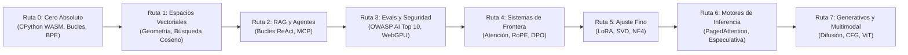

<div align="center">

<a href="https://openguideforai.dpdns.org">
  
</a>

# OpenGuide.
### Comprende la mente detrás de la máquina.

> **Un estudio soberano y nativo del navegador diseñado para desmitificar la inteligencia artificial: transformando complejas cajas negras en comprensión intuitiva y práctica mediante la ejecución directa de código.**  
> **Diseñado para cada ser curioso de la Tierra: desde un teléfono con la pantalla rota iluminado bajo una solitaria bombilla nocturna, hasta una estación de ingeniería con lector de pantalla. 100% Gratuito • Cero Facturas en la Nube • Soberano en tu Navegador.**

<p align="center">
  <a href="https://openguideforai.dpdns.org">
    
  </a>
</p>

[](../../LICENSE)
[](https://pyodide.org/)
[](#arquitectura-soberana-del-lado-del-cliente)
[](#resumen-del-curr%C3%ADculo)
[](#accesibilidad-universal-y-est%C3%A1ndares)
[](#instalaci%C3%B3n-como-aplicaci%C3%B3n-de-escritorio-y-pwa)

<p align="center">
  <b>Traducciones:</b>&nbsp;
  <a href="../../README.md">English</a> &nbsp;•&nbsp;
  <a href="README_es.md"><b>Español</b></a> &nbsp;•&nbsp;
  <a href="README_zh.md">简体中文</a> &nbsp;•&nbsp;
  <a href="README_ur.md">اردو</a> &nbsp;•&nbsp;
  <a href="README_ar.md">العربية</a> &nbsp;•&nbsp;
  <a href="README_hi.md">हिन्दी</a> &nbsp;•&nbsp;
  <a href="README_fr.md">Français</a> &nbsp;•&nbsp;
  <a href="README_de.md">Deutsch</a> &nbsp;•&nbsp;
  <a href="README_ja.md">日本語</a> &nbsp;•&nbsp;
  <a href="README_pt.md">Português</a> &nbsp;•&nbsp;
  <a href="README_ru.md">Русский</a> &nbsp;•&nbsp;
  <a href="README_it.md">Italiano</a>
</p>

---

### [Iniciar Estudio](https://openguideforai.dpdns.org) &nbsp;•&nbsp; [Arquitectura](#arquitectura-soberana-del-lado-del-cliente) &nbsp;•&nbsp; [Currículo](#resumen-del-curr%C3%ADculo) &nbsp;•&nbsp; [Explicación (STE)](../../explainer.md) &nbsp;•&nbsp; [App de Escritorio](#instalaci%C3%B3n-como-aplicaci%C3%B3n-de-escritorio-y-pwa) &nbsp;•&nbsp; [Atajos Rápidos](#ergonom%C3%ADa-y-atajos-de-teclado) &nbsp;•&nbsp; [Inicio Rápido](#gu%C3%ADa-de-desarrollo-local)

</div>

---

## Filosofía y Propósito

La mayor parte de la educación en IA actual tiene serias deficiencias. Te obliga a elegir entre:
1. **Tutoriales superficiales sobre librerías:** Enseñan APIs de caja negra que quedan obsoletas en 6 meses.
2. **Muros de matemáticas intimidantes:** Artículos académicos densos y cerrados, sin ejecución interactiva.
3. **Costosos entornos en la nube corporativos:** Requieren tarjetas de crédito, cuentas en la nube, configuraciones Docker o suscripciones de $30/mes.

**OpenGuide desmantela los tres.**

Creemos que la inteligencia artificial es una alfabetización fundamental de la civilización humana. Ya sea que programes en un **teléfono inteligente Android de $100**, un viejo Chromebook o una estación de trabajo de alta gama; ya sea que navegues con **lectores de pantalla asistivos** o un ratón físico: **OpenGuide te ofrece un laboratorio soberano de élite en tu navegador de forma gratuita.**

> *"Cada característica de OpenGuide es explicable por OpenGuide. No solo estudias matemáticas de IA; observas el flujo de tensores, diseccionas cabezales de atención en vivo, escuchas distancias coseno mediante audio armónico e inspeccionas el motor WebAssembly en vivo con el modo Rayos X (`Alt + X`)."*

---

<a id="arquitectura-soberana-del-lado-del-cliente"></a>
## Arquitectura Soberana del Lado del Cliente

OpenGuide opera bajo la **Regla de los $0**. **No hay servidor backend**. **No hay base de datos rastreándote**. El 100% del cómputo se ejecuta dentro de tu navegador web local:

```
┌────────────────────────────────────────────────────────────────────────┐
│               TU ENTORNO LOCAL AISLADO EN EL NAVEGADOR                 │
│                                                                        │
│  ┌─────────────────────────┐         ┌──────────────────────────────┐  │
│  │   INTERFAZ Y NAVEGACIÓN │         │    WEB WORKER EN SEGUNDO PLANO│ │
│  │   • React 18 + Vite     │         │   • CPython 3.12 (Pyodide)   │  │
│  │   • 24 Temas Calibrados │ ◄─────► │   • Matemáticas Vectoriales  │  │
│  │   • Scroll Suave Lenis  │         │   • Watchdog de 15s          │  │
│  │   • Editor CodeMirror 6 │         │   • Simulador Standby JS Puro│  │
│  └────────────┬────────────┘         └──────────────┬───────────────┘  │
│               │                                     │                  │
│  ┌────────────▼────────────┐         ┌──────────────▼───────────────┐  │
│  │   ESPACIAL Y NEURONAL   │         │    PERSISTENCIA SOBERANA     │  │
│  │   • Three.js WebGL / XR │         │   • IndexedDB vía Dexie      │  │
│  │   • Sintetizador Armónico│        │   • Copia Cifrada AES-GCM    │  │
│  │   • WebGPU en Navegador │         │   • Firma Verificable W3C    │  │
│  └─────────────────────────┘         └──────────────────────────────┘  │
└────────────────────────────────────────────────────────────────────────┘
```

---

<a id="resumen-del-curr%C3%ADculo"></a>
## Resumen del Currículo

Ocho rutas rigurosas de nivel de producción que constan de **57 laboratorios interactivos y ejecutables**:



| Ruta | Labs | Modelo Mental Central | Proyecto Final Destacado |
|:---|:---:|:---|:---|
| **Ruta 0: Cero Absoluto** | 9 | Sintaxis de Python mediante analogías claras de cocina y mapas | Tokenizador Byte-Pair Encoding (BPE) desde cero |
| **Ruta 1: Espacios Vectoriales** | 9 | Geometría espacial, productos punto y densidad semántica | `SemanticSearchEngine` en memoria que indexa documentos |
| **Ruta 2: RAG y Agentes** | 9 | Máquinas de estados Pensamiento $\rightarrow$ Acción $\rightarrow$ Observación y esquemas MCP | Agente de Investigación Autónomo con razonamiento multietapa |
| **Ruta 3: Evaluaciones y Guardas** | 9 | Red-teaming adversario, defensa contra inyección de prompts y métricas | Arnés de evaluación sintético con inferencia WebGPU en navegador |
| **Ruta 4: Sistemas de Frontera** | 9 | $\text{Softmax}(QK^T/\sqrt{d_k})V$, memoria de KV-cache, RoPE y LoRA | Disección de Cabezal de Atención Transformer y Motor de Pérdida DPO |
| **Ruta 5: Ajuste Fino y LoRA** | 6 | Adaptación de bajo rango, truncamiento SVD y cuantización NF4 | Motor de Fusión Dinámica de Pesos LoRA sin Sobrecarga |
| **Ruta 6: Motores de Inferencia** | 3 | Rendimiento de servicio, roofline de ancho de banda y muestreo especulativo | Simulador de Paginación Virtual PagedAttention |
| **Ruta 7: Modelos Generativos y Multimodales** | 3 | Difusión directa con ruido, campos de vectores CFG y parches de imagen ViT | Proyector Lineal de Parches de Vision Transformer |

---

## Continuo Universal de IA para Toda la Humanidad

OpenGuide no está diseñado para una élite reducida. Está diseñado para todo el espectro humano: desde personas sin conocimientos de programación hasta investigadores y arquitectos de modelos de frontera:

| Etapa y Perfil | Contexto en el Mundo Real | Lo que Ofrece OpenGuide |
|---|---|---|
| **Etapa 0: Aprendiz Curioso y Personas sin Código** | Primer contacto con la IA. Abrumado por tecnicismos y muros de pago. | Modelos mentales en lenguaje sencillo ("Tú eres un LLM"), las 3 Reglas de Oro del Prompting (Rol + Contexto + Formato) y claridad de presupuesto de $0. |
| **Etapa 1: Oficios y Profesiones Prácticas** | Mecánicos de automóviles, zapateros, carpinteros, estilistas, chefs, fontaneros. | IA Cotidiana en Acción: diagnósticos prácticos, generadores de presupuestos para clientes, calculadoras de materiales y flujos de taller. |
| **Etapa 2: Profesionales de Conocimiento y Servicios** | Médicos, profesores, contables, investigadores jurídicos, agricultores. | Plantillas estructuradas de prompts, extracción de datos tabulares, guías de estudio sintéticas y privacidad local absoluta. |
| **Etapa 3: Desarrolladores de Sistemas Aplicados** | Ingenieros de software que construyen aplicaciones con LLMs y agentes. | Ejecución real de Python en el navegador, tokenización, esquemas JSON-RPC y envío de herramientas con Model Context Protocol (MCP). |
| **Etapa 4: Arquitectos de Seguridad y Evaluación de IA** | Ingenieros de fiabilidad que blindan modelos en producción. | Defensa OWASP AI Top 10, sandboxes de delimitadores para inyecciones de prompts, filtros de PII y bancos de evaluación automatizados. |
| **Etapa 5: Investigadores y Constructores de Modelos de Frontera** | Especialistas que profundizan en arquitectura generativa. | Atención scaled dot-product desde cero, cinemática de KV-cache, cuantización uniforme INT8 y pérdida cerrada de DPO. |

---

## Autocalificadores Inmanipulables de Doble Fase

Cada uno de los **57 laboratorios del currículo** de OpenGuide está protegido por un arnés de autocalificación de doble fase:
1. **Fase 1 (Desafío Visible):** Valida tipos de retorno, formas de matrices y sintaxis estructural contra ejemplos base.
2. **Fase 2 (Invariantes Matemáticos Ocultos):** Evalúa la solución del estudiante contra cinco invariantes matemáticos ocultos por laboratorio: desigualdades de Cauchy-Schwarz, escalado de varianza, simetría métrica, vectores de prueba dinámicos y casos límite.
3. **Tasa de Eliminación en Pruebas de Mutación:** Sometido a una suite automatizada de pruebas de mutación sobre 171 mutantes adversarios, logrando una **Tasa de Eliminación del 100.0% (171/171 mutantes eliminados)** sin falsos positivos.

---

<a id="instalaci%C3%B3n-como-aplicaci%C3%B3n-de-escritorio-y-pwa"></a>
## Instalación como Aplicación de Escritorio y PWA

OpenGuide está diseñado como una **Aplicación Web Progresiva Instalable (PWA)** con integración nativa con la ventana del sistema operativo:

* **Windows (10 / 11):** Visita [https://openguideforai.dpdns.org](https://openguideforai.dpdns.org) en Chrome, Edge o Brave. Haz clic en el icono de **Instalar OpenGuide** en la barra de direcciones. Crea automáticamente un acceso directo en tu Escritorio y Menú Inicio.
* **macOS:** En Chrome/Brave/Edge, haz clic en **Instalar** en la barra de navegación; en Safari, haz clic en **Archivo** $\rightarrow$ **Añadir al Dock**.
* **Linux:** Instalable desde Chromium o Chrome; crea automáticamente un archivo `.desktop` en el lanzador de aplicaciones.
* **Móviles (Android e iOS):** En Android, pulsa **Instalar aplicación**; en iOS Safari, pulsa **Compartir** $\rightarrow$ **Añadir a pantalla de inicio**.
* **Ejecución Desconectada (Air-Gapped):** Gracias a la caché del Service Worker (`sw.js`), todos los contenidos, el motor WebAssembly Pyodide y los módulos visuales se almacenan en tu dispositivo. Puedes desconectarte por completo y seguir ejecutando Python sin conexión.

---

<a id="ergonom%C3%ADa-y-atajos-de-teclado"></a>
## Ergonomía y Atajos de Teclado

* **Paleta de Comandos (`Cmd + K` / `Ctrl + K`):** Búsqueda difusa instantánea de laboratorios, herramientas y temas.
* **Ejecución Inmediata:** Pulsa `Ctrl + Enter` (o `Cmd + Enter` en Mac) para ejecutar código Python al instante.
* **Doctor de Sintaxis Amigable:** Traduce errores crípticos de compilador en consejos prácticos en lenguaje claro.
* **Exportación a Jupyter Notebook (`.ipynb`):** Descarga tus soluciones verificadas como notebooks estándar de Jupyter.
* **Lente de Depuración Rayos X (`Alt + X`):** Inspecciona el árbol sintáctico (AST), la memoria del Web Worker y las tablas de IndexedDB en tiempo real.
* **Sincronización en Gist Cifrada:** Exporta tu progreso con cifrado **AES-GCM de 256 bits** a tus Gists privados de GitHub.

---

<a id="accesibilidad-universal-y-est%C3%A1ndares"></a>
## Accesibilidad Universal y Estándares

* **24 Temas Científicos Calibrados:** 12 oscuros y 12 claros diseñados para preservar el ritmo circadiano, con contraste superior a WCAG 2.2 AAA (>7:1 hasta 20:1).
* **Compatible con Lectores de Pantalla:** Regiones activas ARIA (`aria-live="polite"`), navegación accesible por teclado y enlaces de salto directo.
* **Compatibilidad RTL Completa:** Interfaces completamente reflejadas en **urdu** y **árabe**, protegiendo la dirección LTR en bloques de código.

---

<a id="autor%C3%ADa-y-patrocinio"></a>
## Autoría y Patrocinio

OpenGuide fue concebido, diseñado y construido por **Adil Rafiq Dar (ARD)**.

```
                    UNA NOTA SOBRE SOBERANÍA Y SOSTENIBILIDAD
"Construí OpenGuide porque estaba cansado de ver mentes brillantes excluidas de la inteligencia
artificial debido a bootcamps de pago, costosas suscripciones en la nube y barreras elitistas.

Cada línea de este estudio fue forjada con incontables noches de trabajo, pruebas matemáticas
rigurosas y una dedicación inflexible al detalle visual. OpenGuide es mi regalo para el mundo.

Para mantener este estudio 100% gratuito, siempre independiente y continuamente actualizado
con los últimos protocolos de IA de frontera sin incluir anuncios ni inversores privados,
confío en la generosidad de estudiantes y patrocinadores que creen en la educación democratizada."
```

Si OpenGuide te ha ayudado a comprender la IA, te ha ahorrado dinero o ha impulsado tu carrera profesional, considera apoyar su desarrollo independiente:

<div align="center">

[](https://github.com/sponsors/openguideforai)
&nbsp;&nbsp;
[](https://ko-fi.com/buymegoodcoffee)
&nbsp;&nbsp;
[](https://paypal.me/buymegoodcoffee)

</div>

---

<a id="gu%C3%ADa-de-desarrollo-local"></a>
## Guía de Desarrollo Local

```bash
git clone https://github.com/openguideforai/OpenGuideForAI.git
cd OpenGuideForAI
corepack enable
yarn install
yarn --cwd apps/web dev
```
Abre `http://localhost:5173` en tu navegador.

---

## Puerta de Garantía de Calidad

Cada contribución debe superar la verificación de cinco puntos antes de fusionarse:
```bash
# 1. Verificación del linter (0 advertencias, 0 errores en el código)
yarn lint

# 2. Suite de pruebas automatizadas con Playwright (100% de éxito en todas las suites de regresión)
yarn --cwd apps/web test:e2e

# 3. Compilación estática de producción (0 errores de TypeScript/Vite)
yarn --cwd apps/web build
```

---

## Documentación Técnica y Referencias

* **[Historial de Versiones (Changelog)](../../CHANGELOG.md):** Lanzamientos cronológicos y evolución del sistema.
* **[Explicación del Sistema ASD-STE100](../../explainer.md):** Especificación técnica detallada en inglés técnico simplificado.
* **[Arquitectura del Sistema](../../ARCHITECTURE.md):** Análisis profundo de Web Workers, WebGPU y persistencia local.
* **[Especificaciones del Currículo](../CURRICULUM.md):** Syllabus y objetivos de los 57 laboratorios interactivos.
* **[Dossier de Auditoría Externa y Control de Calidad](../EXTERNAL-AUDIT-QA-DOSSIER.md):** Fundamentación arquitectónica, matrices de invariantes y guía de reproducción.

