<div align="center">

<a href="https://openguideforai.dpdns.org">
  
</a>

# OpenGuide.
### Comprendre l'esprit derrière la machine.

> **Un studio souverain, conçu nativement pour le navigateur afin de démystifier l'intelligence artificielle — transformant les boîtes noires complexes en une compréhension intuitive et pratique grâce à l'exécution de code réel.**  
> **Façonné pour chaque esprit curieux sur Terre — d'un téléphone à l'écran fissuré brillant sous une ampoule nocturne isolée, à une station d'ingénierie équipée d'un lecteur d'écran. 100% Gratuit • Zéro Facture Cloud • Souverain dans Votre Navigateur.**

<p align="center">
  <a href="https://openguideforai.dpdns.org">
    
  </a>
</p>

[](../../LICENSE)
[](https://pyodide.org/)
[](../../explainer.md)
[](#parcours-dapprentissage-doubles)
[](#conception-universelle-et-accessibilit%C3%A9)
[](#installation-sur-bureau-et-application-mobile-pwa)

<p align="center">
  <b>Traductions / Multilingual Editions:</b>&nbsp;
  <a href="../../README.md">English</a> &nbsp;•&nbsp;
  <a href="README_es.md">Español</a> &nbsp;•&nbsp;
  <a href="README_zh.md">简体中文</a> &nbsp;•&nbsp;
  <a href="README_ur.md">اردو</a> &nbsp;•&nbsp;
  <a href="README_ar.md">العربية</a> &nbsp;•&nbsp;
  <a href="README_hi.md">हिन्दी</a> &nbsp;•&nbsp;
  <a href="README_fr.md"><b>Français</b></a> &nbsp;•&nbsp;
  <a href="README_de.md">Deutsch</a> &nbsp;•&nbsp;
  <a href="README_ja.md">日本語</a> &nbsp;•&nbsp;
  <a href="README_pt.md">Português</a> &nbsp;•&nbsp;
  <a href="README_ru.md">Русский</a> &nbsp;•&nbsp;
  <a href="README_it.md">Italiano</a>
</p>

---

### [Lancer le Studio](https://openguideforai.dpdns.org) &nbsp;•&nbsp; [L'Expérience](#ce-que-vous-exp%C3%A9rimentez) &nbsp;•&nbsp; [Parcours Doubles](#parcours-dapprentissage-doubles) &nbsp;•&nbsp; [Auto-Évaluateurs](#auto-%C3%A9valuateurs-inviolables-%C3%A0-double-phase) &nbsp;•&nbsp; [Banque de Connaissances](#banque-de-connaissances-souveraine-hors-ligne-et-mentor-bluee) &nbsp;•&nbsp; [Accessibilité](#conception-universelle-et-accessibilit%C3%A9) &nbsp;•&nbsp; [Explication STE](../../explainer.md) &nbsp;•&nbsp; [Démarrage Rapide](#d%C3%A9marrage-en-60-secondes)

</div>

---

## Ce que Vous Expérimentez

OpenGuide n'est ni un simple service cloud ni une suite de tutoriels simplistes. C'est un laboratoire souverain natif du navigateur dans lequel vous déconstruisez, examinez et comprenez l'intelligence artificielle grâce à l'exécution de code réel.

| Pilier Fondateur | Ce qui se Passe à l'Intérieur | Pourquoi C'est Déterminant |
|---|---|---|
| **Éducation Pure** | Apprenez les mathématiques authentiques : codez des tokeniseurs BPE, des produits scalaires et des têtes d'attention à partir de zéro. | Vous forgez une compréhension conceptuelle pérenne au lieu de mémoriser des bibliothèques éphémères. |
| **Exécution Instantanée** | Un véritable CPython 3.12 s'exécute dans votre navigateur via WebAssembly (Pyodide v0.26) dans un Web Worker dédié. | Zéro configuration. Pas besoin d'installer Python, Anaconda ou des conteneurs Docker sur votre machine. |
| **Parcours d'Apprentissage Doubles** | Basculez naturellement entre l'ingénierie mathématique profonde et la construction d'applications de production complètes. | Idéal pour les chercheurs théoriques comme pour les créateurs de logiciels, sans aucune perte de progression. |
| **Souverain et Privé** | Calculs 100% côté client. Vos données sont persistées localement dans l'IndexedDB de votre navigateur. Zéro télémétrie. | Confidentialité totale. Zéro abonnement. Zéro facture cloud imprévue (Règle des 0 $). |
| **PWA et Connaissances Hors-Ligne** | L'application Web progressive met en cache l'ensemble du cursus, le moteur CPython et 250 sujets d'IA avec code exécutable. | Coder, expérimenter et apprendre n'importe où sur Terre, même sans aucune connexion Internet. |
| **Visuels Spatiaux Interactifs** | Des variétés 3D accélérées par GPU (Three.js) et des représentations WebXR transposent les tenseurs en coordonnées tangibles. | Visualisez, manipulez et intériorisez les espaces d'embeddings et les graphes neuronaux. |

> 📖 **Spécification Technique Approfondie :** Pour explorer l'architecture système complète, les canaux de communication, le superviseur watchdog de 15 secondes et la divulgation progressive, consultez l'[Explication Technique ASD-STE100](../../explainer.md).

---

## Parcours d'Apprentissage Doubles

OpenGuide propose deux parcours d'apprentissage synchronisés de niveau mondial, conçus pour s'adapter à votre niveau et vos objectifs. Basculez librement entre eux à tout moment depuis la barre supérieure grâce au menu déroulant interactif du sélecteur de parcours (comprenant un quiz de recommandation interactif pour vous orienter), chaque parcours conservant sa progression de manière indépendante :

### Parcours A : Ingénieur IA en Profondeur (Parcours 0–7 • 57 Laboratoires)
*Intuition mathématique profonde, exécution WebAssembly avec CPython 3.12 et mécanismes des modèles de pointe depuis le zéro absolu.*

```mermaid
graph LR
    T0["Parcours 0: Fondations<br/>(CPython WASM, Boucles, BPE)"]
    T1["Parcours 1: Espaces Vectoriels<br/>(Embeddings, Recherche Cosinus)"]
    T2["Parcours 2: Agents & RAG<br/>(Boucles ReAct, FastMCP)"]
    T3["Parcours 3: Évals & Sécurité<br/>(OWASP AI Top 10, WebGPU)"]
    T4["Parcours 4: Systèmes Frontières<br/>(Self-Attention, RoPE, DPO)"]
    T5["Parcours 5: Fine-Tuning<br/>(LoRA, SVD, NF4 Bins)"]
    T6["Parcours 6: Moteurs d'Inférence<br/>(Pagination KV, Spéculatif)"]
    T7["Parcours 7: Modèles Génératifs<br/>(Diffusion, CFG, ViT)"]

    T0 --> T1 --> T2 --> T3 --> T4 --> T5 --> T6 --> T7
```



| Parcours | Labs | Principe Fondateur | Projet Capstone Final |
|:---|:---:|:---|:---|
| **Parcours 0 : Zéro Absolu** | 9 | Syntaxe Python enseignée par des métaphores intuitives du quotidien | Tokeniseur Byte-Pair Encoding (BPE) codé de zéro |
| **Parcours 1 : Espaces Vectoriels** | 9 | Géométrie en haute dimension, produits scalaires et densité sémantique | `SemanticSearchEngine` en mémoire indexant des documents |
| **Parcours 2 : RAG & Agents** | 9 | Machines à états Pensée $\rightarrow$ Action $\rightarrow$ Observation et protocole MCP | Agent de recherche autonome avec raisonnement à étapes multiples |
| **Parcours 3 : Évaluations & Garde-Fous** | 9 | Red-teaming adversaire, injection de prompts et protocoles de sûreté | Banc d'essai d'évaluation synthétique avec inférence WebGPU |
| **Parcours 4 : Systèmes Frontières** | 9 | Attention scaled dot-product, cinématique du KV-cache et RoPE | Dissection de Tête d'Attention Transformer & Moteur de Perte DPO |
| **Parcours 5 : Fine-Tuning & LoRA** | 6 | Adaptation efficace de bas rang, troncature SVD et quantification NF4 | Moteur de Fusion Dynamique de Poids LoRA sans Surcoût |
| **Parcours 6 : Moteurs d'Inférence** | 3 | Débit de service élevé, pagination KV et décodage spéculatif | Simulateur de Pagination Virtuelle PagedAttention |
| **Parcours 7 : Multimodal & Diffusion** | 3 | Bruitage par diffusion avant, vecteurs de guidage CFG et patchs ViT | Projecteur Linéaire de Patchs Vision Transformer |

---

### Parcours B : La Voie des Bâtisseurs (Parcours B0–B7 • 24 Modules / 48 Jalons)
*Ingénierie de l'IA Déployée en Première Ligne (Forward Deployed AI Engineering) : Construisez de vrais logiciels de production à l'aide de spécifications sans ambiguïté, de bacs à sable et de workflows agentiques.*


| Parcours Bâtisseur | Modules | Règle d'Or d'Ingénierie | Laboratoire Interactif |
|:---|:---:|:---|:---|
| **Parcours B0 : Énoncez (Say It)** | 3 | Du néant à votre premier écran interactif en 3 phrases | **Lab Prompt-to-Preview :** Rendu isolé en iframe |
| **Parcours B1 : Spécifiez (Spec It)** | 3 | Rédaction de spécifications techniques limpides sans hallucinations | **Lab Spec Studio :** Auto-évaluateur à grille de 5 critères |
| **Parcours B2 : Vérifiez (Verify It)** | 3 | Lecture experte des diffs de code et détection des failles de sécurité | **Lab Diff Reader :** Audit visuel de diffs et risques de sécurité |
| **Parcours B3 : Connectez (Connect It)** | 3 | Persistance locale côté client (Dexie IndexedDB) et points d'accès | **Atelier de Stockage :** Modélisation de schémas local-first |
| **Parcours B4 : Ancrez (Ground It)** | 3 | Constitutions de contexte (`AGENTS.md`), garde-fous et évaluateurs | **Lab Harness Studio :** Évaluation des performances de bout en bout |
| **Parcours B5 : Déployez (Ship It)** | 3 | Déploiement souverain à 0 $ : GitHub Actions, Cloudflare Pages | **Déployeur de Pipelines :** Configuration de livraison continue |
| **Parcours B6 : Sécurisez (Harden It)** | 3 | Modélisation des menaces, hygiène des secrets et scans pré-commit | **Bac à Sable Sécurité :** Prévention totale des fuites de clés |
| **Parcours B7 : Prouvez (Prove It)** | 3 | Soutenance d'architecture, portfolio et certification capstone | **Soutenance Capstone :** Vérification cryptographique SHA-256 |

---

## Auto-Évaluateurs Inviolables à Double Phase

Chacun des **57 laboratoires du cursus** d'OpenGuide est protégé par un harnais d'auto-évaluation rigoureux à double phase :
1. **Phase 1 (Défi Visible) :** Vérifie les types de retour, les dimensions de tenseurs et la syntaxe par rapport aux cas témoins.
2. **Phase 2 (Invariants Mathématiques Cachés) :** Évalue les implémentations face à 5 invariants mathématiques secrets par lab : inégalité de Cauchy-Schwarz, variance d'échelle, symétrie métrique et cas limites.
3. **Taux d'Élimination en Test de Mutation :** Éprouvé par une suite de tests de mutation automatisée face à 171 mutants adverses, affichant un **Taux d'Élimination de 100,0% (171/171 mutants détruits)** sans aucun faux positif.

---

## Banque de Connaissances Souveraine Hors-Ligne et Mentor Bluee

OpenGuide embarque une base de connaissances d'ingénierie intégrée côté client, sans aucune dépendance cloud externe (Règle des 0 $) :
- **250 Sujets Clés et Métiers Concrets :** Couverture exhaustive de la mécanique d'attention (FlashAttention-2/3, PagedAttention/vLLM, MLA), de l'alignement et de l'optimisation (DPO, KTO, ORPO, LoRA, QLoRA), des géométries vectorielles (HNSW, ColBERT), du décodage contraint, de la quantification (FP8, INT8, AWQ, BitNet b1.58), des architectures multimodales (ViT, CLIP) et des applications pratiques pour 17+ métiers réels.
- **Moteur de Recherche Probabiliste Okapi BM25 :** Modèle de classement ($k_1=1.2, b=0.75$) avec fréquence inverse de document lissée et pondération multicritère.
- **Pont Linguistique Instantané :** Réponses instantanées synchronisées à travers 12 langues majeures (français, anglais, espagnol, hindi, chinois, allemand, arabe, russe, japonais, ourdou, portugais, italien).
- **Cartes Visuelles Explicatives Interactives :** Micro-widgets sans dépendance (curseur de température Softmax, allocation de blocs mémoire PagedAttention, cadran angulaire de similarité cosinus, rotation de phase RoPE) directement intégrés dans les cartes de connaissances.
- **Extraits Python / NumPy Exécutables :** Chaque fiche technique comprend un script Python complet et autonome qui tourne localement dans le moteur WebAssembly Pyodide.

---

## Continuum Humain Universel de l'IA

OpenGuide n'a pas été conçu pour une caste d'initiés. Il s'adresse à l'ensemble du spectre de la curiosité humaine — de la personne qui n'a jamais codé de sa vie aux chercheurs et architectes de modèles d'avant-garde :

| Palier & Profil | Contexte dans le Monde Réel | Ce qu'Apporte OpenGuide |
|---|---|---|
| **Palier 0 : Débutant Curieux & Non-Codeur** | Premier contact avec l'IA. Débordé par le jargon et les péages d'abonnement. | Modèles mentaux vulgarisés (« Vous êtes un LLM »), les 3 Règles d'Or du Prompting (Rôle + Contexte + Format) et clarté du budget 0 $. |
| **Palier 1 : Métiers Manuels & Artisanat de Terrain** | Mécaniciens automobiles, cordonniers, menuisiers, coiffeurs, chefs cuisiniers, plombiers. | L'IA concrète en action : diagnostics d'atelier, générateurs de devis clients, calculateurs de matériaux et procédures de travail. |
| **Palier 2 : Professionnels du Savoir & du Conseil** | Médecins, enseignants, comptables, juristes, agronomes. | Modèles de prompts structurés, extraction de tableaux de données, guides d'apprentissage et confidentialité absolue sur la machine. |
| **Palier 3 : Développeurs de Systèmes Appliqués** | Ingénieurs logiciels intégrant des LLMs et des agents dans des applications. | Vraie exécution Python dans le navigateur, tokenisation, schémas JSON-RPC et orchestration d'outils via le protocole MCP. |
| **Palier 4 : Architectes de Sécurité & d'Évaluation IA** | Ingénieurs fiabilisant et blindant les modèles déployés en production. | Défenses contre le Top 10 OWASP AI, bacs à sable d'isolation contre les injections de prompts, filtres PII et harnais d'évaluation automatisés. |
| **Palier 5 : Chercheurs & Architectes Modèles de Pointe** | Spécialistes plongeant dans les fondations mathématiques de l'apprentissage génératif. | Attention scaled dot-product de zéro, cinématique du cache KV, quantification INT8 uniforme et perte fermée DPO. |

---

## Conception Universelle et Accessibilité

* **24 Thèmes Calibrés à Haut Contraste :** 12 thèmes sombres et 12 thèmes clairs conformes aux **normes internationales WCAG 2.2 AAA** (ratios de contraste supérieurs à 7:1 jusqu'à 20:1) pour le confort visuel et la lecture diurne.
* **12 Langues Mondiales Intégrées :** Typographie soignée avec ligatures Nastaliq authentiques (**ourdou**), calligraphie arabe, devanagari (**hindi**), sinogrammes et kanjis (**chinois**, **japonais**) et alphabets latins et cyrilliques (**anglais**, **espagnol**, **français**, **allemand**, **portugais**, **russe**, **italien**).
* **Certifié pour Lecteurs d'Écran :** Régions d'annonces ARIA dynamiques (`aria-live="polite"`), pièges de focus accessibles dans les fenêtres modales et repères de navigation fluides.
* **Support Bidirectionnel RTL Complet :** Disposition d'interface entièrement inversée pour l'arabe et l'ourdou, tout en préservant l'alignement naturel de gauche à droite pour les blocs de code informatique.
* **Préservation Dynamique du Texte :** Ajustement automatique de la hauteur de ligne pour éviter les collisions visuelles de diacritiques en devanagari et en écritures orientales.
* **Ergonomie Universelle Mobile et Bureau :** Moteur de focus clavier visible WCAG 2.2 AAA (`:focus-visible` halo d'accentuation de 2px) avec isolation de l'éditeur CodeMirror, équilibrage typographique des titres (`text-wrap: balance`), prévention du zoom automatique sur iOS, défilement fluide à 120Hz et fenêtres modales en tiroirs responsifs.

---

## Plan d'Ingénierie IA Déployée en Première Ligne (FDE)

OpenGuide intègre un guide interactif d'**Ingénierie IA Déployée en Première Ligne (FDE)** accessible directement depuis la barre de navigation ou via la Palette de Commandes (`Cmd + K` / `Ctrl + K`) :
- **Matrice Comparative des Rôles et Systèmes :** Compare les codeurs informels, les ingénieurs logiciels traditionnels, les chercheurs purs en IA et les ingénieurs FDE sur 6 dimensions clés.
- **Guides de Configuration des IDEs Agentiques :** Protocoles d'installation, commandes terminal et bonnes pratiques pour Google Antigravity IDE, Anthropic Claude Code CLI, et OpenAI Codex & Cursor.
- **Stack Souveraine à 0 $ :** Plan d'architecture complet associant GitHub Actions CI, le réseau Cloudflare Pages, PostgreSQL serverless Neon, CPython WebAssembly et Hugging Face Spaces.
- **Hygiène Absolue des Secrets :** Isolation des clés en mémoire (BYOK), scanners automatisés avant validation (pre-commit) et fichiers modèles `.env.example`.
- **Règles de Gouvernance du Répertoire :** Chartes techniques unifiées et synchronisées (`AGENTS.md`, `CLAUDE.md`, `ARCHITECTURE.md`, `CHANGELOG.md`).

---

## Architecture Souveraine Côté Client (Règle des 0 $)

OpenGuide fonctionne sous la **Règle des 0 $**. **Aucun serveur backend**. **Aucune base de données ne collecte vos données**. 100% des calculs s'exécutent au sein de votre navigateur web local :

```
┌────────────────────────────────────────────────────────────────────────┐
│                   VOTRE BAC À SABLE LOCAL DANS LE NAVIGATEUR           │
│                                                                        │
│  ┌─────────────────────────┐         ┌──────────────────────────────┐  │
│  │   INTERFACE ET ACCUEIL  │         │     WEB WORKER EN ARRIÈRE-PLAN│ │
│  │   • React 18 + Vite     │         │   • CPython 3.12 (Pyodide)   │  │
│  │   • 24 Thèmes Calibrés  │ ◄─────► │   • Calculs Vectoriels NumPy │  │
│  │   • Défilement Lenis    │         │   • Watchdog de Sécurité 15s │  │
│  │   • Éditeur CodeMirror 6│         │   • Moteur de Secours Pure-JS│  │
│  └────────────┬────────────┘         └──────────────┬───────────────┘  │
│               │                                     │                  │
│  ┌────────────▼────────────┐         ┌──────────────▼───────────────┐  │
│  │    SPATIAL ET NEURONAL  │         │     PERSISTANCE SOUVERAINE   │  │
│  │   • Three.js WebGL / XR │         │   • IndexedDB via Dexie      │  │
│  │   • Sonification Audio  │         │   • Sauvegarde Chiffrée Gist │  │
│  │   • Moteur WebGPU Local │         │   • Signature W3C Vérifiable │  │
│  └─────────────────────────┘         └──────────────────────────────┘  │
└────────────────────────────────────────────────────────────────────────┘
```

---

## Holodeck Spatial 3D et Extensions Matérielles

Capacité interactive de pointe, OpenGuide intègre un Holodeck d'informatique spatiale 3D WebXR / WebGL dans le navigateur (`/holodeck`) et l'accélération matérielle :

* **Variétés Vectorielles Fluides à 60FPS Soutenus :** Visualisation Three.js en temps réel d'espaces vectoriels 3D, de groupements sémantiques et de graphes neuronaux synaptiques avec mémoire tampon préallouée et mise en pause automatique hors écran.
* **Audio Spatial Harmonique Binaural :** Moteur audio Web Audio API générant des harmonies musicales proportionnelles à la similarité cosinus vectorielle.
* **Mode Lunettes AR à Passthrough Optique Noir Pur :** Coupure d'émission `#000000` éteignant les pixels OLED sur les guides d'ondes optiques pour un affichage HUD transparent ultra-net sur Viture, Xreal, RayNeo, Rokid, Meta Quest et Apple Vision Pro.
* **Clavier Spatial Virtuel :** Clavier virtuel utilisable en suspension dans l'air ou ancré sur le bureau pour une exploration immersive complète.

---

## Démarrage en 60 Secondes

### Lancer dans le Navigateur (Aucune Installation)
Rendez-vous sur **[https://openguideforai.dpdns.org](https://openguideforai.dpdns.org)** et cliquez sur **Lancer le Parcours 0** ou **Démarrer en tant que Bâtisseur**. Le moteur WebAssembly s'initialise sur votre machine en moins d'une seconde.

### Lancer Localement via Git
```bash
# 1. Activer Corepack et cloner le dépôt
corepack enable
git clone https://github.com/openguideforai/OpenGuideForAI.git
cd OpenGuideForAI

# 2. Installer les dépendances et démarrer le serveur de développement
yarn install
yarn dev
```
Ouvrez `http://localhost:5173` dans votre navigateur.

#### Tests sur Réseau Local (Mobiles / Tablettes)
Pour tester l'application sur un smartphone ou une tablette connectés à votre réseau local :
```bash
yarn dev --host
```

---

## Installation sur Bureau et Application Mobile PWA

OpenGuide fonctionne comme une **Application Web Progressive (PWA) Installable** avec une intégration fluide aux fenêtres du système :

* **Windows (10 / 11) :** Dans Chrome ou Edge, cliquez sur l'icône **Installer l'application** dans la barre d'adresse pour créer un raccourci direct sur le bureau et le menu Démarrer.
* **macOS :** Dans Safari, sélectionnez **Fichier** $\rightarrow$ **Ajouter au Dock** ; ou cliquez sur **Installer** dans Chrome/Edge.
* **Linux :** Cliquez sur **Installer** dans Chromium ou Chrome pour créer automatiquement un fichier `.desktop` dans votre lanceur d'applications.
* **iOS / Android :** Dans Safari iOS, touchez **Partager** $\rightarrow$ **Sur l'écran d'accueil** ; sur Android, touchez **Installer l'application**.
* **Mode Hors-Ligne Total (Air-Gapped) :** Le Service Worker stocke localement toutes les leçons, les modules 3D et le moteur WebAssembly. Vous pouvez étudier en avion, en train ou dans des zones reculées sans aucune connexion réseau.

---

## Raccourcis Clavier et Ergonomie

| Raccourci | Outil Activé | Action Effectuée |
|---|:---:|---|
| **`Cmd + K` / `Ctrl + K`** | Palette de Commandes | Recherche floue instantanée dans les 57 laboratoires, 24 thèmes, 12 langues et outils. |
| **`Ctrl + Enter`** | Lanceur de Code | Compile et exécute instantanément le code Python actif dans le Web Worker. |
| **`Alt + X`** | Lentille Rayons X | Inspection en temps réel de la mémoire WebAssembly, de l'arbre AST et des tables IndexedDB. |
| **`Alt + S`** | HUD Spatial | Active ou désactive le HUD 3-DoF flottant, les angles de cardan et le mode noir pur pour lunettes AR. |
| **Bandeau Tactile** | Éditeur Mobile | Saisie rapide à une touche des symboles de code fréquents (`Tab`, `:`, `( )`, `[ ]`, `def`, `assert`). |
| **Export `.ipynb`** | Créateur de Notebooks | Télécharge les exercices validés sous forme de notebooks Jupyter standard (nbformat 4.5). |
| **Harmoniques Audio** | Holodeck 3D | Convertit la similarité cosinus vectorielle en accords musicaux harmonieux. |

---

## Portail d'Assurance Qualité (Suite Pré-Vol en 5 Points)

Chaque modification doit impérativement valider le contrôle de qualité en 5 points avant d'être intégrée :
```bash
# 1. Test de disponibilité du serveur local (HTTP 200 OK)
(Invoke-WebRequest http://localhost:5173).StatusCode == 200

# 2. Vérification automatisée par navigateur sans tête (0 erreur console)
# Validé via les tests automatisés Playwright

# 3. Linter statique du code source (0 erreur)
yarn lint

# 4. Suite complète de tests de non-régression (100% de réussite sur les 20 fichiers spec)
npx playwright test --config apps/web/playwright.config.ts

# 5. Compilation statique de production (0 erreur TypeScript/Vite)
yarn --cwd apps/web build
```

---

## Auteur et Intendance

OpenGuide a été conçu, architecturé et construit par **Adil Rafiq Dar (ARD)**.

```
                   UNE DÉCLARATION SUR L'ÉDUCATION SOUVERAINE
"J'ai créé OpenGuide avec la conviction inébranlable que le savoir sur l'intelligence
artificielle doit appartenir à toute l'humanité. Il ne doit pas être confisqué par des abonnements
cloud coûteux, des monopoles industriels ou un élitisme académique inaccessible.

Chaque composant de ce studio a été forgé à travers d'innombrables heures de travail, des tests
mathématiques rigoureux et une exigence sans compromis sur l'expérience utilisateur. OpenGuide
est un don ouvert au monde.

Pour préserver ce studio 100% gratuit, indépendant et constamment aligné sur les avancées de pointe,
sans publicité ni financement privé conditionné, je serai toujours honoré par le soutien des apprenants
et mécènes qui partagent cette vision."
```

Soutenir le développement ouvert et indépendant :

<div align="center">

[](https://github.com/sponsors/openguideforai)
&nbsp;&nbsp;
[](https://ko-fi.com/buymegoodcoffee)
&nbsp;&nbsp;
[](https://paypal.me/buymegoodcoffee)

<br/>

<sub>Vos contributions financent l'hébergement du domaine, l'infrastructure d'intégration continue et l'expansion du cursus libre.</sub>

</div>

---

## Documentation Technique et Références

* **[Historique des Versions (Changelog)](../../CHANGELOG.md) :** Registre chronologique des livraisons et de l'évolution architecturale.
* **[Explication du Système ASD-STE100](../../explainer.md) :** Spécification technique complète couvrant la communication avec les Web Workers, les limites mémoire et la divulgation progressive.
* **[Architecture Détaillée du Système](../../ARCHITECTURE.md) :** Analyse approfondie des magasins réactifs, des Web Workers et des pipelines de calcul WebGPU.
* **[Spécifications du Programme Pédagogique](../CURRICULUM.md) :** Syllabus complet et objectifs des 57 laboratoires (8 parcours).
* **[Dossier d'Audit Technique Externe & Assurance Qualité](../EXTERNAL-AUDIT-QA-DOSSIER.md) :** Fondations d'architecture, matrices d'invariants et protocole de vérification indépendante.
* **[Rapport d'Audit Qualité Tiers](../AUDIT_QA.md) :** Rapport d'audit qualité multiplateforme et de conformité de production.

<div align="center">
  <sub>Conçu et réalisé par Adil Rafiq Dar (ARD). Distribué sous licences AGPL-3.0 et CC BY-NC-SA 4.0.</sub>
</div>
