<div align="center">

<a href="https://openguideforai.dpdns.org">
  
</a>

# OpenGuide.
### Comprendre l'esprit derrière la machine.

> **Un studio souverain, conçu nativement pour le navigateur afin de démystifier l'intelligence artificielle — transformant les boîtes noires complexes en une compréhension intuitive et pratique grâce à l'exécution de code réel.**  
> **Façonné pour chaque esprit curieux sur Terre — d'un téléphone à l'écran fissuré brillant sous une ampoule nocturne isolée, à une station d'ingénierie équipée d'un lecteur d'écran. 100% Gratuit • Zéro Facture Cloud • Souverain dans Votre Navigateur.**

<p align="center">
  <a href="https://openguideforai.dpdns.org">
    
  </a>
</p>

[](../../LICENSE)
[](https://pyodide.org/)
[](#architecture-souveraine-c%C3%B4t%C3%A9-client)
[](#vue-densemble-du-programme)
[](#accessibilit%C3%A9-universelle-et-normes)
[](#installation-sur-bureau-et-application-pwa)

<p align="center">
  <b>Traductions / Translations:</b>&nbsp;
  <a href="../../README.md">English</a> &nbsp;•&nbsp;
  <a href="README_es.md">Español</a> &nbsp;•&nbsp;
  <a href="README_zh.md">简体中文</a> &nbsp;•&nbsp;
  <a href="README_ur.md">اردو</a> &nbsp;•&nbsp;
  <a href="README_ar.md">العربية</a> &nbsp;•&nbsp;
  <a href="README_hi.md">हिन्दी</a> &nbsp;•&nbsp;
  <a href="README_fr.md"><b>Français</b></a> &nbsp;•&nbsp;
  <a href="README_de.md">Deutsch</a> &nbsp;•&nbsp;
  <a href="README_ja.md">日本語</a> &nbsp;•&nbsp;
  <a href="README_pt.md">Português</a> &nbsp;•&nbsp;
  <a href="README_ru.md">Русский</a> &nbsp;•&nbsp;
  <a href="README_it.md">Italiano</a>
</p>

---

### [Lancer le Studio](https://openguideforai.dpdns.org) &nbsp;•&nbsp; [Architecture](#architecture-souveraine-c%C3%B4t%C3%A9-client) &nbsp;•&nbsp; [Programme](#vue-densemble-du-programme) &nbsp;•&nbsp; [Explication (STE)](../../explainer.md) &nbsp;•&nbsp; [Application Bureau](#installation-sur-bureau-et-application-pwa) &nbsp;•&nbsp; [Raccourcis Clavier](#ergonomie-et-raccourcis-clavier) &nbsp;•&nbsp; [Démarrage Local](#guide-de-d%C3%A9veloppement-local)

</div>

---

## Philosophie et Mission

La majorité de l'éducation en IA aujourd'hui est défaillante. Elle vous enferme dans l'une de ces impasses :
1. **Les tutoriels superficiels d'API :** Ils enseignent des boîtes noires qui deviennent obsolètes en 6 mois.
2. **Les barrières mathématiques austères :** Des publications denses et théoriques sans aucune pratique interactive.
3. **Les environnements cloud payants et fermés :** Exigeant cartes de crédit, comptes cloud, conteneurs Docker ou abonnements à 30 $/mois.

**OpenGuide élimine ces trois obstacles.**

Nous croyons que l'intelligence artificielle est une compétence fondamentale de la civilisation humaine. Que vous codiez sur un **smartphone Android à 100 $**, un vieux Chromebook ou une station d'ingénierie de pointe ; que vous utilisiez un **lecteur d'écran d'assistance** ou une souris : **OpenGuide met à votre disposition un laboratoire d'élite souverain directement dans votre navigateur, gratuitement.**

> *"Chaque fonctionnalité d'OpenGuide est expliquée par OpenGuide lui-même. Vous n'étudiez pas seulement les mathématiques de l'IA ; vous observez l'écoulement des tenseurs, disséquez les têtes d'attention en temps réel, écoutez les distances cosinus grâce à une synthèse harmonique et inspectez la mémoire WebAssembly avec le mode Rayons X (`Alt + X`)."*

---

<a id="architecture-souveraine-c%C3%B4t%C3%A9-client"></a>
## Architecture Souveraine Côté Client

OpenGuide fonctionne sous la **Règle des 0 $**. **Aucun serveur backend**. **Aucune base de données ne collecte vos données**. 100% des calculs s'exécutent au sein de votre navigateur web local :

```
┌────────────────────────────────────────────────────────────────────────┐
│                   VOTRE BAC À SABLE LOCAL DANS LE NAVIGATEUR           │
│                                                                        │
│  ┌─────────────────────────┐         ┌──────────────────────────────┐  │
│  │   INTERFACE ET ACCUEIL  │         │     WEB WORKER EN ARRIÈRE-PLAN│ │
│  │   • React 18 + Vite     │         │   • CPython 3.12 (Pyodide)   │  │
│  │   • 24 Thèmes Calibrés  │ ◄─────► │   • Calculs Vectoriels NumPy │  │
│  │   • Défilement Lenis    │         │   • Watchdog de Sécurité 15s │  │
│  │   • Éditeur CodeMirror 6│         │   • Moteur de Secours Pure-JS│  │
│  └────────────┬────────────┘         └──────────────┬───────────────┘  │
│               │                                     │                  │
│  ┌────────────▼────────────┐         ┌──────────────▼───────────────┐  │
│  │    SPATIAL ET NEURONAL  │         │     PERSISTANCE SOUVERAINE   │  │
│  │   • Three.js WebGL / XR │         │   • IndexedDB via Dexie      │  │
│  │   • Sonification Audio  │         │   • Sauvegarde Chiffrée Gist │  │
│  │   • Moteur WebGPU Local │         │   • Signature W3C Vérifiable │  │
│  └─────────────────────────┘         └──────────────────────────────┘  │
└────────────────────────────────────────────────────────────────────────┘
```

---

## Holodeck Spatial sur Lunettes AR Intelligentes (Spatial Holodeck)

OpenGuide intègre un Holodeck d'informatique spatiale 3D WebXR / WebGL directement dans le navigateur (`/holodeck`), optimisé pour les lunettes AR à vision optique transparente (Viture Pro 2, Xreal Air 2 Ultra, RayNeo Air 2s, Rokid Max 2, Meta Quest 3/3S et Apple Vision Pro) :

* **Moteur 60FPS Soutenu sans Ralentissement :** Visualisation Three.js en temps réel des variétés vectorielles 3D, du clustering sémantique et des graphes synaptiques neuronaux.
* **Passthrough Optique OLED Noir Pur (True-Black) :** Mode étalonné `#000000` éteignant les pixels OLED sur les guides d'ondes optiques pour une incrustation spatiale nette au-dessus de votre environnement physique.
* **Audio Spatial Harmonique Binaural :** Synthèse d'accords musicaux harmoniques proportionnels à la similarité cosinus vectorielle via l'API Web Audio.
* **Clavier Spatial Virtuel et Suivi de Tête :** Clavier flottant avec retour haptique et acoustique, et émulation des capteurs de tête 3-DoF.
* **Matrice de Matériel pour Lunettes AR :** Guide interactif et profils de calibrage pour SpaceWalker, Nebula et MyGlasses avec réglage IPD et taux de rafraîchissement 120Hz.

---

<a id="vue-densemble-du-programme"></a>
## Vue d'Ensemble du Programme

Huit parcours d'apprentissage rigoureux comprenant **57 laboratoires interactifs directement exécutables** :

```mermaid
graph LR
    T0["Parcours 0: Zéro Absolu<br/>(CPython WASM, Boucles, BPE)"]
    T1["Parcours 1: Espaces Vectoriels<br/>(Géométrie, Cosinus)"]
    T2["Parcours 2: RAG et Agents<br/>(Boucles ReAct, MCP)"]
    T3["Parcours 3: Évals et Sécurité<br/>(OWASP AI Top 10, WebGPU)"]
    T4["Parcours 4: Systèmes Frontières<br/>(Attention, RoPE, DPO)"]
    T5["Parcours 5: Fine-Tuning<br/>(LoRA, SVD, NF4)"]
    T6["Parcours 6: Moteurs d'Inférence<br/>(PagedAttention, Spéculatif)"]
    T7["Parcours 7: Modèles Génératifs<br/>(Diffusion, CFG, ViT)"]

    T0 --> T1 --> T2 --> T3 --> T4 --> T5 --> T6 --> T7
```



| Parcours | Labs | Modèle Mental Clé | Projet Final d'Élite |
|:---|:---:|:---|:---|
| **Parcours 0: Zéro Absolu** | 9 | Syntaxe Python par des métaphores intuitives de cuisine et de cartes | Création complète d'un tokenizer Byte-Pair Encoding (BPE) |
| **Parcours 1: Espaces Vectoriels** | 9 | Géométrie spatiale, produits scalaires et densité sémantique | Moteur `SemanticSearchEngine` en mémoire indexant des documents |
| **Parcours 2: RAG et Agents** | 9 | Automates Pensée $\rightarrow$ Action $\rightarrow$ Observation et schémas MCP | Agent de Recherche Scientifique Autonome avec raisonnement multi-sauts |
| **Parcours 3: Évaluations et Gardes**| 9 | Red-teaming contradictoire, défenses contre l'injection de prompts | Système d'évaluation synthétique avec inférence WebGPU locale |
| **Parcours 4: Systèmes Frontières** | 9 | $\text{Softmax}(QK^T/\sqrt{d_k})V$, gestion de mémoire KV-cache, RoPE | Dissection de Tête d'Attention Transformer et Moteur de Perte DPO |
| **Parcours 5: Fine-Tuning et LoRA**| 6 | Adaptation de bas rang, troncature SVD et quantification NF4 | Moteur de Fusion de Poids LoRA à Surcoût Nul |
| **Parcours 6: Moteurs d'Inférence**| 3 | Débit de calcul, roofline de bande passante et décodage spéculatif | Simulateur de Pagination Virtuelle PagedAttention |
| **Parcours 7: Multimodal et Diffusion**| 3 | Processus de bruitage direct, vecteur CFG et patchs d'image | Projecteur Linéaire de Patchs Vision Transformer |

---

## Continuum Universel de l'IA pour Toute l'Humanité

OpenGuide n'est pas réservé à une élite fermée. Il est conçu pour couvrir l'intégralité du spectre humain — des personnes n'ayant jamais écrit une ligne de code jusqu'aux chercheurs et concepteurs de modèles d'avant-garde :

| Étape et Profil | Contexte Réel | Ce qu'Apporte OpenGuide |
|---|---|---|
| **Étape 0 : Apprenant Curieux et Non-Codeur** | Premier contact avec l'IA. Dépassé par le jargon et les abonnements payants. | Modèles mentaux clairs ("Vous Êtes un LLM"), les 3 Règles d'Or du Prompting (Rôle + Contexte + Format) et garantie de budget $0. |
| **Étape 1 : Métiers et Métiers Manuels** | Mécaniciens automobiles, cordonniers, menuisiers, coiffeurs, chefs, plombiers. | L'IA du Quotidien en Action : diagnostics pratiques, devis automatiques pour clients, calculs de matériaux et flux d'atelier. |
| **Étape 2 : Professionnels des Services et du Savoir** | Médecins, enseignants, comptables, juristes, agriculteurs. | Modèles de prompts structurés, extraction de données tabulaires, synthèses d'apprentissage et respect absolu de la vie privée. |
| **Étape 3 : Développeurs de Systèmes Appliqués** | Développeurs concevant des applications avec des LLM et des agents. | Exécution réelle de Python dans le navigateur, tokenisation, schémas JSON-RPC et dispatch d'outils Model Context Protocol (MCP). |
| **Étape 4 : Architectes en Sécurité et Évaluation d'IA** | Ingénieurs en fiabilité sécurisant des modèles en production. | Défense OWASP AI Top 10, bacs à sable contre l'injection de prompts, nettoyage des données PII et bancs d'évaluation automatisés. |
| **Étape 5 : Chercheurs et Créateurs de Modèles d'Avant-Garde** | Spécialistes approfondissant les architectures génératives. | Attention scaled dot-product de zéro, cinématique de mémoire KV-cache, quantification uniforme INT8 et perte mathématique DPO. |

---

## Autocalibrateurs Indétournables à Double Phase

Chacun des **57 laboratoires du cursus** d'OpenGuide est protégé par un système de validation à double phase :
1. **Phase 1 (Défi Visible) :** Vérifie les types de retour, les formes de tenseurs et la syntaxe par rapport aux exemples de référence.
2. **Phase 2 (Invariants Mathématiques Masqués) :** Évalue la solution de l'élève par rapport à cinq invariants mathématiques masqués par laboratoire : inégalités de Cauchy-Schwarz, mise à l'échelle de la variance, symétrie métrique, vecteurs de test dynamiques et cas limites.
3. **Taux d'Élimination en Tests de Mutation :** Éprouvé par une suite automatisée de 171 mutants adverses, atteignant un **Taux d'Élimination de 100,0 % (171/171 mutants éliminés)** sans faux positifs.

---

<a id="installation-sur-bureau-et-application-pwa"></a>
## Installation sur Bureau et Application PWA

OpenGuide est conçu comme une **Application Web Progressive Installable (PWA)** parfaitement intégrée à votre système d'exploitation :

* **Windows (10 / 11) :** Dans Chrome ou Edge, cliquez sur le bouton **Installer OpenGuide** dans la barre d'adresse pour générer un raccourci direct sur le Bureau et dans le menu Démarrer.
* **macOS :** Dans Safari, cliquez sur **Fichier** $\rightarrow$ **Ajouter au Dock** ; ou installez via Chrome/Edge pour un fonctionnement natif avec `Cmd + Space`.
* **Mobile (Android et iOS) :** Sélectionnez **Ajouter à l'écran d'accueil** pour un lancement plein écran sans barre d'URL.
* **Exécution 100% Hors-Ligne (Air-Gapped) :** Grâce au cache du Service Worker (`sw.js`), tous les modules, les graphismes 3D et le moteur Pyodide sont stockés sur votre machine. Vous pouvez coder dans le train ou en avion sans aucune connexion internet.

---

<a id="ergonomie-et-raccourcis-clavier"></a>
## Ergonomie et Raccourcis Clavier

* **Palette de Commandes (`Cmd + K` / `Ctrl + K`) :** Recherche instantanée dans tous les laboratoires, outils et thèmes.
* **Exécution Rapide (`Ctrl + Enter`) :** Exécutez le code Python directement depuis l'éditeur.
* **Docteur de Syntaxe Bienveillant :** Traduit les erreurs de compilation complexes en explications claires et en conseils pratiques.
* **Exportation Jupyter Notebook (`.ipynb`) :** Téléchargez vos exercices résolus sous forme de notebooks Jupyter standards.
* **Lentille de Débogage Rayons X (`Alt + X`) :** Inspectez la mémoire du Web Worker et les données locales en temps réel.
* **HUD Spatial pour Lunettes AR (`Alt + S`) :** Activez le HUD spatial flottant 3-DoF, les angles de cardan et le mode passthrough noir pur.
* **Synchronisation Gist Chiffrée :** Sauvegardez votre progression avec un chiffrement sécurisé **AES-GCM 256 bits** sur votre compte GitHub.

---

<a id="accessibilit%C3%A9-universelle-et-normes"></a>
## Accessibilité Universelle et Normes

* **24 Thèmes Scientifiques Calibrés :** 12 thèmes sombres et 12 thèmes clairs respectant scrupuleusement la norme WCAG 2.2 AAA (>7:1 jusqu'à 20:1).
* **Compatible Lecteurs d'Écran :** Régions d'annonces vocales dynamiques (`aria-live="polite"`).
* **Prise en Charge RTL Complète :** Mise en page inversée pour l'arabe et l'ourdou, tout en conservant l'orientation LTR pour les blocs de code informatique.

---

<a id="auteur-et-m%C3%A9c%C3%A9nat"></a>
## Auteur et Mécénat

OpenGuide a été imaginé, conçu et entièrement développé par **Adil Rafiq Dar (ARD)**.

```
                  UN MESSAGE SUR LA SOUVERAINETÉ ET L'INDEPENDANCE
"J'ai créé OpenGuide parce que j'en avais assez de voir des esprits brillants exclus
de l'intelligence artificielle en raison de formations hors de prix, d'abonnements cloud coûteux
et de barrières élitistes.

Chaque ligne de ce studio est le fruit d'innombrables nuits blanches, de tests mathématiques rigoureux
et d'une exigence esthétique sans compromis. OpenGuide est mon cadeau au monde entier.

Pour que ce studio reste toujours 100% gratuit, indépendant et constamment à jour sans jamais
intégrer de publicité ni d'investisseurs privés, j'accueille avec gratitude le soutien des apprenants
et mécènes qui croient en une éducation ouverte pour tous."
```

Si OpenGuide vous a aidé à comprendre l'IA ou a soutenu votre carrière d'ingénieur, vous pouvez soutenir son développement indépendant :

<div align="center">

[](https://github.com/sponsors/openguideforai)
&nbsp;&nbsp;
[](https://ko-fi.com/buymegoodcoffee)
&nbsp;&nbsp;
[](https://paypal.me/buymegoodcoffee)

</div>

---

<a id="guide-de-d%C3%A9veloppement-local"></a>
## Guide de Développement Local

```bash
git clone https://github.com/openguideforai/OpenGuideForAI.git
cd OpenGuideForAI
corepack enable
yarn install
yarn --cwd apps/web dev
```
Ouvrez `http://localhost:5173` dans votre navigateur.

---

## Porte d'Assurance Qualité

Chaque contribution doit valider le contrôle en cinq points avant d'être intégrée :
```bash
# 1. Vérification par le linter (0 avertissement, 0 erreur sur l'ensemble du code)
yarn lint

# 2. Suite de tests automatisés Playwright (100% de succès sur toutes les suites de régression)
yarn --cwd apps/web test:e2e

# 3. Compilation statique de production (0 erreur TypeScript/Vite)
yarn --cwd apps/web build
```

---

## Documentation Technique et Références

* **[Journal des Modifications (Changelog)](../../CHANGELOG.md) :** Versions chronologiques et évolutions de l'architecture.
* **[Spécification Système ASD-STE100](../../explainer.md) :** Description complète en anglais technique simplifié.
* **[Architecture Système](../../ARCHITECTURE.md) :** Analyse approfondie des Web Workers, de WebGPU et de la persistance locale.
* **[Spécifications Pédagogiques](../CURRICULUM.md) :** Programme détaillé et objectifs des 57 laboratoires interactifs.
* **[Dossier d'Audit Technique Externe et Assurance Qualité](../EXTERNAL-AUDIT-QA-DOSSIER.md) :** Fondements architecturaux, matrices d'invariants et guide de reproduction indépendant.

