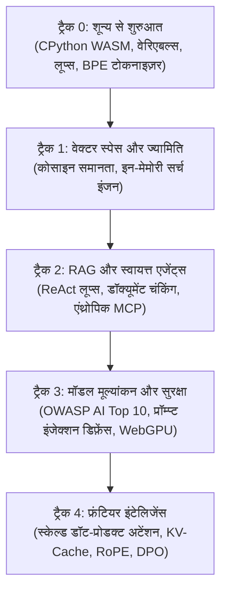

<div align="center">

<a href="https://openguideforai.dpdns.org">
  
</a>

# OpenGuide.
### मशीन के पीछे के मस्तिष्क को समझें।

> **ब्राउज़र के भीतर चलने वाला एक स्वायत्त स्टूडियो, जिसे कृत्रिम बुद्धिमत्ता (AI) के रहस्यों को सुलझाने के लिए तैयार किया गया है—जटिल ब्लैक बॉक्स को वास्तविक कोड निष्पादन के माध्यम से सहज और स्पष्ट समझ में बदलना।**  
> **धरती पर सीखने की चाह रखने वाले हर इंसान के लिए निर्मित—देर रात एक अकेले बल्ब के नीचे टूटी स्क्रीन वाले फोन से लेकर स्क्रीन रीडर वाले इंजीनियरिंग वर्कस्टेशन तक। 100% निःशुल्क • कोई क्लाउड बिल नहीं • आपके ब्राउज़र में पूरी तरह स्वतंत्र।**

<p align="center">
  <a href="https://openguideforai.dpdns.org">
    
  </a>
</p>

[](../../LICENSE)
[](https://pyodide.org/)
[](#संप्रभु-क्लाइंट-साइड-वास्तुकला)
[](#पाठ्यक्रम-का-संक्षिप्त-विवरण)
[](#सार्वभौमिक-सुलभता-और-मानक)
[](#डेस्कटॉप-और-पीडब्लूए-ऐप-इंस्टॉलेशन)

<p align="center">
  <b>भाषाएं / Translations:</b>&nbsp;
  <a href="../../README.md">English</a> &nbsp;•&nbsp;
  <a href="README_es.md">Español</a> &nbsp;•&nbsp;
  <a href="README_zh.md">简体中文</a> &nbsp;•&nbsp;
  <a href="README_ur.md">اردو</a> &nbsp;•&nbsp;
  <a href="README_ar.md">العربية</a> &nbsp;•&nbsp;
  <a href="README_hi.md"><b>हिन्दी</b></a> &nbsp;•&nbsp;
  <a href="README_fr.md">Français</a> &nbsp;•&nbsp;
  <a href="README_de.md">Deutsch</a> &nbsp;•&nbsp;
  <a href="README_ja.md">日本語</a> &nbsp;•&nbsp;
  <a href="README_pt.md">Português</a> &nbsp;•&nbsp;
  <a href="README_ru.md">Русский</a> &nbsp;•&nbsp;
  <a href="README_it.md">Italiano</a>
</p>

---

### [स्टूडियो शुरू करें](https://openguideforai.dpdns.org) &nbsp;•&nbsp; [आर्किटेक्चर](#संप्रभु-क्लाइंट-साइड-वास्तुकला) &nbsp;•&nbsp; [पाठ्यक्रम](#पाठ्यक्रम-का-संक्षिप्त-विवरण) &nbsp;•&nbsp; [सरल व्याख्या](../../explainer.md) &nbsp;•&nbsp; [डेस्कटॉप ऐप](#डेस्कटॉप-और-पीडब्लूए-ऐप-इंस्टॉलेशन) &nbsp;•&nbsp; [शॉर्टकट कीज़](#सुगमता-और-कीबोर्ड-शॉर्टकट्स) &nbsp;•&nbsp; [लोकल रन करें](#लोकल-डेवलपमेंट-शुरुआत)

</div>

---

## दर्शन और उद्देश्य

वर्तमान में अधिकांश एआई शिक्षा में गंभीर कमियां हैं। यह आपको तीन में से किसी एक चक्रव्यूह में फंसाती है:
1. **सतही रैपर ट्यूटोरियल्स:** ऐसे ब्लैक-बॉक्स इंटरफेस सिखाना जो 6 महीने में पुराने पड़ जाते हैं।
2. **डराने वाली गणितीय दीवारें:** जटिल शोध पत्र जिनमें कोई इंटरैक्टिव कोडिंग अभ्यास नहीं होता।
3. **महंगे क्लाउड सैंडबॉक्स:** क्रेडिट कार्ड, क्लाउड अकाउंट, डॉकर या $30/माह के सब्सक्रिप्शन की मांग।

**OpenGuide इन तीनों सीमाओं को समाप्त करता है।**

हमारा विश्वास है कि कृत्रिम बुद्धिमत्ता मानव सभ्यता की बुनियादी साक्षरता है। चाहे आप **$100 के बजट एंड्रॉइड फोन** पर कोड कर रहे हों, किसी पुराने लैपटॉप पर, या अत्याधुनिक वर्कस्टेशन पर; चाहे आप स्क्रीन रीडर इस्तेमाल करते हों या माउस: **OpenGuide आपके ब्राउज़र में एक संप्रभु, विश्वस्तरीय प्रयोगशाला मुफ़्त में उपलब्ध कराता है।**

> *"OpenGuide का प्रत्येक फ़ीचर OpenGuide द्वारा ही समझाया गया है। यहां आप केवल गणित नहीं पढ़ते; आप टेंसरों का प्रवाह देखते हैं, लाइव अटेंशन हेड्स का विश्लेषण करते हैं, ध्वनियों के माध्यम से कोसाइन दूरी सुनते हैं, और एक्स-रे मोड (`Alt + X`) से अपने डिवाइस में वेबअसेंबली मेमोरी का निरीक्षण करते हैं।"*

---

<a id="संप्रभु-क्लाइंट-साइड-वास्तुकला"></a>
## संप्रभु क्लाइंट-साइड वास्तुकला

OpenGuide **$0 नियम** के तहत संचालित होता है। **कोई बैकएंड सर्वर नहीं है**, और **कोई डेटाबेस आपका डेटा ट्रैक नहीं करता**। 100% कंप्यूटेशन सीधे आपके स्थानीय वेब ब्राउज़र में सुरक्षित रूप से चलता है:

```
┌────────────────────────────────────────────────────────────────────────┐
│                   आपका सुरक्षित स्थानीय ब्राउज़र सैंडबॉक्स             │
│                                                                        │
│  ┌─────────────────────────┐         ┌──────────────────────────────┐  │
│  │    यूजर इंटरफ़ेस        │         │      बैकग्राउंड वेब वर्कर    │  │
│  │   • React 18 + Vite     │         │   • CPython 3.12 (Pyodide)   │  │
│  │   • 24 वैज्ञानिक थीम्स  │ ◄─────► │   • NumPy वेक्टर गणित        │  │
│  │   • सहज लेनिस स्क्रॉलिंग│         │   • 15 सेकंड वॉचडॉग सुरक्षा  │  │
│  │   • कोडमिरर 6 संपादक   │         │   • बिना क्रैश बैकअप इंजन    │  │
│  └────────────┬────────────┘         └──────────────┬───────────────┘  │
│               │                                     │                  │
│  ┌────────────▼────────────┐         ┌──────────────▼───────────────┐  │
│  │     3D और न्यूरल इंजन   │         │     लोकल-फर्स्ट डेटा स्टोरेज │  │
│  │   • Three.js WebGL / XR │         │   • Dexie आधारित IndexedDB   │  │
│  │   • हार्मोनिक ऑडियो ध्वनि│        │   • AES-GCM 256 एन्क्रिप्शन  │  │
│  │   • इन-ब्राउज़र WebGPU  │         │   • W3C डिजिटल सर्टिफिकेट   │  │
│  └─────────────────────────┘         └──────────────────────────────┘  │
└────────────────────────────────────────────────────────────────────────┘
```

---

<a id="पाठ्यक्रम-का-संक्षिप्त-विवरण"></a>
## पाठ्यक्रम का संक्षिप्त विवरण

5 संपूर्ण और कठोर ट्रैक्स, जिनमें **45 इंटरैक्टिव और सीधे चलने वाले लैब्स** शामिल हैं:



| ट्रैक | लैब्स | मुख्य वैचारिक मॉडल | मुख्य फाइनल प्रोजेक्ट |
|:---|:---:|:---|:---|
| **ट्रैक 0: शून्य से शुरुआत** | 9 | वास्तविक जीवन के रसोई और मानचित्र के उदाहरणों से पायथन | अपना खुद का Byte-Pair Encoding (BPE) टोकनाइज़र बनाएं |
| **ट्रैक 1: वेक्टर स्पेस** | 9 | बहु-आयामी ज्यामिति, डॉट प्रोडक्ट्स और अर्थगत समानता | मेमोरी में चलने वाला संपूर्ण `SemanticSearchEngine` |
| **ट्रैक 2: RAG और एजेंट्स** | 9 | विचार $\rightarrow$ क्रिया $\rightarrow$ अवलोकन स्टेट मशीन और MCP | स्वायत्त अनुसंधान एजेंट जो बहु-चरणीय तर्क कर सके |
| **ट्रैक 3: सुरक्षा और मूल्यांकन**| 9 | मॉडल रेड-टीमिंग, प्रॉम्प्ट सुरक्षा और प्रदर्शन मेट्रिक्स | स्वचालित सिंथेटिक मूल्यांकन प्रणाली और WebGPU रनटाइम |
| **ट्रैक 4: फ्रंटियर सिस्टम्स** | 9 | $\text{Softmax}(QK^T/\sqrt{d_k})V$, मेमोरी गणित, RoPE | ट्रांसफॉर्मर अटेंशन हेड डिसेक्शन और DPO लॉस इंजन |

---

## संपूर्ण मानव जाति के लिए सार्वभौमिक AI सातत्य (Universal AI Continuum)

OpenGuide किसी संकीर्ण तकनीकी वर्ग के लिए नहीं, बल्कि पूरी मानवता के सीखने के लिए डिज़ाइन किया गया है — बिना कोडिंग अनुभव वाले आम लोगों से लेकर फ्रंटियर AI शोधकर्ताओं तक:

| चरण और प्रोफ़ाइल | वास्तविक जीवन का संदर्भ | OpenGuide क्या प्रदान करता है |
|---|---|---|
| **चरण 0: जिज्ञासु नौसिखिया और सामान्य नागरिक** | AI से पहला परिचय। जटिल शब्दावली और महंगे सब्सक्रिप्शन से मुक्त। | सरल मानसिक मॉडल ("आप एक LLM हैं"), प्रॉम्प्टिंग के 3 स्वर्णिम नियम (भूमिका + संदर्भ + प्रारूप), और ₹0 बजट स्पष्टता। |
| **चरण 1: वास्तविक दुनिया के कारीगर और हुनरमंद** | ऑटो मैकेनिक, मोची, बढ़ई, हेयर स्टाइलिस्ट, रसोइये, प्लंबर। | दैनिक जीवन में व्यावहारिक AI: मरम्मत निदान, ग्राहक अनुमान जनरेटर, सामग्री कैलकुलेटर और वर्कशॉप वर्कफ़्लो। |
| **चरण 2: ज्ञान और सेवा पेशेवर** | डॉक्टर, शिक्षक, चार्टर्ड एकाउंटेंट, कानूनी शोधकर्ता, किसान। | संरचित प्रॉम्प्ट ब्लूप्रिंट, सारणीबद्ध डेटा निष्कर्षण, अध्ययन सामग्री और पूर्ण स्थानीय डेटा गोपनीयता। |
| **चरण 3: अनुप्रयोग प्रणाली डेवलपर्स** | सॉफ्टवेयर इंजीनियर जो LLMs और एजेंट्स के साथ ऐप्स बना रहे हैं। | ब्राउज़र में वास्तविक पायथन निष्पादन, टोकनाइज़ेशन, JSON-RPC स्कीमा और Model Context Protocol (MCP) टूल डिस्पैच। |
| **चरण 4: AI सुरक्षा और मूल्यांकन आर्किटेक्ट्स** | विश्वसनीयता इंजीनियर जो उत्पादन मॉडल को सुरक्षित और मजबूत करते हैं। | OWASP AI Top 10 रक्षा, प्रॉम्प्ट इंजेक्शन सैंडबॉक्स, PII डेटा स्क्रबर और स्वचालित मूल्यांकन परीक्षण। |
| **चरण 5: फ्रंटियर AI शोधकर्ता और मॉडल निर्माता** | गहन जनरेटिव मॉडल आर्किटेक्चर पर काम करने वाले विशेषज्ञ। | स्क्रैच से स्केल्ड डॉट-प्रोडक्ट अटेंशन, KV-कैश मेमोरी गतिकी, INT8 एकसमान क्वांटिज़ेशन और DPO गणितीय लॉस। |

---

## अचूक द्वि-चरणीय ऑटो-ग्रेडर (Dual-Phase Autograders)

OpenGuide की सभी **45 प्रयोगशालाएं** एक कठोर द्वि-चरणीय सत्यापन प्रणाली द्वारा संरक्षित हैं:
1. **चरण 1 (दृश्यमान चुनौती):** बेसलाइन उदाहरणों के विरुद्ध रिटर्न प्रकार, टेंसर आकार और बुनियादी सिंटैक्स को सत्यापित करता है।
2. **चरण 2 (छिपे हुए गणितीय इनवेरिएंट्स):** प्रति लैब 5 छिपे हुए गणितीय इनवेरिएंट्स के विरुद्ध छात्र के समाधान का मूल्यांकन करता है: कॉची-श्वार्ज़ असमानताएं, प्रसरण स्केलिंग, मीट्रिक समरूपता, गतिशील परीक्षण वैक्टर और सीमा स्थितियां।
3. **म्यूटेशन टेस्टिंग किल रेट:** 135 हाथ से बनाए गए त्रुटिपूर्ण म्यूटेंट्स पर परीक्षण किया गया, जिसने बिना किसी गलत पास के **100.0% म्यूटेंट किल रेट (135/135 म्यूटेंट्स समाप्त)** हासिल किया।

---

<a id="डेस्कटॉप-और-पीडब्लूए-ऐप-इंस्टॉलेशन"></a>
## डेस्कटॉप और पीडब्लूए ऐप इंस्टॉलेशन

OpenGuide एक **इंस्टॉल करने योग्य प्रोग्रेसिव वेब ऐप (PWA)** है जो आपके ऑपरेटिंग सिस्टम के साथ सहजता से जुड़ जाता है:

* **Windows (10 / 11):** Chrome या Edge के एड्रेस बार में **Install OpenGuide** आइकन पर क्लिक करें। यह डेस्कटॉप और स्टार्ट मेन्यू में शॉर्टकट बनाता है।
* **macOS:** Safari में **File** $\rightarrow$ **Add to Dock** पर क्लिक करें, या Chrome से इंस्टॉल करें।
* **Android और iOS:** ब्राउज़र मेन्यू से **Add to Home screen** चुनें।
* **बिना इंटरनेट संपूर्ण संचालन (Air-Gapped):** सर्विस वर्कर (`sw.js`) कैश की मदद से सारा कंटेंट और पायथन इंजन आपके फोन या लैपटॉप में सेव हो जाता है। आप हवाई जहाज़ में या बिना इंटरनेट के भी सभी लैब्स चला सकते हैं।

---

<a id="सुगमता-और-कीबोर्ड-शॉर्टकट्स"></a>
## सुगमता और कीबोर्ड शॉर्टकट्स

* **कमांड पैलेट (`Ctrl + K` / `Cmd + K`):** पूरे स्टूडियो में कहीं भी तुरंत सर्च करें और टूल्स खोलें।
* **त्वरित रन (`Ctrl + Enter`):** कोड एडिटर में कहीं भी रहते हुए तुरंत पायथन कोड रन करें।
* **मित्रवत सिंटैक्स डॉक्टर:** पायथन की जटिल त्रुटियों को सरल और समझने योग्य मार्गदर्शन में बदलता है।
* **Jupyter Notebook एक्सपोर्ट (`.ipynb`):** अपने हल किए गए कोड को मानक जुपिटर नोटबुक के रूप में डाउनलोड करें।
* **एक्स-रे डीबग लेंस (`Alt + X`):** मेमोरी, पार्स ट्री और डेटाबेस का रीयल-टाइम में निरीक्षण करें।
* **एन्क्रिप्टेड Gist सिंक:** अपनी प्रगति को **AES-GCM 256-bit** एन्क्रिप्शन के साथ निजी GitHub Gist में सुरक्षित करें।

---

<a id="सार्वभौमिक-सुलभता-और-मानक"></a>
## सार्वभौमिक सुलभता और मानक

* **24 वैज्ञानिक थीम्स:** 12 डार्क और 12 लाइट थीम्स जो WCAG 2.2 AAA मानकों (>7:1 से 20:1) पर पूरी तरह खरी उतरती हैं।
* **स्क्रीन रीडर सपोर्ट:** दृष्टिबाधित शिक्षार्थियों के लिए लाइव ऑडियो स्टेटस क्षेत्र (`aria-live="polite"`).
* **बहुभाषी और RTL सपोर्ट:** उर्दू और अरबी के लिए सहज लेआउट, जबकि कोड ब्लॉक हमेशा सही दिशा में रहते हैं।

---

<a id="रचनाकार-और-सहयोग"></a>
## रचनाकार और सहयोग

OpenGuide की संपूर्ण परिकल्पना, आर्किटेक्चर और निर्माण **आदिल रफ़ीक डार (Adil Rafiq Dar - ARD)** द्वारा किया गया है।

```
                    डिजिटल संप्रभुता और आत्मनिर्भरता पर एक संदेश
"मैंने OpenGuide इसलिए बनाया क्योंकि मैं प्रतिभाशाली दिमागों को महंगे बूटकैंप्स, भारी क्लाउड बिलों
और संभ्रांत पेवॉल के कारण कृत्रिम बुद्धिमत्ता सीखने से वंचित होते देखकर थक चुका था।

इस स्टूडियो की हर एक लाइन अनगिनत रातों के कड़े परिश्रम, गणितीय परीक्षणों और उत्कृष्ट विज़ुअल क्राफ्ट से
तैयार की गई है। OpenGuide दुनिया के लिए मेरा एक उपहार है।

इस स्टूडियो को हमेशा 100% मुफ़्त, स्वतंत्र और विज्ञापनों से मुक्त रखने के लिए, मैं उन सभी शिक्षार्थियों
और समर्थकों के योगदान का स्वागत करता हूँ जो सभी के लिए खुली शिक्षा में विश्वास रखते हैं।"
```

यदि OpenGuide ने आपको एआई समझने में मदद की है, तो आप स्वतंत्र विकास का समर्थन कर सकते हैं:

<div align="center">

[](https://www.paypal.com/paypalme/buymegoodcoffee/sponsor)
&nbsp;&nbsp;
[](https://ko-fi.com/buymegoodcoffee)

</div>

---

<a id="लोकल-डेवलपमेंट-शुरुआत"></a>
## लोकल डेवलपमेंट शुरुआत

```bash
git clone https://github.com/openguideforai/OpenGuideForAI.git
cd OpenGuideForAI
corepack enable
yarn install
yarn --cwd apps/web dev
```
ब्राउज़र में `http://localhost:5173` खोलें।

---

## गुणवत्ता आश्वासन गेट (Quality Assurance Gate)

प्रत्येक योगदान को मर्ज करने से पहले इस 5-बिंदु गुणवत्ता जांच को पास करना अनिवार्य है:
```bash
# 1. लिंटर सत्यापन (कोडबेस में 0 चेतावनियाँ, 0 त्रुटियां)
yarn lint

# 2. प्लेराइट स्वचालित प्रतिगमन परीक्षण सुइट (सभी परीक्षण सुइट्स में 100% सफलता)
yarn --cwd apps/web test:e2e

# 3. प्रोडक्शन स्टेटिक कंपाइलेशन (0 TypeScript/Vite त्रुटियां)
yarn --cwd apps/web build
```

---

## तकनीकी दस्तावेज़ीकरण और संदर्भ

* **[रिलीज़ चेंजलॉग (Changelog)](../../CHANGELOG.md):** ऐतिहासिक संस्करण रिलीज़ और सिस्टम विकास।
* **[ASD-STE100 सिस्टम विनिर्देश](../../explainer.md):** सरलीकृत तकनीकी अंग्रेजी में लिखा गया संपूर्ण सिस्टम विवरण।
* **[सिस्टम आर्किटेक्चर](../../ARCHITECTURE.md):** वेब वर्कर्स, WebGPU और स्थानीय स्टोरेज का गहन विश्लेषण।
* **[पाठ्यक्रम विनिर्देश](../CURRICULUM.md):** सभी 45 प्रयोगशालाओं का पाठ्यक्रम और इंजीनियरिंग परिणाम।
* **[बाहरी तकनीकी ऑडिट डॉसियर](../EXTERNAL-AUDIT-QA-DOSSIER.md):** वास्तुशिल्प आधार, इनवेरिएंट्स मैट्रिक्स और स्वतंत्र सत्यापन गाइड।

