<div align="center">

<a href="https://openguideforai.dpdns.org">
  
</a>

# OpenGuide.
### मशीन के पीछे के मस्तिष्क को समझें।

> **ब्राउज़र के भीतर चलने वाला एक स्वायत्त स्टूडियो, जिसे कृत्रिम बुद्धिमत्ता (AI) के रहस्यों को सुलझाने के लिए तैयार किया गया है—जटिल ब्लैक बॉक्स को वास्तविक कोड निष्पादन के माध्यम से सहज और स्पष्ट समझ में बदलना।**  
> **धरती पर सीखने की चाह रखने वाले हर इंसान के लिए निर्मित—देर रात एक अकेले बल्ब के नीचे टूटी स्क्रीन वाले फोन से लेकर स्क्रीन रीडर वाले इंजीनियरिंग वर्कस्टेशन तक। 100% निःशुल्क • कोई क्लाउड बिल नहीं • आपके ब्राउज़र में पूरी तरह स्वतंत्र।**

<p align="center">
  <a href="https://openguideforai.dpdns.org">
    
  </a>
</p>

[](../../LICENSE)
[](https://pyodide.org/)
[](../../explainer.md)
[](#दोहरे-शिक्षण-मार्ग)
[](#सार्वभौमिक-डिज़ाइन-और-सुलभता)
[](#डेस्कटॉप-और-मोबाइल-पीडब्लूए-ऐप-इंस्टॉलेशन)

<p align="center">
  <b>भाषाएं / Translations:</b>&nbsp;
  <a href="../../README.md">English</a> &nbsp;•&nbsp;
  <a href="README_es.md">Español</a> &nbsp;•&nbsp;
  <a href="README_zh.md">简体中文</a> &nbsp;•&nbsp;
  <a href="README_ur.md">اردو</a> &nbsp;•&nbsp;
  <a href="README_ar.md">العربية</a> &nbsp;•&nbsp;
  <a href="README_hi.md"><b>हिन्दी</b></a> &nbsp;•&nbsp;
  <a href="README_fr.md">Français</a> &nbsp;•&nbsp;
  <a href="README_de.md">Deutsch</a> &nbsp;•&nbsp;
  <a href="README_ja.md">日本語</a> &nbsp;•&nbsp;
  <a href="README_pt.md">Português</a> &nbsp;•&nbsp;
  <a href="README_ru.md">Русский</a> &nbsp;•&nbsp;
  <a href="README_it.md">Italiano</a>
</p>

---

### [स्टूडियो शुरू करें](https://openguideforai.dpdns.org) &nbsp;•&nbsp; [मुख्य अनुभव](#आप-क्या-अनुभव-करते-हैं) &nbsp;•&nbsp; [दोहरे मार्ग](#दोहरे-शिक्षण-मार्ग) &nbsp;•&nbsp; [ऑटोग्रेडर्स](#अभेद्य-द्वि-चरणीय-ऑटोग्रेडर्स) &nbsp;•&nbsp; [ज्ञान कोष](#संप्रभु-ऑफ़लाइन-ज्ञान-कोष-और-bluee-मार्गदर्शक) &nbsp;•&nbsp; [सुलभता](#सार्वभौमिक-डिज़ाइन-और-सुलभता) &nbsp;•&nbsp; [तकनीकी व्याख्या](../../explainer.md) &nbsp;•&nbsp; [त्वरित शुरुआत](#60-सेकंड-में-शुरुआत)

</div>

---

## आप क्या अनुभव करते हैं

OpenGuide कोई साधारण क्लाउड सेवा या सतही ट्यूटोरियल नहीं है। यह आपके ब्राउज़र में चलने वाली एक वास्तविक और स्वायत्त इंजीनियरिंग प्रयोगशाला है, जहाँ आप कोड चलाकर कृत्रिम बुद्धिमत्ता के आंतरिक रहस्यों को समझते और क्रियान्वित करते हैं।

| मुख्य स्तंभ | अंदर क्या घटित होता है | यह क्यों महत्वपूर्ण है |
|---|---|---|
| **शुद्ध मौलिक शिक्षा** | वास्तविक गणित सीखें: स्क्रैच से बाइट-पेयर टोकनाइज़र, वेक्टर डॉट उत्पाद और सेल्फ-अटेंशन हेड्स लिखें। | आपको स्थायी वैचारिक समझ मिलती है, न कि कुछ महीनों में पुरानी पड़ने वाली अस्थायी लाइब्रेरीज़ का रट्टा। |
| **त्वरित निष्पादन** | वास्तविक CPython 3.12 आपके ब्राउज़र के भीतर WebAssembly (Pyodide v0.26) और समर्पित वेब वर्कर द्वारा निष्पादित होता है। | शून्य सेटअप। आपके कंप्यूटर पर पायथन, एनाकोंडा या डॉकर की कोई आवश्यकता नहीं। |
| **दोहरे शिक्षण मार्ग** | गहन गणितीय मॉडल इंजीनियरिंग और व्यावहारिक फुल-स्टैक सॉफ्टवेयर निर्माण के बीच सहजता से स्विच करें। | शोधकर्ताओं और उत्पाद निर्माताओं दोनों के लिए बिना प्रगति खोए पूरी तरह अनुकूल। |
| **संप्रभु और पूर्णतः निजी** | 100% क्लाइंट-साइड कंप्यूटेशन। डेटा ब्राउज़र के स्थानीय IndexedDB में सुरक्षित रहता है। शून्य टेलीमेट्री। | पूर्ण गोपनीयता। शून्य मासिक शुल्क। अप्रत्याशित क्लाउड बिलों से मुक्ति ($0 नियम)। |
| **पीडब्लूए और ऑफ़लाइन ज्ञान** | संपूर्ण पाठ्यक्रम, पायथन इंजन और 250 फ्रंटियर एआई विषयों का संग्रह ऑफ़लाइन उपलब्ध रहता है। | दुनिया के किसी भी कोने में, बिना इंटरनेट के कोड करें, प्रयोग करें और सीखें। |
| **इंटरैक्टिव स्थानिक दृश्य** | Three.js और WebXR द्वारा त्वरित 3D विज़ुअलाइज़ेशन अमूर्त टेंसर्स को भौतिक निर्देशांकों में बदलते हैं। | आप उच्च-आयामी एम्बेडिंग्स और न्यूरल ग्राफ़ को स्वयं देखकर सहजता से समझ सकते हैं। |

> 📖 **गहन इंजीनियरिंग विनिर्देश:** संपूर्ण सिस्टम आर्किटेक्चर, 15-सेकंड वॉचडॉग सुपरवाइज़र और प्रोग्रेसिव डिस्क्लोज़र के लिए [ASD-STE100 तकनीकी व्याख्या](../../explainer.md) पढ़ें।

---

## दोहरे शिक्षण मार्ग

OpenGuide दो विश्वस्तरीय, सिंक्रनाइज़्ड शिक्षण ट्रैक्स प्रदान करता है। शीर्ष नेविगेशन बार से इंटरैक्टिव पाथवे स्विचर ड्रॉपडाउन (जिसमें सही दिशा चुनने हेतु एक इंटरैक्टिव सिफ़ारिश क्विज़ भी शामिल है) के ज़रिए आप किसी भी समय इनके बीच स्विच कर सकते हैं, और दोनों ट्रैक अपनी स्वतंत्र प्रगति सुरक्षित रखते हैं:

### मार्ग 1: डीप एआई इंजीनियर (ट्रैक 0–7 • 57 लैब्स)
*गहन गणितीय अंतर्दृष्टि, ब्राउज़र में CPython 3.12 WebAssembly का वास्तविक निष्पादन, और शून्य से फ्रंटियर मॉडल्स का निर्माण।*

```mermaid
graph LR
    T0["ट्रैक 0: आधारशिला<br/>(CPython WASM, Loops, BPE)"]
    T1["ट्रैक 1: वेक्टर स्पेस<br/>(Embeddings, Cosine Search)"]
    T2["ट्रैक 2: एजेंट्स और RAG<br/>(ReAct Loops, FastMCP)"]
    T3["ट्रैक 3: सुरक्षा और मूल्यांकन<br/>(OWASP AI Top 10, WebGPU)"]
    T4["ट्रैक 4: फ्रंटियर सिस्टम्स<br/>(Self-Attention, RoPE, DPO)"]
    T5["ट्रैक 5: फाइन-ट्यूनिंग<br/>(LoRA, SVD, NF4 Bins)"]
    T6["ट्रैक 6: इन्फेरेंस इंजन<br/>(KV Paging, Speculative)"]
    T7["ट्रैक 7: जनरेटिव मॉडल्स<br/>(Diffusion, CFG, ViT)"]

    T0 --> T1 --> T2 --> T3 --> T4 --> T5 --> T6 --> T7
```



| ट्रैक | लैब्स | मुख्य सिद्धांत | कैपस्टोन प्रमुख प्रोजेक्ट |
|:---|:---:|:---|:---|
| **ट्रैक 0: परम शून्य से शुरुआत** | 9 | रसोई और दैनिक जीवन के सादृश्यों से पायथन सिंटैक्स की गहरी समझ | स्क्रैच से Byte-Pair Encoding (BPE) टोकनाइज़र का निर्माण |
| **ट्रैक 1: वेक्टर स्पेस और खोज** | 9 | उच्च-आयामी ज्यामिति, डॉट उत्पाद और सिमेंटिक घनत्व | इन-मेमोरी `SemanticSearchEngine` जो दस्तावेज़ों को इंडेक्स करे |
| **ट्रैक 2: RAG और स्वायत्त एजेंट्स** | 9 | "विचार $\rightarrow$ क्रिया $\rightarrow$ अवलोकन" स्टेट मशीन और MCP प्रोटोकॉल | बहु-चरणीय तर्क करने वाला स्वायत्त रिसर्च एजेंट |
| **ट्रैक 3: मूल्यांकन और सुरक्षा प्राचीर** | 9 | रेड-टीमिंग, प्रॉम्प्ट इंजेक्शन से बचाव और सुरक्षा नीतियां | ब्राउज़र में WebGPU इन्फेरेंस के साथ सिंथेटिक इवैल्यूएशन हार्नेस |
| **ट्रैक 4: फ्रंटियर सिस्टम्स** | 9 | स्केल्ड डॉट-प्रोडक्ट अटेंशन, KV-cache भौतिकी और RoPE | ट्रांसफॉर्मर अटेंशन डिसेक्शन और DPO लॉस इंजन |
| **ट्रैक 5: फाइन-ट्यूनिंग और LoRA** | 6 | पैरामीटर-कुशल लो-रैंक अनुकूलन, SVD और NF4 क्वांटिज़ेशन | बिना अतिरिक्त ओवरहेड के डायनामिक LoRA वेट मर्जिंग इंजन |
| **ट्रैक 6: इन्फेरेंस इंजन** | 3 | उच्च-थ्रूपुट सर्विंग, KV पेजिंग और स्पेक्युलेटिव डिकोडिंग | PagedAttention वर्चुअल पेजिंग सिम्युलेटर |
| **ट्रैक 7: मल्टीमॉडल और डिफ्यूजन** | 3 | फॉरवर्ड डिफ्यूजन नॉइज़िंग, CFG वेक्टर्स और ViT पैच | विज़न ट्रांसफॉर्मर पैच लीनियर प्रोजेक्टर |

---

### मार्ग 2: द बिल्डर पाथ (ट्रैक B0–B7 • 24 मॉड्यूल / 48 मील के पत्थर)
*फॉरवर्ड डिप्लॉयड एआई इंजीनियरिंग (FDE): विनिर्देशों (Specs), सैंडबॉक्स और एजेंटिक वर्कफ़्लो के माध्यम से वास्तविक उत्पादन सॉफ्टवेयर का निर्माण।*

```mermaid
graph LR
    B0["ट्रैक B0: कहें<br/>(Instant Utility Studio)"]
    B1["ट्रैक B1: विनिर्देश बनाएं<br/>(Specs & Test Cases)"]
    B2["ट्रैक B2: सत्यापित करें<br/>(Diff Reading & Hazards)"]
    B3["ट्रैक B3: जोड़ें<br/>(IndexedDB & APIs)"]
    B4["ट्रैक B4: आधार दें<br/>(Context & Evals)"]
    B5["ट्रैक B5: तैनात करें<br/>($0 Sovereign Cloud)"]
    B6["ट्रैक B6: सुरक्षित करें<br/>(Red-Teaming & Secrets)"]
    B7["ट्रैक B7: सिद्ध करें<br/>(Capstone Defense)"]

    B0 --> B1 --> B2 --> B3 --> B4 --> B5 --> B6 --> B7
```



| बिल्डर ट्रैक | मॉड्यूल | मुख्य सिद्धांत | इंटरैक्टिव लैब |
|:---|:---:|:---|:---|
| **ट्रैक B0: कहें (Say It)** | 3 | केवल 3 वाक्यों के खाके से पहली कार्यशील स्क्रीन का निर्माण | **प्रॉम्प्ट-टू-प्रीव्यू लैब:** सुरक्षित सैंडबॉक्स आईफ्रेम जनरेशन |
| **ट्रैक B1: विनिर्देश बनाएं (Spec It)** | 3 | सटीक और स्पष्ट इंजीनियरिंग विनिर्देश लिखना जिन्हें मॉडल गलत न समझें | **स्पेक स्टूडियो लैब:** 5 स्वर्णिम नियमों पर आधारित ऑटोग्रेडर |
| **ट्रैक B2: सत्यापित करें (Verify It)** | 3 | कोड डिफ़्स (Diffs) का विशेषज्ञ विश्लेषण और सुरक्षा खतरों की पहचान | **डिफ़ रीडर लैब:** विज़ुअल डिफ़ और सुरक्षा जोखिम ऑडिट |
| **ट्रैक B3: जोड़ें (Connect It)** | 3 | क्लाइंट-साइड लोकल डेटा (Dexie IndexedDB) और मॉक एंडपॉइंट्स | **स्टोरेज वर्कबेंच:** लोकल-फर्स्ट डेटाबेस स्कीमा मॉडलिंग |
| **ट्रैक B4: आधार दें (Ground It)** | 3 | संदर्भ संविधान (`AGENTS.md`), सुरक्षा सीमाएं और मूल्यांकक | **हार्नेस स्टूडियो लैब:** एंड-टू-एंड टास्क मूल्यांकन |
| **ट्रैक B5: तैनात करें (Ship It)** | 3 | $0 संप्रभु स्टैक परिनियोजन: GitHub Actions और Cloudflare Pages | **पाइपलाइन डिप्लॉयर:** सतत वितरण और होस्टिंग कॉन्फ़िगरेशन |
| **ट्रैक B6: सुरक्षित करें (Harden It)** | 3 | खतरों की मॉडलिंग, सीक्रेट सुरक्षा और प्री-कमिट स्कैनर्स | **सुरक्षा सैंडबॉक्स:** शून्य कुंजी रिसाव सुरक्षा |
| **ट्रैक B7: सिद्ध करें (Prove It)** | 3 | लाइव आर्किटेक्चर रक्षा, पोर्टफोलियो प्रमाण और कैपस्टोन | **कैपस्टोन डिफेंस:** SHA-256 क्रिप्टोग्राफ़िक सत्यापन |

---

## अभेद्य द्वि-चरणीय ऑटोग्रेडर्स

OpenGuide के **सभी 57 पाठ्यक्रम लैब्स** एक कठोर द्वि-चरणीय स्वचालित मूल्यांकन प्रणाली द्वारा संरक्षित हैं:
1. **प्रथम चरण (दृश्य चुनौती):** आधारभूत उदाहरणों के विरुद्ध फ़ंक्शन रिटर्न प्रकार, मैट्रिक्स आकार और कोड सिंटैक्स की पुष्टि करता है।
2. **द्वितीय चरण (छिपे हुए गणितीय इनवेरिएंट्स):** प्रत्येक लैब के 5 छिपे गणितीय नियमों पर समाधान का परीक्षण करता है—जिसमें कॉची-श्वार्ज़ असमानता, विचरण स्केलिंग, समरूपता और चरम सीमाएं शामिल हैं।
3. **म्यूटेशन टेस्टिंग किल रेट:** 171 प्रतिकूल म्यूटेंट्स के विरुद्ध स्वचालित म्यूटेशन टेस्टिंग में **100.0% पूर्ण किल रेट (171/171 mutants killed)** प्राप्त किया, बिना किसी गलत सकारात्मक परिणाम के।

---

## संप्रभु ऑफ़लाइन ज्ञान कोष और Bluee मार्गदर्शक

OpenGuide में क्लाइंट-साइड पर एक पूर्ण इंजीनियरिंग ज्ञान कोष अंतर्निहित है, जिसमें शून्य क्लाउड निर्भरता है ($0 नियम):
- **250 कोर फ्रंटियर और व्यावसायिक विषय:** ट्रांसफॉर्मर अटेंशन (FlashAttention-2/3, PagedAttention/vLLM, MLA), अलाइनमेंट और ऑप्टिमाइज़ेशन (DPO, KTO, ORPO, LoRA, QLoRA), वेक्टर ज्यामिति (HNSW, ColBERT, कोसाइन स्किप-लिस्ट), स्ट्रक्चर्ड डिकोडिंग, क्वांटिज़ेशन (FP8, INT8, AWQ, BitNet b1.58), मल्टीमॉडल आर्किटेक्चर (ViT, CLIP), और 17+ पारंपरिक व्यवसायों के व्यावहारिक समाधान।
- **ओकापी BM25 सर्च इंजन:** संभाव्यता रैंकिंग इंजन ($k_1=1.2, b=0.75$) जिसमें स्मूथ इन्वर्स डॉक्यूमेंट फ्रीक्वेंसी और मल्टी-फ़ील्ड वेटिंग शामिल है।
- **बहुभाषी सेतु:** दुनिया की 12 भाषाओं (हिन्दी, अंग्रेज़ी, स्पैनिश, चीनी, फ़्रेंच, जर्मन, अरबी, रूसी, जापानी, उर्दू, पुर्तगाली, इतालवी) में त्वरित परिणाम।
- **इंटरैक्टिव विज़ुअल कार्ड्स:** बिना किसी लाइब्रेरी के चलने वाले माइक्रो-विगेट्स (सॉफ्टमैक्स तापमान स्लाइडर, PagedAttention ब्लॉक आवंटन, कोसाइन समानता डायल, RoPE फेज़र रोटेशन) सीधे ज्ञान कार्ड्स में एम्बेडेड हैं।
- **निष्पादन योग्य पायथन कोड:** प्रत्येक तकनीकी विषय के साथ एक संपूर्ण, स्वतंत्र पायथन कोड शामिल है जो ब्राउज़र में तुरंत चलता है।

---

## समस्त मानवता के लिए एआई सातत्य (Continuum)

OpenGuide किसी सीमित वर्ग के लिए नहीं है। यह मानव ज्ञान के पूरे स्पेक्ट्रम के लिए बनाया गया है—शुरुआती शिक्षार्थियों से लेकर फ्रंटियर मॉडल शोधकर्ताओं तक:

| चरण और प्रोफ़ाइल | वास्तविक दुनिया का संदर्भ | OpenGuide क्या प्रदान करता है |
|---|---|---|
| **चरण 0: जिज्ञासु गैर-कोडर शिक्षार्थी** | एआई का पहला अनुभव। कठिन शब्दावली और महंगे सब्सक्रिप्शन से परेशान। | सरल मानसिक मॉडल ("आप एक LLM हैं"), प्रॉम्प्टिंग के 3 स्वर्णिम नियम (भूमिका + संदर्भ + प्रारूप) और शून्य लागत। |
| **चरण 1: पारंपरिक शिल्प और जमीनी पेशे** | ऑटो मैकेनिक, मोची, बढ़ई, हेयर स्टाइलिस्ट, शेफ, प्लंबर। | दैनिक एआई क्रियान्वयन: त्वरित समस्या निदान, ग्राहक कोटेशन जनरेटर, सामग्री कैलकुलेटर और कार्यशाला वर्कफ़्लो। |
| **चरण 2: ज्ञान और सेवा पेशेवर** | डॉक्टर, शिक्षक, लेखाकार, कानूनी शोधकर्ता, किसान। | संरचित प्रॉम्प्ट ब्लूप्रिंट्स, डेटा निष्कर्षण, अध्ययन गाइड और 100% स्थानीय डेटा गोपनीयता। |
| **चरण 3: अनुप्रयोग सिस्टम डेवलपर्स** | सॉफ्टवेयर इंजीनियर जो LLMs और एजेंट्स से वास्तविक सिस्टम बना रहे हैं। | ब्राउज़र में वास्तविक पायथन रन, टोकनाइज़ेशन, JSON-RPC स्कीमा और Model Context Protocol (MCP) टूल डिस्पैच। |
| **चरण 4: एआई सुरक्षा और मूल्यांकन वास्तुकार** | उत्पादन मॉडल को सुरक्षित और विश्वसनीय बनाने वाले इंजीनियर। | OWASP AI Top 10 रक्षा, प्रॉम्प्ट इंजेक्शन सैंडबॉक्स, PII फ़िल्टर और स्वचालित परीक्षण हार्नेस। |
| **चरण 5: फ्रंटियर एआई शोधकर्ता और निर्माता** | जेनरेटिव डीप लर्निंग के गणितीय मॉडल्स पर काम करने वाले विशेषज्ञ। | स्क्रैच से स्केल्ड डॉट-प्रोडक्ट अटेंशन, KV-cache भौतिकी, INT8 क्वांटिज़ेशन और DPO क्लोज़्ड-फॉर्म लॉस। |

---

## सार्वभौमिक डिज़ाइन और सुलभता

* **24 वैज्ञानिक रूप से कैलिब्रेटेड थीम्स:** 12 डार्क और 12 लाइट थीम्स जो **WCAG 2.2 AAA मानकों** (7:1 से 20:1 कंट्रास्ट अनुपात) के अनुसार आंखों की सुरक्षा और पढ़ने की सुगमता सुनिश्चित करती हैं।
* **12 वैश्विक भाषाओं का प्रामाणिक समर्थन:** वास्तविक देवनागरी लिपि (**हिन्दी**), नस्तलीक़ लकीरें (**उर्दू**), अरबी, चीनी, जापानी, और लैटिन व सिरिलिक वर्णमालाएं (**अंग्रेज़ी**, **स्पैनिश**, **फ़्रेंच**, **जर्मन**, **पुर्तगाली**, **रूसी**, **इतालवी**)।
* **स्क्रीन रीडर प्रमाणित:** ARIA लाइव नोटिफिकेशन (`aria-live="polite"`), मोडल फ़ोकस ट्रैप और एक्सेसिबल लैंडमार्क जो पूर्ण गैर-दृश्य नेविगेशन प्रदान करते हैं।
* **पूर्ण दाएँ-से-बाएँ (RTL) समर्थन:** उर्दू और अरबी के लिए पूरी तरह से मिरर किया गया लेआउट, जबकि कोड ब्लॉक को बाएँ-से-दाएँ (LTR) सुरक्षित रखा गया है।
* **टेक्स्ट सुरक्षा प्रणाली:** जटिल लिपियों के लिए डायनामिक लाइन-हाइट ताकि टेक्स्ट की पंक्तियाँ आपस में न टकराएं।
* **सार्वभौमिक मोबाइल और डेस्कटॉप एर्गोनॉमिक्स:** WCAG 2.2 AAA दृश्यमान कीबोर्ड फ़ोकस इंजन (`:focus-visible` 2px एक्सेंट रिंग) कोड एडिटर आइसोलेशन के साथ, डेस्कटॉप हेडिंग का संतुलित टेक्स्ट रैपिंग (`text-wrap: balance`), मोबाइल iOS ज़ूम रोकथाम, 120Hz नेटिव स्मूथ स्क्रॉलिंग, और रिस्पॉन्सिव बॉटम शीट मोडल्स।

---

## फॉरवर्ड डिप्लॉयड एआई इंजीनियरिंग (FDE) ब्लूप्रिंट

OpenGuide में शीर्ष नेविगेशन और कमांड पैलेट (`Cmd + K` / `Ctrl + K`) से सीधे सुलभ एक इंटरैक्टिव **FDE ब्लूप्रिंट** शामिल है:
- **भूमिका तुलना मैट्रिक्स:** 6 महत्वपूर्ण आयामों में नौसिखिए वाइब कोडर्स, पारंपरिक सॉफ्टवेयर इंजीनियर्स, डीप एआई इंजीनियर्स और FDE इंजीनियर्स का तुलनात्मक विश्लेषण।
- **एजेंटिक IDE सेटअप गाइड:** Google Antigravity IDE, Anthropic Claude Code CLI, और OpenAI Codex व Cursor के लिए व्यावहारिक कमांड्स और सर्वोत्तम प्रथाएं।
- **$0 संप्रभु स्टैक का खाका:** GitHub Actions CI, Cloudflare Pages एज नेटवर्क, Neon Serverless Postgres, CPython WebAssembly, और Hugging Face Spaces का संपूर्ण ब्लूप्रिंट।
- **शून्य कुंजी रिसाव सुरक्षा:** मेमोरी आइसोलेशन (BYOK), प्री-कमिट स्कैनर्स और सुरक्षित `.env.example` टेम्प्लेट्स।
- **रिपॉजिटरी गवर्नेंस मानक:** पूरी तरह से सिंक्रनाइज़्ड नियम पुस्तिकाएं (`AGENTS.md`, `CLAUDE.md`, `ARCHITECTURE.md`, `CHANGELOG.md`)।

---

## संप्रभु क्लाइंट-साइड वास्तुकला ($0 नियम)

OpenGuide **$0 नियम** के तहत संचालित होता है। **कोई बैकएंड सर्वर नहीं है**, और **कोई डेटाबेस आपका डेटा ट्रैक नहीं करता**। 100% कंप्यूटेशन सीधे आपके स्थानीय वेब ब्राउज़र में सुरक्षित रूप से चलता है:

```
┌────────────────────────────────────────────────────────────────────────┐
│                   आपका सुरक्षित स्थानीय ब्राउज़र सैंडबॉक्स             │
│                                                                        │
│  ┌─────────────────────────┐         ┌──────────────────────────────┐  │
│  │    यूजर इंटरफ़ेस        │         │      बैकग्राउंड वेब वर्कर    │  │
│  │   • React 18 + Vite     │         │   • CPython 3.12 (Pyodide)   │  │
│  │   • 24 वैज्ञानिक थीम्स  │ ◄─────► │   • NumPy वेक्टर गणित        │  │
│  │   • सहज लेनिस स्क्रॉलिंग│         │   • 15 सेकंड वॉचडॉग सुरक्षा  │  │
│  │   • कोडमिरर 6 संपादक   │         │   • बिना क्रैश बैकअप इंजन    │  │
│  └────────────┬────────────┘         └──────────────┬───────────────┘  │
│               │                                     │                  │
│  ┌────────────▼────────────┐         ┌──────────────▼───────────────┐  │
│  │     3D और न्यूरल इंजन   │         │     लोकल-फर्स्ट डेटा स्टोरेज │  │
│  │   • Three.js WebGL / XR │         │   • Dexie आधारित IndexedDB   │  │
│  │   • हार्मोनिक ऑडियो ध्वनि│        │   • AES-GCM 256 एन्क्रिप्शन  │  │
│  │   • इन-ब्राउज़र WebGPU  │         │   • W3C डिजिटल सर्टिफिकेट   │  │
│  └─────────────────────────┘         └──────────────────────────────┘  │
└────────────────────────────────────────────────────────────────────────┘
```

---

## 3D स्थानिक होलोडैक और हार्डवेयर विस्तार

एक उन्नत इंटरैक्टिव शिक्षण क्षमता के रूप में, OpenGuide में ब्राउज़र-आधारित WebXR / WebGL 3D स्थानिक कंप्यूटिंग होलोडैक (`/holodeck`) और हार्डवेयर त्वरण शामिल है:

* **60FPS निर्बाध 3D वेक्टर स्पेस:** Three.js के माध्यम से रीयल-टाइम 3D वेक्टर स्पेस, उच्च-आयामी सिमेंटिक क्लस्टरिंग और न्यूरल सिनैप्स का विज़ुअलाइज़ेशन बिना किसी मेमोरी लीकेज के।
* **बाइनॉरल हार्मोनिक स्थानिक ऑडियो:** Web Audio API साउंड इंजन जो कोसाइन समानता के अनुपात में मधुर संगीतमय स्वर उत्पन्न करता है।
* **स्मार्ट एआर चश्मा ऑप्टिकल पासथ्रू मोड:** कैलिब्रेटेड `#000000` ट्रू-ब्लैक मोड जो OLED पिक्सल को बंद कर देता है ताकि Viture, Xreal, RayNeo, Rokid, Meta Quest और Apple Vision Pro पर स्पष्ट HUD दिखाई दे।
* **वर्चुअल स्थानिक कीबोर्ड:** विज़र में या डेस्क की सतह पर तैरता हुआ वर्चुअल कीबोर्ड इमर्सिव कोडिंग की सुविधा देता है।

---

## 60 सेकंड में शुरुआत

### ब्राउज़र में तुरंत शुरू करें (बिना किसी इंस्टॉलेशन के)
वेबसाइट **[https://openguideforai.dpdns.org](https://openguideforai.dpdns.org)** पर जाएं और **ट्रैक 0 लॉन्च करें** या **बिल्डर के रूप में शुरू करें** पर क्लिक करें। ब्राउज़र इंजन एक सेकंड से भी कम समय में तैयार हो जाएगा।

### Git के माध्यम से स्थानीय मशीन पर चलाएं
```bash
# 1. कोरपैक सक्षम करें और रिपॉजिटरी क्लोन करें
corepack enable
git clone https://github.com/openguideforai/OpenGuideForAI.git
cd OpenGuideForAI

# 2. डिपेंडेंसीज़ इंस्टॉल करें और लोकल सर्वर शुरू करें
yarn install
yarn dev
```
अपने ब्राउज़र में `http://localhost:5173` खोलें।

#### स्थानीय नेटवर्क पर मोबाइल/टैबलेट परीक्षण
अपने स्थानीय वाई-फ़ाई से जुड़े स्मार्टफोन या टैबलेट पर परीक्षण करने के लिए:
```bash
yarn dev --host
```

---

## डेस्कटॉप और मोबाइल पीडब्लूए ऐप इंस्टॉलेशन

OpenGuide एक **इंस्टॉल करने योग्य प्रोग्रेसिव वेब ऐप (PWA)** के रूप में कार्य करता है:

* **विंडोज (10 / 11):** क्रोम या एज के एड्रेस बार में **ऐप इंस्टॉल करें** आइकन पर क्लिक करें। डेस्कटॉप और स्टार्ट मेनू में एक शॉर्टकट जुड़ जाएगा।
* **मैक (macOS):** सफ़ारी में **File** $\rightarrow$ **Add to Dock** चुनें; या क्रोम/एज में एड्रेस बार से इंस्टॉल करें।
* **लिनक्स (Linux):** क्रोमियम या क्रोम में इंस्टॉल पर क्लिक करें। आपके एप्लिकेशन ड्रॉअर में एक `.desktop` शॉर्टकट अपने आप बन जाएगा।
* **मोबाइल (एंड्रॉइड और iOS):** आईफ़ोन सफ़ारी में **Share** $\rightarrow$ **Add to Home Screen** दबाएं; एंड्रॉइड में **ऐप इंस्टॉल करें** पर टैप करें।
* **पूर्णतः ऑफ़लाइन मोड (Air-Gapped):** सर्विस वर्कर सभी पाठों, विज़ुअलाइज़र्स और पायथन इंजन को डिवाइस में सेव कर लेता है ताकि आप यात्रा में बिना इंटरनेट के भी सीख सकें।

---

## सुगमता और कीबोर्ड शॉर्टकट्स

| शॉर्टकट | सक्रिय होने वाला टूल | निष्पादित क्रिया |
|---|:---:|---|
| **`Cmd + K` / `Ctrl + K`** | कमांड पैलेट | सभी 57 लैब्स, 24 थीम्स, 12 भाषाओं और स्टूडियो टूल्स में त्वरित खोज। |
| **`Ctrl + Enter`** | कोड रनर | सक्रिय पायथन कोड को वेब वर्कर में तुरंत कंपाइल और रन करता है। |
| **`Alt + X`** | एक्स-रे डीबग लेंस | वेबअसेंबली मेमोरी, AST नोड्स और लोकल डेटाबेस तालिकाओं का लाइव निरीक्षण। |
| **`Alt + S`** | स्थानिक HUD | स्मार्ट चश्मों के लिए 3-DoF फ्लोटिंग स्थानिक HUD और ट्रू-ब्लैक मोड को चालू/बंद करता है। |
| **टच रिबन** | मोबाइल एडिटर | आवश्यक कोडिंग प्रतीकों (`Tab`, `:`, `( )`, `[ ]`, `def`, `assert`) तक सिंगल-टैप पहुंच। |
| **`.ipynb` निर्यात** | नोटबुक क्रिएटर | सत्यापित समाधानों को मानक Jupyter Notebooks (nbformat 4.5) के रूप में डाउनलोड करें। |
| **हार्मोनिक ऑडियो** | 3D होलोडैक | वेक्टर समानता को मधुर संगीतमय स्वरों में सुनें। |

---

## गुणवत्ता आश्वासन गेट (5-सूत्रीय प्री-फ़्लाइट सूट)

प्रत्येक योगदान को मर्ज करने से पहले इस 5-सूत्रीय गुणवत्ता जांच को पास करना अनिवार्य है:
```bash
# 1. लोकल सर्वर लाइव चेक (HTTP 200 OK)
(Invoke-WebRequest http://localhost:5173).StatusCode == 200

# 2. हेडलेस ब्राउज़र सत्यापन (0 कंसोल त्रुटियां)
# Playwright द्वारा स्वचालित रूप से सत्यापित

# 3. स्टेटिक लिंटर सत्यापन (0 त्रुटियां)
yarn lint

# 4. स्वचालित रिग्रेशन टेस्ट सूट (20 स्पेक फाइलों में 100% सफलता)
npx playwright test --config apps/web/playwright.config.ts

# 5. प्रोडक्शन स्टेटिक कंपाइलेशन (0 TypeScript/Vite त्रुटियां)
yarn --cwd apps/web build
```

---

## रचनाकार और संरक्षण

OpenGuide की संकल्पना, वास्तुकला और निर्माण **आदिल रफ़ीक डार (Adil Rafiq Dar / ARD)** द्वारा किया गया है।

```
                   सार्वभौमिक शिक्षा और ज्ञान की स्वतंत्रता
"मैंने OpenGuide का निर्माण इसलिए किया क्योंकि मेरा अटूट विश्वास है कि कृत्रिम बुद्धिमत्ता
का ज्ञान पूरी मानवता का साझा अधिकार है। यह महंगे क्लाउड सब्सक्रिप्शन, कॉर्पोरेट पहरेदारों
या अकादमिक संभ्रांतवाद की दीवारों में कैद नहीं होना चाहिए।

इस स्टूडियो का प्रत्येक भाग कठोर परीक्षण, गणितीय सटीकता और उत्कृष्ट इंटरफ़ेस शिल्प
के साथ गढ़ा गया है। OpenGuide विश्व के लिए एक खुला उपहार है।

इस स्टूडियो को 100% मुफ़्त, स्वतंत्र और विज्ञापनों से मुक्त बनाए रखने के लिए,
मैं उन सभी शिक्षार्थियों और संरक्षकों के समर्थन का स्वागत करता हूँ जो इस दृष्टिकोण में विश्वास रखते हैं।"
```

स्वतंत्र खुले विकास का समर्थन करें:

<div align="center">

[](https://github.com/sponsors/openguideforai)
&nbsp;&nbsp;
[](https://ko-fi.com/buymegoodcoffee)
&nbsp;&nbsp;
[](https://paypal.me/buymegoodcoffee)

<br/>

<sub>आपका योगदान डोमेन होस्टिंग, सीआई इंफ्रास्ट्रक्चर और ओपन पाठ्यक्रम विस्तार को बनाए रखने में मदद करता है।</sub>

</div>

---

## तकनीकी दस्तावेज़ और संदर्भ

* **[रिलीज़ इतिहास (Changelog)](../../CHANGELOG.md):** सिस्टम के सभी ऐतिहासिक वर्ज़न और प्रमुख मील के पत्थर।
* **[ASD-STE100 तकनीकी विनिर्देश](../../explainer.md):** वेब वर्कर संचार, मेमोरी प्रबंधन और प्रोग्रेसिव डिस्क्लोज़र पर विस्तृत दस्तावेज़।
* **[सिस्टम आर्किटेक्चर](../../ARCHITECTURE.md):** रिएक्टिव स्टोर्स, वेब वर्कर और WebGPU कंप्यूट पाइपलाइनों का गहन विश्लेषण।
* **[पाठ्यक्रम विनिर्देश](../CURRICULUM.md):** सभी 57 प्रयोगशालाओं (8 ट्रैक्स) के शैक्षणिक और तकनीकी परिणाम।
* **[बाह्य तकनीकी ऑडिट और QA डोजियर](../EXTERNAL-AUDIT-QA-DOSSIER.md):** आर्किटेक्चरल ग्राउंडिंग, गणितीय इनवेरिएंट्स और स्वतंत्र सत्यापन निर्देश।
* **[तृतीय-पक्ष गुणवत्ता ऑडिट](../AUDIT_QA.md):** बहु-प्लेटफ़ॉर्म स्वतंत्र गुणवत्ता ऑडिट रिपोर्ट।

<div align="center">
  <sub>आदिल रफ़ीक डार (ARD) द्वारा निर्मित। AGPL-3.0 और CC BY-NC-SA 4.0 के तहत लाइसेंस प्राप्त।</sub>
</div>
