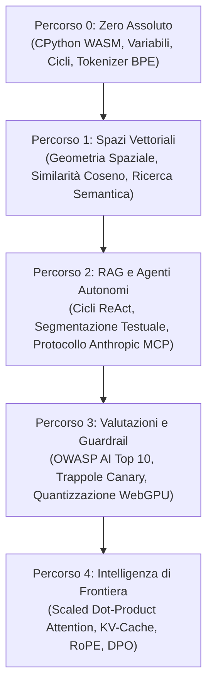

<div align="center">

<a href="https://openguideforai.dpdns.org">
  
</a>

# OpenGuide.
### STUDIO SOVRANO DI INGEGNERIA AI DIRETTAMENTE NEL BROWSER

> **L'istruzione emancipa l'umanità, e la conoscenza umana deve rimanere libera. L'intelligenza non deve mai essere rinchiusa dietro una fattura cloud da 300 $, un pedaggio elitario o silos aziendali proprietari.**  
> **Da uno smartphone scheggiato da 40 $ sotto una luce soffusa a una workstation multi-monitor con screen reader assistivo: OpenGuide porta un laboratorio sovrano di ingegneria AI di livello industriale direttamente nel tuo browser.**  
> **100% Gratuito • Python WebAssembly nel Browser • Zero Configurazione • Zero Telemetria • Sovrano per Sempre.**

<p align="center">
  <a href="https://openguideforai.dpdns.org">
    
  </a>
</p>

[](../../LICENSE)
[](https://pyodide.org/)
[](#architettura-sovrana-lato-client)
[](#panoramica-del-curriculum)
[](#accessibilit%C3%A0-universale-e-standard)
[](#installazione-desktop-e-applicazione-pwa)

<p align="center">
  <b>Traduzioni / Translations:</b>&nbsp;
  <a href="../../README.md">English</a> &nbsp;•&nbsp;
  <a href="README_es.md">Español</a> &nbsp;•&nbsp;
  <a href="README_zh.md">简体中文</a> &nbsp;•&nbsp;
  <a href="README_ur.md">اردو</a> &nbsp;•&nbsp;
  <a href="README_ar.md">العربية</a> &nbsp;•&nbsp;
  <a href="README_hi.md">हिन्दी</a> &nbsp;•&nbsp;
  <a href="README_fr.md">Français</a> &nbsp;•&nbsp;
  <a href="README_de.md">Deutsch</a> &nbsp;•&nbsp;
  <a href="README_ja.md">日本語</a> &nbsp;•&nbsp;
  <a href="README_pt.md">Português</a> &nbsp;•&nbsp;
  <a href="README_ru.md">Русский</a> &nbsp;•&nbsp;
  <a href="README_it.md"><b>Italiano</b></a>
</p>

---

### [Avvia lo Studio](https://openguideforai.dpdns.org) &nbsp;•&nbsp; [Architettura](#architettura-sovrana-lato-client) &nbsp;•&nbsp; [Curriculum](#panoramica-del-curriculum) &nbsp;•&nbsp; [Spiegazione (STE)](../../explainer.md) &nbsp;•&nbsp; [Applicazione Desktop](#installazione-desktop-e-applicazione-pwa) &nbsp;•&nbsp; [Scorciatoie da Tastiera](#ergonomia-e-scorciatoie-da-tastiera) &nbsp;•&nbsp; [Guida allo Sviluppo Locale](#guida-allo-sviluppo-locale)

</div>

---

## Filosofia e Missione

La maggior parte dell'educazione sull'IA oggi è compromessa. Ti costringe in uno di questi vicoli ciechi:
1. **Tutorial superficiali sulle API:** Insegnano scatole nere che diventano obsolete nel giro di sei mesi.
2. **Barriere matematiche astratte:** Pubblicazioni teoriche e dense senza alcuna applicazione pratica interattiva.
3. **Piattaforme cloud proprietarie a pagamento:** Richiedono carte di credito, account cloud, container Docker o costosi abbonamenti mensili.

**OpenGuide elimina questi ostacoli.**

Crediamo che l'intelligenza artificiale sia una competenza fondamentale della civiltà umana. Sia che tu stia programmando su uno **smartphone Android economico**, su un vecchio Chromebook o su una workstation ingegneristica all'avanguardia; sia che utilizzi uno **screen reader assistivo** o un mouse: **OpenGuide mette a tua disposizione un laboratorio sovrano d'élite direttamente nel tuo browser, gratuitamente.**

> *"Ogni funzionalità di OpenGuide è spiegata da OpenGuide stesso. Non studi semplicemente la matematica dell'IA; osservi il flusso dei tensori, dissezioni i meccanismi di attenzione in tempo reale, ascolti le distanze coseno tramite sintesi armonica e ispezioni la memoria WebAssembly con la modalità a Raggi X (`Alt + X`)."*

---

<a id="architettura-sovrana-lato-client"></a>
## Architettura Sovrana Lato Client

OpenGuide opera rigorosamente sotto la **Regola dello $0**. **Nessun server backend**. **Nessun database remoto che traccia i tuoi dati**. Il 100% dell'elaborazione viene eseguito localmente nel tuo browser web:

```
┌────────────────────────────────────────────────────────────────────────┐
│                   IL TUO SANDBOX LOCALE NEL BROWSER                    │
│                                                                        │
│  ┌─────────────────────────┐         ┌──────────────────────────────┐  │
│  │     INTERFACCIA E UI    │         │    WEB WORKER IN BACKGROUND  │  │
│  │   • React 18 + Vite     │         │   • CPython 3.12 (Pyodide)   │  │
│  │   • 24 Temi Calibrati   │ ◄─────► │   • Calcolo Vettoriale NumPy │  │
│  │   • Scorrimento Lenis   │         │   • Watchdog di Sicurezza 15s│  │
│  │   • Editor CodeMirror 6 │         │   • Motore di Fallback JS    │  │
│  └────────────┬────────────┘         └──────────────┬───────────────┘  │
│               │                                     │                  │
│  ┌────────────▼────────────┐         ┌──────────────▼───────────────┐  │
│  │   SPAZIALE E NEURONALE  │         │    PERSISTENZA SOVRANA       │  │
│  │   • Three.js WebGL / XR │         │   • IndexedDB tramite Dexie  │  │
│  │   • Sonificazione Audio │         │   • Backup Cifrato su Gist   │  │
│  │   • Motore WebGPU Locale│         │   • Firma W3C Verificabile   │  │
│  └─────────────────────────┘         └──────────────────────────────┘  │
└────────────────────────────────────────────────────────────────────────┘
```

---

<a id="panoramica-del-curriculum"></a>
## Panoramica del Curriculum

Cinque percorsi di apprendimento rigorosi che comprendono **45 laboratori interattivi direttamente eseguibili**:



| Percorso | Lab | Modello Mentale Chiave | Progetto Finale d'Élite |
|:---|:---:|:---|:---|
| **Percorso 0: Zero Assoluto** | 9 | Sintassi Python tramite metafore intuitive di cucina e mappe | Creazione completa di un tokenizer Byte-Pair Encoding (BPE) |
| **Percorso 1: Spazi Vettoriali** | 9 | Geometria spaziale, prodotti scalari e densità semantica | Motore `SemanticSearchEngine` in memoria con indicizzazione documenti |
| **Percorso 2: RAG e Agenti** | 9 | Automi Pensiero $\rightarrow$ Azione $\rightarrow$ Osservazione e schemi MCP | Agente di Ricerca Scientifica Autonomo con ragionamento multi-hop |
| **Percorso 3: Valutazioni e Guardrail**| 9 | Red-teaming avversario, difese da iniezione di prompt | Sistema di valutazione sintetico con inferenza WebGPU locale |
| **Percorso 4: Sistemi di Frontiera** | 9 | $\text{Softmax}(QK^T/\sqrt{d_k})V$, gestione memoria KV-cache, RoPE | Dissezione della Testa di Attenzione Transformer e Motore di Perdita DPO |

---

<a id="installazione-desktop-e-applicazione-pwa"></a>
## Installazione Desktop e Applicazione PWA

OpenGuide è progettato come una **Progressive Web App (PWA) installabile** e perfettamente integrata nel sistema operativo:

* **Windows (10 / 11):** In Chrome o Edge, fai clic sull'icona **Installa OpenGuide** nella barra degli indirizzi per creare un collegamento sul Desktop e nel menu Start.
* **macOS:** In Safari, seleziona **File** $\rightarrow$ **Aggiungi al Dock**; oppure installa tramite Chrome/Edge per un'esperienza nativa richiamabile con `Cmd + Spazio`.
* **Mobile (Android e iOS):** Seleziona **Aggiungi alla schermata Home** per un'esperienza a schermo intero senza barre del browser.
* **Funzionamento 100% Offline (Air-Gapped):** Grazie alla cache del Service Worker (`sw.js`), tutti i moduli didattici, le visualizzazioni 3D e il runtime Pyodide risiedono sul tuo dispositivo. Puoi programmare in treno o in aereo senza connessione Internet.

---

<a id="ergonomia-e-scorciatoie-da-tastiera"></a>
## Ergonomia e Scorciatoie da Tastiera

* **Palette dei Comandi (`Cmd + K` / `Ctrl + K`):** Ricerca istantanea tra tutti i laboratori, strumenti e temi visivi.
* **Esecuzione Rapida (`Ctrl + Invio`):** Esegui il codice Python all'istante dall'editor.
* **Dottore di Sintassi Empatico:** Traduce i messaggi di errore complessi in spiegazioni amichevoli e chiare.
* **Esportazione Jupyter Notebook (`.ipynb`):** Scarica i tuoi esercizi risolti come veri notebook Jupyter riutilizzabili.
* **Lente di Debug a Raggi X (`Alt + X`):** Ispeziona in tempo reale lo stato della memoria del Web Worker e le risorse locali.
* **Sincronizzazione Cifrata su Gist:** Salva i tuoi progressi con crittografia **AES-GCM a 256 bit** sul tuo account GitHub personale.

---

<a id="accessibilit%C3%A0-universale-e-standard"></a>
## Accessibilità Universale e Standard

* **24 Temi Scientifici Calibrati:** 12 temi scuri e 12 temi chiari calibrati rigorosamente secondo lo standard WCAG 2.2 AAA (>7:1 fino a 20:1).
* **Supporto Screen Reader Completo:** Regioni ARIA dinamiche con annunci contestuali (`aria-live="polite"`).
* **Supporto RTL Completo:** Layout speculare automatico per arabo e urdu, mantenendo l'orientamento LTR per il codice informatico.

---

<a id="autore-e-sostegno"></a>
## Autore e Sostegno

OpenGuide è stato ideato, progettato e sviluppato interamente da **Adil Rafiq Dar (ARD)**.

```
                   UN MESSAGGIO SULLA SOVRANITÀ E L'INDIPENDENZA
"Ho creato OpenGuide perché non potevo più accettare che menti brillanti venissero escluse
dall'intelligenza artificiale a causa di corsi a pagamento, costose sottoscrizioni cloud
e barriere elitarie.

Ogni singola riga di questo studio è nata da innumerevoli notti di lavoro, test matematici
rigorosi e una costante dedizione estetica. OpenGuide è il mio dono al mondo intero.

Affinché questo studio rimanga sempre gratuito al 100%, indipendente e aggiornato senza
mai introdurre annunci pubblicitari o investitori privati, accolgo con gratitudine il sostegno
degli studenti e dei mecenati che credono in un'educazione aperta e universale."
```

Se OpenGuide ti ha aiutato a comprendere l'IA o ha accelerato il tuo percorso ingegneristico, puoi sostenere il suo sviluppo indipendente:

<div align="center">

[](https://www.paypal.com/paypalme/buymegoodcoffee/sponsor)
&nbsp;&nbsp;
[](https://ko-fi.com/buymegoodcoffee)

</div>

---

<a id="guida-allo-sviluppo-locale"></a>
## Guida allo Sviluppo Locale

```bash
git clone https://github.com/openguideforai/OpenGuideForAI.git
cd OpenGuideForAI
corepack enable
yarn install
yarn --cwd apps/web dev
```
Apri `http://localhost:5173` nel tuo browser web.
