<div align="center">

<a href="https://openguideforai.dpdns.org">
  
</a>

# OpenGuide.
### Comprendi la mente dietro la macchina.

> **Uno studio sovrano e nativo nel browser progettato per demistificare l'intelligenza artificiale — trasformando complesse scatole nere in una comprensione intuitiva e pratica attraverso l'esecuzione diretta del codice.**  
> **Creato per ogni mente curiosa sulla Terra: da uno schermo rotto che brilla sotto una lampadina notturna, a una workstation di ingegneria con screen reader. 100% Gratuito • Zero Bollette Cloud • Sovrano nel Tuo Browser.**

<p align="center">
  <a href="https://openguideforai.dpdns.org">
    
  </a>
</p>

[](../../LICENSE)
[](https://pyodide.org/)
[](../../explainer.md)
[](#doppi-percorsi-di-apprendimento)
[](#design-universale-e-accessibilit%C3%A0)
[](#installazione-desktop-e-applicazione-mobile-pwa)

<p align="center">
  <b>Edizioni Multilingue / Multilingual Editions:</b>&nbsp;
  <a href="../../README.md">English</a> &nbsp;•&nbsp;
  <a href="README_es.md">Español</a> &nbsp;•&nbsp;
  <a href="README_zh.md">简体中文</a> &nbsp;•&nbsp;
  <a href="README_ur.md">اردو</a> &nbsp;•&nbsp;
  <a href="README_ar.md">العربية</a> &nbsp;•&nbsp;
  <a href="README_hi.md">हिन्दी</a> &nbsp;•&nbsp;
  <a href="README_fr.md">Français</a> &nbsp;•&nbsp;
  <a href="README_de.md">Deutsch</a> &nbsp;•&nbsp;
  <a href="README_ja.md">日本語</a> &nbsp;•&nbsp;
  <a href="README_pt.md">Português</a> &nbsp;•&nbsp;
  <a href="README_ru.md">Русский</a> &nbsp;•&nbsp;
  <a href="README_it.md"><b>Italiano</b></a>
</p>

---

### [Avvia lo Studio](https://openguideforai.dpdns.org) &nbsp;•&nbsp; [L'Esperienza](#cosa-sperimenti-nello-studio) &nbsp;•&nbsp; [Doppi Percorsi](#doppi-percorsi-di-apprendimento) &nbsp;•&nbsp; [Autovalutatori](#autovalutatori-inviolabili-a-doppia-fase) &nbsp;•&nbsp; [Banca della Conoscenza](#banca-della-conoscenza-sovrana-offline-e-mentore-bluee) &nbsp;•&nbsp; [Accessibilità](#design-universale-e-accessibilit%C3%A0) &nbsp;•&nbsp; [Spiegazione STE](../../explainer.md) &nbsp;•&nbsp; [Guida Rapida](#inizia-in-60-secondi)

</div>

---

## Cosa Sperimenti nello Studio

OpenGuide non è un comune servizio cloud né una serie di tutorial superficiali. È un laboratorio ingegneristico sovrano nativo del browser in cui decostruisci, esamini e comprendi l'intelligenza artificiale attraverso l'esecuzione reale del codice.

| Pilastro Fondamentale | Cosa Avviene all'Interno | Perché è Decisivo |
|---|---|---|
| **Educazione Fondamentale Pura** | Impara la vera matematica: programma tokenizer BPE, prodotti scalari e teste di auto-attenzione da zero. | Acquisisci una comprensione concettuale permanente invece di memorizzare wrapper temporanei di librerie. |
| **Esecuzione Istantanea del Codice** | Il vero CPython 3.12 viene eseguito localmente nel tuo browser tramite WebAssembly (Pyodide v0.26) in un Web Worker dedicato. | Zero configurazioni. Nessuna necessità di installare Python, Anaconda o container Docker sul tuo computer. |
| **Doppi Percorsi di Apprendimento** | Passa senza attriti dall'architettura teorica avanzata dei modelli alla costruzione pratica di applicazioni complete. | Accoglie sia ricercatori accademici che sviluppatori di prodotto senza alcuna perdita di progressi. |
| **Sovrano e Privato** | 100% di computazione lato client. I dati persistono localmente nell'IndexedDB del browser. Zero telemetria. | Privacy totale dei dati. Nessun costo di abbonamento. Nessuna bolletta cloud inaspettata (Regola dello $0). |
| **PWA e Conoscenza Offline** | L'applicazione Web progressiva memorizza nella cache l'intero corso, il motore Python e 250 argomenti IA con codice eseguibile. | Scrivi codice, sperimenta e impara ovunque sulla Terra, anche in totale assenza di connessione Internet. |
| **Visualizzazioni Spaziali Interattive** | Varietà 3D accelerate da GPU in Three.js e WebXR traducono tensori astratti in coordinate fisiche tangibili. | Osserva, manipola e interiorizza intuitivamente spazi di incorporamento (embeddings) e grafi neurali. |

> 📖 **Specifiche Ingegneristiche Approfondite:** Per l'architettura di sistema completa, le pipeline di esecuzione, il supervisore watchdog da 15 secondi e il design a divulgazione progressiva, consulta la [Guida Tecnica ASD-STE100](../../explainer.md).

---

## Doppi Percorsi di Apprendimento

OpenGuide offre due percorsi di apprendimento sincronizzati di livello mondiale, progettati per accoglierti a qualsiasi livello di partenza. Passa liberamente dall'uno all'altro in ogni momento dalla barra superiore tramite il menu a discesa interattivo del Selettore di Percorso (che include un quiz di raccomandazione interattivo per orientarti), mantenendo per entrambi i percorsi progressi indipendenti e persistenti:

### Percorso A: Deep AI Engineer (Percorsi 0–7 • 57 Laboratori)
*Profonda intuizione matematica, esecuzione WebAssembly di CPython 3.12 nel browser e meccanica dei modelli di frontiera dallo zero assoluto.*

```mermaid
graph LR
    T0["Percorso 0: Fondamenta<br/>(CPython WASM, Cicli, BPE)"]
    T1["Percorso 1: Spazi Vettoriali<br/>(Embeddings, Ricerca Coseno)"]
    T2["Percorso 2: Agenti & RAG<br/>(Cicli ReAct, FastMCP)"]
    T3["Percorso 3: Evals & Sicurezza<br/>(OWASP AI Top 10, WebGPU)"]
    T4["Percorso 4: Sistemi di Frontiera<br/>(Self-Attention, RoPE, DPO)"]
    T5["Percorso 5: Fine-Tuning<br/>(LoRA, SVD, Cestini NF4)"]
    T6["Percorso 6: Motori di Inferenza<br/>(Paginazione KV, Speculativo)"]
    T7["Percorso 7: Modelli Generativi<br/>(Diffusione, CFG, ViT)"]

    T0 --> T1 --> T2 --> T3 --> T4 --> T5 --> T6 --> T7
```



| Percorso | Lab | Principio Guida | Progetto Capstone Finale |
|:---|:---:|:---|:---|
| **Percorso 0: Zero Assoluto** | 9 | Sintassi Python spiegata con metafore intuitive del mondo reale | Tokenizer Byte-Pair Encoding (BPE) sviluppato da zero |
| **Percorso 1: Spazi Vettoriali** | 9 | Geometria ad alta dimensione, prodotti scalari e densità semantica | `SemanticSearchEngine` in-memory per indicizzare documenti |
| **Percorso 2: RAG & Agenti** | 9 | Macchine a stati Pensiero $\rightarrow$ Azione $\rightarrow$ Osservazione | Agente di ricerca autonomo con ragionamento multi-passo |
| **Percorso 3: Valutazioni & Barriere** | 9 | Red-teaming avversario, iniezione di prompt e regole di sicurezza | Banco di prova per valutazioni sintetiche con inferenza WebGPU |
| **Percorso 4: Sistemi di Frontiera** | 9 | Attenzione scaled dot-product, fisica del KV-cache e RoPE | Dissezione delle teste di attenzione Transformer & Motore DPO |
| **Percorso 5: Fine-Tuning & LoRA** | 6 | Adattamento a basso rango ad alta efficienza e quantizzazione NF4 | Motore di fusione dinamica dei pesi LoRA a zero overhead |
| **Percorso 6: Motori di Inferenza** | 3 | Servizio ad alto throughput, paginazione KV e decodifica speculativa | Simulatore di paginazione virtuale PagedAttention |
| **Percorso 7: Multimodale & Diffusione** | 3 | Rumore per diffusione in avanti, vettori di guida CFG e patch ViT | Proiettore lineare di patch per Vision Transformer |

---

### Percorso B: The Builder Path (Percorsi B0–B7 • 24 Moduli / 48 Traguardi)
*Ingegneria dell'IA in Prima Linea (Forward Deployed AI Engineering): Costruisci veri sistemi software per la produzione tramite specifiche tecniche, ambienti sandbox e flussi agentici.*

```mermaid
graph LR
    B0["Percorso B0: Dillo<br/>(Studio Prototipi Istantaneo)"]
    B1["Percorso B1: Specificalo<br/>(Rubriche e Test Case)"]
    B2["Percorso B2: Verificalo<br/>(Lettura Diffs e Pericoli)"]
    B3["Percorso B3: Connettilo<br/>(IndexedDB e API)"]
    B4["Percorso B4: Ancoralo<br/>(Contesto e Valutazioni)"]
    B5["Percorso B5: Rilascialo<br/>(Cloud Sovrano $0)"]
    B6["Percorso B6: Fortificalo<br/>(Red-Teaming e Segreti)"]
    B7["Percorso B7: Dimostralo<br/>(Difesa Capstone)"]

    B0 --> B1 --> B2 --> B3 --> B4 --> B5 --> B6 --> B7
```



| Percorso Builder | Moduli | Regola Ingegneristica | Laboratorio Interattivo |
|:---|:---:|:---|:---|
| **Percorso B0: Dillo (Say It)** | 3 | Da zero alla prima interfaccia funzionante con 3 frasi di progetto | **Lab Prompt-to-Preview:** Rendering isolato in iframe |
| **Percorso B1: Specificalo (Spec It)** | 3 | Scrivere specifiche tecniche prive di ambiguità a prova di allucinazione | **Lab Spec Studio:** Autovalutatore a rubrica di 5 regole |
| **Percorso B2: Verificalo (Verify It)** | 3 | Lettura esperta dei diffs di codice e rilevamento di falle di sicurezza | **Lab Diff Reader:** Controllo visivo di diff e rischi di sicurezza |
| **Percorso B3: Rilascialo (Ship It)** | 3 | Simulazione Edge CDN, persistenza Dexie IndexedDB e scansione fughe di credenziali | **Edge Deploy Lab:** Simulatore CDN, persistenza IDB e scanner .env |
| **Percorso B4: Proteggilo (Trust It)** | 3 | Sicurezza a livello di riga (Postgres RLS), CVE-2025-48757 e filtri di iniezione | **Defensive Security Lab:** Query attaccanti RLS in tempo reale e sanitizzatori |
| **Percorso B5: Dirigilo (Direct It)** | 3 | Costituzioni di progetto (`AGENTS.md`), budget di token e guardie anti-deriva | **Agent Director Lab:** Costituzione a 5 clausole e compattazione del contesto |
| **Percorso B6: Eseguilo (Run It)** | 3 | Gate CI GitHub a 4 fasi, telemetria degli errori e rollback a zero downtime | **Pipeline Ops Lab:** Esecutore CI e simulazione di disaster recovery |
| **Percorso B7: Dimostralo (Prove It)** | 3 | Difesa dell'architettura in 8 punti, firme Web Crypto SHA-256 e registro immutabile | **Capstone Ledger Lab:** Firma Web Crypto ed esportazione JSON immutabile |

---

## Autovalutatori Inviolabili a Doppia Fase

Ciascuno dei **57 laboratori del curriculum** di OpenGuide è protetto da un rigoroso sistema di autovalutazione a doppia fase:
1. **Fase 1 (Sfida Visibile):** Valida tipi di ritorno, forme dei tensori e sintassi strutturale rispetto a casi di prova base.
2. **Fase 2 (Invarianti Matematici Nascosti):** Testa le soluzioni su 5 invarianti matematici segreti per laboratorio: disuguaglianza di Cauchy-Schwarz, scaling della varianza, simmetria metrica e casi limite.
3. **Tasso di Neutralizzazione nei Test di Mutazione:** Testato su una suite automatica di 171 mutanti avversari, raggiungendo un **Tasso di Neutralizzazione del 100,0% (171/171 mutanti abbattuti)** con zero falsi positivi.

---

## Banca della Conoscenza Sovrana Offline e Mentore Bluee

OpenGuide include una base di conoscenza ingegneristica integrata sul client senza alcuna dipendenza da servizi cloud esterni (Regola dello $0):
- **250 Argomenti Chiave e Professioni Reali:** Copertura esaustiva della Meccanica dell'Attenzione (FlashAttention-2/3, PagedAttention/vLLM, MLA), Allineamento e Ottimizzazione (DPO, KTO, ORPO, LoRA, QLoRA), Geometria Vettoriale (HNSW, ColBERT), Decodifica Strutturata, Quantizzazione (FP8, INT8, AWQ, BitNet b1.58), Architetture Multimodali (ViT, CLIP) e applicazioni pratiche per oltre 17 mestieri del mondo reale.
- **Motore di Ricerca Probabilistico Okapi BM25:** Formula di ranking avanzata ($k_1=1.2, b=0.75$) con frequenza inversa dei documenti smussata e ponderazione su campi multipli.
- **Ponte Multilingue Istantaneo:** Risultati di ricerca istantanei e coerenti in 12 lingue mondiali (italiano, inglese, spagnolo, hindi, cinese, francese, tedesco, arabo, russo, giapponese, urdu, portoghese).
- **Schede Visive Esplicative Interattive:** Micro-widget in puro JavaScript (cursore della temperatura Softmax, allocazione di blocchi PagedAttention, quadrante angolare di similarità coseno, rotazione fasoriale RoPE) integrati direttamente nelle schede.
- **Snippet Python / NumPy Eseguibili:** Ogni scheda tecnica contiene un esempio Python completo e autonomo che viene eseguito localmente nel runtime Pyodide WebAssembly.

---

## Continuo Umano Universale dell'IA

OpenGuide non è pensato per un'élite esclusiva. È progettato per l'intero spettro dell'ingegno umano — da chi non ha mai scritto una riga di codice ai massimi ricercatori e architetti di modelli di frontiera:

| Livello e Profilo | Contesto nel Mondo Reale | Cosa Offre OpenGuide |
|---|---|---|
| **Livello 0: Curioso Principiante Senza Codice** | Primo approccio con l'IA. Disorientato da gerghi e abbonamenti a pagamento. | Modelli mentali chiari ("Tu sei un LLM"), le 3 Regole d'Oro del Prompting (Ruolo + Contesto + Formato) e costo zero assoluto. |
| **Livello 1: Mestieri Manuali e Artigianato Reale** | Meccanici auto, calzolai, falegnami, parrucchieri, chef, idraulici. | L'IA concreta nel lavoro reale: diagnosi d'officina, preventivi clienti, calcolo materiali e flussi di laboratorio. |
| **Livello 2: Professionisti della Conoscenza** | Medici, insegnanti, commercialisti, ricercatori legali, agronomi. | Modelli di prompt strutturati, estrazione di dati tabulari, schede di studio e privacy totale sul dispositivo. |
| **Livello 3: Sviluppatori di Sistemi Applicati** | Ingegneri software che creano applicazioni con LLM e agenti. | Vero Python nel browser, tokenizzazione, contratti JSON-RPC e orchestrazione di tool tramite Model Context Protocol (MCP). |
| **Livello 4: Architetti di Sicurezza e Valutazione IA** | Ingegneri dell'affidabilità che proteggono i sistemi in produzione. | Difesa da OWASP AI Top 10, sandbox contro le iniezioni di prompt, filtri PII e suite di valutazione automatizzate. |
| **Livello 5: Ricercatori e Creatori di Modelli di Punta** | Esperti che approfondiscono le fondamenta matematiche dell'apprendimento generativo. | Attenzione scaled dot-product da zero, cinematica del KV-cache, quantizzazione uniforme INT8 e perdita chiusa DPO. |

---

## Design Universale e Accessibilità

* **24 Temi Calibrati ad Alto Contrasto:** 12 temi scuri e 12 chiari progettati secondo gli **standard internazionali WCAG 2.2 AAA** (rapporti di contrasto superiori a 7:1 fino a 20:1) per il riposo della vista e la leggibilità ottimale.
* **12 Lingue Mondiali con Tipografia Autentica:** Legature native Nastaliq (**urdu**), calligrafia araba, devanagari (**hindi**), ideogrammi CJK (**cinese**, **giapponese**), e alfabeti latino e cirillico (**italiano**, **inglese**, **spagnolo**, **francese**, **tedesco**, **portoghese**, **russo**).
* **Certificato per Screen Reader:** Aree di notifica ARIA in tempo reale (`aria-live="polite"`), trappole di focus accessibili nelle modali e punti di riferimento semantici chiari.
* **Supporto Completo RTL:** Layout specchiato per urdu e arabo, garantendo l'allineamento da sinistra a destra (LTR) per i blocchi di codice sorgente.
* **Altezza della Linea Sicura:** Regolazione dinamica per prevenire collisioni verticali di caratteri complessi in devanagari e scritture orientali.
* **Ergonomia Universale Mobile e Desktop:** Layout adattivi in visualizzazione divisa, contenimento dinamico delle unità viewport (`100dvh`), barre dei comandi tattili ad alta densità e modali reattivi testati su schermi compatti, tablet, monitor High-DPI e configurazioni multimonitor.

---

## Schema di Ingegneria dell'IA in Prima Linea (FDE)

OpenGuide include una guida interattiva all'**Ingegneria dell'IA in Prima Linea (FDE)** accessibile direttamente dalla barra superiore o dalla Palette dei Comandi (`Cmd + K` / `Ctrl + K`):
- **Matrice Comparativa di Ruoli e Sistemi:** Mette a confronto sviluppatori occasionali, ingegneri software tradizionali, ricercatori di IA e ingegneri FDE su 6 dimensioni chiave.
- **Manuali di Configurazione delle IDE Agenti:** Protocolli pratici di configurazione, comandi da terminale e buone pratiche per Google Antigravity IDE, Anthropic Claude Code CLI e OpenAI Codex & Cursor.
- **Stack Sovrano a $0:** Schema architetturale completo che combina GitHub Actions CI, la rete perimetrale Cloudflare Pages, database serverless Neon Postgres, CPython WebAssembly e Hugging Face Spaces.
- **Igiene Assoluta delle Credenziali:** Isolamento delle chiavi in memoria (BYOK), scanner di sicurezza pre-commit e file modello `.env.example` protetti.
- **Standard di Governance del Repository:** Regolamenti di sviluppo perfettamente sincronizzati (`AGENTS.md`, `CLAUDE.md`, `ARCHITECTURE.md`, `CHANGELOG.md`).

---

## Architettura Sovrana Lato Client (Regola dello $0)

OpenGuide opera rigorosamente sotto la **Regola dello $0**. **Nessun server backend**. **Nessun database remoto che traccia i tuoi dati**. Il 100% dell'elaborazione viene eseguito localmente nel tuo browser web:

```
┌────────────────────────────────────────────────────────────────────────┐
│                   IL TUO SANDBOX LOCALE NEL BROWSER                    │
│                                                                        │
│  ┌─────────────────────────┐         ┌──────────────────────────────┐  │
│  │     INTERFACCIA E UI    │         │    WEB WORKER IN BACKGROUND  │  │
│  │   • React 18 + Vite     │         │   • CPython 3.12 (Pyodide)   │  │
│  │   • 24 Temi Calibrati   │ ◄─────► │   • Calcolo Vettoriale NumPy │  │
│  │   • Scorrimento Lenis   │         │   • Watchdog di Sicurezza 15s│  │
│  │   • Editor CodeMirror 6 │         │   • Motore di Fallback JS    │  │
│  └────────────┬────────────┘         └──────────────┬───────────────┘  │
│               │                                     │                  │
│  ┌────────────▼────────────┐         ┌──────────────▼───────────────┐  │
│  │   SPAZIALE E NEURONALE  │         │    PERSISTENZA SOVRANA       │  │
│  │   • Three.js WebGL / XR │         │   • IndexedDB tramite Dexie  │  │
│  │   • Sonificazione Audio │         │   • Backup Cifrato su Gist   │  │
│  │   • Motore WebGPU Locale│         │   • Firma W3C Verificabile   │  │
│  └─────────────────────────┘         └──────────────────────────────┘  │
└────────────────────────────────────────────────────────────────────────┘
```

---

## Holodeck Spaziale 3D ed Estensioni Hardware

Come funzionalità interattiva avanzata, OpenGuide include un Holodeck di calcolo spaziale 3D WebXR / WebGL nel browser (`/holodeck`) e accelerazione hardware:

* **Spazi Vettoriali Fluidi a 60FPS Costanti:** Rendering Three.js in tempo reale di spazi vettoriali 3D, cluster semantici e grafi sinaptici con memoria preallocata e pausa automatica fuori schermo.
* **Audio Spaziale Armonico Binaurale:** Motore sonoro Web Audio API che sintetizza armonie musicali proporzionali alla similarità coseno dei vettori.
* **Modalità True-Black per Occhiali AR:** Spegnimento dei pixel OLED (`#000000`) per visualizzare un HUD fluttuante nitido su Viture, Xreal, RayNeo, Rokid, Meta Quest e Apple Vision Pro.
* **Tastiera Spaziale Virtuale:** Utilizzabile a mezz'aria o agganciata al piano della scrivania per un'esplorazione immersiva completa.

---

## Inizia in 60 Secondi

### Avvia nel Browser (Senza Installazione)
Visita **[https://openguideforai.dpdns.org](https://openguideforai.dpdns.org)** e fai clic su **Avvia Percorso 0** o **Inizia come Builder**. L'ambiente WebAssembly CPython si avvia localmente in meno di un secondo.

### Esecuzione Locale tramite Git
```bash
# 1. Abilitare Corepack e clonare il repository
corepack enable
git clone https://github.com/openguideforai/OpenGuideForAI.git
cd OpenGuideForAI

# 2. Installare le dipendenze e avviare il server di sviluppo
yarn install
yarn dev
```
Apri `http://localhost:5173` nel tuo browser.

#### Test su Rete Locale (Smartphone / Tablet)
Per provare l'applicazione su smartphone o tablet connessi al tuo Wi-Fi locale:
```bash
yarn dev --host
```

---

## Installazione Desktop e Applicazione Mobile PWA

OpenGuide opera come una **Progressive Web App (PWA) Installabile** con integrazione nativa alle finestre di sistema:

* **Windows (10 / 11):** In Chrome o Edge, fai clic sull'icona di installazione nella barra degli indirizzi per creare un collegamento sul desktop e nel menu Start.
* **macOS:** In Safari, seleziona **File** $\rightarrow$ **Aggiungi al Dock**; oppure clicca su **Installa** nella barra di Chrome/Edge.
* **Linux:** Fai clic su Installa in Chromium o Chrome. Verrà creato automaticamente un file `.desktop` nel menu applicazioni.
* **Smartphone (Android e iOS):** In Safari su iPhone tocca **Condividi** $\rightarrow$ **Aggiungi alla schermata Home**; su Android tocca **Installa applicazione**.
* **Modalità Completamente Offline (Air-Gapped):** Il Service Worker memorizza localmente tutte le lezioni, i moduli 3D e il motore Python per consentirti di studiare in viaggio senza alcuna connessione di rete.

---

## Ergonomia e Scorciatoie da Tastiera

| Scorciatoia | Strumento Attivato | Azione Eseguita |
|---|:---:|---|
| **`Cmd + K` / `Ctrl + K`** | Palette dei Comandi | Ricerca rapida tra tutti i 57 laboratori, 24 temi, 12 lingue e strumenti. |
| **`Ctrl + Enter`** | Esecutore di Codice | Compila ed esegue istantaneamente il codice Python attivo nel Web Worker. |
| **`Alt + X`** | Lente a Raggi X | Ispezione in tempo reale della memoria WebAssembly, dell'albero AST e delle tabelle IndexedDB. |
| **`Alt + S`** | HUD Spaziale | Attiva o disattiva l'HUD spaziale 3-DoF e la modalità nero puro per occhiali AR. |
| **Barra Tattile** | Editor Mobile | Inserimento rapido a un tocco dei caratteri di codice frequenti (`Tab`, `:`, `( )`, `[ ]`, `def`, `assert`). |
| **Esporta `.ipynb`** | Creatore di Notebook | Scarica le soluzioni verificate come notebook Jupyter standard (nbformat 4.5). |
| **Audio Armonico** | Holodeck 3D | Converte la similarità vettoriale in armonie musicali udibili. |

---

## Cancello di Garanzia della Qualità (Suite Pre-Volo in 5 Punti)

Ogni modifica deve superare il controllo rigoroso in 5 punti prima di essere integrata:
```bash
# 1. Verifica disponibilità del server locale (HTTP 200 OK)
(Invoke-WebRequest http://localhost:5173).StatusCode == 200

# 2. Controllo automatizzato con browser headless (0 errori in console)
# Verificato automaticamente tramite Playwright

# 3. Linter statico del codice sorgente (0 errori)
yarn lint

# 4. Suite completa di test di regressione (100% superati su tutti i file spec)
npx playwright test --config apps/web/playwright.config.ts

# 5. Compilazione statica di produzione (0 errori TypeScript/Vite)
yarn --cwd apps/web build
```

---

## Autore e Visione

OpenGuide è stato ideato, progettato e realizzato interamente da **Adil Rafiq Dar (ARD)**.

```
                   UNA DICHIARAZIONE SULL'EDUCAZIONE SOVRANA
"Ho creato OpenGuide perché credo fermamente che la conoscenza dell'intelligenza
artificiale debba appartenere all'intera umanità. Non deve essere imprigionata dietro
costosi abbonamenti cloud, monopoli aziendali o barriere accademiche elitarie.

Ogni riga di questo studio, ogni formula matematica e ogni dettaglio dell'interfaccia sono
stati forgiati attraverso innumerevoli notti di lavoro, rigorosi test scientifici e una cura
senza compromessi per il design. OpenGuide è un dono aperto al mondo.

Per mantenere questo studio 100% gratuito, indipendente e costantemente allineato ai modelli
di frontiera senza pubblicità o investitori privati, apprezzo con gratitudine il sostegno
di studenti e sostenitori che condividono questa visione."
```

Sostieni lo sviluppo aperto e indipendente:

<div align="center">

[](https://github.com/sponsors/openguideforai)
&nbsp;&nbsp;
[](https://ko-fi.com/buymegoodcoffee)
&nbsp;&nbsp;
[](https://paypal.me/buymegoodcoffee)

<br/>

<sub>I tuoi contributi sostengono l'hosting del dominio, l'infrastruttura di integrazione continua e l'espansione del curriculum aperto.</sub>

</div>

---

## Documentazione Tecnica e Riferimenti

* **[Registro delle Versioni (Changelog)](../../CHANGELOG.md):** Cronologia dei rilasci e dell'evoluzione architetturale.
* **[Spiegazione Tecnica ASD-STE100](../../explainer.md):** Specifica tecnica completa su comunicazione Web Worker, gestione memoria e divulgazione progressiva.
* **[Architettura del Sistema](../../ARCHITECTURE.md):** Analisi dettagliata di store reattivi, Web Worker e pipeline di calcolo WebGPU.
* **[Specifiche del Curriculum](../CURRICULUM.md):** Obiettivi formativi e tecnici di tutti i 57 laboratori (8 percorsi).
* **[Dossier di Audit Tecnico Esterno e QA](../EXTERNAL-AUDIT-QA-DOSSIER.md):** Fondamenti di architettura, matrici di invarianti matematici e guida alla verifica indipendente.
* **[Rapporto di Controllo Qualità Terzo](../AUDIT_QA.md):** Report approfondito di audit multipiattaforma e prontezza produttiva.

<div align="center">
  <sub>Architettato e costruito da Adil Rafiq Dar (ARD). Concesso in licenza con AGPL-3.0 e CC BY-NC-SA 4.0.</sub>
</div>
