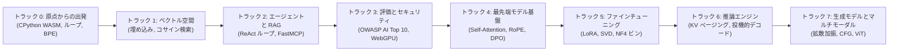
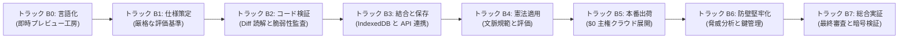

<div align="center">

<a href="https://openguideforai.dpdns.org">
  
</a>

# OpenGuide.
### 機械の背後にある知性を理解する。

> **ブラウザネイティブな自己完結型スタジオ。人工知能のブラックボックスを解体し、真のコード実行を通じて直感的かつ確固たる理解へと導くために設計されています。**  
> **地球上のすべての探求する心のために——夜更けの電球の下で光る画面の割れたスマートフォンから、スクリーンリーダーを備えたエンジニアリングワークステーションまで。100% 無料 • クラウド請求ゼロ • ブラウザで完結する主権。**

<p align="center">
  <a href="https://openguideforai.dpdns.org">
    
  </a>
</p>

[](../../LICENSE)
[](https://pyodide.org/)
[](../../explainer.md)
[](#デュアル学習パスウェイ)
[](#ユニバーサルデザインとアクセシビリティ)
[](#デスクトップおよび-pwa-アプリのインストール)

<p align="center">
  <b>多言語版 / Multilingual Editions:</b>&nbsp;
  <a href="../../README.md">English</a> &nbsp;•&nbsp;
  <a href="README_es.md">Español</a> &nbsp;•&nbsp;
  <a href="README_zh.md">简体中文</a> &nbsp;•&nbsp;
  <a href="README_ur.md">اردو</a> &nbsp;•&nbsp;
  <a href="README_ar.md">العربية</a> &nbsp;•&nbsp;
  <a href="README_hi.md">हिन्दी</a> &nbsp;•&nbsp;
  <a href="README_fr.md">Français</a> &nbsp;•&nbsp;
  <a href="README_de.md">Deutsch</a> &nbsp;•&nbsp;
  <a href="README_ja.md"><b>日本語</b></a> &nbsp;•&nbsp;
  <a href="README_pt.md">Português</a> &nbsp;•&nbsp;
  <a href="README_ru.md">Русский</a> &nbsp;•&nbsp;
  <a href="README_it.md">Italiano</a>
</p>

---

### [スタジオを起動](https://openguideforai.dpdns.org) &nbsp;•&nbsp; [体験の核心](#あなたが体験する世界) &nbsp;•&nbsp; [デュアル学習パス](#デュアル学習パスウェイ) &nbsp;•&nbsp; [自動採点エンジン](#改ざん不可能な二段階自動採点ハーネス) &nbsp;•&nbsp; [知識ベース](#主権型オフライン工学知識ベースと-bluee-メンター) &nbsp;•&nbsp; [アクセシビリティ](#ユニバーサルデザインとアクセシビリティ) &nbsp;•&nbsp; [解説ドキュメント](../../explainer.md) &nbsp;•&nbsp; [クイックスタート](#60秒でクイックスタート)

</div>

---

## あなたが体験する世界

OpenGuide は、ありきたりなクラウドサービスや表面的なチュートリアルではありません。本物のコード実行を通じて人工知能の内部構造を解剖・検査し、本質的に理解するためのブラウザネイティブな独立研究所です。

| 開発の柱 | 内部で起きていること | なぜそれが重要なのか |
|---|---|---|
| **妥協のない基礎教育** | 本物の数学理論を学ぶ：BPE トークナイザー、内積演算、セルフアテンションヘッドをゼロから手書き実装。 | 数ヶ月で時代遅れになる高水準ライブラリの暗記ではなく、生涯色褪せない本質的な洞察を獲得できます。 |
| **即時コード実行** | 本物の CPython 3.12 が WebAssembly（Pyodide v0.26）と専用 Web Worker によりブラウザ内で直接実行。 | 環境構築ゼロ。ローカルマシンに Python、Anaconda、Docker などをインストールする必要は一切ありません。 |
| **デュアル学習パス** | 数理モデルの深層アーキテクチャ探求と、実践的フルスタックアプリ開発の間を自由に切り替え可能。 | 理論研究者から現場のプロダクト開発者まで、学習の進捗を一切失うことなく自在に往来できます。 |
| **主権と絶対的プライバシー** | 100% 完全クライアントサイド実行。データはブラウザの IndexedDB にのみ保存され、外部テレメトリは皆無。 | 完全なデータ主権。サブスクリプション不要。予期せぬクラウド請求のリスクも皆無です（完全0ドル原則）。 |
| **PWA と完全オフライン知識** | 全カリキュラム、Python エンジン、250 の最先端 AI 知識項目（実行可能コード付き）がオフラインで利用可能。 | 飛行機の中や砂漠など、地球上のあらゆるオフライン環境でコードを書き、実験し、学習できます。 |
| **インタラクティブな空間視覚化** | GPU 加速による Three.js 3D 多様体と WebXR 空間投影が、抽象的なテンソルを物理的な座標空間へと翻訳。 | 高次元の埋め込み空間やニューラルシナプス DAG を直接操作しながら直感的に把握できます。 |

> 📖 **詳細なエンジニアリング技術仕様：** システム全体の構造、通信パイプライン、15秒暴走防止ウォッチドッグ、段階的開示設計については、[ASD-STE100 技術解説書](../../explainer.md)をご覧ください。

---

## デュアル学習パスウェイ

OpenGuide は、あらゆる背景を持つ学習者のニーズに応えるため、完全に同期された2つの世界水準トラックを提供しています。ヘッダーのナビゲーションにあるインタラクティブなパスウェイ切替ドロップダウン（最適な選択を支援するおすすめ診断クイズ付き）からいつでも自由に切り替えられ、両トラックとも独立した学習進捗が自動保存されます：

### パスウェイ A：ディープ AI エンジニア (トラック 0–7 • 57 ラボ)
*高度な数学的直観、ブラウザ内 CPython 3.12 WebAssembly のリアル実行、そして絶対零度からのフロンティアモデル構築。*



| トラック | ラボ数 | 核心となる設計思想 | 集大成となる最終プロジェクト |
|:---|:---:|:---|:---|
| **トラック 0: 絶対零度からの基礎** | 9 | 日常のたとえや料理の直観を通じて学ぶ Python 構文 | Byte-Pair Encoding (BPE) トークナイザーのフルスクラッチ実装 |
| **トラック 1: ベクトル空間と検索** | 9 | 高次元空間幾何学、内積演算、そして意味論的密度 | メモリ上で高速動作する文書検索エンジン `SemanticSearchEngine` |
| **トラック 2: RAG と自律エージェント** | 9 | 「思考 $\rightarrow$ 行動 $\rightarrow$ 観察」ReAct 状態遷移機械と MCP | 複数ステップの推論を自律実行する学術リサーチエージェント |
| **トラック 3: 評価基盤と安全防御** | 9 | 敵対的レッドチーミング、プロンプト注入防御、安全ガード | ブラウザ内 WebGPU 推論を用いた自動化合成評価ハーネス |
| **トラック 4: 最先端モデル基盤** | 9 | Scaled Dot-Product 注意機構、KV キャッシュの物理、RoPE | Transformer 多頭アテンションヘッドの解剖と DPO 損失エンジン |
| **トラック 5: ファインチューニングと LoRA** | 6 | パラメータ効率の高い低ランク適応、SVD 切断、NF4 量子化 | 推論オーバーヘッドゼロの動的 LoRA 重みマージエンジン |
| **トラック 6: 高スループット推論エンジン** | 3 | 高並列サービング、仮想メモリページング、投機的サンプリング | PagedAttention 仮想ページ割り当てシミュレータ |
| **トラック 7: 生成モデルとマルチモーダル** | 3 | 順方向拡散ノイズ付加、CFG ベクトル誘導、ViT パッチ分割 | Vision Transformer パッチ線形射影器 |

---

### パスウェイ B：実践的ビルダーパス (トラック B0–B7 • 24 モジュール / 48 マイルストーン)
*最前線配備 AI エンジニアリング (Forward Deployed AI Engineering)：明確な仕様書、サンドボックス、エージェントワークフローを用いて、本番品質のソフトウェアを構築。*



| ビルダートラック | モジュール数 | 設計原則 | インタラクティブ実践ラボ |
|:---|:---:|:---|:---|
| **トラック B0: 言語化 (Say It)** | 3 | わずか 3 文の設計骨子から最初の対話型画面をゼロから立ち上げる | **プロンプト即時描画ラボ：** 隔離 iframe レンダリング |
| **トラック B1: 仕様策定 (Spec It)** | 3 | AI モデルが絶対に誤解できない曖昧さゼロの仕様書を書く | **仕様設計スタジオ：** 5 つの黄金律による自動採点 |
| **トラック B2: コード検証 (Verify It)** | 3 | 熟練の精度でコード差分 (Diff) を読み解き、回帰障害と脆弱性を検知 | **差分読解ラボ：** 視覚的 Diff 監査とセキュリティ検証 |
| **トラック B3: エッジ出荷 (Ship It)** | 3 | Cloudflare Edge CDN 模倣、Dexie IndexedDB 永続化と機密漏洩スキャン | **Edge Deploy ラボ：** CDN シミュレータ、IDB 永続化 ＆ .env スキャナ |
| **トラック B4: 信頼防衛 (Trust It)** | 3 | 行レベルセキュリティ (Postgres RLS)、CVE-2025-48757 実演と注入攻撃遮断 | **Defensive Security ラボ：** リアルタイム RLS 攻撃クエリ ＆ サニタイザ |
| **トラック B5: 指揮統制 (Direct It)** | 3 | 5 大条項プロジェクト憲法 (`AGENTS.md`)、トークン予算制御と文脈圧縮 | **Agent Director ラボ：** プロジェクト憲法構築器 ＆ 文脈圧縮実験室 |
| **トラック B6: 運用監視 (Run It)** | 3 | 4 段階 GitHub CI ゲート、本番エラー率監視とダウンタイムゼロのロールバック | **Pipeline Ops ラボ：** CI 自動検証器 ＆ 災害復旧ドリル |
| **トラック B7: 総合実証 (Prove It)** | 3 | 8 項目アーキテクチャ口頭審査、Web Crypto SHA-256 署名と不変台帳出力 | **Capstone Ledger ラボ：** 暗号署名生成 ＆ スタンドアロン JSON 台帳出力 |

---

## 改ざん不可能な二段階自動採点ハーネス

OpenGuide の**全 57 カリキュラムラボ**は、二段階の厳格な自動採点エンジンによって保護されています：
1. **第 1 段階（可視テスト基準）：** 基本的なテストケースに対し、関数の戻り値の型、テンソルの形状、構文構造を即座に検証。
2. **第 2 段階（非可逆的数学不変条件）：** 各ラボの背後にある 5 つの隠伏的不変条件を網羅的に検証——コーシー・シュワルツの不等式、分散スケーリング、距離の対称性、動的テストベクトル、境界条件など。
3. **ミューテーションテスト撃破率検証：** 171 の敵対的変異体（Mutants）に対する自動テストスイートにおいて、**100.0% の完全撃破率（171/171 mutants killed）**を達成し、誤検知による不正合格を完全に排除。

---

## 主権型オフライン工学知識ベースと Bluee メンター

OpenGuide は、外部クラウド依存を完全に排除した（完全0ドル原則）クライアント完結型の工学ナレッジベースを内蔵しています：
- **250 の最先端フロンティアおよび日常実務トピック：** アテンション機構（FlashAttention-2/3、PagedAttention/vLLM、MLA）、アライメントと最適化（DPO、KTO、ORPO、LoRA、QLoRA）、ベクトル幾何学（HNSW、ColBERT、コサインスキップリスト）、文脈自由文法構文解析、量子化（FP8、INT8、AWQ、BitNet b1.58）、マルチモーダル（ViT、CLIP）、そして 17 以上の現実世界の職人技における実務 AI 活用まで網羅。
- **Okapi BM25 確率的検索エンジン：** 平滑化逆文書頻度、文書長正規化、多要素加重（タイトル、キーワード、要約、詳細解説）を備えた本格的なランキングアルゴリズム ($k_1=1.2, b=0.75$)。
- **世界 12 言語のリアルタイム言語間ブリッジ：** 日本語、英語、スペイン語、ヒンディー語、中国語、フランス語、ドイツ語、アラビア語、ロシア語、ウルドゥー語、ポルトガル語、イタリア語でミリ秒精度の検索が可能。
- **直感的な視覚的解説カード：** 外部依存ライブラリなしの純粋な UI ウィジェット（Softmax 温度スライダー、PagedAttention ブロック割り当て図、コサイン類似度角度ゲージ、RoPE 回転フェーザー）を知識カード内に直接マウント。
- **即座に実行可能な Python / NumPy スニペット：** すべての技術トピックに自立した実行可能 Python スクリプトが付属し、ブラウザ内の Pyodide WebAssembly 上で瞬時に動作します。

---

## 人類すべてのための AI コンティニュアム

OpenGuide は特定のエリート層だけのために作られたものではありません。プログラミング未経験の初心者から、第一線で活躍するモデルアーキテクトまで、あらゆる知識段階に対応しています：

| 学習段階とペルソナ | 現実世界の文脈と課題 | OpenGuide が提供する解決策 |
|---|---|---|
| **段階 0: 好奇心旺盛な未経験者** | AI に初めて触れる。専門用語や高額なサブスクリプションに圧倒されている。 | 平易な言葉による直感的思考モデル（「あなたが LLM です」）、プロンプトの3つの黄金律（役割＋文脈＋形式）、そして完全無料の透明性。 |
| **段階 1: 現実世界の職人・現場の技術者** | 自動車整備士、靴職人、大工、理美容師、料理人、配管工。 | 現場で役立つ実践 AI：故障診断アシスタント、見積書ジェネレーター、資材計算機、工房の工程管理。 |
| **段階 2: 知識専門職・サービス業務従事者** | 医師、教育者、会計士、法務研究者、農業従事者。 | 構造化プロンプトテンプレート、表形式データの抽出、自習用ガイド生成、そして完全なローカルプライバシー。 |
| **段階 3: 応用システム開発エンジニア** | LLM や自律エージェントを用いた実運用プロダクトを開発するエンジニア。 | ブラウザ内での本物 Python 実行、トークナイズの物理的理解、JSON-RPC 規約、Model Context Protocol (MCP) によるツール統合。 |
| **段階 4: AI セキュリティ・評価アーキテクト** | 本番稼働するモデルの堅牢性と信頼性を保証するセキュリティ担当者。 | OWASP AI Top 10 防御策、プロンプト注入分離サンドボックス、個人識別情報 (PII) 除去フィルター、自動評価フレームワーク。 |
| **段階 5: 最先端 AI 研究者・モデル構築者** | 生成ディープラーニングの数学的基礎を深く追究するスペシャリスト。 | ゼロからの Scaled Dot-Product 注意機構、KV キャッシュの運動力学、INT8 一様量子化、閉形式 DPO 損失計算。 |

---

## ユニバーサルデザインとアクセシビリティ

* **24 種類の精密キャリブレーションテーマ：** 12 種類のダークテーマと 12 種類のライトテーマ。生体リズムと視認性を考慮し、**WCAG 2.2 AAA 国際基準**（7:1 から最大 20:1 の超高コントラスト比）を完全に満たしています。
* **世界 12 主要言語の真正なタイポグラフィ：** ウルドゥー語の本物のナスタアリーク体リガチャ、アラビア書道フォント、デーヴァナーガリー文字（**ヒンディー語**）、漢字（**日本語**、**中国語**）、ラテン・キリル文字（**英語**、**スペイン語**、**フランス語**、**ドイツ語**、**ポルトガル語**、**ロシア語**、**イタリア語**）。
* **スクリーンリーダー完全認定：** ライブ ARIA 通知領域 (`aria-live="polite"`)、モーダル内のフォーカストラップ、明確なランドマークにより、音声のみによる完全な操作を保証。
* **ネイティブ RTL 双方向表示：** ウルドゥー語やアラビア語向けにレイアウト全体を左右反転しつつ、コードブロックの LTR 表示は自然に保護。
* **文字保護システム：** 複雑な結合文字やダイアクリティカルマークが上下に重なることを防ぐ動的行高設定。
* **ユニバーサルなモバイル＆デスクトップ操作性：** アダプティブな分割画面レイアウト、動的ビューポート単位の制約保護（`100dvh`）、高密度な触覚コマンドバー、小型画面・タブレット・高DPIディスプレイ・マルチモニター環境で完全検証されたレスポンシブなモーダル設計。

---

## 最前線配備 AI エンジニアリング (FDE) ブループリント

OpenGuide には、ヘッダーおよびコマンドパレット (`Cmd + K` / `Ctrl + K`) からいつでも呼び出せるインタラクティブな **FDE ブループリント** が内蔵されています：
- **エンジニア役割マトリクス：** 気軽なバイブコーダー、従来のソフトウェア技術者、理論研究者、FDE エンジニアの違いを 6 つの重要指標で徹底比較。
- **エージェント駆動型 IDE 構築マニュアル：** Google Antigravity IDE、Anthropic Claude Code CLI、OpenAI Codex & Cursor の導入手順とターミナル設定。
- **完全0ドル主権スタック全景：** GitHub Actions CI、Cloudflare Pages エッジネットワーク、Neon Serverless Postgres、CPython WebAssembly、Hugging Face Spaces を連携させた運用モデル。
- **秘密情報漏洩ゼロの安全規範：** インメモリ BYOK 隔離設計、コミット前漏洩スキャナー、安全な `.env.example` テンプレート。
- **リポジトリ統合ガバナンス憲章：** 完全に同期された開発規約（`AGENTS.md`、`CLAUDE.md`、`ARCHITECTURE.md`、`CHANGELOG.md`）。

---

## 自律型クライアントサイドアーキテクチャ (完全0ドル原則)

OpenGuide は**「完全0ドル原則（$0 Rule）」**で動作します。**バックエンドサーバーは存在しません**。**データを収集・追跡する外部データベースもありません**。100% の計算処理がお使いのローカルブラウザ内で安全に完結します：

```
┌────────────────────────────────────────────────────────────────────────┐
│                      ローカルブラウザ内の隔離サンドボックス            │
│                                                                        │
│  ┌─────────────────────────┐         ┌──────────────────────────────┐  │
│  │   UI・インタラクション  │         │    バックグラウンド WEB WORKER │  │
│  │   • React 18 + Vite     │         │   • CPython 3.12 (Pyodide)   │  │
│  │   • 24 種類の精密テーマ │ ◄─────► │   • NumPy ベクトル演算       │  │
│  │   • Lenis スムーズスクロ│         │   • 15秒暴走防止ウォッチドッグ ││
│  │   • CodeMirror 6 エディタ│        │   • クラッシュゼロの予備エンジン││
│  └────────────┬────────────┘         └──────────────┬───────────────┘  │
│               │                                     │                  │
│  ┌────────────▼────────────┐         ┌──────────────▼───────────────┐  │
│  │     空間・ニューラル核  │         │       ローカル永続化ストレージ│ │
│  │   • Three.js WebGL / XR │         │   • Dexie 経由の IndexedDB   │  │
│  │   • 和音音声シンセサイザ│         │   • AES-GCM 256 暗号化バック │  │
│  │   • ブラウザ内 WebGPU   │         │   • W3C 検証可能デジタル証明 │  │
│  └─────────────────────────┘         └──────────────────────────────┘  │
└────────────────────────────────────────────────────────────────────────┘
```

---

## 3D 空間ホロデッキとハードウェア拡張機能

先進的な対話型学習機能として、OpenGuide にはブラウザネイティブの WebXR / WebGL 3D 空間コンピューティングホロデッキ (`/holodeck`) およびハードウェア加速機能が搭載されています：

* **持続的 60FPS 安定の 3D ベクトル多様体：** Three.js による 3D ベクトル空間、意味論的クラスタリング、ニューラルシナプス DAG のリアルタイムレンダリング。メモリの動的再確保をゼロにする事前確保バッファと、画面外での自動休止機能を搭載。
* **バイノーラル調和空間オーディオ：** ベクトルコサイン類似度に正確に比例した完全五度和音を合成する Web Audio API 音響エンジン。
* **スマート AR グラス用完全漆黒透過モード：** `#000000` 完全消灯モードにより、光波導レンズ上で OLED 画素を消灯させ、Viture、Xreal、RayNeo、Rokid、Meta Quest、Apple Vision Pro 上で驚くほど鮮明な HUD を表示。
* **仮想空間キーボード：** 空間内または机上平面にスナップ配置可能な仮想キーボードにより、ハンズフリーの没入型コーディングを実現。

---

## 60秒でクイックスタート

### ブラウザで今すぐ開始（インストール不要）
**[https://openguideforai.dpdns.org](https://openguideforai.dpdns.org)** にアクセスし、**トラック 0 を起動** または **ビルダーとして開始** をクリックしてください。ブラウザ内 WebAssembly 環境が1秒未満で起動します。

### Git 経由でローカル起動
```bash
# 1. Corepack を有効化してリポジトリをクローン
corepack enable
git clone https://github.com/openguideforai/OpenGuideForAI.git
cd OpenGuideForAI

# 2. 依存パッケージをインストールして開発サーバーを起動
yarn install
yarn dev
```
ブラウザで `http://localhost:5173` を開きます。

#### ローカル Wi-Fi 経由での実機端末テスト
ローカルネットワーク上のスマートフォンやタブレットで実機検証を行う場合：
```bash
yarn dev --host
```

---

## デスクトップおよび PWA アプリのインストール

OpenGuide は、ネイティブウィンドウ制御を備えた**インストール可能なプログレッシブウェブアプリ（PWA）**として機能します：

* **Windows (10 / 11)：** Chrome または Edge のアドレスバー右側にあるインストールアイコンをクリックします。デスクトップとスタートメニューにショートカットが追加されます。
* **macOS：** Safari で **ファイル** $\rightarrow$ **Dock に追加** を選択するか、Chrome / Edge のアドレスバーからインストールします。
* **Linux：** Chromium または Chrome でインストールをクリックすると、アプリケーションメニューに `.desktop` エントリが自動生成されます。
* **スマートフォン (Android & iOS)：** iPhone Safari では **共有** $\rightarrow$ **ホーム画面に追加**、Android では **アプリをインストール** をタップします。
* **完全オフライン対応 (Air-Gapped)：** サービスワーカーがすべての講義内容、3D 可視化モジュール、Python WASM エンジンを端末内に自動保存するため、通信環境のない飛行機や山奥でも学習できます。

---

## 快適な操作性とショートカット

| ショートカット | 起動するツール | 実行されるアクション |
|---|:---:|---|
| **`Cmd + K` / `Ctrl + K`** | コマンドパレット | 全 57 ラボ、24 テーマ、12 言語、各種スタジオツールを瞬時にあいまい検索。 |
| **`Ctrl + Enter`** | コード実行 | 編集中の Python コードを直ちにコンパイルし、Web Worker 上で実行。 |
| **`Alt + X`** | X 線デバッグレンズ | WebAssembly メモリ、構文木 (AST)、ローカルデータベースの状況をリアルタイム透視。 |
| **`Alt + S`** | 空間 HUD 切替 | スマートグラス用の 3-DoF 浮遊 HUD、ジンバル角度、完全漆黒透過モードを切替。 |
| **タッチ専用バー** | モバイルエディタ | よく使う記号キー（`Tab`、`:`、`( )`、`[ ]`、`def`、`assert`）をスマホ上でワンタップ入力。 |
| **`.ipynb` エクスポート** | ノートブック変換 | 合格した解答コードを業界標準の Jupyter Notebook 形式で端末にダウンロード。 |
| **和音サウンド** | 3D ホロデッキ | ベクトルコサイン類似度を調和のとれた五度和音として聴覚化。 |

---

## 厳格な品質保証ゲート (5段階プリフライトスイート)

すべての変更は、マージ前に厳格な 5 段階の品質検証を完全に通過する必要があります：
```bash
# 1. 開発サーバー稼働確認 (HTTP 200 OK)
(Invoke-WebRequest http://localhost:5173).StatusCode == 200

# 2. 実ブラウザ自動検証 (コンソールエラー 0 件)
# Playwright による実ヘッドレスブラウザ環境での自動検証

# 3. 静的コード品質検査 (エラー 0 件)
yarn lint

# 4. 全自動リグレッションテスト (全テストファイル 100% 合格)
npx playwright test --config apps/web/playwright.config.ts

# 5. 本番用静的ビルドコンパイル (TypeScript / Vite エラー 0 件)
yarn --cwd apps/web build
```

---

## 開発者と基本理念

OpenGuide は、**Adil Rafiq Dar (ARD)** によって単独で構想され、設計され、構築されました。

```
                   自立した教育と知識の解放についての宣言
「私が OpenGuide を創ったのは、人工知能に関する深層の知識は全人類に等しく開かれて
いるべきだと信じているからです。高額なクラウド課金、大企業の囲い込み、学術的な
エリート主義によって学ぶ権利が制限されてはなりません。

このスタジオのすべてのコード、すべての数式、すべての細部に至るインターフェースは、
数え切れない夜の試行錯誤、厳格な数学的検証、そして職人技への妥協なき情熱によって
鍛え上げられました。OpenGuide は世界への贈り物です。

このスタジオを永久に 100% 無料かつ完全に独立した状態に保ち、広告や商業資本に
左右されることなく最先端の進化を届けるため、志を共にしてくださる学習者や
スポンサーの皆様の温かいご支援を心より歓迎いたします。」
```

独立したオープン開発の継続を支援する：

<div align="center">

[](https://github.com/sponsors/openguideforai)
&nbsp;&nbsp;
[](https://ko-fi.com/buymegoodcoffee)
&nbsp;&nbsp;
[](https://paypal.me/buymegoodcoffee)

<br/>

<sub>いただいた支援は、ドメイン維持費、CI/CD サーバー運用費、オープンな教材の拡充に全額充当されます。</sub>

</div>

---

## 技術ドキュメントと参照仕様

* **[変更履歴 (Changelog)](../../CHANGELOG.md)：** 各バージョンの進化とアーキテクチャの系譜。
* **[ASD-STE100 技術解説書](../../explainer.md)：** Web Worker 通信、メモリ管理、段階的開示設計を網羅した詳細仕様書。
* **[詳細システム構造](../../ARCHITECTURE.md)：** リアクティブストア、Web Worker、WebGPU パイプラインの深層解剖。
* **[カリキュラム詳細仕様書](../CURRICULUM.md)：** 全 57 ラボ（8 トラック）の学習目標と技術仕様。
* **[外部技術監査・品質保証文書](../EXTERNAL-AUDIT-QA-DOSSIER.md)：** 設計根拠、数学不変量テストマトリクス、再現検証手順。
* **[第三者品質監査レポート](../AUDIT_QA.md)：** マルチプラットフォームでの厳密な適合性監査報告書。

<div align="center">
  <sub>設計・開発：Adil Rafiq Dar (ARD)。AGPL-3.0 および CC BY-NC-SA 4.0 ライセンスに基づくオープンソース。</sub>
</div>
