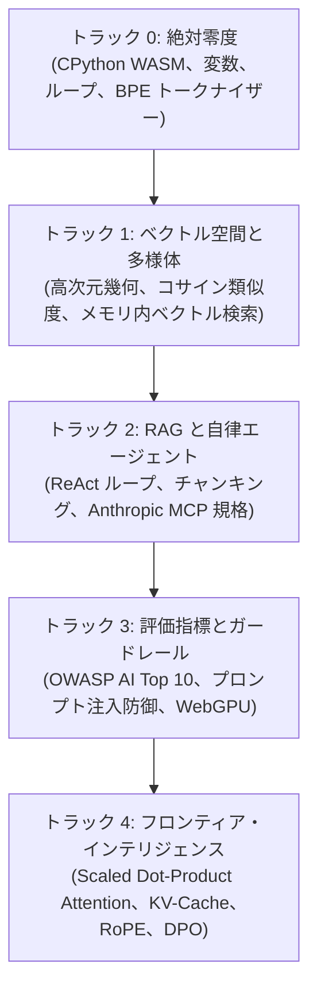

<div align="center">

<a href="https://openguideforai.dpdns.org">
  
</a>

# OpenGuide.
### 機械の背後にある知性を理解する。

> **ブラウザネイティブな自己完結型スタジオ。人工知能のブラックボックスを解体し、真のコード実行を通じて直感的かつ確固たる理解へと導くために設計されています。**  
> **地球上のすべての探求する心のために——夜更けの電球の下で光る画面の割れたスマートフォンから、スクリーンリーダーを備えたエンジニアリングワークステーションまで。100% 無料 • クラウド請求ゼロ • ブラウザで完結する主権。**

<p align="center">
  <a href="https://openguideforai.dpdns.org">
    
  </a>
</p>

[](../../LICENSE)
[](https://pyodide.org/)
[](#自律型クライアントサイドアーキテクチャ)
[](#カリキュラム概要)
[](#ユニバーサルアクセシビリティと標準規格)
[](#デスクトップおよび-pwa-アプリのインストール)

<p align="center">
  <b>言語切り替え / Translations:</b>&nbsp;
  <a href="../../README.md">English</a> &nbsp;•&nbsp;
  <a href="README_es.md">Español</a> &nbsp;•&nbsp;
  <a href="README_zh.md">简体中文</a> &nbsp;•&nbsp;
  <a href="README_ur.md">اردو</a> &nbsp;•&nbsp;
  <a href="README_ar.md">العربية</a> &nbsp;•&nbsp;
  <a href="README_hi.md">हिन्दी</a> &nbsp;•&nbsp;
  <a href="README_fr.md">Français</a> &nbsp;•&nbsp;
  <a href="README_de.md">Deutsch</a> &nbsp;•&nbsp;
  <a href="README_ja.md"><b>日本語</b></a> &nbsp;•&nbsp;
  <a href="README_pt.md">Português</a> &nbsp;•&nbsp;
  <a href="README_ru.md">Русский</a> &nbsp;•&nbsp;
  <a href="README_it.md">Italiano</a>
</p>

---

### [スタジオを起動](https://openguideforai.dpdns.org) &nbsp;•&nbsp; [アーキテクチャ](#自律型クライアントサイドアーキテクチャ) &nbsp;•&nbsp; [カリキュラム](#カリキュラム概要) &nbsp;•&nbsp; [解説ドキュメント](../../explainer.md) &nbsp;•&nbsp; [デスクトップアプリ](#デスクトップおよび-pwa-アプリのインストール) &nbsp;•&nbsp; [ショートカット一覧](#快適な操作性とショートカット) &nbsp;•&nbsp; [ローカル開発](#ローカル開発環境のセットアップ)

</div>

---

## 開発思想と目的

現在の AI 教育の多くは深刻な課題を抱えています：
1. **表面的なライブラリ解説：** 半年で陳腐化するブラックボックス API の呼び出し方しか教えない。
2. **難解な数式の壁：** 実装やインタラクティブなコード実行を伴わない論文の丸写し。
3. **高額なクラウドサンドボックス：** クレジットカード登録、クラウド課金、Docker 設定や月額30ドルの課金を要求する。

**OpenGuide はこれら3つの障壁をすべて取り払います。**

AI エンジニアリングは人類共通の基礎教養であるべきです。**100ドルの格安 Android スマートフォン**でも、古いノート PC でも、最新のワークステーションでも；マウス操作でも**スクリーンリーダー**でも：**OpenGuide は最高水準の開発・学習ラボをお使いのブラウザ上に完全無料で展開します。**

> *「OpenGuide のすべての機能は、OpenGuide 自身の仕組みによって説明可能です。単に数式を読むのではなく、テンソルの流れを視覚化し、アテンションヘッドを分解し、コサイン類似度を和音で聞き、X線モード（`Alt + X`）で WebAssembly の実行メモリを直接検査できます。」*

---

<a id="自律型クライアントサイドアーキテクチャ"></a>
## 自律型クライアントサイドアーキテクチャ

OpenGuide は**「完全0ドル原則（$0 Rule）」**で動作します。**バックエンドサーバーは存在しません**。**データを収集・追跡する外部データベースもありません**。100% の計算処理がお使いのローカルブラウザ内で安全に完結します：

```
┌────────────────────────────────────────────────────────────────────────┐
│                      ローカルブラウザ内の隔離サンドボックス            │
│                                                                        │
│  ┌─────────────────────────┐         ┌──────────────────────────────┐  │
│  │   UI・インタラクション  │         │    バックグラウンド WEB WORKER │  │
│  │   • React 18 + Vite     │         │   • CPython 3.12 (Pyodide)   │  │
│  │   • 24 種類の精密テーマ │ ◄─────► │   • NumPy ベクトル演算       │  │
│  │   • Lenis スムーズスクロ│         │   • 15秒暴走防止ウォッチドッグ ││
│  │   • CodeMirror 6 エディタ│        │   • クラッシュゼロの予備エンジン││
│  └────────────┬────────────┘         └──────────────┬───────────────┘  │
│               │                                     │                  │
│  ┌────────────▼────────────┐         ┌──────────────▼───────────────┐  │
│  │     空間・ニューラル核  │         │       ローカル永続化ストレージ│ │
│  │   • Three.js WebGL / XR │         │   • Dexie 経由の IndexedDB   │  │
│  │   • 和音音声シンセサイザ│         │   • AES-GCM 256 暗号化バック │  │
│  │   • ブラウザ内 WebGPU   │         │   • W3C 検証可能デジタル証明 │  │
│  └─────────────────────────┘         └──────────────────────────────┘  │
└────────────────────────────────────────────────────────────────────────┘
```

---

<a id="カリキュラム概要"></a>
## カリキュラム概要

ブラウザ上で直接動作・検証できる **45 の実践的コーディングラボ**で構成された 5 つの体系的トラック：



| トラック | ラボ数 | 基礎メンタルモデル | 卒業制作プロジェクト |
|:---|:---:|:---|:---|
| **トラック 0: 絶対零度** | 9 | 料理のレシピや地図の比喩で直感的に学ぶ Python 入門 | ゼロからの Byte-Pair Encoding (BPE) 実装 |
| **トラック 1: ベクトル空間** | 9 | 空間幾何学、内積、高次元の意味的密度 | ドキュメントを検索する `SemanticSearchEngine` |
| **トラック 2: RAG とエージェント**| 9 | 思考 $\rightarrow$ 行動 $\rightarrow$ 観察のステートマシンと MCP ツール | 多段推論を実行する自律型研究調査エージェント |
| **トラック 3: 評価とガードレール**| 9 | レッドチーム検証、プロンプト注入防御、安全性評価 | ブラウザ内 WebGPU 推論を活用した自動評価システム |
| **トラック 4: フロンティアシステム**| 9 | $\text{Softmax}(QK^T/\sqrt{d_k})V$、KV キャッシュ計算、RoPE | Transformer アテンションヘッドの解体と DPO 損失エンジン |

---

<a id="デスクトップおよび-pwa-アプリのインストール"></a>
## デスクトップおよび PWA アプリのインストール

OpenGuide は**インストール可能なプログレッシブ Web アプリ (PWA)** として設計されています：

* **Windows (10 / 11):** Chrome または Edge のアドレスバーにある「OpenGuide をインストール」をクリックするだけで、デスクトップおよびスタートメニューにショートカットが生成されます。
* **macOS:** Safari で「ファイル」 $\rightarrow$ 「Dock に追加」を選択、または Chrome からインストールして独立アプリとして起動。
* **スマートフォン (Android / iOS):** ブラウザメニューから「ホーム画面に追加」を選択。
* **完全オフライン動作 (Air-Gapped):** Service Worker (`sw.js`) により、全教材と Python 仮想環境が端末に保存されます。機内やオフライン環境でもすべてのコード演習が可能です。

---

<a id="快適な操作性とショートカット"></a>
## 快適な操作性とショートカット

* **コマンドパレット (`Cmd + K` / `Ctrl + K`):** 全ラボ、テーマ、ツールを高速インクリメンタル検索。
* **コード即時実行 (`Ctrl + Enter`):** エディタ内のコードを一瞬でコンパイル・実行。
* **親切な構文ドクター:** エラーのスタックトレースを分かりやすい日本語と具体的な修正案に変換。
* **Jupyter Notebook 出力 (`.ipynb`):** 解答コードを標準の Jupyter 形式でダウンロード。
* **X線デバッグレンズ (`Alt + X`):** Web Worker のメモリ消費量や構文木をリアルタイム監視。
* **暗号化 Gist 同期:** 学習の進捗状況を **AES-GCM 256 ビット**で安全に GitHub Gist へバックアップ。

---

<a id="ユニバーサルアクセシビリティと標準規格"></a>
## ユニバーサルアクセシビリティと標準規格

* **24 種類の科学的テーマ:** 視覚疲労を抑える12種類のダークと12種類のライトテーマ（WCAG 2.2 AAA 準拠、コントラスト比 >7:1 〜 20:1）。
* **スクリーンリーダー完全対応:** 実行結果を音声で読み上げる `aria-live="polite"` 領域を完備。
* **多言語・RTL 対応:** アラビア語・ウルドゥー語の右横書きにも完全対応（コード部分は LTR を厳守）。

---

<a id="作者とスポンサーシップ"></a>
## 作者とスポンサーシップ

OpenGuide は **Adil Rafiq Dar (ARD)** によって構想・設計・開発されました。

```
                     教育の自立と持続可能性についてのメッセージ
「高額なブートキャンプやクラウド課金によって、優れた才能を持つ人々が AI の学習から
排除されている現状を変えたいという強い思いから、私は OpenGuide を開発しました。

このスタジオのすべてのコードは、幾多の徹夜、徹底した数学的検証、そして美しいデザインへの
妥協なき追求の結晶です。OpenGuide は世界中の学習者への私の贈り物です。

広告や投資家の意向に左右されず、このプラットフォームを永久に完全無料・完全独立で提供し続けるため、
教育の民主化に共感してくださる皆様のご支援を歓迎しております。」
```

OpenGuide がお役に立った場合は、ぜひ開発の継続をサポートしてください：

<div align="center">

[](https://www.paypal.com/paypalme/buymegoodcoffee/sponsor)
&nbsp;&nbsp;
[](https://ko-fi.com/buymegoodcoffee)

</div>

---

<a id="ローカル開発環境のセットアップ"></a>
## ローカル開発環境のセットアップ

```bash
git clone https://github.com/openguideforai/OpenGuideForAI.git
cd OpenGuideForAI
corepack enable
yarn install
yarn --cwd apps/web dev
```
ブラウザで `http://localhost:5173` にアクセスしてください。
