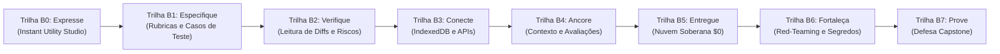

<div align="center">

<a href="https://openguideforai.dpdns.org">
  
</a>

# OpenGuide.
### Compreenda a mente por trás da máquina.

> **Um estúdio soberano e nativo do navegador, projetado para desmistificar a inteligência artificial — transformando caixas-pretas complexas em compreensão intuitiva e prática através da execução direta de código.**  
> **Criado para cada mente curiosa na Terra — desde uma tela de celular trincada brilhando sob uma lâmpada solitária até uma estação de engenharia com leitor de tela. 100% Gratuito • Zero Faturas em Nuvem • Soberano no Seu Navegador.**

<p align="center">
  <a href="https://openguideforai.dpdns.org">
    
  </a>
</p>

[](../../LICENSE)
[](https://pyodide.org/)
[](../../explainer.md)
[](#trilhas-duplas-de-aprendizado)
[](#design-universal-e-acessibilidade)
[](#instala%C3%A7%C3%A3o-no-desktop-e-como-pwa)

<p align="center">
  <b>Edições Multilíngues / Multilingual Editions:</b>&nbsp;
  <a href="../../README.md">English</a> &nbsp;•&nbsp;
  <a href="README_es.md">Español</a> &nbsp;•&nbsp;
  <a href="README_zh.md">简体中文</a> &nbsp;•&nbsp;
  <a href="README_ur.md">اردو</a> &nbsp;•&nbsp;
  <a href="README_ar.md">العربية</a> &nbsp;•&nbsp;
  <a href="README_hi.md">हिन्दी</a> &nbsp;•&nbsp;
  <a href="README_fr.md">Français</a> &nbsp;•&nbsp;
  <a href="README_de.md">Deutsch</a> &nbsp;•&nbsp;
  <a href="README_ja.md">日本語</a> &nbsp;•&nbsp;
  <a href="README_pt.md"><b>Português</b></a> &nbsp;•&nbsp;
  <a href="README_ru.md">Русский</a> &nbsp;•&nbsp;
  <a href="README_it.md">Italiano</a>
</p>

---

### [Abrir Estúdio](https://openguideforai.dpdns.org) &nbsp;•&nbsp; [A Experiência](#o-que-voc%C3%AA-experimenta) &nbsp;•&nbsp; [Trilhas Duplas](#trilhas-duplas-de-aprendizado) &nbsp;•&nbsp; [Avaliadores Automáticos](#avaliadores-autom%C3%A1ticos-inviol%C3%A1veis-de-dupla-fase) &nbsp;•&nbsp; [Banco de Conhecimento](#banco-de-conhecimento-soberano-offline-e-mentor-bluee) &nbsp;•&nbsp; [Acessibilidade](#design-universal-e-acessibilidade) &nbsp;•&nbsp; [Guia Explicativo](../../explainer.md) &nbsp;•&nbsp; [Início Rápido](#comece-em-60-segundos)

</div>

---

## O que Você Experimenta

O OpenGuide não é um serviço comum em nuvem nem uma série de tutoriais superficiais. É um laboratório de engenharia soberano nativo do navegador no qual você desconstrói, examina e compreende a inteligência artificial através da execução real de código.

| Pilar Fundamental | O que Acontece por Dentro | Por que Isso é Vital |
|---|---|---|
| **Educação Pura** | Aprenda a matemática genuína: escreva tokenizadores BPE, produtos escalares e cabeçotes de autoatenção a partir do zero. | Você constrói um entendimento conceitual permanente em vez de memorizar bibliotecas efêmeras. |
| **Execução Instantânea** | CPython 3.12 real executado no navegador via WebAssembly (Pyodide v0.26) em um Web Worker dedicado. | Zero configuração. Dispensa instalação de Python, Anaconda ou contêineres Docker em sua máquina. |
| **Trilhas Duplas de Aprendizado** | Alterne livremente entre arquitetura matemática profunda e desenvolvimento prático de aplicações completas. | Atende pesquisadores conceituais e desenvolvedores de produto sem nenhuma perda de progresso. |
| **Soberano e Privado** | 100% de computação do lado do cliente. Persistência local no IndexedDB do navegador. Zero telemetria. | Privacidade total. Zero assinaturas. Zero cobranças inesperadas na nuvem (Regra dos US$ 0). |
| **PWA e Conhecimento Offline** | Aplicação Web Progressiva que armazena em cache o currículo, o motor CPython e 250 tópicos de IA com código executável. | Programe, experimente e aprenda em qualquer lugar da Terra, mesmo sem conexão à Internet. |
| **Visuais Espaciais Interativos** | Variedades 3D aceleradas por GPU (Three.js) e WebXR traduzem tensores abstratos em coordenadas físicas. | Visualize, manipule e compreenda intuitivamente espaços de embeddings e grafos neurais. |

> 📖 **Especificação de Engenharia Aprofundada:** Para conhecer a arquitetura completa do sistema, o pipeline de execução, o watchdog de segurança de 15 segundos e a divulgação progressiva, consulte o [Guia Técnico ASD-STE100](../../explainer.md).

---

## Trilhas Duplas de Aprendizado

O OpenGuide oferece duas trilhas de aprendizado sincronizadas e de nível mundial. Alterne livremente entre elas a qualquer momento na barra de navegação superior usando o menu suspenso interativo do Seletor de Trilhas (que inclui um quiz interativo de recomendação para orientar sua escolha), com persistência independente de progresso para cada trilha:

### Trilha A: Engenheiro de IA Profunda (Trilhas 0–7 • 57 Laboratórios)
*Intuição matemática profunda, execução em WebAssembly com CPython 3.12 e mecânica de modelos de fronteira a partir do zero absoluto.*

```mermaid
graph LR
    T0["Trilha 0: Fundamentos<br/>(CPython WASM, Loops, BPE)"]
    T1["Trilha 1: Espaços Vetoriais<br/>(Embeddings, Busca Cosseno)"]
    T2["Trilha 2: Agentes e RAG<br/>(Loops ReAct, FastMCP)"]
    T3["Trilha 3: Evals e Segurança<br/>(OWASP AI Top 10, WebGPU)"]
    T4["Trilha 4: Sistemas de Fronteira<br/>(Self-Attention, RoPE, DPO)"]
    T5["Trilha 5: Fine-Tuning<br/>(LoRA, SVD, Bins NF4)"]
    T6["Trilha 6: Motores de Inferência<br/>(Paginação KV, Especulativo)"]
    T7["Trilha 7: Modelos Generativos<br/>(Difusão, CFG, ViT)"]

    T0 --> T1 --> T2 --> T3 --> T4 --> T5 --> T6 --> T7
```



| Trilha | Labs | Princípio Central | Projeto Capstone de Destaque |
|:---|:---:|:---|:---|
| **Trilha 0: Zero Absoluto** | 9 | Sintaxe Python explicada através de analogias intuitivas do cotidiano | Tokenizador Byte-Pair Encoding (BPE) criado do zero |
| **Trilha 1: Espaços Vetoriais** | 9 | Geometria de alta dimensão, produtos escalares e densidade semântica | `SemanticSearchEngine` em memória para indexar documentos |
| **Trilha 2: RAG e Agentes** | 9 | Máquinas de estado Pensamento $\rightarrow$ Ação $\rightarrow$ Observação | Agente de Pesquisa Autônomo com raciocínio multietapa |
| **Trilha 3: Avaliações e Blindagem** | 9 | Testes adversários, injeção de prompts e regras de segurança | Harness de avaliação sintética com inferência WebGPU |
| **Trilha 4: Sistemas de Fronteira** | 9 | Atenção scaled dot-product, cinemática de KV-cache e RoPE | Dissecação de Atenção Transformer e Motor de Perda DPO |
| **Trilha 5: Fine-Tuning e LoRA** | 6 | Adaptação eficiente de baixo posto, corte SVD e quantização NF4 | Motor de Fusão Dinâmica de Pesos LoRA sem Sobrecarga |
| **Trilha 6: Motores de Inferência** | 3 | Atendimento de alto rendimento, paginação KV e decodificação especulativa | Simulador de Paginação Virtual PagedAttention |
| **Trilha 7: Multimodal e Difusão** | 3 | Difusão direta com ruído, vetores de orientação CFG e patches ViT | Projetor Linear de Patches para Vision Transformer |

---

### Trilha B: The Builder Path (Trilhas B0–B7 • 24 Módulos / 48 Marcos)
*Engenharia de IA em Primeira Linha (Forward Deployed AI Engineering): Construa sistemas de software reais para produção usando especificações inequívocas, sandboxes e fluxos de trabalho agênticos.*



| Trilha Construtora | Módulos | Princípio de Engenharia | Laboratório Interativo |
|:---|:---:|:---|:---|
| **Trilha B0: Expresse (Say It)** | 3 | Do zero à primeira tela funcional em 3 frases | **Prompt-to-Preview Lab:** Renderização isolada em iframe |
| **Trilha B1: Especifique (Spec It)** | 3 | Escrever especificações técnicas cristalinas sem ambiguidades | **Spec Studio Lab:** Autocalibrador com rubrica de 5 regras |
| **Trilha B2: Verifique (Verify It)** | 3 | Leitura experiente de diffs de código e detecção de riscos de segurança | **Diff Reader Lab:** Auditoria visual de diffs e riscos de segurança |
| **Trilha B3: Entregue (Ship It)** | 3 | Simulação CDN Edge, persistência Dexie IndexedDB e escaneamento de vazamentos | **Edge Deploy Lab:** Simulador CDN, persistência IDB e scanner .env |
| **Trilha B4: Confie (Trust It)** | 3 | Segurança a nível de linha (Postgres RLS), CVE-2025-48757 e guardas de injeção | **Defensive Security Lab:** Consultas atacantes RLS em tempo real e sanitizadores |
| **Trilha B5: Dirija (Direct It)** | 3 | Constituições de projetos (`AGENTS.md`), orçamentos de tokens e anti-derivação | **Agent Director Lab:** Constituição de 5 cláusulas e compactação de contexto |
| **Trilha B6: Opere (Run It)** | 3 | Portões CI do GitHub de 4 estágios, telemetria de erros e reversão sem inatividade | **Pipeline Ops Lab:** Executor de CI e simulação de recuperação de desastres |
| **Trilha B7: Prove (Prove It)** | 3 | Defesa de arquitetura de 8 pontos, assinaturas Web Crypto SHA-256 e livro-razão imutável | **Capstone Ledger Lab:** Assinatura Web Crypto e exportação JSON imutável |

---

## Avaliadores Automáticos Invioláveis de Dupla Fase

Todos os **57 laboratórios do currículo** do OpenGuide são protegidos por um sistema rigoroso de avaliação automática de dupla fase:
1. **Fase 1 (Desafio Visível):** Valida tipos de retorno, dimensões de matrizes e sintaxe estrutural em relação a exemplos base.
2. **Fase 2 (Invariantes Matemáticos Ocultos):** Testa as soluções contra 5 invariantes matemáticos secretos por laboratório — checando desigualdade de Cauchy-Schwarz, escala de variância, simetria métrica e condições de borda.
3. **Taxa de Eliminação em Teste de Mutação:** Submetido a uma suíte automatizada de testes de mutação com 171 mutantes adversários, alcançando uma **Taxa de Eliminação de 100,0% (171/171 mutantes eliminados)** sem nenhum falso positivo.

---

## Banco de Conhecimento Soberano Offline e Mentor Bluee

O OpenGuide inclui uma base de conhecimento de engenharia integrada no cliente, com zero dependências externas em nuvem (Regra dos US$ 0):
- **250 Tópicos Essenciais de Fronteira e Ofícios Reais:** Cobertura de Mecânica de Atenção (FlashAttention-2/3, PagedAttention/vLLM, MLA), Alinhamento e Otimização (DPO, KTO, ORPO, LoRA, QLoRA), Geometria Vetorial (HNSW, ColBERT), Decodificação Estruturada, Quantização (FP8, INT8, AWQ, BitNet b1.58), Arquiteturas Multimodais (ViT, CLIP) e aplicações para mais de 17 ofícios do mundo real.
- **Motor de Busca Probabilística Okapi BM25:** Modelo de classificação ($k_1=1.2, b=0.75$) com frequência de documento inversa suavizada e ponderação multicampo.
- **Ponte Interlinguística Imediata:** Respostas instantâneas em 12 idiomas mundiais (português, inglês, espanhol, hindi, chinês, francês, alemão, árabe, russo, japonês, urdu, italiano).
- **Cartões Explicativos Visuais Interativos:** Micro-widgets puramente em JavaScript (controle deslizante de temperatura Softmax, alocação de blocos PagedAttention, mostrador de similaridade cosseno, rotação fasorial RoPE) montados nos cartões de conhecimento.
- **Códigos Python / NumPy Executáveis:** Cada tópico técnico inclui um exemplo Python completo e autônomo que roda localmente no runtime WebAssembly Pyodide.

---

## Continuum Humano Universal de IA

O OpenGuide não foi criado para uma casta seleta. Ele foi concebido para todo o espectro do conhecimento humano — desde quem nunca escreveu uma linha de código até pesquisadores e arquitetos de modelos de fronteira:

| Estágio e Perfil | Contexto no Mundo Real | O que o OpenGuide Entrega |
|---|---|---|
| **Estágio 0: Curioso Sem Código** | Primeiro contato com IA. Sobrecarregado por jargões e assinaturas pagas. | Modelos mentais claros ("Você é um LLM"), as 3 Regras de Ouro do Prompting (Papel + Contexto + Formato) e transparência de custo zero. |
| **Estágio 1: Ofícios e Profissões Práticas** | Mecânicos automotivos, sapateiros, carpinteiros, cabeleireiros, chefs, encanadores. | IA Cotidiana em ação: diagnósticos de oficina, geradores de orçamentos, calculadoras de materiais e fluxos de trabalho. |
| **Estágio 2: Profissionais de Conhecimento e Serviços** | Médicos, professores, contadores, pesquisadores jurídicos, agrônomos. | Modelos de prompts estruturados, extração de tabelas, guias de estudo e privacidade local absoluta. |
| **Estágio 3: Desenvolvedores de Sistemas Aplicados** | Engenheiros de software construindo aplicações com LLMs e agentes. | Execução real de Python no navegador, tokenização, esquemas JSON-RPC e chamadas de ferramentas via Model Context Protocol (MCP). |
| **Estágio 4: Arquitetos de Segurança e Avaliação de IA** | Engenheiros de confiabilidade que protegem modelos em produção. | Proteção contra OWASP AI Top 10, sandboxes de injeção de prompts, filtros de PII e baterias de testes automatizados. |
| **Estágio 5: Pesquisadores e Construtores de Modelos de Fronteira** | Especialistas que mergulham nos fundamentos matemáticos generativos. | Atenção scaled dot-product do zero, cinemática de KV-cache, quantização uniforme INT8 e perda fechada DPO. |

---

## Design Universal e Acessibilidade

* **24 Temas Calibrados com Alto Contraste:** 12 temas escuros e 12 claros em conformidade com os **padrões WCAG 2.2 AAA** (taxas de contraste acima de 7:1 até 20:1) para conforto ocular e leitura diurna.
* **12 Idiomas Nativos Suportados:** Tipografia cuidadosa com ligaduras autênticas Nastaliq (**urdu**), caligrafia árabe, devanagari (**hindi**), CJK (**chinês**, **japonês**) e alfabetos latino e cirílico (**inglês**, **espanhol**, **francês**, **alemão**, **português**, **russo**, **italiano**).
* **Certificado para Leitores de Tela:** Regiões de notificação ARIA dinâmicas (`aria-live="polite"`), retenção de foco em modais e marcos semânticos que garantem navegação assistiva completa.
* **Suporte Bidirecional RTL Completo:** Layout espelhado para urdu e árabe, mantendo a direção da esquerda para a direita (LTR) em blocos de código-fonte.
* **Sistema de Segurança Tipográfica:** Alturas de linha dinâmicas que evitam sobreposições visuais em escritas complexas como devanagari e nastaliq.
* **Ergonomia Universal Mobile e Desktop:** Layouts adaptativos em visualização dividida, contenção dinâmica de unidades de viewport (`100dvh`), barras de comando táteis de alta densidade e modais responsivos testados em telas compactas, tablets, displays de alta densidade e setups multimonitor.

---

## Blueprint de Engenharia de IA em Primeira Linha (FDE)

O OpenGuide traz um guia interativo de **Engenharia de IA em Primeira Linha (FDE)** acessível diretamente pelo cabeçalho ou pela Paleta de Comandos (`Cmd + K` / `Ctrl + K`):
- **Matriz Comparativa de Funções e Sistemas:** Compara programadores casuais, engenheiros de software tradicionais, pesquisadores de IA e engenheiros FDE em 6 dimensões operacionais.
- **Manuais de Configuração de IDEs Agênticas:** Guias práticos, comandos de terminal e configurações para Google Antigravity IDE, Anthropic Claude Code CLI e OpenAI Codex & Cursor.
- **Stack Soberana a US$ 0:** Arquitetura completa utilizando GitHub Actions CI, rede de borda Cloudflare Pages, PostgreSQL sem servidor Neon, CPython WebAssembly e Hugging Face Spaces.
- **Higiene Rigorosa de Segredos:** Isolamento de chaves na memória (BYOK), verificadores automáticos pré-commit e modelos `.env.example` protegidos.
- **Diretrizes de Governança do Repositório:** Acordos técnicos sincronizados (`AGENTS.md`, `CLAUDE.md`, `ARCHITECTURE.md`, `CHANGELOG.md`).

---

## Arquitetura Soberana do Lado do Cliente (Regra dos US$ 0)

O OpenGuide opera sob a **Regra dos US$ 0**. **Não há servidor backend**. **Não há banco de dados rastreando você**. 100% da computação é executada no seu navegador local:

```
┌────────────────────────────────────────────────────────────────────────┐
│                   SEU AMBIENTE LOCAL ISOLADO NO NAVEGADOR              │
│                                                                        │
│  ┌─────────────────────────┐         ┌──────────────────────────────┐  │
│  │   INTERFACE E NAVEGAÇÃO │         │      WEB WORKER EM 2º PLANO  │  │
│  │   • React 18 + Vite     │         │   • CPython 3.12 (Pyodide)   │  │
│  │   • 24 Temas Calibrados │ ◄─────► │   • Matemática Vetorial NumPy│  │
│  │   • Rolagem Suave Lenis │         │   • Watchdog Protetor de 15s │  │
│  │   • Editor CodeMirror 6 │         │   • Simulador JS à Prova Queda│ │
│  └────────────┬────────────┘         └──────────────┬───────────────┘  │
│               │                                     │                  │
│  ┌────────────▼────────────┐         ┌──────────────▼───────────────┐  │
│  │    ESPACIAL E NEURONAL  │         │     PERSISTÊNCIA SOBERANA    │  │
│  │   • Three.js WebGL / XR │         │   • IndexedDB via Dexie      │  │
│  │   • Síntese Harmônica   │         │   • Backup Criptografado Gist│  │
│  │   • Motor WebGPU Local  │         │   • Certificado Digital W3C  │  │
│  └─────────────────────────┘         └──────────────────────────────┘  │
└────────────────────────────────────────────────────────────────────────┘
```

---

## Holodeck Espacial 3D e Extensões de Hardware

Como recurso interativo avançado, o OpenGuide traz um Holodeck de computação espacial 3D WebXR / WebGL no navegador (`/holodeck`) com aceleração por hardware:

* **Variedades Vetoriais a 60FPS Sustentados:** Visualização em tempo real de espaços vetoriais 3D, agrupamentos semânticos e grafos neurais via Three.js, com buffers pré-alocados e pausa automática fora de tela.
* **Áudio Espacial Harmônico Binaural:** Motor de som Web Audio API que sintetiza acordes musicais harmônicos proporcionais à similaridade cosseno vetorial.
* **Modo Óculos AR com Preto Puro Óptico:** Modo calibrado `#000000` que apaga os pixels OLED nas guias de onda ópticas para exibir um HUD nítido em dispositivos Viture, Xreal, RayNeo, Rokid, Meta Quest e Apple Vision Pro.
* **Teclado Espacial Virtual:** Flutuante no ar ou acoplado à mesa para exploração imersiva sem toque físico.

---

## Comece em 60 Segundos

### Inicie no Navegador (Sem Instalação)
Acesse **[https://openguideforai.dpdns.org](https://openguideforai.dpdns.org)** e clique em **Iniciar Trilha 0** ou **Começar como Construtor**. O ambiente WebAssembly CPython inicializa localmente em menos de um segundo.

### Executar Localmente via Git
```bash
# 1. Ativar o Corepack e clonar o repositório
corepack enable
git clone https://github.com/openguideforai/OpenGuideForAI.git
cd OpenGuideForAI

# 2. Instalar dependências e iniciar o servidor de desenvolvimento
yarn install
yarn dev
```
Abra `http://localhost:5173` no seu navegador.

#### Testes na Rede Local (Smartphones / Tablets)
Para testar em um smartphone ou tablet conectado ao seu Wi-Fi local:
```bash
yarn dev --host
```

---

## Instalação no Desktop e como PWA

O OpenGuide opera como um **Progressive Web App (PWA) Instalável** com integração nativa de janelas:

* **Windows (10 / 11):** No Chrome ou Edge, clique no ícone de instalação na barra de endereços para criar um atalho na Área de Trabalho e no Menu Iniciar.
* **macOS:** No Safari, clique em **Arquivo** $\rightarrow$ **Adicionar ao Dock**; ou em **Instalar** no Chrome/Edge.
* **Linux:** Clique em Instalar no Chromium ou Chrome. Um inicializador `.desktop` será criado automaticamente no seu menu de aplicativos.
* **Smartphones (Android e iOS):** No Safari do iPhone, toque em **Compartilhar** $\rightarrow$ **Adicionar à Tela de Início**; no Android, toque em **Instalar aplicativo**.
* **Modo Totalmente Offline (Air-Gapped):** O Service Worker salva todas as aulas, visualizadores 3D e o motor WebAssembly no dispositivo, permitindo estudar em viagens ou sem rede.

---

## Ergonomia e Atalhos

| Atalho | Ferramenta Ativada | Ação Executada |
|---|:---:|---|
| **`Cmd + K` / `Ctrl + K`** | Paleta de Comandos | Busca difusa imediata em todos os 57 laboratórios, 24 temas, 12 idiomas e ferramentas. |
| **`Ctrl + Enter`** | Executor de Código | Compila e roda instantaneamente o código Python ativo no Web Worker. |
| **`Alt + X`** | Lente de Raio-X | Inspeção em tempo real da memória WebAssembly, nós da árvore AST e tabelas IndexedDB. |
| **`Alt + S`** | HUD Espacial | Alterna o HUD 3-DoF flutuante e o modo preto puro para óculos inteligentes AR. |
| **Barra de Toque** | Editor Mobile | Acesso com um toque às teclas sintáticas frequentes (`Tab`, `:`, `( )`, `[ ]`, `def`, `assert`). |
| **Exportar `.ipynb`** | Criador de Notebooks | Baixa os exercícios aprovados como notebooks padrão Jupyter (nbformat 4.5). |
| **Áudio Harmônico** | Holodeck 3D | Converte similaridades vetoriais em harmonias musicais audíveis. |

---

## Portão de Garantia de Qualidade (Suíte Pré-Voo de 5 Pontos)

Cada contribuição deve ser aprovada na verificação em 5 pontos antes de ser integrada:
```bash
# 1. Verificação de servidor local ativo (HTTP 200 OK)
(Invoke-WebRequest http://localhost:5173).StatusCode == 200

# 2. Verificação automatizada por navegador headless (0 erros no console)
# Testado de forma autônoma via Playwright

# 3. Linter estático de código-fonte (0 erros)
yarn lint

# 4. Suíte automatizada de testes de regressão (100% de sucesso em todos os arquivos de teste)
npx playwright test --config apps/web/playwright.config.ts

# 5. Compilação estática de produção (0 erros TypeScript/Vite)
yarn --cwd apps/web build
```

---

## Autoria e Curadoria

O OpenGuide foi idealizado, desenhado e construído por **Adil Rafiq Dar (ARD)**.

```
                   UMA DECLARAÇÃO SOBRE EDUCAÇÃO SOBERANA
"Construí o OpenGuide porque acredito profundamente que o conhecimento sobre
inteligência artificial deve pertencer a toda a humanidade. Ele não pode ficar restrito
por assinaturas caras de nuvem, pedágios corporativos ou barreiras acadêmicas elitistas.

Cada linha deste estúdio foi forjada através de noites incontáveis de dedicação, testes
matemáticos rigorosos e uma atenção inflexível ao design de interfaces. O OpenGuide é
um presente aberto para o mundo.

Para manter este estúdio 100% gratuito, independente e sempre alinhado aos modelos
de ponta sem anúncios ou investidores privados, conto com o apoio de estudantes e
patrocinadores que compartilham dessa visão."
```

Apoie o desenvolvimento aberto e contínuo:

<div align="center">

[](https://github.com/sponsors/openguideforai)
&nbsp;&nbsp;
[](https://ko-fi.com/buymegoodcoffee)
&nbsp;&nbsp;
[](https://paypal.me/buymegoodcoffee)

<br/>

<sub>Suas contribuições mantêm a hospedagem do domínio, a infraestrutura de integração contínua e a expansão do currículo aberto.</sub>

</div>

---

## Documentação Técnica e Referências

* **[Histórico de Lançamentos (Changelog)](../../CHANGELOG.md):** Marcos cronológicos e evolução da arquitetura.
* **[Guia Técnico Explicativo ASD-STE100](../../explainer.md):** Especificação técnica completa abordando comunicação com Web Workers, limites de memória e design de divulgação progressiva.
* **[Arquitetura do Sistema](../../ARCHITECTURE.md):** Análise detalhada dos stores reativos, Web Workers e pipelines de computação WebGPU.
* **[Especificações do Currículo](../CURRICULUM.md):** Conteúdo programático completo e resultados técnicos dos 57 laboratórios (8 trilhas).
* **[Dossiê de Auditoria Técnica Externa e QA](../EXTERNAL-AUDIT-QA-DOSSIER.md):** Fundamentação de arquitetura, matrizes de invariantes matemáticos e instruções de verificação independente.
* **[Auditoria Externa de Qualidade](../AUDIT_QA.md):** Relatório de auditoria multiplataforma e conformidade técnica.

<div align="center">
  <sub>Projetado e construído por Adil Rafiq Dar (ARD). Sob licenças AGPL-3.0 e CC BY-NC-SA 4.0.</sub>
</div>
