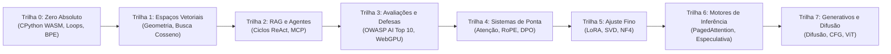

<div align="center">

<a href="https://openguideforai.dpdns.org">
  
</a>

# OpenGuide.
### Compreenda a mente por trás da máquina.

> **Um estúdio soberano e nativo do navegador, projetado para desmistificar a inteligência artificial — transformando caixas-pretas complexas em compreensão intuitiva e prática através da execução direta de código.**  
> **Criado para cada mente curiosa na Terra — desde uma tela de celular trincada brilhando sob uma lâmpada solitária até uma estação de engenharia com leitor de tela. 100% Gratuito • Zero Faturas em Nuvem • Soberano no Seu Navegador.**

<p align="center">
  <a href="https://openguideforai.dpdns.org">
    
  </a>
</p>

[](../../LICENSE)
[](https://pyodide.org/)
[](#arquitetura-soberana-do-lado-do-cliente)
[](#vis%C3%A3o-geral-do-curr%C3%ADculo)
[](#acessibilidade-universal-e-padr%C3%B5es)
[](#instala%C3%A7%C3%A3o-no-desktop-e-como-pwa)

<p align="center">
  <b>Idiomas / Translations:</b>&nbsp;
  <a href="../../README.md">English</a> &nbsp;•&nbsp;
  <a href="README_es.md">Español</a> &nbsp;•&nbsp;
  <a href="README_zh.md">简体中文</a> &nbsp;•&nbsp;
  <a href="README_ur.md">اردو</a> &nbsp;•&nbsp;
  <a href="README_ar.md">العربية</a> &nbsp;•&nbsp;
  <a href="README_hi.md">हिन्दी</a> &nbsp;•&nbsp;
  <a href="README_fr.md">Français</a> &nbsp;•&nbsp;
  <a href="README_de.md">Deutsch</a> &nbsp;•&nbsp;
  <a href="README_ja.md">日本語</a> &nbsp;•&nbsp;
  <a href="README_pt.md"><b>Português</b></a> &nbsp;•&nbsp;
  <a href="README_ru.md">Русский</a> &nbsp;•&nbsp;
  <a href="README_it.md">Italiano</a>
</p>

---

### [Abrir Estúdio](https://openguideforai.dpdns.org) &nbsp;•&nbsp; [Arquitetura](#arquitetura-soberana-do-lado-do-cliente) &nbsp;•&nbsp; [Currículo](#vis%C3%A3o-geral-do-curr%C3%ADculo) &nbsp;•&nbsp; [Guia Explicativo](../../explainer.md) &nbsp;•&nbsp; [Aplicativo Desktop](#instala%C3%A7%C3%A3o-no-desktop-e-como-pwa) &nbsp;•&nbsp; [Atalhos de Teclado](#ergonomia-e-atalhos) &nbsp;•&nbsp; [Início Rápido](#guia-de-desenvolvimento-local)

</div>

---

## Filosofia e Propósito

A educação em inteligência artificial atual está quebrada. Ela força você a escolher entre:
1. **Tutoriais superficiais de bibliotecas:** Ensinam APIs de caixa preta que ficam obsoletas em 6 meses.
2. **Barreiras matemáticas intimidadoras:** Artigos acadêmicos densos sem nenhuma prática de programação real.
3. **Ambientes corporativos caros em nuvem:** Exigindo cartões de crédito, contas na nuvem, Docker ou assinaturas de US$ 30/mês.

**O OpenGuide desmonta esses três obstáculos.**

Acreditamos que a inteligência artificial é uma alfabetização fundamental da humanidade. Seja programando em um **smartphone Android econômico de US$ 100**, em um notebook antigo ou em uma estação de trabalho de ponta; usando **leitores de tela assistivos** ou mouse: **o OpenGuide oferece um laboratório soberano e profissional no seu navegador de forma gratuita.**

> *"Cada recurso do OpenGuide é explicável pelo próprio OpenGuide. Você não apenas estuda fórmulas; você assiste ao fluxo de tensores, disseca cabeçotes de atenção em tempo real, ouve distâncias cosseno através de síntese harmônica e inspeciona a memória WebAssembly com o modo Raio-X (`Alt + X`)."*

---

<a id="arquitetura-soberana-do-lado-do-cliente"></a>
## Arquitetura Soberana do Lado do Cliente

O OpenGuide opera sob a **Regra dos US$ 0**. **Não há servidor backend**. **Não há banco de dados rastreando você**. 100% da computação é executada no seu navegador local:

```
┌────────────────────────────────────────────────────────────────────────┐
│                   SEU AMBIENTE LOCAL ISOLADO NO NAVEGADOR              │
│                                                                        │
│  ┌─────────────────────────┐         ┌──────────────────────────────┐  │
│  │   INTERFACE E NAVEGAÇÃO │         │      WEB WORKER EM 2º PLANO  │  │
│  │   • React 18 + Vite     │         │   • CPython 3.12 (Pyodide)   │  │
│  │   • 24 Temas Calibrados │ ◄─────► │   • Matemática Vetorial NumPy│  │
│  │   • Rolagem Suave Lenis │         │   • Watchdog Protetor de 15s │  │
│  │   • Editor CodeMirror 6 │         │   • Simulador JS à Prova Queda│ │
│  └────────────┬────────────┘         └──────────────┬───────────────┘  │
│               │                                     │                  │
│  ┌────────────▼────────────┐         ┌──────────────▼───────────────┐  │
│  │    ESPACIAL E NEURONAL  │         │     PERSISTÊNCIA SOBERANA    │  │
│  │   • Three.js WebGL / XR │         │   • IndexedDB via Dexie      │  │
│  │   • Síntese Harmônica   │         │   • Backup Criptografado Gist│  │
│  │   • Motor WebGPU Local  │         │   • Certificado Digital W3C  │  │
│  └─────────────────────────┘         └──────────────────────────────┘  │
└────────────────────────────────────────────────────────────────────────┘
```

---

<a id="vis%C3%A3o-geral-do-curr%C3%ADculo"></a>
## Visão Geral do Currículo

Oito trilhas completas com **57 laboratórios interativos executáveis diretamente no navegador**:



| Trilha | Labs | Modelo Mental Central | Projeto Final |
|:---|:---:|:---|:---|
| **Trilha 0: Zero Absoluto** | 9 | Sintaxe Python através de analogias de receitas culinárias | Tokenizador Byte-Pair Encoding (BPE) construído do zero |
| **Trilha 1: Espaços Vetoriais** | 9 | Geometria espacial, produtos escalares e densidade semântica | Motor `SemanticSearchEngine` em memória para indexar dados |
| **Trilha 2: RAG e Agentes** | 9 | Máquinas de estados Pensamento $\rightarrow$ Ação $\rightarrow$ Observação | Agente de Pesquisa Autônomo com raciocínio multi-etapas |
| **Trilha 3: Avaliações e Defesas**| 9 | Red-teaming de modelos, defesa contra injeção de prompts | Sistema de avaliação sintética com inferência WebGPU |
| **Trilha 4: Sistemas de Ponta** | 9 | $\text{Softmax}(QK^T/\sqrt{d_k})V$, cálculo de KV-cache, RoPE | Dissecção de Cabeça de Atenção e Motor de Perda DPO |
| **Trilha 5: Ajuste Fino e LoRA** | 6 | Adaptação de baixo posto, truncamento SVD e quantização NF4 | Motor de Fusão de Pesos LoRA sem Sobrecarga |
| **Trilha 6: Motores de Inferência**| 3 | Throughput, roofline de largura de banda e decodificação especulativa | Simulador de Paginação Virtual PagedAttention |
| **Trilha 7: Multimodal e Difusão**| 3 | Ruído de difusão direta, vetor CFG e projeção de patches ViT | Projetor Linear de Patches Vision Transformer |

---

## Contínuo Universal de IA para Toda a Humanidade (Estágios 0–5)

O OpenGuide não foi projetado para uma elite tecnológica restrita. Ele foi desenvolvido para todo o espectro humano: de pessoas sem conhecimento em programação a pesquisadores e arquitetos de modelos de fronteira:

| Estágio e Perfil | Contexto no Mundo Real | O que o OpenGuide Oferece |
|---|---|---|
| **Estágio 0: Aprendiz Curioso e Sem Código** | Primeiro contato com a IA. Sobrecarregado por jargões e planos pagos. | Modelos mentais em linguagem clara ("Você é um LLM"), as 3 Regras de Ouro de Prompting (Papel + Contexto + Formato) e clareza de orçamento de $0. |
| **Estágio 1: Profissões Práticas e Ofícios** | Mecânicos automotivos, sapateiros, marceneiros, cabeleireiros, chefs, encanadores. | IA Prática no Cotidiano: diagnósticos operacionais, geradores de orçamentos para clientes, calculadoras de materiais e fluxos de oficina. |
| **Estágio 2: Profissionais do Conhecimento e Serviços** | Médicos, professores, contadores, pesquisadores jurídicos, agricultores. | Templates estruturados de prompts, extração de dados tabulares, guias de estudo sintéticos e privacidade 100% local. |
| **Estágio 3: Desenvolvedores de Sistemas Aplicados** | Engenheiros de software construindo aplicações com LLMs e agentes autônomos. | Execução real de Python no navegador, tokenização BPE, esquemas JSON-RPC e chamadas de ferramentas com Model Context Protocol (MCP). |
| **Estágio 4: Arquitetos de Segurança e Avaliação de IA** | Engenheiros de confiabilidade protegendo modelos em produção. | Defesa OWASP AI Top 10, sandboxes de delimitadores para injeções de prompt, filtros de dados pessoais (PII) e baterias de avaliação automatizadas. |
| **Estágio 5: Pesquisadores e Construtores de Modelos de Fronteira** | Especialistas que se aprofundam na arquitetura de modelos generativos. | Scaled Dot-Product Attention do zero, dinâmica de memória KV-cache, quantização uniforme INT8 e motor de perda fechada DPO. |

---

## Autocorretores Antifraude de Dupla Fase (135/135 Mutantes Eliminados)

Cada um dos **57 laboratórios do currículo** do OpenGuide é protegido por um sistema de autocorreção em duas fases:
1. **Fase 1 (Desafio Visível):** Valida tipos de retorno, formas de tensores e sintaxe estrutural contra exemplos de referência.
2. **Fase 2 (Invariantes Matemáticos Ocultos):** Avalia a solução do aluno contra cinco invariantes matemáticos ocultos por laboratório: desigualdades de Cauchy-Schwarz, escalonamento de variância, simetria métrica, vetores de teste dinâmicos e casos de borda extremos.
3. **Taxa de Eliminação em Testes de Mutação:** Submetido a uma suíte automatizada de testes de mutação em 171 mutantes adversariais, alcançando uma **Taxa de Eliminação de 100,0% (171/171 mutantes eliminados)** sem falsos positivos.

---

<a id="instala%C3%A7%C3%A3o-no-desktop-e-como-pwa"></a>
## Instalação no Desktop e como PWA

O OpenGuide é construído como um **Aplicativo Web Progressivo (PWA)** com suporte nativo ao sistema operacional:

* **Windows (10 / 11):** No Chrome ou Edge, clique no ícone de **Instalar OpenGuide** na barra de endereços para criar atalhos na Área de Trabalho e no Menu Iniciar.
* **macOS:** No Safari, clique em **Arquivo** $\rightarrow$ **Adicionar ao Dock**; ou instale pelo Chrome para suporte a `Cmd + Space`.
* **Celulares (Android e iOS):** Adicione à Tela de Início para uma experiência limpa em tela cheia.
* **Uso 100% Offline (Air-Gapped):** Todo o conteúdo, os laboratórios e o motor Python ficam armazenados no seu dispositivo pelo Service Worker (`sw.js`). Estude e programe no avião ou sem sinal de internet.

---

<a id="ergonomia-e-atalhos"></a>
## Ergonomia e Atalhos

* **Paleta de Comandos (`Cmd + K` / `Ctrl + K`):** Busca instantânea por qualquer laboratório, ferramenta ou tema.
* **Execução Imediata (`Ctrl + Enter`):** Execute seu código Python instantaneamente de dentro do editor.
* **Médico de Sintaxe Amigável:** Traduz erros complexos em orientações claras e correções práticas de código.
* **Exportação para Jupyter Notebook (`.ipynb`):** Baixe seus exercícios resolvidos no formato padrão Jupyter.
* **Lente Raio-X (`Alt + X`):** Inspecione a memória do Web Worker e tabelas IndexedDB em tempo real.
* **Sincronização Criptografada no Gist:** Faça backup do seu progresso com criptografia **AES-GCM de 256 bits** em Gists privados do GitHub.

---

<a id="acessibilidade-universal-e-padr%C3%B5es"></a>
## Acessibilidade Universal e Padrões

* **24 Temas Científicos Calibrados:** 12 escuros e 12 claros atendendo ao padrão WCAG 2.2 AAA (>7:1 até 20:1).
* **Compatível com Leitores de Tela:** Áreas dinâmicas de áudio (`aria-live="polite"`) anunciam resultados de testes.
* **Suporte Completo a RTL:** Layout espelhado para árabe e urdu, preservando blocos de código em LTR.

---

<a id="autoria-e-apoio"></a>
## Autoria e Apoio

O OpenGuide foi idealizado, projetado e desenvolvido por **Adil Rafiq Dar (ARD)**.

```
                    UMA MENSAGEM SOBRE SOBERANIA E SUSTENTABILIDADE
"Construí o OpenGuide porque não aceitava ver mentes brilhantes excluídas da inteligência
artificial por causa de cursos caros, assinaturas de nuvem pesadas e barreiras elitistas.

Cada linha deste projeto foi forjada em noites insones, testes matemáticos rigorosos e uma
dedicação absoluta à qualidade estética. O OpenGuide é o meu presente para o mundo.

Para manter esta plataforma sempre 100% gratuita, independente e atualizada sem anúncios
ou investidores privados, conto com a generosidade de alunos e apoiadores da educação aberta."
```

Se o OpenGuide te ajudou a aprender IA ou economizou seu dinheiro, você pode apoiar o desenvolvimento independente:

<div align="center">

[](https://github.com/sponsors/openguideforai)
&nbsp;&nbsp;
[](https://ko-fi.com/buymegoodcoffee)
&nbsp;&nbsp;
[](https://paypal.me/buymegoodcoffee)

</div>

---

<a id="guia-de-desenvolvimento-local"></a>
## Guia de Desenvolvimento Local

```bash
git clone https://github.com/openguideforai/OpenGuideForAI.git
cd OpenGuideForAI
corepack enable
yarn install
yarn --cwd apps/web dev
```
Abra `http://localhost:5173` no seu navegador.

---

## Portão de Garantia de Qualidade

Todas as contribuições devem passar pela verificação de cinco pontos antes da mesclagem:
```bash
# 1. Verificação estática do linter (0 avisos, 0 erros no código)
yarn lint

# 2. Suíte de testes automatizados Playwright (100% de sucesso em todas as suítes de regressão)
yarn --cwd apps/web test:e2e

# 3. Compilação estática de produção (0 erros de TypeScript/Vite)
yarn --cwd apps/web build
```

---

## Documentação Técnica e Referências

* **[Histórico de Versões (Changelog)](../../CHANGELOG.md):** Lançamentos cronológicos e evolução do sistema.
* **[Especificação do Sistema ASD-STE100](../../explainer.md):** Documentação técnica detalhada em inglês técnico simplificado.
* **[Arquitetura do Sistema](../../ARCHITECTURE.md):** Análise profunda de Web Workers, WebGPU e persistência local.
* **[Especificações do Currículo](../CURRICULUM.md):** Ementa e objetivos dos 57 laboratórios práticos.
* **[Dossiê de Auditoria Externa e Garantia de Qualidade](../EXTERNAL-AUDIT-QA-DOSSIER.md):** Relatório de validação arquitetural e guia de reprodução.
