<div align="center">

<a href="https://openguideforai.dpdns.org">
  
</a>

# OpenGuide.
### Поймите разум, стоящий за машиной.

> **Автономная браузерная лаборатория, созданная для демистификации искусственного интеллекта: превращение сложных «черных ящиков» в ясное практическое понимание через реальное исполнение кода.**  
> **Создано для каждого пытливого ума на Земле: от разбитого экрана телефона под одинокой ночной лампочкой до инженерной рабочей станции с экранным диктором. 100% Бесплатно • Ноль Счетов за Облако • Полный Суверенитет в Вашем Браузере.**

<p align="center">
  <a href="https://openguideforai.dpdns.org">
    
  </a>
</p>

[](../../LICENSE)
[](https://pyodide.org/)
[](../../explainer.md)
[](#два-образовательных-трека)
[](#универсальный-дизайн-и-доступность)
[](#установка-на-пк-и-мобильные-устройства-pwa)

<p align="center">
  <b>Языковые Версии / Multilingual Editions:</b>&nbsp;
  <a href="../../README.md">English</a> &nbsp;•&nbsp;
  <a href="README_es.md">Español</a> &nbsp;•&nbsp;
  <a href="README_zh.md">简体中文</a> &nbsp;•&nbsp;
  <a href="README_ur.md">اردو</a> &nbsp;•&nbsp;
  <a href="README_ar.md">العربية</a> &nbsp;•&nbsp;
  <a href="README_hi.md">हिन्दी</a> &nbsp;•&nbsp;
  <a href="README_fr.md">Français</a> &nbsp;•&nbsp;
  <a href="README_de.md">Deutsch</a> &nbsp;•&nbsp;
  <a href="README_ja.md">日本語</a> &nbsp;•&nbsp;
  <a href="README_pt.md">Português</a> &nbsp;•&nbsp;
  <a href="README_ru.md"><b>Русский</b></a> &nbsp;•&nbsp;
  <a href="README_it.md">Italiano</a>
</p>

---

### [Запустить Студию](https://openguideforai.dpdns.org) &nbsp;•&nbsp; [Опыт Студии](#ваш-опыт-в-студии) &nbsp;•&nbsp; [Два Трека](#два-образовательных-трека) &nbsp;•&nbsp; [Автогрейдеры](#защищенные-двухфазные-автогрейдеры) &nbsp;•&nbsp; [База Знаний](#суверенная-офлайн-база-знаний-и-ментор-bluee) &nbsp;•&nbsp; [Доступность](#универсальный-дизайн-и-доступность) &nbsp;•&nbsp; [Техническое Описание](../../explainer.md) &nbsp;•&nbsp; [Быстрый Старт](#старт-за-60-секунд)

</div>

---

## Ваш Опыт в Студии

OpenGuide — это не обычный облачный сервис и не поверхностный сборник туториалов. Это суверенная инженерная лаборатория в вашем браузере, где вы разбираете, анализируете и понимаете искусственный интеллект через реальное исполнение программного кода.

| Фундаментальный Принцип | Что Происходит Внутри | Почему Это Важно |
|---|---|---|
| **Чистое Фундаментальное Обучение** | Изучайте подлинную математику: создавайте токенизаторы BPE, скалярные произведения и блоки внимания с нуля. | Вы получаете долговечное концептуальное понимание вместо заучивания библиотечных оберток, устаревающих за полгода. |
| **Мгновенное Исполнение Кода** | Полноценный CPython 3.12 запускается прямо в браузере через WebAssembly (Pyodide v0.26) в выделенном Web Worker. | Ноль настроек. На вашем компьютере не нужны Python, Anaconda или тяжелые Docker-контейнеры. |
| **Два Образовательных Трека** | Легко переключайтесь между глубокой математической архитектурой и практической разработкой готовых приложений. | Подходит как для ученых-исследователей, так и для инженеров-создателей продуктов без потери прогресса. |
| **Суверенитет и Приватность** | 100% вычислений на стороне клиента. Данные сохраняются локально в IndexedDB браузера. Ноль телеметрии. | Абсолютная конфиденциальность. Никаких платных подписок. Никаких неожиданных счетов за облако (Правило 0 $). |
| **PWA и Офлайн-Знания** | Прогрессивное веб-приложение сохраняет весь учебный план, движок Python и 250 тем с исполняемым кодом локально. | Программируйте, экспериментируйте и учитесь в любой точке планеты даже без подключения к сети. |
| **Интерактивная 3D-Пространственная Визуализация** | GPU-ускоренная Three.js и WebXR визуализация переводит абстрактные тензоры в физические пространственные координаты. | Вы наглядно наблюдаете, вращаете и интуитивно постигаете многомерные эмбеддинги и нейронные графы. |

> 📖 **Глубокая Инженерная Спецификация:** Подробное описание системной архитектуры, каналов связи, 15-секундного сторожевого таймера и принципов прогрессивного раскрытия доступно в [Техническом Описании ASD-STE100](../../explainer.md).

---

## Два Образовательных Трека

OpenGuide предлагает два синхронизированных учебных трека мирового уровня. Переключайтесь между ними в любой момент через верхнюю панель навигации:

### Трек А: Глубокий Инженер ИИ (Направления 0–7 • 57 Лабораторных)
*Глубокая математическая интуиция, реальное исполнение CPython 3.12 WebAssembly и понимание передовых архитектур с абсолютного нуля.*

```mermaid
graph LR
    T0["Трек 0: Основы<br/>(CPython WASM, Циклы, BPE)"]
    T1["Трек 1: Векторные Пространства<br/>(Эмбеддинги, Косинусный Поиск)"]
    T2["Трек 2: Агенты и RAG<br/>(Циклы ReAct, FastMCP)"]
    T3["Трек 3: Оценки и Безопасность<br/>(OWASP AI Top 10, WebGPU)"]
    T4["Трек 4: Передовые Системы<br/>(Self-Attention, RoPE, DPO)"]
    T5["Трек 5: Тонкая Настройка<br/>(LoRA, SVD, Бины NF4)"]
    T6["Трек 6: Движки Инференса<br/>(Пейджинг KV, Спекулятивный)"]
    T7["Трек 7: Генеративные Модели<br/>(Диффузия, CFG, ViT)"]

    T0 --> T1 --> T2 --> T3 --> T4 --> T5 --> T6 --> T7
```



| Трек | Лаб | Базовый Принцип | Итоговый Проект Capstone |
|:---|:---:|:---|:---|
| **Трек 0: Абсолютный Ноль** | 9 | Синтаксис Python через жизненные метафоры кухни и пространства | Токенизатор Byte-Pair Encoding (BPE) с чистого листа |
| **Трек 1: Векторные Пространства** | 9 | Многомерная геометрия, скалярные произведения и плотность смыслов | Движок поиска `SemanticSearchEngine` в оперативной памяти |
| **Трек 2: RAG и Автономные Агенты** | 9 | Конечные автоматы «Мысль $\rightarrow$ Действие $\rightarrow$ Наблюдение» и MCP | Автономный исследовательский агент с многошаговыми рассуждениями |
| **Трек 3: Оценки и Барьеры Безопасности** | 9 | Состязательное тестирование (Red-Teaming) и защита от инъекций | Автоматизированный стенд синтетической оценки на базе WebGPU |
| **Трек 4: Передовые Системы** | 9 | Механизм внимания Scaled Dot-Product, динамика KV-кэша и RoPE | Анатомия блоков внимания Transformer и функция потерь DPO |
| **Трек 5: Тонкая Настройка и LoRA** | 6 | Эффективная адаптация низкого ранга, усечение SVD и квантование NF4 | Движок динамического слияния весов LoRA без задержек |
| **Трек 6: Движки Инференса** | 3 | Высокопроизводительный сервинг, виртуальный пейджинг и декодирование | Симулятор виртуального распределения памяти PagedAttention |
| **Трек 7: Генеративные и Мультимодальные Модели** | 3 | Прямая зашумляющая диффузия, векторы наведения CFG и патчи ViT | Линейный проектор патчей изображений для Vision Transformer |

---

### Трек Б: Путь Создателя ПО (Направления B0–B7 • 24 Модуля / 48 Вех)
*Передовая Инженерия ИИ (Forward Deployed AI Engineering): Создавайте реальное производственное ПО с помощью четких спецификаций, песочниц и агентных пайплайнов.*

```mermaid
graph LR
    B0["Трек B0: Сформулируйте<br/>(Студия Прототипов)"]
    B1["Трек B1: Специфицируйте<br/>(Критерии и Тесты)"]
    B2["Трек B2: Проверьте<br/>(Чтение Diffs и Риски)"]
    B3["Трек B3: Подключите<br/>(IndexedDB и API)"]
    B4["Трек B4: Закрепите<br/>(Контекст и Эвалы)"]
    B5["Трек B5: Разверните<br/>(Суверенное Облако $0)"]
    B6["Трек B6: Укрепите<br/>(Red-Teaming и Секреты)"]
    B7["Трек B7: Докажите<br/>(Защита Capstone)"]

    B0 --> B1 --> B2 --> B3 --> B4 --> B5 --> B6 --> B7
```



| Направление Создателя | Модули | Инженерный Принцип | Практическая Лаборатория |
|:---|:---:|:---|:---|
| **Трек B0: Сформулируйте (Say It)** | 3 | От идеи к первому работающему интерфейсу за 3 предложения | **Prompt-to-Preview Lab:** Изолированный рендеринг в iframe |
| **Трек B1: Специфицируйте (Spec It)** | 3 | Составление кристально ясных ТЗ, исключающих галлюцинации моделей | **Spec Studio Lab:** Автогрейдер по 5 золотым правилам спецификаций |
| **Трек B2: Проверьте (Verify It)** | 3 | Экспертный анализ diff-патчей кода и перехват уязвимостей | **Diff Reader Lab:** Визуальный аудит диффов и рисков безопасности |
| **Трек B3: Подключите (Connect It)** | 3 | Локальная база данных (Dexie IndexedDB) и мок-эндпоинты | **Storage Workbench:** Проектирование схем данных local-first |
| **Трек B4: Закрепите (Ground It)** | 3 | Контекстные конституции (`AGENTS.md`), правила и автоматические эвалы | **Harness Studio Lab:** Комплексная оценка выполнения задач |
| **Трек B5: Разверните (Ship It)** | 3 | Автоматическое развертывание с бюджетом 0 $: GitHub Actions + Cloudflare | **Pipeline Deployer:** Настройка непрерывной доставки (CI/CD) |
| **Трек B6: Укрепите (Harden It)** | 3 | Моделирование угроз, гигиена API-ключей и прекоммит-сканеры | **Security Sandbox:** Предотвращение утечек секретов |
| **Трек B7: Докажите (Prove It)** | 3 | Защита архитектуры, подтвержденное портфолио и крипто-сертификат | **Capstone Defense:** Криптографическая верификация SHA-256 |

---

## Защищенные Двухфазные Автогрейдеры

Все **57 практических лабораторий** OpenGuide защищены строгой двухфазной системой автоматической проверки:
1. **Фаза 1 (Открытый Тест):** Проверяет типы возвращаемых значений, размерности тензоров и синтаксис на эталонных примерах.
2. **Фаза 2 (Скрытые Математические Инварианты):** Тестирует решения на 5 скрытых математических правилах для каждой лабы — неравенство Коши-Буняковского, масштабирование дисперсии, симметрия метрик и граничные условия.
3. **Результат Мутационного Тестирования:** Проверено автоматизированным набором мутационных тестов на 171 враждебном мутанте с достижением **100,0% Уничтожения Мутантов (171/171 mutants killed)** без ложноположительных пропусков.

---

## Суверенная Офлайн-База Знаний и Ментор Bluee

OpenGuide включает встроенную инженерную базу знаний, работающую на стороне клиента без внешних облачных зависимостей (Правило 0 $):
- **250 Ключевых Тем и Реальных Профессий:** Механизмы внимания Transformer (FlashAttention-2/3, PagedAttention/vLLM, MLA), выравнивание и оптимизация (DPO, KTO, ORPO, LoRA, QLoRA), векторная геометрия (HNSW, ColBERT), структурированное декодирование, квантование (FP8, INT8, AWQ, BitNet b1.58), мультимодальные модели (ViT, CLIP) и прикладные решения для 17+ реальных профессий.
- **Вероятностный Поисковый Движок Okapi BM25:** Промышленная формула ранжирования ($k_1=1.2, b=0.75$) со сглаженной инверсной частотой документов и взвешиванием полей.
- **Мгновенный Мультиязычный Поиск:** Быстрый поиск на 12 мировых языках (русский, английский, испанский, хинди, китайский, французский, немецкий, арабский, японский, урду, португальский, итальянский).
- **Интерактивные Наглядные Карточки:** Микро-виджеты на чистом JS (ползунок температуры Softmax, распределение блоков памяти PagedAttention, шкала косинусного сходства, фазовые углы RoPE) прямо в карточках знаний.
- **Исполняемые Скрипты Python / NumPy:** Каждая статья снабжена полностью готовым скриптом на Python, запускаемым локально в Pyodide.

---

## Общечеловеческий Континуум ИИ

OpenGuide создан не для закрытой элиты. Он спроектирован для всего спектра человеческих возможностей — от новичков до ведущих исследователей и архитекторов моделей:

| Уровень и Профиль | Реальный Контекст и Потребность | Что Дает OpenGuide |
|---|---|---|
| **Уровень 0: Любознательный Новичок** | Первое знакомство с ИИ. Растерянность от терминов и платных подписок. | Понятные ментальные модели («Вы и есть LLM»), 3 золотых правила промптинга (Роль + Контекст + Формат) и нулевая стоимость. |
| **Уровень 1: Реальные Ремесла и Профессии** | Автомеханики, сапожники, плотники, стилисты, повара, сантехники. | Прикладной ИИ: экспресс-диагностика, расчет смет для клиентов, калькуляторы материалов и рабочие чек-листы. |
| **Уровень 2: Специалисты Знаний и Сервиса** | Врачи, преподаватели, бухгалтеры, юристы, агрономы. | Структурированные шаблоны промптов, извлечение таблиц, создание учебных пособий и полная приватность на устройстве. |
| **Уровень 3: Разработчики Прикладных Систем** | Программисты, создающие продукты на базе LLM и агентов. | Запуск реального Python в браузере, механика токенизации, контракты JSON-RPC и интеграция инструментов через протокол MCP. |
| **Уровень 4: Архитекторы Безопасности и Оценки** | Инженеры надежности, защищающие продакшн-системы. | Защита от OWASP AI Top 10, изоляция промпт-инъекций, фильтрация ПДн (PII) и автоматизированные тест-сьюты. |
| **Уровень 5: Исследователи и Создатели Моделей** | Специалисты, погружающиеся в математические основы глубокого обучения. | Скалярное внимание с нуля, кинематика KV-кэша, квантование INT8 и точные формулы функции потерь DPO. |

---

## Универсальный Дизайн и Доступность

* **24 Научно Выверенные Темы:** 12 темных и 12 светлых палитр, соответствующих **международному стандарту WCAG 2.2 AAA** (контрастность от 7:1 до 20:1) для защиты зрения и комфортного чтения.
* **Поддержка 12 Языков с Аутентичной Типографикой:** Шрифт насталик с естественными лигатурами (**урду**), арабская вязь, деванагари (**хинди**), восточноазиатские иероглифы (**китайский**, **японский**), латиница и кириллица (**русский**, **английский**, **испанский**, **французский**, **немецкий**, **португальский**, **итальянский**).
* **Сертификация для Экранных Дикторов:** Динамические уведомления ARIA (`aria-live="polite"`), фокус-ловушки в модальных окнах и четкие структурные ориентиры для невизуального управления.
* **Полноценная Поддержка RTL:** Зеркальная компоновка для урду и арабского языка с автоматическим сохранением направления LTR для фрагментов кода.
* **Безопасная Высота Строк:** Динамические интервалы предотвращают вертикальное наложение диакритических знаков в сложных шрифтах.

---

## Руководство по Передовой Инженерии ИИ (FDE)

В OpenGuide встроено интерактивное **Руководство по Передовой Инженерии ИИ (FDE)**, доступное прямо из верхней панели или через палитру команд (`Cmd + K` / `Ctrl + K`):
- **Сравнительная Матрица Компетенций:** Объективное сопоставление вайб-кодеров, классических разработчиков, исследователей ИИ и FDE-инженеров по 6 ключевым параметрам.
- **Инструкции по Настройке Агентных IDE:** Проверенные конфигурации, терминальные команды и регламенты для Google Antigravity IDE, Anthropic Claude Code CLI и OpenAI Codex & Cursor.
- **Суверенный Стек за 0 $:** Архитектурная схема использования GitHub Actions CI, Cloudflare Pages, Neon Serverless Postgres, CPython WebAssembly и Hugging Face Spaces.
- **Надежная Защита от Утечек Ключей:** Изоляция ключей в оперативной памяти (BYOK), прекоммит-сканеры и безопасные шаблоны `.env.example`.
- **Единые Стандарты Управления Репозиторием:** Согласованные регламенты разработки (`AGENTS.md`, `CLAUDE.md`, `ARCHITECTURE.md`, `CHANGELOG.md`).

---

## Суверенная Клиентская Архитектура (Правило 0 $)

OpenGuide работает по **Правилу 0 $**. **Здесь нет бэкенд-сервера**. **Нет баз данных, собирающих ваши данные**. 100% вычислений выполняются локально в вашем браузере:

```
┌────────────────────────────────────────────────────────────────────────┐
│                   ВАША ЛОКАЛЬНАЯ ИЗОЛИРОВАННАЯ СРЕДА                   │
│                                                                        │
│  ┌─────────────────────────┐         ┌──────────────────────────────┐  │
│  │   ИНТЕРФЕЙС И РАБОТА    │         │     ФОНОВЫЙ WEB WORKER       │  │
│  │   • React 18 + Vite     │         │   • CPython 3.12 (Pyodide)   │  │
│  │   • 24 Темы Оформления  │ ◄─────► │   • Векторная Математика     │  │
│  │   • Плавный Скролл      │         │   • Сторожевой Таймер 15с    │  │
│  │   • Редактор CodeMirror │         │   • Надежный Резервный Движок│  │
│  └────────────┬────────────┘         └──────────────┬───────────────┘  │
│               │                                     │                  │
│  ┌────────────▼────────────┐         ┌──────────────▼───────────────┐  │
│  │   ПРОСТРАНСТВО И НЕЙРО  │         │     ЛОКАЛЬНОЕ ХРАНИЛИЩЕ      │  │
│  │   • Three.js WebGL / XR │         │   • IndexedDB через Dexie    │  │
│  │   • Звуковой Синтезатор │         │   • Шифрованный Бэкап Gist   │  │
│  │   • Локальный WebGPU    │         │   • W3C Цифровая Подпись     │  │
│  └─────────────────────────┘         └──────────────────────────────┘  │
└────────────────────────────────────────────────────────────────────────┘
```

---

## 3D Пространственный Голодек и Аппаратные Расширения

В качестве передовой интерактивной возможности OpenGuide включает браузерный 3D-голодек пространственных вычислений WebXR / WebGL (`/holodeck`) и аппаратное ускорение:

* **Стабильная Визуализация 60FPS:** Three.js визуализация 3D-векторных пространств, семантических кластеров и синаптических графов с предварительно выделенной памятью и авто-паузой вне экрана.
* **Бинауральный Гармонический Звук:** Аудиодвижок Web Audio API, синтезирующий гармонические аккорды, пропорциональные косинусному сходству векторов.
* **Режим Оптической Прозрачности True-Black для AR-Очков:** Отключение пикселей OLED (`#000000`) для отображения четкого парящего HUD на очках Viture, Xreal, RayNeo, Rokid, Meta Quest и Apple Vision Pro.
* **Виртуальная Пространственная Клавиатура:** Управление в воздухе или с привязкой к поверхности стола для полного погружения.

---

## Старт за 60 Секунд

### Запуск в Браузере (Без Установки)
Перейдите на **[https://openguideforai.dpdns.org](https://openguideforai.dpdns.org)** и нажмите **Запустить Трек 0** или **Начать как Создатель ПО**. Окружение WebAssembly запустится менее чем за секунду.

### Локальный Запуск через Git
```bash
# 1. Включите Corepack и клонируйте репозиторий
corepack enable
git clone https://github.com/openguideforai/OpenGuideForAI.git
cd OpenGuideForAI

# 2. Установите зависимости и запустите локальный сервер
yarn install
yarn dev
```
Откройте `http://localhost:5173` в браузере.

#### Тестирование в Локальной Сети (Смартфоны / Планшеты)
Для проверки на смартфоне или планшете, подключенном к вашей сети Wi-Fi:
```bash
yarn dev --host
```

---

## Установка на ПК и Мобильные Устройства (PWA)

OpenGuide работает как **Устанавливаемое Прогрессивное Веб-Приложение (PWA)**:

* **Windows (10 / 11):** В Chrome или Edge нажмите на значок установки в адресной строке для создания ярлыка на рабочем столе и в меню «Пуск».
* **macOS:** В Safari выберите **Файл** $\rightarrow$ **Добавить в Dock**; либо нажмите **Установить** в Chrome/Edge.
* **Linux:** Нажмите «Установить» в Chromium или Chrome. Файл `.desktop` будет создан автоматически.
* **Смартфоны (Android и iOS):** В Safari на iPhone нажмите **Поделиться** $\rightarrow$ **На экран «Домой»**; на Android нажмите **Установить приложение**.
* **Полная Автономность (Air-Gapped):** Сервис-воркер сохраняет все уроки, 3D-визуализации и движок Python на устройстве, позволяя учиться в поездках без интернета.

---

## Эргономика и Горячие Клавиши

| Сочетание | Инструмент | Выполняемое Действие |
|---|:---:|---|
| **`Cmd + K` / `Ctrl + K`** | Палитра Команд | Мгновенный нечеткий поиск по всем 57 лабораториям, 24 темам, 12 языкам и инструментам. |
| **`Ctrl + Enter`** | Запуск Кода | Компиляция и мгновенное выполнение текущего кода Python в Web Worker. |
| **`Alt + X`** | Рентген-Линза | Инспекция памяти WebAssembly, дерева AST и локальной базы данных в реальном времени. |
| **`Alt + S`** | Пространственный HUD | Включение/выключение 3-DoF HUD и режима True-Black для AR-очков. |
| **Сенсорная Панель** | Мобильный Редактор | Быстрый ввод ключевых символов (`Tab`, `:`, `( )`, `[ ]`, `def`, `assert`) на смартфоне. |
| **Экспорт в `.ipynb`** | Генератор Ноутбуков | Скачивание проверенных решений в формате стандартных Jupyter Notebooks (nbformat 4.5). |
| **Гармонический Звук** | 3D Голодек | Преобразование косинусного сходства векторов в гармоничные музыкальные аккорды. |

---

## Шлюз Обеспечения Качества (5-Точечный Предполетный Тест)

Каждое изменение должно пройти строгую 5-точечную проверку качества перед слиянием:
```bash
# 1. Проверка доступности локального сервера (HTTP 200 OK)
(Invoke-WebRequest http://localhost:5173).StatusCode == 200

# 2. Автоматизированная проверка безголовым браузером (0 ошибок в консоли)
# Проверяется автоматически через Playwright

# 3. Статическая проверка линтером (0 ошибок)
yarn lint

# 4. Полный набор регрессионных тестов (100% прохождение по 20 тестовым файлам)
npx playwright test --config apps/web/playwright.config.ts

# 5. Статическая сборка продакшн-бандла (0 ошибок TypeScript/Vite)
yarn --cwd apps/web build
```

---

## Авторство и Миссия

OpenGuide был концептуализирован, спроектирован и создан **Адилем Рафиком Даром (Adil Rafiq Dar / ARD)**.

```
                   ДЕКЛАРАЦИЯ О СУВЕРЕННОМ ОБРАЗОВАНИИ
"Я создал OpenGuide, потому что глубоко убежден: знания об искусственном интеллекте
должны принадлежать всему человечеству. Они не должны быть ограничены платными подписками,
корпоративными шлагбаумами или элитарными академическими барьерами.

Каждая строчка этой студии, каждая формула и каждая деталь интерфейса созданы в ходе
бесчисленных ночей работы, строгих математических проверок и бескомпромиссного внимания
к качеству. OpenGuide — это открытый подарок миру.

Чтобы эта студия оставалась на 100% бесплатной, независимой и свободной от рекламы
или сторонних инвесторов, я с радостью принимаю поддержку учеников и меценатов,
разделяющих это видение."
```

Поддержите независимое открытое развитие проекта:

<div align="center">

[](https://github.com/sponsors/openguideforai)
&nbsp;&nbsp;
[](https://ko-fi.com/buymegoodcoffee)
&nbsp;&nbsp;
[](https://paypal.me/buymegoodcoffee)

<br/>

<sub>Ваши пожертвования идут на оплату домена, инфраструктуры CI/CD и расширение открытого учебного плана.</sub>

</div>

---

## Техническая Документация и Ресурсы

* **[История Релизов (Changelog)](../../CHANGELOG.md):** Хронология версий и архитектурной эволюции системы.
* **[Техническое Описание ASD-STE100](../../explainer.md):** Подробная спецификация взаимодействия с Web Worker, лимитов памяти и прогрессивного раскрытия.
* **[Архитектура Системы](../../ARCHITECTURE.md):** Глубокий анализ реактивных хранилищ, Web Worker и вычислительных конвейеров WebGPU.
* **[Спецификация Учебного Плана](../CURRICULUM.md):** Полный перечень целей и результатов всех 57 лабораторий (8 треков).
* **[Внешний Технический Аудит и Досье QA](../EXTERNAL-AUDIT-QA-DOSSIER.md):** Обоснование архитектуры, матрицы математических инвариантов и инструкции по воспроизведению.
* **[Независимый Отчет о Качестве](../AUDIT_QA.md):** Многоуровневый отчет о тестировании и готовности к эксплуатации.

<div align="center">
  <sub>Архитектура и разработка: Adil Rafiq Dar (ARD). Лицензии AGPL-3.0 и CC BY-NC-SA 4.0.</sub>
</div>
