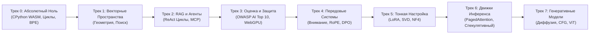

<div align="center">

<a href="https://openguideforai.dpdns.org">
  
</a>

# OpenGuide.
### Поймите разум, стоящий за машиной.

> **Автономная браузерная лаборатория, созданная для демистификации искусственного интеллекта: превращение сложных «черных ящиков» в ясное практическое понимание через реальное исполнение кода.**  
> **Создано для каждого пытливого ума на Земле: от разбитого экрана телефона под одинокой ночной лампочкой до инженерной рабочей станции с экранным диктором. 100% Бесплатно • Ноль Счетов за Облако • Полный Суверенитет в Вашем Браузере.**

<p align="center">
  <a href="https://openguideforai.dpdns.org">
    
  </a>
</p>

[](../../LICENSE)
[](https://pyodide.org/)
[](#суверенная-клиентская-архитектура)
[](#обзор-учебного-плана)
[](#универсальная-доступность-и-стандарты)
[](#установка-на-пк-и-pwa)

<p align="center">
  <b>Языки / Translations:</b>&nbsp;
  <a href="../../README.md">English</a> &nbsp;•&nbsp;
  <a href="README_es.md">Español</a> &nbsp;•&nbsp;
  <a href="README_zh.md">简体中文</a> &nbsp;•&nbsp;
  <a href="README_ur.md">اردو</a> &nbsp;•&nbsp;
  <a href="README_ar.md">العربية</a> &nbsp;•&nbsp;
  <a href="README_hi.md">हिन्दी</a> &nbsp;•&nbsp;
  <a href="README_fr.md">Français</a> &nbsp;•&nbsp;
  <a href="README_de.md">Deutsch</a> &nbsp;•&nbsp;
  <a href="README_ja.md">日本語</a> &nbsp;•&nbsp;
  <a href="README_pt.md">Português</a> &nbsp;•&nbsp;
  <a href="README_ru.md"><b>Русский</b></a> &nbsp;•&nbsp;
  <a href="README_it.md">Italiano</a>
</p>

---

### [Запустить Студию](https://openguideforai.dpdns.org) &nbsp;•&nbsp; [Архитектура](#суверенная-клиентская-архитектура) &nbsp;•&nbsp; [Учебный План](#обзор-учебного-плана) &nbsp;•&nbsp; [Пояснение (STE)](../../explainer.md) &nbsp;•&nbsp; [Десктоп-версия](#установка-на-пк-и-pwa) &nbsp;•&nbsp; [Горячие Клавиши](#эргономика-и-горячие-клавиши) &nbsp;•&nbsp; [Локальный Запуск](#локальная-разработка)

</div>

---

## Философия и Миссия

Современное образование в области ИИ сталкивается с тремя фундаментальными проблемами:
1. **Поверхностные туториалы по готовым библиотекам:** Обучение черным ящикам, устаревающим за полгода.
2. **Пугающие математические стены:** Сложные научные статьи без интерактивной программной практики.
3. **Дорогие облачные песочницы:** Требование кредитных карт, облачных подписок или 30 $/месяц за доступ.

**OpenGuide устраняет все три барьера.**

Мы верим, что искусственный интеллект — это фундаментальная грамотность человеческой цивилизации. Программируете ли вы на **бюджетном Android-смартфоне за 100 $**, старом ноутбуке или мощной рабочей станции; используете ли вы экранный диктор или обычную мышь: **OpenGuide предоставляет вам первоклассную суверенную лабораторию в браузере совершенно бесплатно.**

> *"Каждая функция OpenGuide объясняется самим OpenGuide. Вы не просто читаете математические формулы; вы наблюдаете поток тензоров, разбираете блоки внимания в реальном времени, слышите косинусные расстояния через гармонический звук и исследуете память WebAssembly в рентген-режиме (`Alt + X`)."*

---

<a id="суверенная-клиентская-архитектура"></a>
## Суверенная Клиентская Архитектура

OpenGuide работает по **Правилу 0 $**. **Здесь нет бэкенд-сервера**. **Нет баз данных, собирающих ваши данные**. 100% вычислений выполняются локально в вашем браузере:

```
┌────────────────────────────────────────────────────────────────────────┐
│                   ВАША ЛОКАЛЬНАЯ ИЗОЛИРОВАННАЯ СРЕДА                   │
│                                                                        │
│  ┌─────────────────────────┐         ┌──────────────────────────────┐  │
│  │   ИНТЕРФЕЙС И РАБОТА    │         │     ФОНОВЫЙ WEB WORKER       │  │
│  │   • React 18 + Vite     │         │   • CPython 3.12 (Pyodide)   │  │
│  │   • 24 Темы Оформления  │ ◄─────► │   • Векторная Математика     │  │
│  │   • Плавный Скролл      │         │   • Сторожевой Таймер 15с    │  │
│  │   • Редактор CodeMirror │         │   • Надежный Резервный Движок│  │
│  └────────────┬────────────┘         └──────────────┬───────────────┘  │
│               │                                     │                  │
│  ┌────────────▼────────────┐         ┌──────────────▼───────────────┐  │
│  │   ПРОСТРАНСТВО И НЕЙРО  │         │     ЛОКАЛЬНОЕ ХРАНИЛИЩЕ      │  │
│  │   • Three.js WebGL / XR │         │   • IndexedDB через Dexie    │  │
│  │   • Звуковой Синтезатор │         │   • Шифрованный Бэкап Gist   │  │
│  │   • Локальный WebGPU    │         │   • W3C Цифровая Подпись     │  │
│  └─────────────────────────┘         └──────────────────────────────┘  │
└────────────────────────────────────────────────────────────────────────┘
```

---

## Пространственный Голодек на Смарт-Очках AR (Spatial Holodeck)

OpenGuide включает встроенный в браузер 3D-голодек пространственных вычислений WebXR / WebGL (`/holodeck`), оптимизированный для флагманских прозрачных смарт-очков AR (Viture Pro 2, Xreal Air 2 Ultra, RayNeo Air 2s, Rokid Max 2, Meta Quest 3/3S и Apple Vision Pro):

* **Стабильная Производительность 60FPS:** Three.js визуализация 3D-векторных пространств, семантической кластеризации и графов нейронных синапсов в реальном времени.
* **Оптический Сквозной Режим True-Black OLED:** Калиброванный режим `#000000`, отключающий пиксели OLED на волноводах для четкого наложения пространственного HUD на реальный мир.
* **Бинауральный Гармонический Пространственный Звук:** Звуковой синтез гармонических квинт, пропорциональных косинусному сходству векторов через Web Audio API.
* **Виртуальная Пространственная Клавиатура и Трекинг Головы:** Парящая клавиатура с акустической и тактильной отдачей и эмуляцией 3-DoF датчиков головы.
* **Матрица Оборудования AR-Очков:** Интерактивное руководство для SpaceWalker, Nebula и MyGlasses с настройкой IPD и частоты 120 Гц.

---

<a id="обзор-учебного-плана"></a>
## Обзор Учебного Плана

Восемь комплексных направлений, включающих **57 интерактивных исполняемых практических лабораторных**:



| Трек | Лаб | Ментальная Модель | Финальный Проект |
|:---|:---:|:---|:---|
| **Трек 0: Абсолютный Ноль** | 9 | Синтаксис Python через понятные жизненные аналогии | Полноценный Byte-Pair Encoding (BPE) токенизатор с нуля |
| **Трек 1: Векторные Пространства**| 9 | Геометрия пространств, скалярные произведения и смысл | Движок семантического поиска `SemanticSearchEngine` |
| **Трек 2: RAG и Агенты** | 9 | Автоматы Мысль $\rightarrow$ Действие $\rightarrow$ Наблюдение | Автономный исследовательский агент со сложными рассуждениями |
| **Трек 3: Оценка и Безопасность** | 9 | Тестирование моделей, защита от атак и метрики качества | Автоматизированная система синтетической оценки на WebGPU |
| **Трек 4: Передовые Системы** | 9 | $\text{Softmax}(QK^T/\sqrt{d_k})V$, расчет памяти, RoPE | Анатомия механизма внимания Transformer и функция потерь DPO |
| **Трек 5: Тонкая Настройка и LoRA**| 6 | Низкоранговая адаптация, SVD-сжатие и NF4 квантование | Движок слияния весов LoRA с нулевыми накладными расходами |
| **Трек 6: Движки Инференса**| 3 | Пропускная способность, руфлайн памяти и спекулятивное декодирование | Симулятор виртуального пейджинга PagedAttention |
| **Трек 7: Мультимодальность и Диффузия**| 3 | Прямое зашумление, векторное поле CFG и патчи изображений ViT | Линейный проектор патчей Vision Transformer |

---

## Универсальный Континуум ИИ для Всего Человечества (Стадии 0–5)

OpenGuide создан не для узкой технологической элиты. Он спроектирован для всего спектра человечества: от новичков без опыта в программировании до исследователей передовых генеративных архитектур:

| Стадия и Профиль | Реальный Жизненный Контекст | Что Предлагает OpenGuide |
|---|---|---|
| **Стадия 0: Любознательный Новичок и No-Code** | Первое знакомство с ИИ; страх перед заумными терминами и платными подписками. | Ментальные модели простым языком («Вы сами являетесь LLM»), 3 Золотых Правила Промптинга (Роль + Контекст + Формат) и нулевой бюджет ($0). |
| **Стадия 1: Прикладные Ремесла и Профессии** | Автомеханики, сапожники, плотники, парикмахеры, повара, сантехники. | Повседневный ИИ в деле: оперативная диагностика поломок, генераторы смет для клиентов, калькуляторы материалов и мастерские процессы. |
| **Стадия 2: Интеллектуальный Труд и Специалисты** | Врачи, преподаватели, бухгалтеры, юристы, агрономы. | Структурированные шаблоны промптов, извлечение табличных данных, синтетические учебные пособия и 100% локальная приватность. |
| **Стадия 3: Разработчики Прикладных Систем** | Инженеры-программисты, создающие приложения на базе LLM и автономных агентов. | Полноценный Python прямо в браузере, BPE-токенизация, схемы JSON-RPC и вызов внешних инструментов через Model Context Protocol (MCP). |
| **Стадия 4: Архитекторы Безопасности и Оценки** | Инженеры надежности, защищающие промышленные модели в продакшене. | Защита от угроз OWASP AI Top 10, изолирующие разделители от инъекций промптов, фильтры персональных данных (PII) и автоматические эвалы. |
| **Стадия 5: Исследователи и Создатели Моделей** | Специалисты, погружающиеся в фундаментальную математику генеративных сетей. | Scaled Dot-Product Attention с нуля, кинематика KV-кэша, равномерное INT8 квантование и расчет функции потерь DPO в замкнутой форме. |

---

## Двухфазные Защищенные Автогрейдеры (171/171 Мутантов Ликвидировано)

Каждая из **57 лабораторных работ** OpenGuide защищена надежной двухфазной системой автоматической проверки:
1. **Фаза 1 (Открытый Тест):** Проверяет типы возвращаемых значений, размерности тензоров и синтаксис на базовых примерах.
2. **Фаза 2 (Скрытые Математические Инварианты):** Оценивает решение учащегося по 5 скрытым математическим инвариантам для каждого задания: неравенства Коши-Буняковского-Шварца, масштабирование дисперсии, симметрия метрик, динамические тест-векторы и экстремальные граничные условия.
3. **Результат Мутационного Тестирования:** Проверено на автоматическом наборе из 171 искусственного вредоносного мутанта кода — достигнута **100.0% ликвидация (171 из 171 мутанта устранен)** без ложных срабатываний.

---

<a id="установка-на-пк-и-pwa"></a>
## Установка на ПК и PWA

OpenGuide спроектирован как **Устанавливаемое Прогрессивное Веб-Приложение (PWA)**:

* **Windows (10 / 11):** В строке адреса Chrome или Edge нажмите кнопку **Установить OpenGuide** для создания ярлыков на рабочем столе и в меню «Пуск».
* **macOS:** В Safari выберите **Файл** $\rightarrow$ **Добавить в Dock**, либо установите через Chrome.
* **Мобильные Устройства:** Добавьте на главный экран для полноэкранного автономного режима.
* **Полная Автономная Работа (Air-Gapped):** Благодаря кэшу Service Worker (`sw.js`) все материалы курса и интерпретатор Pyodide хранятся на вашем устройстве. Вы можете учиться и писать код в самолете без подключения к сети.

---

<a id="эргономика-и-горячие-клавиши"></a>
## Эргономика и Горячие Клавиши

* **Командная Панель (`Cmd + K` / `Ctrl + K`):** Быстрый поиск по всем лабораторным, инструментам и темам.
* **Мгновенный Запуск (`Ctrl + Enter`):** Выполнение кода Python прямо из редактора.
* **Дружелюбный Доктор Синтаксиса:** Преобразует непонятные ошибки компилятора в ясные практические подсказки.
* **Экспорт в Jupyter Notebook (`.ipynb`):** Скачивание решенных заданий в виде стандартных ноутбуков.
* **Рентген-Режим (`Alt + X`):** Мониторинг памяти Web Worker и баз данных в реальном времени.
* **Пространственный HUD Очков AR (`Alt + S`):** Переключение плавающего 3-DoF HUD гарнитуры, углов подвеса и режима True-Black.
* **Шифрованная Синхронизация Gist:** Безопасное сохранение прогресса с шифрованием **AES-GCM 256 бит** в GitHub Gist.

---

<a id="универсальная-доступность-и-стандарты"></a>
## Универсальная Доступность и Стандарты

* **24 Научно Выверенные Темы:** 12 темных и 12 светлых схем, соответствующих стандартам WCAG 2.2 AAA (>7:1 до 20:1).
* **Поддержка Экранных Дикторов:** Специальные зоны голосового оповещения (`aria-live="polite"`).
* **Поддержка Языков Справа Налево (RTL):** Корректное отображение для арабского языка и урду с сохранением направления LTR для кода.

---

<a id="авторство-и-поддержка"></a>
## Авторство и Поддержка

OpenGuide разработан, спроектирован и создан **Адилем Рафиком Даром (Adil Rafiq Dar - ARD)**.

```
                    ОБРАЩЕНИЕ О СУВЕРЕНИТЕТЕ И ДОСТУПНОСТИ
"Я создал OpenGuide, потому что устал видеть, как талантливые люди лишаются возможности
изучать искусственный интеллект из-за дорогих курсов, облачных счетов и закрытых барьеров.

Каждая строка этого проекта создавалась бессонными ночами, строгими математическими тестами
и бескомпромиссным вниманием к эстетике интерфейса. OpenGuide — мой подарок миру.

Чтобы эта студия оставалась на 100% бесплатной, независимой и свободной от рекламы,
я с благодарностью принимаю поддержку тех, кто верит в свободное образование для всех."
```

Если OpenGuide помог вам освоить ИИ или сэкономил ваши средства, вы можете поддержать проект:

<div align="center">

[](https://github.com/sponsors/openguideforai)
&nbsp;&nbsp;
[](https://ko-fi.com/buymegoodcoffee)
&nbsp;&nbsp;
[](https://paypal.me/buymegoodcoffee)

</div>

---

<a id="локальная-разработка"></a>
## Локальная Разработка

```bash
git clone https://github.com/openguideforai/OpenGuideForAI.git
cd OpenGuideForAI
corepack enable
yarn install
yarn --cwd apps/web dev
```
Откройте `http://localhost:5173` в браузере.

---

## Контрольный Шлюз Качества (Quality Assurance Gate)

Каждое изменение обязано успешно пройти пятиступенчатую проверку качества перед слиянием:
```bash
# 1. Проверка линтером (0 предупреждений, 0 ошибок во всем коде)
yarn lint

# 2. Набор автоматических тестов Playwright (100% успешное прохождение всех регрессионных наборов)
yarn --cwd apps/web test:e2e

# 3. Статическая сборка для продакшена (0 ошибок TypeScript / Vite)
yarn --cwd apps/web build
```

---

## Техническая Документация и Материалы

* **[История Версий (Changelog)](../../CHANGELOG.md):** Хронология релизов и развитие проекта.
* **[Спецификация Системы ASD-STE100](../../explainer.md):** Подробное техническое описание на упрощенном английском языке.
* **[Архитектура Системы](../../ARCHITECTURE.md):** Глубокий анализ Web Workers, WebGPU и локального хранилища.
* **[Спецификация Учебной Программы](../CURRICULUM.md):** Полная программа и цели всех 57 интерактивных лабораторий.
* **[Досье Внешнего Аудита и Контроля Качества](../EXTERNAL-AUDIT-QA-DOSSIER.md):** Отчет для независимых аудиторов и руководство по воспроизведению.
