<div align="center" dir="rtl">

<a href="https://openguideforai.dpdns.org">
  
</a>

# OpenGuide.
### مشین کے پیچھے چھپے ذہن کو سمجھیں۔

> **ایک بااختیار، براؤزر-مقامی اسٹوڈیو جسے مصنوعی ذہانت کے اسرار کو حل کرنے کے لیے وضع کیا گیا ہے—جو پیچیدہ بلیک باکسز کو خالص کوڈ کے نفاذ کے ذریعے براہ راست فہم اور وجدان میں تبدیل کرتا ہے۔**  
> **زمین پر بسنے والے ہر متجسس انسان کے لیے تراشا گیا—رات کے اندھیرے میں اکلوتے بلب تلے ٹوٹی ہوئی اسکرین والے فون سے لے کر اسکرین ریڈر والے انجینئرنگ ورک اسٹیشن تک۔ 100% مفت • زیرو کلاؤڈ بلز • آپ کے براؤزر میں مکمل خودمختار۔**

<p align="center">
  <a href="https://openguideforai.dpdns.org">
    
  </a>
</p>

[](../../LICENSE)
[](https://pyodide.org/)
[](#خود-مختار-کلائنٹ-سائیڈ-ڈھانچہ)
[](#نصاب-کا-خلاصہ)
[](#ہمہ-گیر-رسائی-اور-معیارات)
[](#ڈیسک-ٹاپ-اور-پی-ڈبلیو-اے-انسٹالیشن)

<p align="center">
  <b>ترجمے / Translations:</b>&nbsp;
  <a href="../../README.md">English</a> &nbsp;•&nbsp;
  <a href="README_es.md">Español</a> &nbsp;•&nbsp;
  <a href="README_zh.md">简体中文</a> &nbsp;•&nbsp;
  <a href="README_ur.md"><b>اردو</b></a> &nbsp;•&nbsp;
  <a href="README_ar.md">العربية</a> &nbsp;•&nbsp;
  <a href="README_hi.md">हिन्दी</a> &nbsp;•&nbsp;
  <a href="README_fr.md">Français</a> &nbsp;•&nbsp;
  <a href="README_de.md">Deutsch</a> &nbsp;•&nbsp;
  <a href="README_ja.md">日本語</a> &nbsp;•&nbsp;
  <a href="README_pt.md">Português</a> &nbsp;•&nbsp;
  <a href="README_ru.md">Русский</a> &nbsp;•&nbsp;
  <a href="README_it.md">Italiano</a>
</p>

---

### [اسٹوڈیو شروع کریں](https://openguideforai.dpdns.org) &nbsp;•&nbsp; [سافٹ ویئر کا ڈھانچہ](#خود-مختار-کلائنٹ-سائیڈ-ڈھانچہ) &nbsp;•&nbsp; [مکمل نصاب](#نصاب-کا-خلاصہ) &nbsp;•&nbsp; [آسان تشریح](../../explainer.md) &nbsp;•&nbsp; [ڈیسک ٹاپ ایپ](#ڈیسک-ٹاپ-اور-پی-ڈبلیو-اے-انسٹالیشن) &nbsp;•&nbsp; [کی بورڈ شارٹ کٹس](#طاقتور-شارٹ-کٹس-اور-سہولیات) &nbsp;•&nbsp; [مقامی سیٹ اپ](#مقامی-ڈیولپمنٹ-گائیڈ)

</div>

---

<div dir="rtl">

## فلسفہ اور مقصد

آج کے دور میں اے آئی کی بیشتر تعلیم ناقص ہے۔ یہ آپ کو تین میں سے کسی ایک چکر میں ڈالتی ہے:
1. **سطحی لائبریری ٹیوٹوریلز:** بلیک باکس انٹرفیس سکھانا جو 6 ماہ میں بے کار ہو جاتے ہیں۔
2. **خوفزدہ کرنے والی ریاضیاتی دیواریں:** پیچیدہ مقالے جن میں عملی کمپیوٹر کوڈ کی کوئی گنجائش نہیں ہوتی۔
3. **مہنگے کلاؤڈ سینڈ باکسز:** کریڈٹ کارڈ، کلاؤڈ اکاؤنٹس، ڈوکر یا ماہانہ 30 ڈالر فیس کا تقاضا۔

**اوپن گائیڈ ان تینوں رکاوٹوں کو جڑ سے ختم کرتا ہے۔**

ہمارا پختہ یقین ہے کہ مصنوعی ذہانت انسانی تہذیب کی بنیادی خواندگی ہے۔ چاہے آپ **100 ڈالر کے عام اینڈرائیڈ فون** پر کوڈ کر رہے ہوں، کسی پرانے لیپ ٹاپ پر، یا کسی شاندار ورک اسٹیشن پر؛ چاہے آپ اسکرین ریڈر استعمال کرتے ہوں یا روایتی ماؤس: **اوپن گائیڈ آپ کے براؤزر کے اندر ایک خودمختار، عالمی معیار کی لیبارٹری بالکل مفت فراہم کرتا ہے۔**

> *"اوپن گائیڈ کی ہر ایک خصوصیت کو اوپن گائیڈ خود بیان کرتا ہے۔ یہاں آپ صرف ریاضی نہیں پڑھتے؛ آپ ٹینسرز کو حرکت کرتے دیکھتے ہیں، اٹینشن ہیڈز کا براہ راست معائنہ کرتے ہیں، اور ایکس رے موڈ (`Alt + X`) سے اپنے کمپیوٹر میں ویب اسمبلی انجن کی یادداشت دیکھتے ہیں۔"*

---

<a id="خود-مختار-کلائنٹ-سائیڈ-ڈھانچہ"></a>
## خود مختار کلائنٹ سائیڈ ڈھانچہ

اوپن گائیڈ **صفر ڈالر ($0) کے اصول** پر کام کرتا ہے۔ **نہ کوئی بیک اینڈ سرور ہے**، اور **نہ ہی آپ کا ڈیٹا جمع کرنے والا کوئی ڈیٹا بیس**۔ تمام حسابی کارروائی آپ کے اپنے براؤزر کے اندر محفوظ طریقے سے انجام پاتی ہے:

```
┌────────────────────────────────────────────────────────────────────────┐
│                   آپ کے براؤزر کے اندر محفوظ لیبارٹری                   │
│                                                                        │
│  ┌─────────────────────────┐         ┌──────────────────────────────┐  │
│  │     انٹرفیس اور تعامل   │         │     پس منظر میں ویب ورکر     │  │
│  │   • React 18 + Vite     │         │   • CPython 3.12 (Pyodide)   │  │
│  │   • 24 سائنسی تھیمز     │ ◄─────► │   • NumPy ویکٹر ریاضی        │  │
│  │   • ہموار اسکرولنگ      │         │   • 15 سیکنڈ واچ ڈاگ پروٹیکشن│  │
│  │   • کوڈ مرر 6 ایڈیٹر    │         │   • بغیر کریش اسٹینڈ بائی    │  │
│  └────────────┬────────────┘         └──────────────┬───────────────┘  │
│               │                                     │                  │
│  ┌────────────▼────────────┐         ┌──────────────▼───────────────┐  │
│  │    تھری ڈی اور نیورل    │         │      خود مختار مقامی ڈیٹا    │  │
│  │   • Three.js WebGL / XR │         │   • IndexedDB بذریعہ Dexie   │  │
│  │   • ویکٹر آواز سنتھیسس  │         │   • AES-GCM خفیہ انکرپشن     │  │
│  │   • لوکل WebGPU کمپیوٹ  │         │   • W3C تصدیق شدہ دستخط      │  │
│  └─────────────────────────┘         └──────────────────────────────┘  │
└────────────────────────────────────────────────────────────────────────┘
```

---

<a id="نصاب-کا-خلاصہ"></a>
## نصاب کا خلاصہ

پروڈکشن گریڈ کے 8 جامع ٹریکس جن میں **57 انٹرایکٹو اور قابل عمل لیبز** شامل ہیں:

```mermaid
graph LR
    T0["ٹریک 0: مکمل آغاز<br/>(CPython WASM، لوپس، BPE)"]
    T1["ٹریک 1: ویکٹر اسپیس<br/>(جیومیٹری، کوسائن مماثلت)"]
    T2["ٹریک 2: راگ اور ایجنٹس<br/>(ReAct لوپس، MCP)"]
    T3["ٹریک 3: حفاظتی باڑ<br/>(OWASP AI Top 10، WebGPU)"]
    T4["ٹریک 4: فرنٹیئر سسٹمز<br/>(اٹینشن، RoPE، DPO)"]
    T5["ٹریک 5: فائن ٹیوننگ<br/>(LoRA، SVD، NF4)"]
    T6["ٹریک 6: انفرنس انجن<br/>(PagedAttention، قیاسی ڈیکوڈنگ)"]
    T7["ٹریک 7: جنریٹو اور ڈفیوژن<br/>(ڈفیوژن، CFG، ViT)"]

    T0 --> T1 --> T2 --> T3 --> T4 --> T5 --> T6 --> T7
```



| ٹریک | لیبز | بنیادی تصور | اختتامی فائنل پروجیکٹ |
|:---|:---:|:---|:---|
| **ٹریک 0: مکمل آغاز** | 9 | روزمرہ باورچی خانے اور نقشوں کی مثالوں سے ازگر کی بنیاد | اپنا ذاتی Byte-Pair Encoding (BPE) ٹوکنائزر بنائیں |
| **ٹریک 1: ویکٹر اسپیس** | 9 | کثیر جہتی جیومیٹری، ڈاٹ پروڈکٹس اور معنوی فاصلے | میموری کے اندر مکمل `SemanticSearchEngine` سرچ انجن |
| **ٹریک 2: راگ اور ایجنٹس** | 9 | سوچ $\rightarrow$ عمل $\rightarrow$ مشاہدہ اسٹیٹ مشین اور ٹول پروٹوکول | ملٹی ہوپ استدلال کرنے والا خود مختار ریسرچ ایجنٹ |
| **ٹریک 3: حفاظتی باڑ** | 9 | ماڈلز کی سخت جانچ، پرامپٹ سیکیورٹی اور ویب جی پی یو | خودکار ایول سسٹم اور مقامی انفرنس |
| **ٹریک 4: فرنٹیئر سسٹمز** | 9 | $\text{Softmax}(QK^T/\sqrt{d_k})V$، کی-ویلیو کیشے، RoPE | ٹرانسفارمر اٹینشن ہیڈ کا تشریح اور DPO نقصان کا انجن |
| **ٹریک 5: فائن ٹیوننگ اور LoRA**| 6 | لو رینک اڈاپٹیشن، SVD ٹرنکیشن اور NF4 کوانٹائزیشن | زیرو اوور ہیڈ LoRA ویٹ مرجنگ انجن |
| **ٹریک 6: انفرنس انجن** | 3 | تھرو پٹ، میموری بینڈوڈتھ روف لائن اور قیاسی نمونہ بندی | PagedAttention ورچوئل پیجنگ سمیلیٹر |
| **ٹریک 7: ملٹی ماڈل اور ڈفیوژن**| 3 | فارورڈ ڈفیوژن نوائزنگ، CFG ویکٹر فیلڈ اور امیج پیچز | Vision Transformer پیچ لائنر پروجیکٹر |

---

## ہمہ گیر انسانی تسلسل (مراحل 0 تا 5)

اوپن گائیڈ کسی مخصوص تکنیکی طبقے تک محدود نہیں ہے۔ یہ ہر متجسس انسان کے لیے ڈیزائن کیا گیا ہے—بغیر کوڈ کے سیکھنے والوں سے لے کر فرنٹیئر ریسرچرز تک:

| مرحلہ اور پروفائل | حقیقی دنیا کا سیاق و سباق | اوپن گائیڈ کی عملی پیشکش |
|---|---|---|
| **مرحلہ 0: متجسس مبتدی اور نان کوڈرز** | مصنوعی ذہانت سے پہلی ملاقات؛ اصطلاحات اور سبسکرپشن فیس سے پریشان۔ | آسان زبان میں ذہنی ماڈلز ("آپ خود ایک LLM ہیں")، پرامپٹنگ کے 3 سنہری اصول (کردار + سیاق و سباق + فارمیٹ) اور صفر ڈالر بجٹ۔ |
| **مرحلہ 1: عملی دستکار اور روزمرہ پیشے** | آٹو مکینک، موچی، بڑھئی، درزی، شیف، پلمبر۔ | روزمرہ عملی اے آئی: گاڑیوں کی خرابیوں کی تشخیص، گاہکوں کے تخمینہ جات، مٹیریل کیلکولیٹر اور ورکشاپ فلو۔ |
| **مرحلہ 2: علمی پیشہ ور افراد اور سروسز** | ڈاکٹر، اساتذہ، اکاؤنٹنٹ، قانون دان، کسان۔ | منظم پرامپٹ ٹیمپلیٹس، ٹیبلر ڈیٹا کا تجزیہ، مصنوعی امتحانی گائیڈز اور 100% مقامی رازداری۔ |
| **مرحلہ 3: اپلائیڈ سسٹمز کے انجینئرز** | سافٹ ویئر انجینئرز جو LLMs اور خود مختار ایجنٹس بنا رہے ہیں۔ | براؤزر کے اندر حقیقی ازگر کا نفاذ، بی پی ای ٹوکنائزیشن، JSON-RPC اور ماڈل کونٹیکسٹ پروٹوکول (MCP)۔ |
| **مرحلہ 4: سیکیورٹی آرکیٹیکٹس اور ایویلیوایشن** | وہ انجینئرز جو پروڈکشن ماڈلز کو محفوظ بناتے ہیں۔ | OWASP AI Top 10 سیکیورٹی، پرامپٹ انجیکشن سے بچاؤ کے ڈیلیمیٹرز، ذاتی ڈیٹا (PII) فلٹرز اور خودکار ایول بینچ مارکس۔ |
| **مرحلہ 5: فرنٹیئر ریسرچرز اور ماڈل بلڈرز** | ماہرین جو جنریٹو سسٹمز کی گہرائیوں میں کام کرتے ہیں۔ | شروع سے Scaled Dot-Product Attention، کے وی کیشے (KV-Cache) ڈائنامکس، یکساں INT8 کوانٹائزیشن اور DPO نقصان کا انجن۔ |

---

## دو مرحلہ وار خودکار امتحانی نظام (135/135 میوٹینٹس کا خاتمہ)

اوپن گائیڈ کی تمام **57 انٹرایکٹو لیبز** کو ایک سخت دو مرحلہ وار خودکار امتحانی نظام تحفظ فراہم کرتا ہے:
1. **پہلا مرحلہ (ظاہری ٹیسٹ):** ریٹرن ٹائپس، میٹرکس کی ساخت اور سنٹیکس کی بنیادی جانچ پڑتال۔
2. **دوسرا مرحلہ (خفیہ ریاضیاتی شرائط):** ہر لیب میں 5 خفیہ ریاضیاتی شرائط کی جانچ: کاشی-شوارز مساوات، ویرینس اسکیلنگ، میٹرک ہم آہنگی، متحرک ٹیسٹ ویکٹرز اور انتہائی حدود۔
3. **میوٹیشن ٹیسٹنگ اسکور:** 171 دانستہ طور پر خراب کیے گئے کوڈ میوٹینٹس پر آزمایا گیا اور **100.0% خاتمے کی شرح (171/171 میوٹینٹس کا مکمل خاتمہ)** حاصل کی گئی بغیر کسی غلط کامیابی کے۔

---

<a id="ڈیسک-ٹاپ-اور-پی-ڈبلیو-اے-انسٹالیشن"></a>
## ڈیسک ٹاپ اور پی ڈبلیو اے انسٹالیشن

اوپن گائیڈ ایک **انسٹال کے قابل پروگریسو ویب ایپ (PWA)** ہے جو کمپیوٹر یا موبائل میں مقامی سافٹ ویئر کی طرح کام کرتی ہے:

* **ونڈوز (10 / 11):** کروم یا ایج کے ایڈریس بار میں موجود **انسٹال اوپن گائیڈ** کے بٹن پر کلک کریں۔ یہ خود بخود ڈیسک ٹاپ پر شارٹ کٹ بناتا ہے۔
* **میک (macOS):** سفاری میں **File** $\rightarrow$ **Add to Dock** پر کلک کریں، یا کروم سے انسٹال کریں۔
* **اینڈرائیڈ اور آئی فون:** براؤزر مینو سے **Add to Home screen** منتخب کریں۔
* **انٹرنیٹ کے بغیر مکمل استعمال (Air-Gapped):** سروس ورکر (`sw.js`) کے ذریعے تمام کوڈ، ازگر انجن اور تھری ڈی ماڈلز آپ کے آلے میں محفوظ ہو جاتے ہیں۔ آپ ہوائی جہاز میں ہوں یا انٹرنیٹ بند ہو، تمام لیبز روانی سے چلتی ہیں۔

---

<a id="طاقتور-شارٹ-کٹس-اور-سہولیات"></a>
## طاقتور شارٹ کٹس اور سہولیات

* **اسٹوڈیو کمانڈ پیلیٹ (`Ctrl + K` یا `Cmd + K`):** کسی بھی وقت تمام لیبز، ٹولز اور تھیمز کو تلاش کریں۔
* **فوری ایگزیکیوشن (`Ctrl + Enter`):** ایڈیٹر میں رہتے ہوئے فوراً پائتھن کوڈ چلائیں۔
* **دوستانہ سنٹیکس ڈاکٹر:** ازگر کے پیچیدہ نقصانات کو آسان اردو یا سادہ الفاظ میں واضح رہنمائی میں بدلتا ہے۔
* **جوپیٹر نوٹ بک ڈاؤن لوڈ (`.ipynb`):** اپنے حل کیے گئے کوڈ کو معیاری Jupyter Notebook کے طور پر محفوظ کریں۔
* **ایکس رے موڈ (`Alt + X`):** سسٹم کی یادداشت، آبجیکٹ ٹری اور لوکل ڈیٹا بیس کا جائزہ لیں۔
* **محفوظ گسٹ سنکرونائزیشن:** اپنی تمام پڑھائی کو **AES-GCM 256-bit** انکرپشن کے ساتھ اپنے پرائیویٹ گٹ ہب میں بیک اپ کریں۔

---

<a id="ہمہ-گیر-رسائی-اور-معیارات"></a>
## ہمہ گیر رسائی اور معیارات

* **24 سائنسی طور پر تیار کردہ تھیمز:** 12 ڈارک اور 12 لائٹ تھیمز جو بینائی کو سکون دیتے ہیں اور WCAG 2.2 AAA کے سخت معیار پر پورا اترتے ہیں۔
* **اسکرین ریڈرز کے لیے موزوں:** بصارت سے محروم طلباء کے لیے مکمل آڈیو اعلانات (`aria-live="polite"`).
* **دائیں سے بائیں (RTL) مکمل سپورٹ:** نستعلیق اردو اور عربی کے لیے خوبصورت کشیدہ انداز، جبکہ پروگرامنگ کوڈ کے بلاکس درست بائیں سے دائیں رہتے ہیں۔

---

<a id="تخلیق-کار-اور-تعاون"></a>
## تخلیق کار اور تعاون

اوپن گائیڈ کی مکمل منصوبہ بندی، فن تعمیر اور تیاری **عادل رفیق ڈار (ARD)** نے سرانجام دی ہے۔

```
                       خود مختاری اور پائیداری پر ایک پیغام
"میں نے اوپن گائیڈ اس لیے بنایا کیونکہ میں باصلاحیت ذہنوں کو مہنگے بوٹ کیمپس، کلاؤڈ سبسکرپشنز
اور اشرافیہ کی دیواروں کی وجہ سے مصنوعی ذہانت سیکھنے سے محروم ہوتے دیکھ کر تنگ آ چکا تھا۔

اس اسٹوڈیو کی ہر ایک لائن ان گنت بے خواب راتوں، کڑی ریاضیاتی آزمائشوں اور خوبصورت بصری معیار کے ساتھ
تیار کی گئی ہے۔ اوپن گائیڈ دنیا کے لیے میرا تحفہ ہے۔

اس پلیٹ فارم کو ہمیشہ 100٪ مفت، آزاد اور اشتہارات سے پاک رکھنے کے لیے میں ان تمام افراد کے تعاون کی
قدر کرتا ہوں جو سب کے لیے علم کے قائل ہیں۔"
```

اگر اوپن گائیڈ نے آپ کے لیے اے آئی سیکھنا آسان بنایا ہے، تو آپ آزادانہ ترقی کی حمایت کر سکتے ہیں:

<div align="center">

[](https://github.com/sponsors/openguideforai)
&nbsp;&nbsp;
[](https://ko-fi.com/buymegoodcoffee)
&nbsp;&nbsp;
[](https://paypal.me/buymegoodcoffee)

</div>

---

<a id="مقامی-ڈیولپمنٹ-گائیڈ"></a>
## مقامی ڈیولپمنٹ گائیڈ

```bash
git clone https://github.com/openguideforai/OpenGuideForAI.git
cd OpenGuideForAI
corepack enable
yarn install
yarn --cwd apps/web dev
```
اپنے براؤزر میں `http://localhost:5173` کھولیں۔

---

## کوالٹی ایشورنس گیٹ (Quality Assurance Gate)

کسی بھی نئے اضافے کو شامل کرنے سے پہلے اس پانچ نکاتی معیار پر پورا اترنا لازمی ہے:
```bash
# 1. لنٹنگ کی جانچ (پورے کوڈ بیس میں 0 تنبیہات، 0 غلطیاں)
yarn lint

# 2. پلے رائٹ خودکار ریگریشن ٹیسٹ سوٹ (تمام سوٹس میں 100% کامیابی)
yarn --cwd apps/web test:e2e

# 3. پروڈکشن اسٹیٹک بلڈ (ٹائپ اسکرپٹ / وائٹ کی 0 غلطیاں)
yarn --cwd apps/web build
```

---

## تکنیکی حوالہ جات اور دستاویزات

* **[ورژن کی تاریخ (Changelog)](../../CHANGELOG.md):** تمام ورژنز کی تاریخ اور ارتقاء۔
* **[سسٹم کی تفصیلی وضاحت](../../explainer.md):** تکنیکی انگریزی میں مکمل رہنما اصول۔
* **[سافٹ ویئر کا فن تعمیر](../../ARCHITECTURE.md):** ویب ورکرز، ویب جی پی یو اور لوکل اسٹوریج کی گہرائی۔
* **[نصاب کی وضاحت](../CURRICULUM.md):** تمام 57 لیبز کا مکمل نصاب اور مقاصد۔
* **[آڈٹ اور کوالٹی کنٹرول ڈوزیئر](../EXTERNAL-AUDIT-QA-DOSSIER.md):** بیرونی آڈٹ اور معائنے کی مکمل رپورٹ۔

</div>
