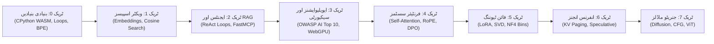

<div align="center" dir="rtl">

<a href="https://openguideforai.dpdns.org">
  
</a>

# OpenGuide.
### مشین کے پیچھے چھپے ذہن کو سمجھیں۔

> **ایک بااختیار، براؤزر-مقامی اسٹوڈیو جسے مصنوعی ذہانت کے اسرار کو حل کرنے کے لیے وضع کیا گیا ہے—جو پیچیدہ بلیک باکسز کو خالص کوڈ کے نفاذ کے ذریعے براہ راست فہم اور وجدان میں تبدیل کرتا ہے۔**  
> **زمین پر بسنے والے ہر متجسس انسان کے لیے تراشا گیا—رات کے اندھیرے میں اکلوتے بلب تلے ٹوٹی ہوئی اسکرین والے فون سے لے کر اسکرین ریڈر والے انجینئرنگ ورک اسٹیشن تک۔ 100% مفت • زیرو کلاؤڈ بلز • آپ کے براؤزر میں مکمل خودمختار۔**

<p align="center">
  <a href="https://openguideforai.dpdns.org">
    
  </a>
</p>

[](../../LICENSE)
[](https://pyodide.org/)
[](../../explainer.md)
[](#دوہری-تعلیمی-راہیں)
[](#ہمہ-گیر-ڈیزائن-اور-رسائی)
[](#ڈیسک-ٹاپ-اور-موبائل-ایپ-انسٹالیشن-pwa)

<p align="center">
  <b>ترجمے / Translations:</b>&nbsp;
  <a href="../../README.md">English</a> &nbsp;•&nbsp;
  <a href="README_es.md">Español</a> &nbsp;•&nbsp;
  <a href="README_zh.md">简体中文</a> &nbsp;•&nbsp;
  <a href="README_ur.md"><b>اردو</b></a> &nbsp;•&nbsp;
  <a href="README_ar.md">العربية</a> &nbsp;•&nbsp;
  <a href="README_hi.md">हिन्दी</a> &nbsp;•&nbsp;
  <a href="README_fr.md">Français</a> &nbsp;•&nbsp;
  <a href="README_de.md">Deutsch</a> &nbsp;•&nbsp;
  <a href="README_ja.md">日本語</a> &nbsp;•&nbsp;
  <a href="README_pt.md">Português</a> &nbsp;•&nbsp;
  <a href="README_ru.md">Русский</a> &nbsp;•&nbsp;
  <a href="README_it.md">Italiano</a>
</p>

---

### [اسٹوڈیو شروع کریں](https://openguideforai.dpdns.org) &nbsp;•&nbsp; [اہم تجربہ](#آپ-کیا-تجربہ-کرتے-ہیں) &nbsp;•&nbsp; [دوہری راہیں](#دوہری-تعلیمی-راہیں) &nbsp;•&nbsp; [آٹو گریڈرز](#ناقابل-فریب-دو-مرحلہ-آٹو-گریڈرز) &nbsp;•&nbsp; [آف لائن نالج بینک](#خود-مختار-آف-لائن-نالج-بینک-اور-بلیو-اے-آئی-مینٹور) &nbsp;•&nbsp; [ہمہ گیر رسائی](#ہمہ-گیر-ڈیزائن-اور-رسائی) &nbsp;•&nbsp; [آسان تشریح](../../explainer.md) &nbsp;•&nbsp; [فوری آغاز](#60-سیکنڈ-میں-شروع-کریں)

</div>

---

<div dir="rtl">

## آپ کیا تجربہ کرتے ہیں

اوپن گائیڈ کوئی روایتی کلاؤڈ سروس یا سطحی ٹیوٹوریل نہیں ہے۔ یہ براؤزر کے اندر موجود ایک حقیقی اور خود مختار لیبارٹری ہے جہاں آپ کوڈ چلا کر مصنوعی ذہانت کے بنیادی سسٹمز کو کھولتے، جانچتے اور سمجھتے ہیں۔

| ستون | اس کے اندر کیا ہوتا ہے | یہ کیوں اہم ہے |
|---|---|---|
| **خالص بنیادی تعلیم** | حقیقی ریاضیاتی بنیادی ماڈلز سیکھیں: BPE ٹوکنائزرز، ویکٹر ڈاٹ پروڈکٹس اور سیلف اٹینشن ہیڈز بالکل شروع سے لکھیں۔ | آپ کو مستقل تصوراتی فہم حاصل ہوتا ہے بجائے اس کے کہ آپ چند ماہ میں تبدیل ہونے والی لائبریریوں کو رٹیں۔ |
| **فوری نفاذ** | حقیقی CPython 3.12 آپ کے براؤزر کے اندر WebAssembly (Pyodide v0.26) اور ویب ورکر کے ذریعے چلتا ہے۔ | بغیر کسی سیٹ اپ کے۔ آپ کے کمپیوٹر پر پائتھن، ایناکونڈا یا ڈوکر کی کوئی ضرورت نہیں۔ |
| **دوہری تعلیمی راہیں** | گہری ریاضیاتی تحقیق اور عملی فل اسٹیک سوفٹ ویئر سازی کے درمیان بغیر کسی رکاوٹ کے سوئچ کریں۔ | یہ ریاضی کے محققین اور مصنوعات بنانے والے انجینئرز دونوں کے لیے یکساں طور پر کارآمد ہے۔ |
| **خود مختار اور نجی** | 100% پروسیسنگ کلائنٹ سائیڈ پر۔ ڈیٹا آپ کے براؤزر کے IndexedDB میں محفوظ رہتا ہے۔ زیرو ٹیلی میٹری۔ | مکمل ڈیٹا پرائیویسی۔ زیرو ماہانہ فیس۔ کلاؤڈ بلز کا کوئی خطرہ نہیں ($0 رول)۔ |
| **پی ڈبلیو اے اور آف لائن نالج** | مکمل نصاب، پائتھن انجن اور 250 موضوعات پر مشتمل نالج بینک آف لائن کیش ہو جاتے ہیں۔ | دنیا کے کسی بھی کونے میں، بغیر انٹرنیٹ کے کوڈنگ کریں، تجربات کریں اور سیکھیں۔ |
| **انٹرایکٹو اسپیشل بصری مظاہرے** | Three.js اور WebXR کے ذریعے تجریدی ٹینسرز کو فزیکل 3D کوآرڈینیٹس میں دیکھا جا سکتا ہے۔ | آپ ہائی ڈائمینشنل ایمبیڈنگز اور نیورل نیٹ ورکس کو خود حرکت دے کر سمجھ سکتے ہیں۔ |

> 📖 **گہری انجینئرنگ تصریح:** مکمل سسٹم آرکیٹیکچر، ایگزیکیوشن پائپ لائن، 15 سیکنڈ کے واچ ڈاگ اور پروگریسو ڈسکلوزر کے لیے [ASD-STE100 ٹیکنیکل ایکسپلینر](../../explainer.md) کا مطالعہ کریں۔

---

## دوہری تعلیمی راہیں

اوپن گائیڈ دو ہم آہنگ، عالمی معیار کے تعلیمی ٹریکس فراہم کرتا ہے۔ اوپر موجود نیویگیشن بار سے آپ کسی بھی وقت ان کے درمیان باآسانی سوئچ کر سکتے ہیں:

### راہ اول: ڈیپ اے آئی انجینئر (ٹریکس 0 تا 7 • 57 لیبارٹریز)
*گہرا ریاضیاتی فہم، براؤزر میں CPython 3.12 وازم کا براہ راست نفاذ، اور ماڈل میکانکس کی ابتدا سے انتہا تک تفہیم۔*



| ٹریک | لیبز | بنیادی فلسفہ | کیپ اسٹون پروجیکٹ |
|:---|:---:|:---|:---|
| **ٹریک 0: مکمل شروعات** | 9 | روزمرہ کی زندگی اور کچن کی مثالوں سے پائتھن نحو کا فہم | شروع سے بائٹ پیئر انکوڈنگ (BPE) ٹوکنائزر کی تیاری |
| **ٹریک 1: ویکٹر اسپیسز** | 9 | ہائی ڈائمینشنل جیومیٹری، ڈاٹ پروڈکٹس اور سیمنٹک کثافت | ان میموری `SemanticSearchEngine` جو دستاویزات انڈیکس کرے |
| **ٹریک 2: RAG اور ایجنٹس** | 9 | سوچ $\rightarrow$ عمل $\rightarrow$ مشاہدہ اسٹیٹ مشین اور MCP پروٹوکول | خود مختار ریسرچ ایجنٹ جو ملٹی ہوپ استدلال کر سکے |
| **ٹریک 3: ایویلیوایشنز اور حفاظتی تدابیر** | 9 | ریڈ ٹیمنگ، پرامپٹ انجیکشن ڈیفنس اور اخلاقی فائر والز | براؤزر کے اندر چلنے والا WebGPU مصنوعی ٹیسٹنگ فریم ورک |
| **ٹریک 4: فرنٹیئر سسٹمز** | 9 | اسکیلڈ ڈاٹ پروڈکٹ اٹینشن، KV-cache فزکس اور RoPE | ٹرانسفارمر اٹینشن ڈسیکشن اور DPO لاس انجن |
| **ٹریک 5: فائن ٹیوننگ اور LoRA** | 6 | پیرامیٹر ایفی شینٹ اڈاپٹیشن، SVD ٹرنکیشن اور NF4 | زیرو اوور ہیڈ ڈائنامک LoRA ویٹ مرجنگ انجن |
| **ٹریک 6: انفرنس انجنز** | 3 | ہائی تھرو پٹ سرونگ، ورچوئل میموری پیجنگ اور اسپیکولیٹو ڈی کوڈنگ | PagedAttention ورچوئل پیجنگ سمیلیٹر |
| **ٹریک 7: ملٹی موڈل اور ڈفیوژن** | 3 | فارورڈ ڈفیوژن نوائزنگ، CFG ویکٹرز اور ViT پیچز | ویژن ٹرانسفارمر پیچ لینیئر پروجیکٹر |

---

### راہ دوم: دی بلڈر پاتھ (ٹریکس B0 تا B7 • 24 ماڈیولز / 48 سنگ میل)
*فارورڈ ڈیپلائیڈ اے آئی انجینئرنگ (FDE): نردیشن ناموں (Specs)، سینڈ باکسز اور ایجنٹک ورک فلو کے ذریعے حقیقی پروڈکشن سوفٹ ویئر کی تعمیر۔*

```mermaid
graph LR
    B0["ٹریک B0: بیان کریں<br/>(Instant Utility Studio)"]
    B1["ٹریک B1: تصریح بنائیں<br/>(Specs & Test Cases)"]
    B2["ٹریک B2: جانچیں<br/>(Diff Reading & Hazards)"]
    B3["ٹریک B3: جوڑیں<br/>(IndexedDB & APIs)"]
    B4["ٹریک B4: گراؤنڈ کریں<br/>(Context & Evals)"]
    B5["ٹریک B5: لانچ کریں<br/>($0 Sovereign Cloud)"]
    B6["ٹریک B6: محفوظ بنائیں<br/>(Red-Teaming & Secrets)"]
    B7["ٹریک B7: ثابت کریں<br/>(Capstone Defense)"]

    B0 --> B1 --> B2 --> B3 --> B4 --> B5 --> B6 --> B7
```



| بلڈر ٹریک | ماڈیولز | بنیادی اصول | انٹرایکٹو لیبارٹری |
|:---|:---:|:---|:---|
| **ٹریک B0: بیان کریں (Say It)** | 3 | صرف 3 جملوں کے خاکے سے پہلی مکمل کام کرنے والی اسکرین | **پرامپٹ ٹو پری ویو لیب:** محفوظ سینڈ باکس آئی فریم رینڈرنگ |
| **ٹریک B1: تصریح بنائیں (Spec It)** | 3 | غیر مبہم اور دو ٹوک انجینئرنگ تصریحات لکھنا | **اسپیک اسٹوڈیو لیب:** 5 سنہری اصولوں پر مبنی آٹو گریڈر |
| **ٹریک B2: جانچیں (Verify It)** | 3 | کوڈ ڈفس (Diffs) کا ماہرانہ معائنہ اور سیکیورٹی خطرات کی تلاش | **ڈف ریڈر لیب:** بصری ڈف اور سیکیورٹی ہیزرڈ آڈٹ |
| **ٹریک B3: جوڑیں (Connect It)** | 3 | کلائنٹ سائیڈ پر لوکل فرسٹ ڈیٹا (Dexie IndexedDB) اور موک اینڈ پوائنٹس | **اسٹوریج ورک بینچ:** لوکل فرسٹ ڈیٹا بیس اسکیما ڈیزائن |
| **ٹریک B4: گراؤنڈ کریں (Ground It)** | 3 | سیاق و سباق کا آئین (`AGENTS.md`)، حفاظتی حدود اور خودکار جانچ | **ہارنس اسٹوڈیو لیب:** اینڈ ٹو اینڈ ٹاسک ایویلیوایشن |
| **ٹریک B5: لانچ کریں (Ship It)** | 3 | صفر ڈالر خود مختار اسٹیک ڈیپلائمنٹ: GitHub Actions اور Cloudflare | **پائپ لائن ڈیپلائر:** مسلسل ڈیلیوری اور ہوسٹنگ کنفیگریشن |
| **ٹریک B6: محفوظ بنائیں (Harden It)** | 3 | خطرات کی ماڈلنگ، خفیہ چابیوں کا تحفظ اور پری کمٹ اسکینرز | **سیکیورٹی سینڈ باکس:** زیرو لیکج کلید تحفظ |
| **ٹریک B7: ثابت کریں (Prove It)** | 3 | لائیو آرکیٹیکچر دفاع، پورٹ فولیو اسناد اور کیپ اسٹون پروجیکٹ | **کیپ اسٹون ڈیفنس:** SHA-256 کرپٹوگرافک تصدیق |

---

## ناقابل فریب دو مرحلہ آٹو گریڈرز

اوپن گائیڈ کی **تمام 57 نصابی لیبز** ایک ناقابل فریب دو مرحلہ ٹیسٹنگ سسٹم کے تحت جانچی جاتی ہیں:
1. **پہلا مرحلہ (ظاہری چیلنج):** فنکشن کی ریٹرن ٹائپ، میٹرکس شیپ اور کوڈ کے نحو کو بنیادی مثالوں کے خلاف جانچتا ہے۔
2. **دوسرا مرحلہ (خفیہ ریاضیاتی اصول):** طلبہ کے حل کو فی لیب 5 خفیہ ریاضیاتی اصولوں پر پرکھتا ہے—بشمول کاشی شوارز عدم مساوات، ویرینس اسکیلنگ، میٹرک ہم آہنگی، اور ڈائنامک باؤنڈری کیسز۔
3. **میوٹیشن ٹیسٹنگ کل ریٹ:** 171 حملہ آور میوٹنٹس کے خلاف آٹومیٹڈ ٹیسٹنگ سویٹ میں **100.0% مکمل کل ریٹ (171/171 mutants killed)** حاصل کیا گیا، بغیر کسی جھوٹے پاس کے۔

---

## خود مختار آف لائن نالج بینک اور بلیو اے آئی مینٹور

اوپن گائیڈ میں کلائنٹ سائیڈ پر ایک مکمل انجینئرنگ نالج بیس شامل ہے جس میں کلاؤڈ پر کوئی انحصار نہیں ($0 رول):
- **250 اہم جدید اور پیشہ ورانہ موضوعات:** ٹرانسفارمر اٹینشن میکانکس (FlashAttention-2/3, PagedAttention/vLLM, MLA)، الائنمنٹ اور آپٹیمائزیشن (DPO, KTO, ORPO, LoRA, QLoRA)، ویکٹر جیومیٹری (HNSW, ColBERT, Cosine Skip-Lists)، اسٹرکچرڈ ڈی کوڈنگ، کوانٹائزیشن (FP8, INT8, AWQ, BitNet b1.58)، ملٹی موڈل آرکیٹیکچرز (ViT, CLIP)، اور 17+ زمینی پیشوں کے عملی حل۔
- **اوکاپی BM25 سرچ انجن:** پروبابلسٹک رینکنگ انجن ($k_1=1.2, b=0.75$) مع اسمتھ انورس ڈاکیومنٹ فریکوئنسی اور کثیر فیلڈ وزن۔
- **کثیر لسانی برج:** 12 عالمی زبانوں (اردو، انگریزی، عربی، چینی، ہندی، ہسپانوی، فرانسیسی، جرمن، روسی، جاپانی، پرتگالی، اطالوی) میں فوری سرچ نتائج۔
- **انٹرایکٹو ویژول کارڈز:** زیرو ڈیپنڈنسی مائیکرو ویجیٹس (سافٹ میکس ٹمپریچر سلائیڈر، پیجڈ اٹینشن بلاک ایلوکیشن، کوسائن سملیریٹی ڈائل، روپ فیزر اینگل) جو براہ راست نالج کارڈز کے اندر چلتے ہیں۔
- **قابل عمل پائتھن کوڈ اسنیپٹس:** ہر تکنیکی موضوع کے ساتھ مکمل اور خود کفیل پائتھن اسکرپٹ موجود ہے جو براؤزر کے اندر وازم میں چلتی ہے۔

---

## تمام انسانیت کے لیے اے آئی تسلسل

اوپن گائیڈ کسی مخصوص اشرافیہ کے لیے نہیں بنا۔ یہ پوری انسانیت کے علم و ہنر کو محیط ہے—شروع سے لے کر جدید ماڈل آرکیٹیکٹس تک:

| مرحلہ اور خاکہ | حقیقی زندگی کا تناظر | اوپن گائیڈ کی فراہم کردہ طاقت |
|---|---|---|
| **مرحلہ 0: غیر تکنیکی متجسس انسان** | پہلی بار اے آئی سے واسطہ۔ اصطلاحات اور سبسکرپشن فیس سے پریشان۔ | آسان ذہنی ماڈلز ("آپ ایک LLM ہیں")، پرامپٹنگ کے 3 سنہری اصول (کردار + سیاق + فارمیٹ) اور صفر لاگت کی وضاحت۔ |
| **مرحلہ 1: روایتی زمینی پیشے اور ہنر** | آٹو مکینک، موچی، بڑھئی، ہیئر اسٹائلسٹ، باورچی، پلمبر۔ | روزمرہ اے آئی عملی طور پر: تشخیصی معاون، کسٹمر کوٹیشن جنریٹر، مٹیریل کیلکولیٹر اور ورکشاپ ورک فلو۔ |
| **مرحلہ 2: علمی اور پیشہ ورانہ خدمات** | ڈاکٹر، اساتذہ، اکاؤنٹنٹ، قانونی محققین، کسان۔ | منظم پرامپٹ ٹیمپلیٹس، ٹیبلر ڈیٹا کا اخراج، مطالعہ کے نوٹس اور مکمل مقامی رازداری۔ |
| **مرحلہ 3: سسٹمز سوفٹ ویئر انجینئرز** | وہ انجینئرز جو LLMs اور ایجنٹس کے ذریعے حقیقی ایپس بنا رہے ہیں۔ | براؤزر میں حقیقی پائتھن، ٹوکنائزیشن، JSON-RPC معاہدے اور Model Context Protocol (MCP) کے ذریعے ٹولز کا استعمال۔ |
| **مرحلہ 4: سیکیورٹی اور ایویلیوایشن معمار** | سسٹم کو محفوظ اور قابل اعتماد بنانے والے انجینئرز۔ | OWASP AI Top 10 ڈیفنس، پرامپٹ انجیکشن رکاوٹیں، PII فلٹرز اور خودکار ٹیسٹنگ سویٹس۔ |
| **مرحلہ 5: فرنٹیئر اے آئی محققین اور معمار** | جنریٹو ڈیپ لرننگ کے بنیادی ریاضیاتی ماڈلز پر کام کرنے والے ماہرین۔ | اسکیلڈ ڈاٹ پروڈکٹ اٹینشن، KV-cache فزکس، INT8 کوانٹائزیشن اور DPO کلوزڈ فارم لاس۔ |

---

## ہمہ گیر ڈیزائن اور رسائی

* **24 سائنسی کیلیبریٹڈ تھیمز:** 12 ڈارک اور 12 لائٹ تھیمز جو **WCAG 2.2 AAA معیارات** (7:1 سے 20:1 تک کا بہترین کنٹراسٹ) کے مطابق آنکھوں کی صحت اور پڑھنے کی سہولت فراہم کرتے ہیں۔
* **12 عالمی زبانوں کی مکمل حمایت:** حقیقی نستعلیق رسم الخط (**اردو**)، خط نسخ (**عربی**)، دیوناگری (**ہندی**)، چینی، جاپانی، اور لاطینی و سیریلک زبانیں (**انگریزی**، **ہسپانوی**، **فرانسیسی**، **جرمن**، **پرتگالی**، **روسی**، **اطالوی**).
* **اسکرین ریڈر کے لیے مصدقہ:** ARIA کے لائیو نوٹیفکیشن ریجنز (`aria-live="polite"`)، فوکس ٹریپ اور قابل رسائی نیویگیشن۔
* **مکمل دائیں سے بائیں (RTL) سپورٹ:** اردو اور عربی کے لیے مکمل فلپ شدہ لے آؤٹ، جبکہ پروگرامنگ کوڈ بلاکس کی سمت بائیں سے دائیں (LTR) محفوظ رہتی ہے۔
* **متن کی حفاظت کا نظام:** اردو اور عربی لگیچرز کے لیے متحرک لائن ہائٹ تاکہ متن کا کوئی حصہ اوپر نیچے ٹکرائے بغیر صاف نظر آئے۔

---

## فارورڈ ڈیپلائیڈ اے آئی انجینئرنگ (FDE) بلیو پرنٹ

اوپن گائیڈ میں اوپر موجود ہیڈر اور کمانڈ پیلیٹ (`Cmd + K` / `Ctrl + K`) سے قابل رسائی ایک انٹرایکٹو **فارورڈ ڈیپلائیڈ اے آئی انجینئرنگ بلیو پرنٹ** شامل ہے:
- **انجینئرنگ کرداروں کا تقابلی میٹرکس:** 6 اہم جہتوں میں وائب کوڈرز، روایتی سوفٹ ویئر انجینئرز، ڈیپ اے آئی انجینئرز اور FDE انجینئرز کا تفصیلی موازنہ۔
- **جدید ایجنٹک IDE سیٹ اپ گائیڈ:** Google Antigravity IDE، Anthropic Claude Code CLI، اور OpenAI Codex و Cursor کے لیے ٹرمینل کمانڈز اور سیٹنگز۔
- **صفر ڈالر ($0) خود مختار ٹیکنالوجی اسٹیک:** GitHub Actions CI، Cloudflare Pages، Neon Serverless Postgres، CPython WebAssembly، اور Hugging Face Spaces کا مکمل منصوبہ۔
- **خفیہ چابیوں کی زیرو لیکج پروٹیکشن:** میموری آئسولیشن (BYOK)، پری کمٹ اسکینرز اور محفوظ `.env.example` ٹیمپلیٹس۔
- **ریپوزٹری گورننس کے معیارات:** مکمل طور پر ہم آہنگ اصول نامے (`AGENTS.md`, `CLAUDE.md`, `ARCHITECTURE.md`, `CHANGELOG.md`).

---

## خود مختار کلائنٹ سائیڈ ڈھانچہ ($0 کا اصول)

اوپن گائیڈ **صفر ڈالر ($0) کے اصول** پر کام کرتا ہے۔ **نہ کوئی بیک اینڈ سرور ہے**، اور **نہ ہی آپ کا ڈیٹا جمع کرنے والا کوئی ڈیٹا بیس**۔ تمام حسابی کارروائی آپ کے اپنے براؤزر کے اندر محفوظ طریقے سے انجام پاتی ہے:

```
┌────────────────────────────────────────────────────────────────────────┐
│                   آپ کے براؤزر کے اندر محفوظ لیبارٹری                   │
│                                                                        │
│  ┌─────────────────────────┐         ┌──────────────────────────────┐  │
│  │     انٹرفیس اور تعامل   │         │     پس منظر میں ویب ورکر     │  │
│  │   • React 18 + Vite     │         │   • CPython 3.12 (Pyodide)   │  │
│  │   • 24 سائنسی تھیمز     │ ◄─────► │   • NumPy ویکٹر ریاضی        │  │
│  │   • ہموار اسکرولنگ      │         │   • 15 سیکنڈ واچ ڈاگ پروٹیکشن│  │
│  │   • کوڈ مرر 6 ایڈیٹر    │         │   • بغیر کریش اسٹینڈ بائی    │  │
│  └────────────┬────────────┘         └──────────────┬───────────────┘  │
│               │                                     │                  │
│  ┌────────────▼────────────┐         ┌──────────────▼───────────────┐  │
│  │    تھری ڈی اور نیورل    │         │      خود مختار مقامی ڈیٹا    │  │
│  │   • Three.js WebGL / XR │         │   • IndexedDB بذریعہ Dexie   │  │
│  │   • ویکٹر آواز سنتھیسس  │         │   • AES-GCM خفیہ انکرپشن     │  │
│  │   • لوکل WebGPU کمپیوٹ  │         │   • W3C تصدیق شدہ دستخط      │  │
│  └─────────────────────────┘         └──────────────────────────────┘  │
└────────────────────────────────────────────────────────────────────────┘
```

---

## تھری ڈی اسپیشل ہولوڈیک اور ہارڈویئر توسیعات

ایک جدید انٹرایکٹو تعلیمی صلاحیت کے طور پر، اوپن گائیڈ میں براؤزر پر مبنی مقامی WebXR / WebGL 3D اسپیشل کمپیوٹنگ ہولوڈیک (`/holodeck`) اور ہارڈویئر ایکسلریشن شامل ہے:

* **مستقل 60FPS ویکٹر اسپیسز:** Three.js کے ذریعے لائیو 3D ویکٹر اسپیس، ہائی ڈائمینشنل سیمنٹک کلسٹرنگ، اور نیورل سائنیپس کا ریئل ٹائم مشاہدہ بغیر میموری رساؤ کے۔
* **بائنورل ہارمونک اسپیشل آڈیو:** Web Audio API ساؤنڈ انجن جو ویکٹر کوسائن مشابہت کے تناسب سے ہم آہنگ موسیقی کے سُر سنتھیسائز کرتا ہے۔
* **سمارٹ اے آر شیشوں کا آپٹیکل پاس تھرو موڈ:** کیلیبریٹڈ `#000000` ٹرو بلیک اخراج موڈ جو شیشوں کے OLED پکسلز کو آف کر کے Viture, Xreal, RayNeo, Rokid, Meta Quest اور Apple Vision Pro پر کرکرا HUD دکھاتا ہے۔
* **ورچوئل اسپیشل کی بورڈ:** ہوا میں یا میز کی سطح پر فلوٹنگ کی بورڈ کے ذریعے مکمل ان پٹ۔

---

## 60 سیکنڈ میں شروع کریں

### براؤزر میں براہ راست شروع کریں (بغیر انسٹالیشن کے)
ویب سائٹ **[https://openguideforai.dpdns.org](https://openguideforai.dpdns.org)** پر جائیں اور **ٹریک 0 لانچ کریں** یا **بطور بلڈر شروع کریں** پر کلک کریں۔ براؤزر کا انجن ایک سیکنڈ میں تیار ہو جائے گا۔

### گٹ کے ذریعے مقامی کمپیوٹر پر چلائیں
```bash
# 1. کورپیک فعال کریں اور کوڈ کلون کریں
corepack enable
git clone https://github.com/openguideforai/OpenGuideForAI.git
cd OpenGuideForAI

# 2. لائبریریاں انسٹال کریں اور لوکل سرور چلائیں
yarn install
yarn dev
```
اپنے براؤزر میں `http://localhost:5173` کھولیں۔

#### موبائل فون یا ٹیبلٹ پر لوکل نیٹ ورک ٹیسٹنگ
اپنے لوکل وائی فائی سے منسلک موبائل فون یا ٹیبلٹ پر دیکھنے کے لیے:
```bash
yarn dev --host
```

---

## ڈیسک ٹاپ اور موبائل ایپ انسٹالیشن (PWA)

اوپن گائیڈ مکمل طور پر **انسٹال ایبل پروگریسو ویب ایپ (PWA)** کے طور پر کام کرتا ہے:

* **ونڈوز (10 / 11):** کروم یا ایج میں ایڈریس بار میں موجود انسٹال آئیکن پر کلک کریں۔ ڈیسک ٹاپ اور اسٹارٹ مینو میں ایک شارٹ کٹ شامل ہو جائے گا۔
* **میک (macOS):** سفاری میں **File** $\rightarrow$ **Add to Dock** پر کلک کریں، یا کروم/ایج میں ایڈریس بار سے انسٹال کریں۔
* **لینکس (Linux):** کرومیم یا کروم میں انسٹال پر کلک کریں۔ آپ کے ایپلیکیشن مینو میں ایک `.desktop` شارٹ کٹ خودکار بن جائے گا۔
* **موبائل (اینڈرائیڈ اور آئی او ایس):** آئی فون سفاری میں **Share** $\rightarrow$ **Add to Home Screen** دبائیں؛ اینڈرائیڈ میں **ایپ انسٹال کریں** پر کلک کریں۔
* **مکمل آف لائن موڈ:** سروس ورکر تمام اسباق، ٹولز اور پائتھن وازم انجن کو محفوظ کر لیتا ہے۔ آپ سفر کے دوران بغیر انٹرنیٹ کے بھی کوڈنگ کر سکتے ہیں۔

---

## طاقتور شارٹ کٹس اور سہولیات

| شارٹ کٹ | متحرک ہونے والا ٹول | انجام پانے والا عمل |
|---|:---:|---|
| **`Cmd + K` / `Ctrl + K`** | کمانڈ پیلیٹ | تمام 57 لیبز، 24 تھیمز، 12 زبانوں اور اسٹوڈیو ٹولز میں فوری سرچ۔ |
| **`Ctrl + Enter`** | کوڈ رنر | موجودہ پائتھن کوڈ کو ویب ورکر میں فوری کمپائل اور ایگزیکیوٹ کرتا ہے۔ |
| **`Alt + X`** | ایکس رے ڈیبگ لینس | ویب اسمبلی میموری، AST نوڈز اور IndexedDB ڈیٹا کا لائیو معائنہ۔ |
| **`Alt + S`** | اسپیشل HUD | سمارٹ چشموں کے لیے 3-DoF اسپیشل HUD اور ٹرو بلیک پاس تھرو کو آن/آف کرتا ہے۔ |
| **ٹچ ربن** | موبائل ایڈیٹر | اہم کوڈنگ علامات (`Tab`, `:`, `( )`, `[ ]`, `def`, `assert`) کا فوری اندراج۔ |
| **`.ipynb` ایکسپورٹ** | نوٹ بک کریئیٹر | مکمل حل شدہ لیب کوڈ کو معیاری Jupyter Notebook کے طور پر ڈاؤن لوڈ کریں۔ |
| **ہارمونک آڈیو** | 3D ہولوڈیک | ویکٹر مشابہت کو ہم آہنگ موسیقی کے سروں میں سنیں۔ |

---

## معیار کی ضمانت کا گیٹ (5 نکاتی پری فلائٹ سویٹ)

کسی بھی کوڈ کو شامل کرنے سے پہلے اس 5 نکاتی معیار پر پورا اترنا لازمی ہے:
```bash
# 1. لوکل سرور کی جانچ (HTTP 200 OK)
(Invoke-WebRequest http://localhost:5173).StatusCode == 200

# 2. ہیڈ لیس براؤزر تصدیق (0 کنسول ایررز)
# Playwright کے ذریعے براؤزر میں لائیو ڈوم کا معائنہ

# 3. کوڈ کوالٹی لنٹر (0 ایررز)
yarn lint

# 4. خودکار ریگریشن ٹیسٹ سویٹ (تمام 20 فائلز میں 100% کامیابی)
npx playwright test --config apps/web/playwright.config.ts

# 5. پروڈکشن بلڈ کمپائلیشن (0 ٹائپ اسکرپٹ/وائٹ ایررز)
yarn --cwd apps/web build
```

---

## تخلیق اور سرپرستی

اوپن گائیڈ کو **عادل رفیق ڈار (Adil Rafiq Dar / ARD)** نے تصوراتی بنیادوں پر وضع کیا، ڈیزائن کیا اور تعمیر کیا۔

```
                   خود مختار تعلیم کے بارے میں ایک بیانیہ
"میں نے اوپن گائیڈ اس لیے بنایا کیونکہ میرا پختہ یقین ہے کہ مصنوعی ذہانت کا علم
پوری انسانیت کی مشترکہ میراث ہے۔ یہ کسی مہنگی کلاؤڈ سبسکرپشن، کارپوریٹ اجارہ داری
یا تعلیمی اشرافیہ کی دیواروں میں مقید نہیں ہونا چاہیے۔

اس اسٹوڈیو کی ہر لائن، ہر حسابی مساوات اور ہر بصری تفصیل کو انتھک محنت، سخت سائنسی
جانچ اور بے لوث محبت سے سنوارا گیا ہے۔ اوپن گائیڈ دنیا کے لیے ایک کھلا تحفہ ہے۔

اس پلیٹ فارم کو ہمیشہ 100% مفت، خود مختار اور کمرشل اشتہارات سے پاک رکھنے کے لیے،
میں ان تمام طلبہ اور معاونین کی سرپرستی کا خیرمقدم کرتا ہوں جو اس وژن پر یقین رکھتے ہیں۔"
```

اس آزاد تعلیمی سفر کی معاونت کریں:

<div align="center">

[](https://github.com/sponsors/openguideforai)
&nbsp;&nbsp;
[](https://ko-fi.com/buymegoodcoffee)
&nbsp;&nbsp;
[](https://paypal.me/buymegoodcoffee)

<br/>

<sub>آپ کا تعاون ڈومین ہوسٹنگ، کنٹینیوئس انٹیگریشن انفراسٹرکچر اور اوپن نصاب کی توسیع میں مدد فراہم کرتا ہے۔</sub>

</div>

---

## تکنیکی دستاویزات اور حوالہ جات

* **[ریلیز تاریخچہ (Changelog)](../../CHANGELOG.md):** تمام ورژنز اور ان کی اہم ترقیاں۔
* **[ASD-STE100 سسٹم ایکسپلینر](../../explainer.md):** ویب ورکر مواصلات، میموری کی حدود اور پروگریسو ڈسکلوزر پر تفصیلی وضاحت۔
* **[سسٹم کا تفصیلی ڈھانچہ](../../ARCHITECTURE.md):** ری ایکٹو اسٹورز، ویب ورکر اور WebGPU پروسیسنگ پائپ لائنز۔
* **[مکمل نصاب کی تصریحات](../CURRICULUM.md):** تمام 57 لیبارٹریز (8 ٹریکس) کے تعلیمی اہداف۔
* **[بیرونی ٹیکنیکل آڈٹ و کوالٹی ڈوزیئر](../EXTERNAL-AUDIT-QA-DOSSIER.md):** سسٹم کی بنیادیں، ریاضیاتی ٹیسٹنگ اور تصدیق کی گائیڈ۔
* **[تھرڈ پارٹی کوالٹی آڈٹ](../AUDIT_QA.md):** ملٹی پلیٹ فارم خودکار آڈٹ رپورٹ۔

<div align="center">
  <sub>عادل رفیق ڈار (ARD) کی تخلیق۔ تحت لائسنس AGPL-3.0 اور CC BY-NC-SA 4.0۔</sub>
</div>

</div>
