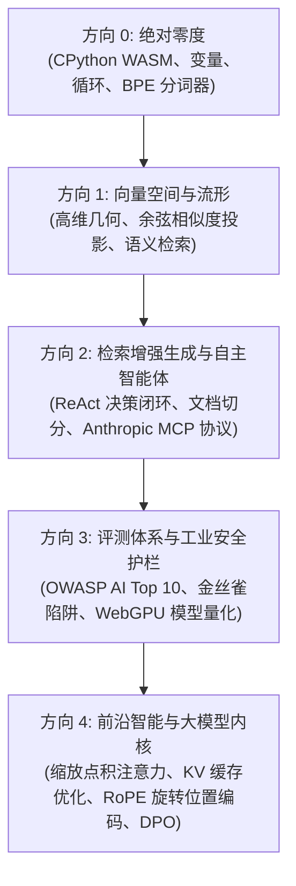

<div align="center">

<a href="https://openguideforai.dpdns.org">
  
</a>

# OpenGuide.
### 理解机器背后的智慧。

> **一个运行于浏览器内的原生独立工作室，旨在破除人工智能的神秘面纱——通过纯代码执行，将复杂的黑盒子化为直观、亲手可触的深刻理解。**  
> **为地球上每一个怀揣求知欲的心灵而造——无论是在深夜孤灯下握着碎屏手机的学生，还是使用屏幕朗读器的无障碍工程工作站。100% 免费 • 零云端账单 • 浏览器内完全自主。**

<p align="center">
  <a href="https://openguideforai.dpdns.org">
    
  </a>
</p>

[](../../LICENSE)
[](https://pyodide.org/)
[](#自主客户端架构)
[](#课程体系全景)
[](#无障碍与设计标准)
[](#桌面与离线-pwa-应用安装)

<p align="center">
  <b>语言切换 / Translations:</b>&nbsp;
  <a href="../../README.md">English</a> &nbsp;•&nbsp;
  <a href="README_es.md">Español</a> &nbsp;•&nbsp;
  <a href="README_zh.md"><b>简体中文</b></a> &nbsp;•&nbsp;
  <a href="README_ur.md">اردو</a> &nbsp;•&nbsp;
  <a href="README_ar.md">العربية</a> &nbsp;•&nbsp;
  <a href="README_hi.md">हिन्दी</a> &nbsp;•&nbsp;
  <a href="README_fr.md">Français</a> &nbsp;•&nbsp;
  <a href="README_de.md">Deutsch</a> &nbsp;•&nbsp;
  <a href="README_ja.md">日本語</a> &nbsp;•&nbsp;
  <a href="README_pt.md">Português</a> &nbsp;•&nbsp;
  <a href="README_ru.md">Русский</a> &nbsp;•&nbsp;
  <a href="README_it.md">Italiano</a>
</p>

---

### [打开工作室](https://openguideforai.dpdns.org) &nbsp;•&nbsp; [架构解析](#自主客户端架构) &nbsp;•&nbsp; [课程全景](#课程体系全景) &nbsp;•&nbsp; [第一性原理图解](../../explainer.md) &nbsp;•&nbsp; [桌面客户端](#桌面与离线-pwa-应用安装) &nbsp;•&nbsp; [高效快捷键](#人机工效与快捷键) &nbsp;•&nbsp; [本地开发启动](#本地开发与源码运行)

</div>

---

## 核心理念与初心

当下主流的 AI 教育存在三大痛点：
1. **浮于表面的 API“套壳”教学：** 只教调用高层黑盒接口，6 个月后便全面过时。
2. **令人望而生畏的晦涩学术门槛：** 充斥数学符号论文，却缺乏随时可运行的交互式实践验证。
3. **昂贵封闭的云端沙盒：** 动辄要求绑定信用卡、云平台账号、复杂 Docker 部署或每月 30 美元订阅费。

**OpenGuide 从根源上打破这三大枷锁。**

我们坚信：人工智能应当像读写一样，成为人类现代文明的基础素养。无论您使用的是 **100 美元的入门级安卓手机**、老旧的 Chromebook，还是顶级工作站；无论您依赖屏幕朗读辅助还是鼠标键盘：**OpenGuide 都在您的浏览器中免费交付一个世界级的纯本地工程实验室。**

> *“OpenGuide 的每一个特性都能被 OpenGuide 自身原理解释。在这里，您不只是学习数学公式；您将亲眼看见张量流转，实时拆解注意力头，通过声学谐波聆听余弦相似度，并借助 X 射线模式（`Alt + X`）直接透视 WebAssembly 虚拟机的内存运行。”*

---

<a id="自主客户端架构"></a>
## 自主客户端架构

OpenGuide 严格恪守 **$0 成本法则**。**没有后端服务器**，**没有收集用户数据的中心数据库**。100% 的计算与模型推断均在您的浏览器本地执行：

```
┌────────────────────────────────────────────────────────────────────────┐
│                        您的本地浏览器隔离计算环境                      │
│                                                                        │
│  ┌─────────────────────────┐         ┌──────────────────────────────┐  │
│  │       界面与人机交互    │         │       后台独立 WEB WORKER    │  │
│  │   • React 18 + Vite     │         │   • CPython 3.12 (Pyodide)   │  │
│  │   • 24 款生理学调校主题 │ ◄─────► │   • NumPy 高维向量数学运算   │  │
│  │   • Lenis 惯性平滑滚动  │         │   • 15 秒失控循环看门狗守护  │  │
│  │   • CodeMirror 6 编辑器 │         │   • 零崩溃 Pure-JS 离线备用核│  │
│  └────────────┬────────────┘         └──────────────┬───────────────┘  │
│               │                                     │                  │
│  ┌────────────▼────────────┐         ┌──────────────▼───────────────┐  │
│  │       空间感知与神经核  │         │       纯本地自主持久化存储   │  │
│  │   • Three.js WebGL / XR │         │   • Dexie 驱动的 IndexedDB   │  │
│  │   • 向量声波合成器      │         │   • AES-GCM 256 加密同步备份 │  │
│  │   • 浏览器端 WebGPU 算力│         │   • W3C 可验证证书数字签名   │  │
│  └─────────────────────────┘         └──────────────────────────────┘  │
└────────────────────────────────────────────────────────────────────────┘
```

---

<a id="课程体系全景"></a>
## 课程体系全景

包含 5 个严谨进阶方向、共 **45 个完全可直接在浏览器中编译运行的交互式实验**：



| 方向 | 实验数 | 核心心智模型 | 压轴结课大项目 |
|:---|:---:|:---|:---|
| **方向 0: 绝对零度** | 9 | 通过生动的厨房配方与地图隐喻理解 Python 逻辑 | 从零手工实现 Byte-Pair Encoding (BPE) 分词器 |
| **方向 1: 向量空间** | 9 | 空间流形几何、点积与高维语义密度分析 | 内存版 `SemanticSearchEngine` 文档索引与向量检索 |
| **方向 2: RAG 与智能体**| 9 | 思考 $\rightarrow$ 行动 $\rightarrow$ 观察有限状态机与 MCP 规范 | 具备多跳推理能力的自主科研文献 Agent |
| **方向 3: 评测与护栏** | 9 | 提示词注入攻防对抗、幻觉检测与量化评价标准 | 结合浏览器端 WebGPU 算力的自动化合成评测系统 |
| **方向 4: 前沿大模型体系**| 9 | $\text{Softmax}(QK^T/\sqrt{d_k})V$、KV 缓存内存计算、RoPE | 深度拆解 Transformer 注意力头与 DPO 强化学习损失引擎 |

---

<a id="桌面与离线-pwa-应用安装"></a>
## 桌面与离线 PWA 应用安装

OpenGuide 深度集成为**可安装的渐进式 Web 应用 (PWA)**，与操作系统原生无缝融合：

* **Windows (10 / 11):** 在 Chrome 或 Edge 地址栏点击“安装 OpenGuide”，自动生成桌面快捷方式并固定至任务栏，提供无网址栏的独立沉浸式原生窗口。
* **macOS:** 在 Safari 中点击“文件” $\rightarrow$ “添加到程序坞”；或在 Chrome/Edge 中点击安装，支持 `Cmd + Space` 快速全局检索与 `Cmd + Tab` 多任务切换。
* **Linux (Ubuntu/Arch/Fedora):** 通过 Chromium 菜单一键安装，自动注册 `.desktop` 启动项并与系统托盘深度集成。
* **移动端 (Android / iOS):** 支持安卓主屏幕快捷启动与 iOS 全屏 Safari WebApp 模式。
* **完全离线运行 (Air-Gapped):** 凭借内置 Service Worker (`sw.js`) 强劲缓存，所有课程资源、Pyodide CPython 虚拟机与可视化引擎均常驻设备，无需连网即可在飞机或无信号环境中完整编译运行 Python 脚本。

---

<a id="人机工效与快捷键"></a>
## 人机工效与快捷键

* **全局极速命令面板 (`Cmd + K` / `Ctrl + K`):** 随时唤起，模糊检索所有实验关卡、快捷切换主题、直达工具。
* **代码极速运行 (`Ctrl + Enter` / `Cmd + Enter`):** 在编辑器内随时秒级编译运行当前脚本。
* **语法医生友善诊断:** 将报错 Traceback 实时转化为通俗自然语言解答与代码修复建议。
* **Jupyter Notebook 一键导出 (`.ipynb`):** 支持将已验证的代码实验直接导出为标准的 Jupyter 文件。
* **X 射线调试透视镜 (`Alt + X`):** 实时监控 Web Worker 堆内存、Pyodide 抽象语法树与本地 IndexedDB 记录。
* **AES-GCM 256 位加密 Gist 同步:** 学习进度通过高强度加密安全同步至个人私有 GitHub Gist。

---

<a id="无障碍与设计标准"></a>
## 无障碍与设计标准

* **24 款生理学科学调校主题:** 12 款深色与 12 款浅色，严格符合 W3C WCAG 2.2 AAA 对比度标准（>7:1 至 20.4:1）。
* **全键盘与屏幕朗读无障碍支持:** 动态 ARIA 实时通告区 (`aria-live="polite"`)，终端运行状态语音无阻。
* **双向文字布局 (RTL):** 完美支持阿拉伯语与乌尔都语镜像排版，同时确保代码区域锁定 LTR 规范。

---

<a id="作者与赞助支持"></a>
## 作者与赞助支持

OpenGuide 由 **Adil Rafiq Dar (ARD)** 独立构思、架构并全栈打造。

```
                       关于本地自主与可持续性的寄语
“我之所以打造 OpenGuide，是因为我不忍看到无数充满才华的人，被高昂的收费训练营、
昂贵的云端订阅和精英化的学术壁垒挡在人工智能的大门之外。

这套工作室的每一行代码，都凝聚了无数个攻坚的深夜、严苛的数学验证以及对人机交互艺术的执着追求。
OpenGuide 是我献给全世界的一份礼物。

为了让这个平台永久 100% 免费、永葆独立，且持续跟进最新前沿 AI 协议而不添加任何广告或资方壁垒，
我真诚欢迎认可‘知识无界’理念的学习者与同道者的赞助支持。”
```

如果 OpenGuide 帮助您领悟了 AI 技术、节省了学习成本或助力了您的工程事业，欢迎通过以下渠道支持本项目的独立维护：

<div align="center">

[](https://www.paypal.com/paypalme/buymegoodcoffee/sponsor)
&nbsp;&nbsp;
[](https://ko-fi.com/buymegoodcoffee)

</div>

---

<a id="本地开发与源码运行"></a>
## 本地开发与源码运行

```bash
git clone https://github.com/openguideforai/OpenGuideForAI.git
cd OpenGuideForAI
corepack enable
yarn install
yarn --cwd apps/web dev
```
在浏览器中访问 `http://localhost:5173` 即可开启本地工作台。
