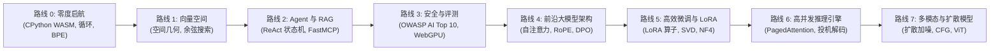

<div align="center">

<a href="https://openguideforai.dpdns.org">
  
</a>

# OpenGuide.
### 理解机器背后的智慧。

> **一个运行于浏览器内的原生独立工作室，旨在破除人工智能的神秘面纱——通过纯代码执行，将复杂的黑盒子化为直观、亲手可触的深刻理解。**  
> **为地球上每一个怀揣求知欲的心灵而造——无论是在深夜孤灯下握着碎屏手机的学生，还是使用屏幕朗读器的无障碍工程工作站。100% 免费 • 零云端账单 • 浏览器内完全自主。**

<p align="center">
  <a href="https://openguideforai.dpdns.org">
    
  </a>
</p>

[](../../LICENSE)
[](https://pyodide.org/)
[](../../explainer.md)
[](#双轨进阶学习路径)
[](#通用包容设计与无障碍标准)
[](#桌面端与移动端-pwa-安装)

<p align="center">
  <b>语言版本 / Multilingual Editions:</b>&nbsp;
  <a href="../../README.md">English</a> &nbsp;•&nbsp;
  <a href="README_es.md">Español</a> &nbsp;•&nbsp;
  <a href="README_zh.md"><b>简体中文</b></a> &nbsp;•&nbsp;
  <a href="README_ur.md">اردو</a> &nbsp;•&nbsp;
  <a href="README_ar.md">العربية</a> &nbsp;•&nbsp;
  <a href="README_hi.md">हिन्दी</a> &nbsp;•&nbsp;
  <a href="README_fr.md">Français</a> &nbsp;•&nbsp;
  <a href="README_de.md">Deutsch</a> &nbsp;•&nbsp;
  <a href="README_ja.md">日本語</a> &nbsp;•&nbsp;
  <a href="README_pt.md">Português</a> &nbsp;•&nbsp;
  <a href="README_ru.md">Русский</a> &nbsp;•&nbsp;
  <a href="README_it.md">Italiano</a>
</p>

---

### [打开在线工作室](https://openguideforai.dpdns.org) &nbsp;•&nbsp; [核心体验](#您所体验的独创特性) &nbsp;•&nbsp; [双轨路径](#双轨进阶学习路径) &nbsp;•&nbsp; [自动评分器](#不可作弊的双阶段数学自动化评分器) &nbsp;•&nbsp; [离线知识库](#离线主权工程知识库与-bluee-导师) &nbsp;•&nbsp; [通用无障碍](#通用包容设计与无障碍标准) &nbsp;•&nbsp; [第一性原理图解](../../explainer.md) &nbsp;•&nbsp; [快速上手](#60-秒快速上手)

</div>

---

## 您所体验的独创特性

OpenGuide 绝非浮于表面的云端封装或玩具教程。它是一个完全原生于浏览器的高性能工程实验室，让您通过真实的代码执行，亲手拆解、检视并透彻理解人工智能底层原理。

| 核心支柱 | 内部如何运转 | 核心价值与意义 |
|---|---|---|
| **第一性原理教育** | 学习真正的底层数学：从零编写 BPE 分词器、向量点积与自注意力计算头。 | 获取永不过期的概念理解，而非死记硬背几个月就淘汰的高层 API 库。 |
| **毫秒级极速执行** | 浏览器内原生 WebAssembly (Pyodide v0.26) 独立 Web Worker 直接编译运行真 CPython 3.12。 | 零环境配置。本地机器无需安装 Python、Anaconda 或复杂 Docker 容器。 |
| **双轨进阶路线** | 自由无缝切换：既可深潜数学架构原理，亦可动手构建全栈生产级 AI 软件系统。 | 完美兼顾算法研究者与全栈软件工程师，两套进度各自持久化且永不丢失。 |
| **数据绝对主权** | 100% 纯客户端算力。全部代码与答题状态保存在浏览器本地 IndexedDB。零隐私追踪。 | 极致隐私保障。零订阅费用。绝无意料之外的云服务巨额账单（$0 成本法则）。 |
| **PWA 与离线知识库** | 渐进式 Web 应用完整离线缓存课程、CPython 引擎与 250 个前沿 AI 主题及可运行代码。 | 即使身处无网络航班、偏远乡村或沙漠，依然随时随地离线钻研前沿 AI。 |
| **交互式 3D 空间流形** | GPU 硬件加速的 Three.js 流形与 WebXR 空间投影，将抽象高维张量映射为实体物理坐标。 | 亲手拖拽、观察并直观感悟高维嵌入向量空间与复杂的神经网络拓扑图。 |

> 📖 **硬核工程技术规范：** 欲深入了解完整系统架构、通信管道、15 秒防卡死看门狗监督器及渐进式披露交互设计，请参阅 [ASD-STE100 技术解析文档](../../explainer.md)。

---

## 双轨进阶学习路径

OpenGuide 提供两条完全同步、世界级品质的进阶路线，满足不同背景学习者的真实需求。在顶部导航栏使用触控友好的 **学习路径切换器** 下拉菜单即可一键自由切换，或使用内置的推荐测试自测最适合的切入点：

### 路径 A：深度 AI 算法工程师 (路线 0–7 • 57 个硬核实验)
*深入底层数学直觉，浏览器内 CPython 3.12 WebAssembly 真实执行，从绝对零度精通前沿模型架构。*



| 课程路线 | 实验数 | 核心第一性原理 | 压轴实战项目 |
|:---|:---:|:---|:---|
| **路线 0: 绝对零度启航** | 9 | 通过通俗的生活与厨房隐喻建立 Python 语法直觉 | 从零手写实现 Byte-Pair Encoding (BPE) 分词器 |
| **路线 1: 向量空间与检索** | 9 | 高维空间几何学、内积、余弦距离与语义密度 | 纯内存构建高性能文档索引 `SemanticSearchEngine` |
| **路线 2: RAG 与智能体系统** | 9 | “思考 $\rightarrow$ 行动 $\rightarrow$ 观察” ReAct 状态机与 MCP 协议 | 具备多跳推理能力的自主学术调研智能体 |
| **路线 3: 评测与安全防御** | 9 | 红蓝对抗测试、Prompt 注入防御与合规防火墙 | 浏览器内运行的 WebGPU 自动化合成评测测试台 |
| **路线 4: 前沿大模型架构** | 9 | Scaled Dot-Product 注意力、KV 缓存动力学与 RoPE | Transformer 多头注意力拆解与 DPO 损失引擎 |
| **路线 5: 高效微调与 LoRA** | 6 | 参数高效低秩分解、SVD 奇异值截断与 NF4 量化 | 零额外推理开销的动态 LoRA 权重融合引擎 |
| **路线 6: 高性能推理引擎** | 3 | 高吞吐量服务架构、虚拟内存分页与投机采样解码 | PagedAttention 虚拟内存分页分配仿真器 |
| **路线 7: 多模态与生成扩散** | 3 | 前向扩散加噪、CFG 分类器引导向量与 ViT 图像分块 | Vision Transformer (ViT) 图像分块线性投影器 |

---

### 路径 B：应用构建者进阶之路 (路线 B0–B7 • 24 个模块 / 48 个里程碑)
*前线部署 AI 工程 (Forward Deployed AI Engineering)：运用精准 Prompt 规范、沙盒与智能体工作流，快速构建面向生产的真实全栈软件系统。*


| 构建者路线 | 模块数 | 核心工程原则 | 交互式实战实验室 |
|:---|:---:|:---|:---|
| **路线 B0: 构想显化 (Say It)** | 3 | 仅凭 3 句话架构蓝图，实现从无到有的首屏交互生成 | **Prompt-to-Preview 实验室：** 隔离 iframe 渲染 |
| **路线 B1: 精确规范 (Spec It)** | 3 | 撰写毫无歧义的系统技术规格，消除大模型幻觉与误解 | **Spec Studio 实验室：** 5 项黄金法则自动评分器 |
| **路线 B2: 代码审查 (Verify It)** | 3 | 专家级审查代码差异 (Diff)，敏锐捕获性能退化与安全陷阱 | **Diff Reader 实验室：** 可视化 Diff 与安全漏洞排查 |
| **路线 B3: 边缘交付 (Ship It)** | 3 | Cloudflare 边缘 CDN 模拟、Dexie IndexedDB 持久化与机密泄露扫描 | **Edge Deploy 实验室：** 边缘 CDN 模拟器、IDB 持久化与 .env 扫描器 |
| **路线 B4: 防御安全 (Trust It)** | 3 | Postgres 行级安全 (RLS) 实战、CVE-2025-48757 攻击重现与提示词注入防御 | **Defensive Security 实验室：** 实时 RLS 越权攻击查询与消毒器 |
| **路线 B5: 智能体指挥 (Direct It)** | 3 | 5 核心条款项目宪法 (`AGENTS.md`)、Token 预算控制与上下文压缩防偏离 | **Agent Director 实验室：** 项目宪法构建器与上下文压缩模拟器 |
| **路线 B6: 生产流水线 (Run It)** | 3 | 4 阶段 GitHub CI 门禁验证、生产错误率遥测与零停机 Git 回滚演练 | **Pipeline Ops 实验室：** CI 自动化门禁执行器与灾难恢复演练 |
| **路线 B7: 毕业答辩 (Prove It)** | 3 | 8 维度系统架构防御答辩、Web Crypto SHA-256 签名与不可变账本导出 | **Capstone Ledger 实验室：** 密码学签名生成与 JSON 独立凭证导出 |

---

## 不可作弊的双阶段数学自动化评分器

OpenGuide **全套 57 个课程实验**全部由双阶段自动化评测引擎守护：
1. **阶段 1（显式测试基准）：** 针对样例基准输入，校验函数返回值类型、张量形状与代码结构语法。
2. **阶段 2（隐式不可逆数学不变量）：** 针对每个实验背后的 5 个隐藏数学不变量进行压力测试——验证柯西-施瓦茨不等式、方差缩放稳定性、度量对称性、动态高维测试向量与极端边界条件。
3. **变异测试斩杀率验证：** 历经自动化变异测试工具生成的 171 个对抗性突变体检验，达成 **100.0% 完美斩杀率 (171/171 mutants killed)**，且零误报通过。

---

## 离线主权工程知识库与 Bluee 导师

OpenGuide 内置运行于客户端的完备工程技术知识库，完全杜绝外部云依赖（$0 成本法则）：
- **250 个前沿核心与现代职业主题：** 全面涵盖 Transformer 注意力机制（FlashAttention-2/3、PagedAttention/vLLM、MLA）、对齐与优化（DPO、KTO、ORPO、LoRA、QLoRA）、向量几何（HNSW、ColBERT、余弦跳表）、受限结构化解码（下推自动机、JSON Schema）、量化理论（FP8、INT8、AWQ、BitNet b1.58）、多模态模型（ViT、CLIP）及 17+ 行现实世界传统行业实战应用。
- **Okapi BM25 概率检索引擎：** 工业级检索评分模型 ($k_1=1.2, b=0.75$)，结合平滑逆文档频率、文档长度归一化与多字段权重分配（标题、关键词、摘要、详细解析）。
- **跨语言即时多语种桥接：** 支持全球 12 种语言（中文、英语、西班牙语、印地语、法语、德语、阿拉伯语、俄语、日语、乌尔都语、葡萄牙语、意大利语）毫秒级检索匹配。
- **交互式可视化原理解释卡片：** 零依赖纯前端微交互组件（Softmax 温度调节滑块、PagedAttention 物理块分配图、余弦相似度夹角表盘、RoPE 旋转相量演示）直接嵌入知识卡片。
- **随时可运行的 Python / NumPy 代码：** 每个技术词条均附带完整可执行的 Python 脚本，直接在浏览器端 Pyodide 环境中运行。

---

## 普适全人类的 AI 进阶连续体

OpenGuide 从不孤芳自赏。我们面向整个人类知识图谱而设计——从从未写过一行代码的新手，到前沿大模型研究员与架构师：

| 进阶阶段与画像 | 现实场景与痛点 | OpenGuide 提供的破局方案 |
|---|---|---|
| **阶段 0: 零基础探索者与非技术人群** | 初次接触 AI，被专业术语与付费门槛劝退。 | 白话思维模型（“你就是大模型”）、提示词三黄金法则（角色 + 背景 + 格式）与零成本透明度。 |
| **阶段 1: 现实传统技艺与各行匠人** | 汽修工、鞋匠、木匠、美发师、厨师、管道工。 | 现实行业 AI 实战：故障速诊助手、报价生成器、耗料精准测算器与工坊流程规范。 |
| **阶段 2: 知识与专业服务工作者** | 临床医生、教师、会计师、法律从业者、现代农业专家。 | 结构化专业 Prompt 蓝图、表格数据清洗提取、学习大纲自动生成与 100% 本地隐私防护。 |
| **阶段 3: 应用级全栈系统开发工程师** | 负责基于 LLM 和智能体构建实际工程产品的开发者。 | 浏览器内真 Python 运行、分词切片原理解析、JSON-RPC 契约与 Model Context Protocol (MCP) 工具调度。 |
| **阶段 4: AI 安全专家与评测架构师** | 负责保障生产级大模型系统鲁棒性与合规的可靠性工程师。 | OWASP AI Top 10 防御指南、Prompt 注入隔离沙盒、隐私信息 (PII) 脱敏器与自动化评估套件。 |
| **阶段 5: 前沿大模型研究者与底层架构师** | 深入研究生成式深度学习底层数学的技术攻坚者。 | 从零实现 Scaled Dot-Product 注意力、KV 缓存流体力学、INT8 均匀量化与 DPO 闭式解损失函数。 |

---

## 通用包容设计与无障碍标准

* **24 款生理学调校高对比度主题：** 12 款深色主题与 12 款浅色主题，严格符合 **WCAG 2.2 AAA 国际无障碍标准**（对比度高达 7:1 至 20:1），保护视力健康与暗光下的生理节律。
* **支持全球 12 种主要语言：** 原生字体排版与真实 Nastaliq 连字（**乌尔都语**）、阿拉伯书法体、天城文（**印地语**）、中日韩表意字符（**简体中文**、**日语**）及拉丁与西里尔语系（**英语**、**西班牙语**、**法语**、**德语**、**葡萄牙语**、**俄语**、**意大利语**）。
* **屏幕朗读器全流程兼容：** 实时 ARIA 状态宣告 (`aria-live="polite"`)、模态弹窗焦点捕获与语义化 Landmark，提供完整的无障碍阅读体验。
* **原生 RTL 双向文字支持：** 针对乌尔都语和阿拉伯语实现完全镜像翻转布局，同时智能保持编程代码块的原生 LTR 方向。
* **文本基线防碰撞系统：** 针对复杂文字调整动态行高，杜绝天城文与阿拉伯连字在移动端的垂直重叠问题。
* **全平台移动端与桌面端人机工学优化：** WCAG 2.2 AAA 可见键盘焦点引擎（`:focus-visible` 2px 强调色外框）与 CodeMirror 光标隔离、桌面端标题防孤字折行平衡 (`text-wrap: balance`)、iOS 移动端输入框防自动缩放、120Hz 原生平滑滚动及响应式底部抽屉模态窗。

---

## 前线部署 AI 工程师 (FDE) 实战蓝图

OpenGuide 内置全交互式**前线部署 AI 工程师架构蓝图**模态框，可通过顶部导航或命令面板快捷键 (`⌘K` / `Ctrl + K`) 随时唤出：
- **工程师能力矩阵对照表：** 从 6 个关键维度客观对比轻度 Vibe 程序员、传统软件工程师、深度算法研究员与前线部署 AI 工程师的区别。
- **现代化智能体 IDE 全套配置手册：** 提供 Google Antigravity IDE、Anthropic Claude Code CLI、OpenAI Codex 与 Cursor 的端到端最佳实践与脚本。
- **$0 极简主权技术栈全景：** 详述基于 GitHub Actions CI、Cloudflare Pages 边缘节点、Neon Serverless Postgres、CPython WASM 及 Hugging Face Spaces 的零成本生产方案。
- **零泄露密钥安全防线：** 内存安全隔离 (BYOK)、预提交泄漏扫描器配置与规范化 `.env.example` 生产模板。
- **开源仓库协作规范体系：** 全套多智能体协同宪法契约（`AGENTS.md`、`CLAUDE.md`、`ARCHITECTURE.md`、`CHANGELOG.md`）。

---

## 纯本地客户端主权架构 ($0 成本法则)

OpenGuide 严格恪守 **$0 成本法则**。**没有中心后端服务器**，**没有窥探隐私的用户数据库**。100% 的计算与模型推断均在您的浏览器本地执行：

```
┌────────────────────────────────────────────────────────────────────────┐
│                        您的本地浏览器隔离计算环境                      │
│                                                                        │
│  ┌─────────────────────────┐         ┌──────────────────────────────┐  │
│  │       界面与人机交互    │         │       后台独立 WEB WORKER    │  │
│  │   • React 18 + Vite     │         │   • CPython 3.12 (Pyodide)   │  │
│  │   • 24 款生理学调校主题 │ ◄─────► │   • NumPy 高维向量数学运算   │  │
│  │   • Lenis 惯性平滑滚动  │         │   • 15 秒失控循环看门狗守护  │  │
│  │   • CodeMirror 6 编辑器 │         │   • 零崩溃 Pure-JS 离线备用核│  │
│  └────────────┬────────────┘         └──────────────┬───────────────┘  │
│               │                                     │                  │
│  ┌────────────▼────────────┐         ┌──────────────▼───────────────┐  │
│  │       空间感知与神经核  │         │       纯本地自主持久化存储   │  │
│  │   • Three.js WebGL / XR │         │   • Dexie 驱动的 IndexedDB   │  │
│  │   • 向量声波合成器      │         │   • AES-GCM 256 加密同步备份 │  │
│  │   • 浏览器端 WebGPU 算力│         │   • W3C 可验证证书数字签名   │  │
│  └─────────────────────────┘         └──────────────────────────────┘  │
└────────────────────────────────────────────────────────────────────────┘
```

---

## 3D 空间全息舱与硬件拓展能力

作为面向未来的前瞻性探索，OpenGuide 包含基于 WebXR / WebGL 的浏览器端 3D 空间计算全息舱 (`/holodeck`) 与硬件加速支持：

* **60FPS 极速稳定 3D 向量流形：** 基于 Three.js 的实时高维向量空间流形、语义聚类与神经突触计算图渲染，具备视口外自动休眠与零垃圾回收预分配缓冲池。
* **双耳立体声空间泛音化：** 利用 Web Audio API 实现高维余弦相似度谐波声学映射，在空间定位中以五度音程直接“听见”语义距离。
* **智能 AR 眼镜纯黑光学透视模式：** 精确校准 `#000000` 纯黑零发射截止模式，在光波导镜片上彻底熄灭 OLED 像素，在 Viture、Xreal、RayNeo、Rokid、Meta Quest 及 Apple Vision Pro 上呈现清晰悬浮 HUD。
* **虚拟空间全息键盘：** 支持悬浮空间或吸附于实体桌面平面，实现免手持的独立沉浸式操作。

---

## 60 秒快速上手

### 在浏览器中直接开启（无需任何安装）
访问 **[https://openguideforai.dpdns.org](https://openguideforai.dpdns.org)** 并点击 **开启路线 0** 或 **以构建者身份启程**。浏览器端 WebAssembly 运行时将在 1 秒内完成就绪。

### 本地克隆源码启动
```bash
# 1. 启用 Corepack 并克隆项目仓库
corepack enable
git clone https://github.com/openguideforai/OpenGuideForAI.git
cd OpenGuideForAI

# 2. 安装依赖并启动本地开发服务器
yarn install
yarn dev
```
在浏览器中打开 `http://localhost:5173`。

#### 局域网移动端设备联调
若需在局域网内的真实智能手机或平板电脑上测试：
```bash
yarn dev --host
```

---

## 桌面端与移动端 PWA 安装

OpenGuide 原生支持**渐进式 Web 应用 (PWA)** 规范，可作为独立桌面或移动客户端运行：

* **Windows (10 / 11):** 在 Chrome 或 Edge 地址栏点击 **安装应用** 按钮，系统会自动创建桌面及“开始”菜单独立启动图标。
* **macOS:** 在 Safari 中点击 **文件** $\rightarrow$ **添加到程序坞**；在 Chrome / Edge 中点击地址栏右侧的 **安装**。
* **Linux:** 在 Chromium 或 Chrome 中点击安装，系统应用启动器将自动生成 `.desktop` 原生快捷方式。
* **iOS / Android:** 在 iOS Safari 中点击 **分享** $\rightarrow$ **添加到主屏幕**；在 Android 中点击 **安装应用**，即可全屏纯净沉浸式体验。
* **完全离线运行能力 (Air-Gapped):** Service Worker 将全套教学内容、3D 空间可视化与 CPython 运行时完整缓存至本地，无需网络即可无拘无束编码探索。

---

## 极客生产力快捷键

| 快捷键 | 唤醒的工程工具 | 触发的即时行为 |
|---|:---:|---|
| **`Cmd + K` / `Ctrl + K`** | 全局命令面板 | 毫秒级模糊检索全部 57 个实验、24 款主题、12 种语言及全部工作室工具。 |
| **`Ctrl + Enter`** | 代码执行器 | 即时编译并在后台 Web Worker 中调度运行当前编辑的 Python 代码。 |
| **`Alt + X`** | X 射线透视镜头 | 实时监测 WebAssembly 堆内存状态、语法抽象语法树 (AST) 与本地数据库表。 |
| **`Alt + S`** | 空间 HUD 开关 | 切换 3-DoF 悬浮空间全息头显 HUD、云台角度指示器与纯黑透视模式。 |
| **触控专用功能栏** | 移动端代码键盘 | 手机上一键输入高频代码符号（`Tab`、`:`、`( )`、`[ ]`、`def`、`assert`）。 |
| **`.ipynb` 格式导出** | Notebook 转换器 | 将已通过验证的实验作业完整导出为工业标准的 Jupyter Notebook (nbformat 4.5)。 |
| **向量声波泛音** | 3D 空间全息舱 | 将向量点积余弦相似度实时转化为和谐的五度和弦立体声音频。 |

---

## 严苛质量保障网关 (5 点起飞前自动化验证)

每次代码合并前，均须通过严密的五点质量保障准入检查：
```bash
# 1. 本地守护进程存活检查 (HTTP 200 OK)
(Invoke-WebRequest http://localhost:5173).StatusCode == 200

# 2. 真实无头浏览器验证 (0 项控制台错误)
# 通过 Playwright 真实无头浏览器环境自动化检查

# 3. 静态代码质量审查 (0 报错)
yarn lint

# 4. 全套自动化回归测试套件 (20 个测试规范文件 100% 通过)
npx playwright test --config apps/web/playwright.config.ts

# 5. 生产级静态构建校验 (0 项 TypeScript / Vite 编译异常)
yarn --cwd apps/web build
```

---

## 作者与开源初心

OpenGuide 由 **Adil Rafiq Dar (ARD)** 独立构想、架构设计并亲手构建。

```
                   关于主权教育与知识普惠的誓言
“我之所以创造 OpenGuide，是因为我坚信人工智能的知识应当属于全人类。
它绝不应被昂贵的商业云订阅、高墙林立的企业门阀或精英主义的学术黑话所垄断。

这个工作室的每一行代码、每一个公式与每一处界面细节，都凝聚着无数个通宵达旦的推导、
极其严苛的工程测试与对工匠精神的绝不妥协。OpenGuide 是我献给全世界的一份公开礼物。

为了保持这个工作室 100% 免费、完全独立且始终紧跟前沿进展，我们不接受任何广告投放或
商业资本束缚。我衷心欢迎认同这一愿景的学习者与赞助者，共同守护这份教育的火种。”
```

支持独立开源的可持续演进：

<div align="center">

[](https://github.com/sponsors/openguideforai)
&nbsp;&nbsp;
[](https://ko-fi.com/buymegoodcoffee)
&nbsp;&nbsp;
[](https://paypal.me/buymegoodcoffee)

<br/>

<sub>您的赞助将直接用于域名与 CDN 托管、持续集成算力维护以及开放课程内容的持续扩展。</sub>

</div>

---

## 深度技术文档与工程规范

* **[版本演进记录 (Changelog)](../../CHANGELOG.md):** 记录系统各版本的编年史演进与重大架构升级。
* **[ASD-STE100 技术解析说明书](../../explainer.md):** 涵盖 Web Worker 通信、内存配额管理与渐进式披露架构的硬核工程技术规格书。
* **[系统深度架构文档](../../ARCHITECTURE.md):** 响应式状态流、Web Worker 通信与 WebGPU 计算管线深层解密。
* **[核心课程体系规范](../CURRICULUM.md):** 57 个实验项目（8 大路线）完整的教学大纲与技术指标。
* **[外部独立技术审计与质检档案](../EXTERNAL-AUDIT-QA-DOSSIER.md):** 架构现实锚定报告、数学不变量测试矩阵与可复现验证指引。
* **[第三方专业质量审计报告](../AUDIT_QA.md):** 涵盖多端兼容性与生产就绪度的详尽审计档案。

<div align="center">
  <sub>由 Adil Rafiq Dar (ARD) 架构与构建。遵循 AGPL-3.0 与 CC BY-NC-SA 4.0 开源协议。</sub>
</div>
