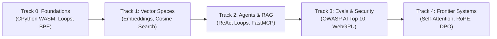

# OpenGuide — Technical System Specification

> **Standard:** ASD-STE100 (Simplified Technical English, ~85% conformance).  
> **System:** OpenGuide (Brand: `OpenGuide.`, Monogram: `OG`, Subtitle: `AI STUDIO`).  
> **Creator & Architect:** Adil Rafiq Dar (ARD).  
> **Production Endpoint:** `https://openguideforai.dpdns.org`  
> **Companion Document:** [`README.md`](README.md)  

---

## 1. System Overview & The $0 Rule

OpenGuide is a sovereign artificial intelligence (AI) engineering studio.  
It operates completely inside the client web browser.  
The platform teaches modern machine learning from basic mathematical principles.  
It requires zero user payment, zero server configuration, and zero account registration.

### 1.1 The $0 Operational Rule
- **No Cloud Compute Fees:** All compilation and tensor math execute locally on client device hardware.
- **Zero Remote Telemetry:** The platform does not track user behavior, store user code remotely, or log user actions.
- **Private Key Isolation:** Users can optionally provide personal API keys (Bring Your Own Key — BYOK) for frontier models. Keys remain in local browser memory and transmit directly to official provider endpoints.

---

## 2. System Scope & Operational Boundaries

To maintain software reliability and focus, OpenGuide establishes clear operational boundaries:

| Dimension | In-Scope (Algorithmic Foundry) | Out-of-Scope (Industrial Compute) |
|---|---|---|
| **Execution Runtime** | CPython 3.12 WebAssembly via Pyodide in a Web Worker | Distributed cluster nodes or remote container fleets |
| **Numerical Compute** | Pure NumPy linear algebra and vector math | Multi-node InfiniBand GPU clusters (e.g. 8x H100) |
| **Model Pre-Training** | Foundations: Byte-Pair Encoding (BPE), scaled self-attention, and toy LLMs | Multi-billion parameter pre-training (70B+ weights) |
| **Local Inference** | Quantized Small Language Models (135M–360M) via WebGPU / WebAssembly | Large-scale data warehouse inference pipelines |
| **Tool Protocols** | Model Context Protocol (MCP JSON-RPC 2.0) tool calling and ReAct loops | Proprietary closed-source agent orchestration clouds |
| **Data Persistence** | Native client IndexedDB (Dexie) with AES-GCM 256-bit Gist backup | Centralized relational database clusters |

---

## 3. Four Architectural Profiles

OpenGuide supports four universal profiles defined by hardware realities and learning goals:

| Profile | Environmental Reality | Technical Solution |
|---|---|---|
| **Resource-Constrained Learner** | Operates on entry-level hardware, shared devices, or metered data connections. | In-browser CPython WebAssembly runtime. Fully functional offline via Service Worker caching ($0 cost). |
| **Systems & Software Engineer** | Proficient in traditional engineering (Go, Rust, TypeScript). Rejects black-box library wrappers. | Raw mathematical implementations (NumPy, self-attention $QK^T/\sqrt{d_k}$, MCP schemas) without commercial wrappers. |
| **Academic & Career Candidate** | Requires verifiable proof of competency for evaluation or employment. | Generates exportable standard Jupyter Notebooks (`.ipynb`) and W3C Verifiable Credentials with SHA-256 signatures. |
| **Privacy-Critical Practitioner** | Subject to strict data privacy policies and prohibited from cloud code transmission. | Zero telemetry. Zero remote databases. All computations run in local memory. |

---

## 4. Technical Architecture

The software architecture consists of four distinct layers operating inside the browser:

```
┌────────────────────────────────────────────────────────────────────────┐
│                   CLIENT WEB BROWSER SANDBOX                           │
│                                                                        │
│  ┌─────────────────────────┐         ┌──────────────────────────────┐  │
│  │   UI & INTERACTION      │         │   BACKGROUND WEB WORKER      │  │
│  │   • React 19 + Vite     │         │   • CPython 3.12 (Pyodide)   │  │
│  │   • 24 Calibrated Themes│ ◄─────► │   • NumPy Vector Math        │  │
│  │   • CodeMirror 6 Editor │         │   • 15s Runaway Watchdog     │  │
│  │   • Responsive Layouts  │         │   • Safe Fallback Simulator  │  │
│  └────────────┬────────────┘         └──────────────┬───────────────┘  │
│               │                                     │                  │
│  ┌────────────▼────────────┐         ┌──────────────▼───────────────┐  │
│  │   SPATIAL & NEURAL      │         │   SOVEREIGN PERSISTENCE      │  │
│  │   • Three.js WebGL / XR │         │   • Native IndexedDB (Dexie) │  │
│  │   • WebGPU Tensor Engine│         │   • AES-GCM Encrypted Backup │  │
│  │   • Harmonic Audio Synth│         │   • W3C Verifiable Signature │  │
│  └─────────────────────────┘         └──────────────────────────────┘  │
└────────────────────────────────────────────────────────────────────────┘
```

### 4.1 User Interface Layer (UI)
- Built with React 19, TypeScript, and Vite.
- Styled with modern CSS variables without heavy runtime design frameworks.
- Includes 24 calibrated themes (12 Dark themes and 12 Light themes).
- Meets WCAG 2.2 AAA color contrast standards (>7:1 up to 20:1).
- Supports 12 languages with native Right-to-Left (RTL) mirroring for Arabic and Urdu.

### 4.2 Background Web Worker Execution Engine
- Runs CPython 3.12 through Pyodide WebAssembly (WASM).
- Executes off the main browser thread to maintain 60 FPS user interface responsiveness.
- A 15-second watchdog timer automatically terminates runaway loops to protect client memory.
- An offline fallback engine provides simulation execution if WebAssembly CDN assets fail to download.

### 4.3 Spatial Holodeck & Graphics Subsystem
- Uses Three.js and WebGL to project high-dimensional semantic vectors into three-dimensional Euclidean coordinates.
- Provides 3 hardware profiles:
  1. **2D Lean Mode:** Pure SVG rendering with 0% GPU load for low-end hardware.
  2. **3D Hardware Mode:** Hardware-accelerated 60 FPS orbit controls with raycaster hit testing.
  3. **WebXR Gateway:** Immersive stereoscopic mode for Meta Quest and Apple Vision Pro.

### 4.4 Local Persistence Layer
- Uses browser IndexedDB managed through Dexie.
- Stores exercise completion records, code drafts, and user preferences locally.
- Synchronizes cross-tab updates via native browser `BroadcastChannel` events.
- Provides client-side **AES-GCM 256-bit** encryption for optional backup to private GitHub Gists.

---

## 5. Information Density Management (Progressive Disclosure)

OpenGuide implements a three-tier Progressive Disclosure Architecture to prevent user fatigue:

```
┌────────────────────────────────────────────────────────────────────────┐
│                   PROGRESSIVE DISCLOSURE SYSTEM                        │
│                                                                        │
│  TIER 1: FOCUSED DEFAULT WORKSPACE                                     │
│  • Clean single-column layout                                          │
│  • Plain-English conceptual briefing                                   │
│  • Code editor and execution output terminal                           │
│                                                                        │
│  TIER 2: CONTEXTUAL GUIDANCE (WHEN STUCK)                              │
│  • Friendly Syntax Doctor diagnostic translations                      │
│  • Progressive clue expandable card                                    │
│  • 1-Click "Load into Editor" canonical solution seed                  │
│                                                                        │
│  TIER 3: SUMMONABLE DEEP INSTRUMENTATION                               │
│  • Command Palette via Cmd + K                                         │
│  • X-Ray Debug Lens via Alt + X (AST, Worker Heap, IndexedDB)          │
│  • 3D Spatial Holodeck & Attention Dissection Matrices                 │
└────────────────────────────────────────────────────────────────────────┘
```

1. **Focused Default:** Learners begin in a clean, uncluttered interface focused solely on the immediate coding objective.
2. **Contextual Assistance:** When an error occurs, the Friendly Syntax Doctor converts complex compiler tracebacks into clear guidance. Learners can reveal progressive clues or load canonical solutions with a single click.
3. **Summonable Instruments:** Advanced diagnostic panels (X-Ray lens, 3D Holodeck, Attention Matrices) remain docked until summoned with keyboard shortcuts (`Cmd + K`, `Alt + X`).

---

## 6. Curriculum Structure (5 Tracks, 45 Labs)



- **Track 0: Absolute Zero (9 Labs):** CPython bytecode execution, standard streams, dictionary serialization, and Byte-Pair Encoding (BPE) tokenization from scratch.
- **Track 1: Vector Spaces & High-Dimensional Geometry (9 Labs):** Vector embeddings, Euclidean distance versus Cosine Similarity, and an in-memory semantic search engine.
- **Track 2: Retrieval-Augmented Generation & Autonomous Agents (9 Labs):** Document chunking, sliding-window stride, ReAct state machines, and Anthropic Model Context Protocol (MCP) tool integration.
- **Track 3: Model Evaluation, Guardrails & Local SLMs (9 Labs):** Adversarial red-teaming, prompt injection defenses, canary token traps, and local WebGPU quantized SLM inference.
- **Track 4: Frontier Intelligence & Transformer Mechanics (9 Labs):** Scaled dot-product self-attention ($QK^T/\sqrt{d_k}$), Multi-Head projections, Rotary Position Embeddings (RoPE), KV-cache dynamics, and Direct Preference Optimization (DPO).

---

## 7. Quality Assurance & Verification Standards

OpenGuide enforces continuous quality assurance through a strict 5-point pre-flight gate:
1. **Live Local Dev Server:** HTTP `200 OK` on `http://127.0.0.1:5173`.
2. **Playwright Telemetry:** Zero browser console errors across all routes.
3. **Linter Check:** `yarn lint` passes with 0 errors.
4. **Automated Regression Suite:** 97/97 tests passing (100% pass rate) via Playwright E2E.
5. **Production Build:** `yarn --cwd apps/web build` compiles with 0 errors.

---

## 8. Authorship & Licensing

* **Architect & Developer:** Adil Rafiq Dar (ARD)
* **License:** Dual License — AGPL-3.0 (Code) and CC BY-NC-SA 4.0 (Curriculum).
* **Production Deployment:** `https://openguideforai.dpdns.org`
