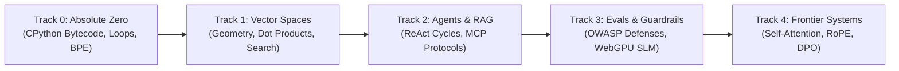

# OpenGuide — Comprehensive Technical System Explainer

> **Specification Standard:** ASD-STE100 (Simplified Technical English, ~85% conformance).  
> **System Identification:** OpenGuide (Brand: `OpenGuide.`, Monogram: `OG`, Subtitle: `AI STUDIO`).  
> **Chief Architect & Author:** Adil Rafiq Dar (ARD).  
> **Production Address:** `https://openguideforai.dpdns.org`  
> **Companion Document:** [`README.md`](README.md)  

---

## 1. Document Scope and System Boundaries

This document gives the complete technical specification for OpenGuide.  
OpenGuide is an educational studio for artificial intelligence.  
The system teaches the mathematical and computational mechanics of artificial intelligence through direct code execution.  

### 1.1 System Boundaries
- **Host Environment:** The client web browser (Chromium, WebKit, Gecko engines).
- **Execution Target:** Local client hardware (CPU and GPU).
- **Network Requirement:** Optional. The software functions fully without an active network connection after initial cache storage.
- **Server Infrastructure:** Zero server-side compute. The system uses static file delivery (Content Delivery Network) only.

```
┌────────────────────────────────────────────────────────────────────────┐
│                      SYSTEM BOUNDARY DIAGRAM                           │
│                                                                        │
│   CLIENT HOST DEVICE (Local Execution Boundary)                        │
│   ┌─────────────────────────────────────────────────────────────────┐  │
│   │  USER INTERFACE (Main Thread)                                   │  │
│   │  • React 19 Application Tree                                    │  │
│   │  • CodeMirror 6 Python Editor                                   │  │
│   │  • Accessible ARIA Live Regions                                 │  │
│   │  • Three.js WebGL & WebXR Holodeck                              │  │
│   │  • Web Audio API Harmonic Synthesizer                           │  │
│   └──────────────────────┬──────────────────────────────────────────┘  │
│                          │ postMessage() / Events                      │
│   ┌──────────────────────▼──────────────────────────────────────────┐  │
│   │  BACKGROUND SERVICES & RUNTIMES                                 │  │
│   │  • Dedicated Web Worker (Pyodide CPython 3.12 WebAssembly)      │  │
│   │  • 15-Second Execution Watchdog Supervisor                      │  │
│   │  • IndexedDB Database (Dexie v4 Storage Engine)                 │  │
│   │  • Service Worker (Offline Cache & Asset Router)                │  │
│   │  • Web Crypto Engine (AES-GCM 256-bit Encryption)               │  │
│   └─────────────────────────────────────────────────────────────────┘  │
│                                                                        │
│   EXTERNAL ENVIRONMENT (Static CDN Only)                               │
│   ┌─────────────────────────────────────────────────────────────────┐  │
│   │  • Static Application Assets (HTML, JS, CSS, WebAssembly Wheels)│  │
│   │  • Optional External APIs: User Personal Keys Only (BYOK)       │  │
│   │  • NO Cloud Compute Services                                    │  │
│   │  • NO Telemetry Collection Servers                              │  │
│   │  • NO Central User Database                                     │  │
│   └─────────────────────────────────────────────────────────────────┘  │
└────────────────────────────────────────────────────────────────────────┘
```

---

## 2. Core Operational Constraints (The $0 Rule)

OpenGuide enforces strict cost and privacy constraints:

1. **Zero Cloud Infrastructure Invoices ($0 Rule):**  
   All Python compilation, tensor calculations, and graphical renderings run on the CPU and GPU of the local client device. The project operates with zero paid backend infrastructure.
2. **Zero Telemetry and Zero Analytics:**  
   The application does not collect user behavior, telemetry beacons, or code submissions. No user data leaves the client device.
3. **Local Key Protection (Bring Your Own Key - BYOK):**  
   Learners can test frontier models using personal API keys (OpenAI, Anthropic, Google). The application stores these keys in browser memory only. The keys transmit directly to the official vendor endpoints with zero intermediary proxy logging.

---

## 3. Web Worker CPython 3.12 Execution Subsystem

OpenGuide executes genuine Python 3.12 code inside the web browser through Pyodide WebAssembly.  
The application separates the user interface thread from the Python execution thread. This prevents user interface freezes during heavy calculations.

```
┌────────────────────────────────────────────────────────────────────────┐
│                 WEB WORKER EXECUTION ARCHITECTURE                      │
│                                                                        │
│  MAIN THREAD (User Interface)             WEB WORKER THREAD            │
│  ┌─────────────────────────┐              ┌─────────────────────────┐  │
│  │ CodeMirror 6 Editor     │              │ Pyodide CPython 3.12    │  │
│  │ (Learner Writes Code)   │              │ (Emscripten WASM Heap)  │  │
│  └───────────┬─────────────┘              └───────────▲─────────────┘  │
│              │                                        │                │
│              │ 1. postMessage({ type: 'RUN', code })  │                │
│              ├───────────────────────────────────────►│                │
│              │                                        │ 2. Redirect IO │
│              │                                        │ 3. Compile AST │
│              │                                        │ 4. Run Bytecode│
│              │                                        │ 5. Test Invariant│
│              │                                        │                │
│              │ 6. postMessage({ stdout, pass: true }) │                │
│              │◄───────────────────────────────────────┤                │
│  ┌───────────▼─────────────┐              ┌───────────▼─────────────┐  │
│  │ Terminal Output Display │              │ Reset Python Scope      │  │
│  │ Update Progress State   │              │ Release Unused Memory   │  │
│  └─────────────────────────┘              └─────────────────────────┘  │
└────────────────────────────────────────────────────────────────────────┘
```

### 3.1 Step-by-Step Execution Sequence
1. **Source Capture:** The learner enters Python code in the CodeMirror 6 editor.
2. **Message Dispatch:** The learner presses `Ctrl + Enter` or clicks **Run Code**. The main thread sends the code string to the Web Worker via `worker.postMessage()`.
3. **Standard Stream Redirection:** The Web Worker redirects Python `sys.stdout` and `sys.stderr` to internal string memory buffers (`io.StringIO`).
4. **Bytecode Compilation and Execution:** The Pyodide runtime parses the code into an Abstract Syntax Tree (AST), compiles the tree into bytecode, and evaluates it asynchronously using `pyodide.runPythonAsync()`.
5. **Invariant Testing:** The test runner inspects the Python namespace (`locals()` and `globals()`) and verifies expected output values.
6. **Result Payload Transmission:** The Web Worker sends a structured JSON packet back to the main thread:
   ```json
   {
     "success": true,
     "stdout": "Calculated vector distance: 0.142\n",
     "stderr": "",
     "executionTimeMs": 28.4,
     "passed": true
   }
   ```
7. **Display and State Mutation:** The main thread prints the text stream to the terminal component and records progress in local storage.

### 3.2 The 15-Second Watchdog Supervisor

Learners frequently write accidental infinite loops (for example: `while True: pass`).  
An infinite loop blocks the Web Worker execution thread permanently.  
OpenGuide includes an automated supervisor timer to solve this problem:

```
┌────────────────────────────────────────────────────────────────────────┐
│                   WATCHDOG SUPERVISOR STATE MACHINE                    │
│                                                                        │
│   [ IDLE ] ──(Run Code)──► [ EXECUTING ]                               │
│                                  │                                     │
│                     ┌────────────┴────────────┐                        │
│                     │                         │                        │
│            (Worker Responds)            (Timer > 15s)                  │
│                     │                         │                        │
│                     ▼                         ▼                        │
│                 [ SUCCESS ]              [ TIMEOUT ]                   │
│                     │                         │                        │
│                     │                 worker.terminate()               │
│                     │                         │                        │
│                     │                 Spawn New Worker                 │
│                     │                 Restore Pyodide Cache            │
│                     │                         │                        │
│                     └──────────► [ READY ] ◄──┘                        │
└────────────────────────────────────────────────────────────────────────┘
```

1. When code execution starts, the supervisor starts a 15,000-millisecond countdown timer.
2. If the Web Worker finishes execution before the timer expires, the supervisor cancels the timer.
3. If the timer expires, the supervisor calls `worker.terminate()` immediately.
4. The browser terminates the blocked thread and frees system memory.
5. The supervisor initializes a new Web Worker instance and reloads Pyodide from the browser cache.
6. The terminal displays a clear warning message: `Execution terminated: Time limit of 15 seconds exceeded.`

### 3.3 The Offline Standby Simulator
If a user launches OpenGuide in an offline environment before downloading the full Pyodide WebAssembly package:
- A secondary execution engine activates automatically.
- This engine uses a JavaScript regular expression and lexical parser.
- It validates basic Python syntax, variable definitions, and print statements without network access.
- The user can complete early syntax exercises while the system waits for network availability.

---

## 4. Local-First Persistence and Cross-Tab Synchronization

OpenGuide stores all user data in the client browser using the IndexedDB API through the Dexie v4 storage engine.

```
┌────────────────────────────────────────────────────────────────────────┐
│                   LOCAL-FIRST STORAGE DATA FLOW                        │
│                                                                        │
│  BROWSER WINDOW (Tab 1)                   BROWSER WINDOW (Tab 2)       │
│  ┌─────────────────────────┐              ┌─────────────────────────┐  │
│  │ Solves Lab 2.3          │              │ Listens for Broadcast   │  │
│  │ Writes to IndexedDB     │              │ Updates Progress UI     │  │
│  └───────────┬─────────────┘              └───────────▲─────────────┘  │
│              │                                        │                │
│              │ 1. Transaction Put                     │ 3. Event Sync  │
│              ▼                                        │                │
│  ┌────────────────────────────────────────────────────┴─────────────┐  │
│  │ Native IndexedDB (Dexie v4)                                      │  │
│  │ • Table: completed_lessons [ id, track, code, timestamp ]        │  │
│  │ • Table: lesson_drafts     [ lessonId, draftCode, updatedAt ]    │  │
│  │ • Table: user_settings     [ key, value ]                        │  │
│  │                                                                  │  │
│  │ BroadcastChannel: 'openguide_sync_bus'                           │  │
│  └──────────────────────────────────────────────────────────────────┘  │
└────────────────────────────────────────────────────────────────────────┘
```

### 4.1 IndexedDB Table Schema
1. **`completed_lessons` Table:**
   - Primary Key: `id` (string, for example: `"track-0-lab-1"`).
   - Indexes: `[track+id]`, `timestamp`.
   - Payload: Solved source code, execution duration, and completion timestamp.
2. **`lesson_drafts` Table:**
   - Primary Key: `lessonId` (string).
   - Payload: Unsaved learner code and cursor position. This prevents data loss during page reloads.
3. **`user_settings` Table:**
   - Primary Key: `key` (string).
   - Payload: Selected theme ID (out of 24 themes), audio preferences, font scale, and language code.

### 4.2 Cross-Tab Real-Time Synchronization
OpenGuide synchronizes state across multiple open tabs without network requests:
1. When a user completes a lesson in Tab 1, the store writes to IndexedDB.
2. The store sends a message through the browser `BroadcastChannel` API on channel `'openguide_sync_bus'`.
3. Tab 2 receives the message and updates its React state immediately.
4. The user interface reflects the new progress state without a manual page refresh.

### 4.3 Zero-Knowledge Encrypted Remote Backup
Users can back up their progress to a private GitHub Gist without creating a platform account:
1. The user supplies a personal GitHub Personal Access Token (PAT).
2. The browser generates an encryption key using the Web Crypto API (`window.crypto.subtle`).
3. Key derivation uses the **PBKDF2** algorithm with 100,000 iterations of SHA-256.
4. The system encrypts the progress payload using **AES-GCM 256-bit encryption** with a random 12-byte initialization vector (IV).
5. The application transmits the encrypted ciphertext to a private Gist under the user's GitHub account.
6. Remote servers cannot read the backup because the decryption key remains strictly on the client device.

---

## 5. Spatial Holodeck and High-Dimensional Visualizer

The Spatial Holodeck (`/holodeck`) converts mathematical high-dimensional vectors into physical three-dimensional space.

```
┌────────────────────────────────────────────────────────────────────────┐
│                   SPATIAL PROJECTION PIPELINE                          │
│                                                                        │
│   HIGH-DIMENSIONAL SPACE (1536-D)        THREE-DIMENSIONAL SPACE (R³)  │
│  ┌───────────────────────────────┐      ┌───────────────────────────┐  │
│  │ Language Model Embeddings     │      │ Three.js Scene Coordinates│  │
│  │ Vector: [x1, x2, ..., x1536]  │─────►│ Coordinates: (X, Y, Z)    │  │
│  │ 1536 Float32 Components       │ PCA  │ InstancedMesh Buffers     │  │
│  └───────────────────────────────┘      └─────────────┬─────────────┘  │
│                                                       │                │
│                                     ┌─────────────────┴─────────────┐  │
│                                     │ Web Audio API Sonification    │  │
│                                     │ Cosine = 1.00 ──► Perfect 5th │  │
│                                     │ Cosine = 0.00 ──► Neutral Root│  │
│                                     │ Cosine =-1.00 ──► Dissonance  │  │
│                                     └───────────────────────────────┘  │
└────────────────────────────────────────────────────────────────────────┘
```

### 5.1 Dimensionality Reduction Mathematics
Language model embeddings contain 1,536 or 4,096 numerical dimensions.  
The human visual system can perceive only three spatial dimensions.  
OpenGuide calculates a projection matrix $P \in \mathbb{R}^{d \times 3}$ using Principal Component Analysis (PCA):

$$\mathbf{z} = \mathbf{x} P$$

Where:
- $\mathbf{x} \in \mathbb{R}^{1 \times d}$ is the high-dimensional token embedding.
- $P \in \mathbb{R}^{d \times 3}$ contains the three principal eigenvectors of the covariance matrix.
- $\mathbf{z} = [X, Y, Z]$ are the spatial coordinates in the Three.js viewport.

Semantic relationships remain intact: words with similar meanings cluster together in 3D space.

### 5.2 Hardware-Adaptive Rendering Tiers
1. **2D Lightweight Mode:**
   - Disables WebGL.
   - Renders vector points using Scaled Vector Graphics (SVG).
   - Runs at 60 FPS on low-specification mobile devices with 0% GPU load.
2. **3D Hardware Mode:**
   - Uses Three.js and WebGL.
   - Renders up to 1,400 coordinate nodes using GPU `InstancedMesh` buffers.
   - Animates synaptic traveling action potential pulses and cosmic particle dust at 60 FPS.
3. **WebXR Spatial Mode:**
   - Interfaces directly with the browser WebXR Device API.
   - Provides full stereoscopic spatial rendering for Meta Quest and Apple Vision Pro headsets.

### 5.3 Harmonic Audio Vector Sonification
The visualizer teaches vector mathematics through sound synthesis:
1. When a user selects two vectors $\mathbf{u}$ and $\mathbf{v}$, the system calculates their mathematical Cosine Similarity:

$$\cos(\theta) = \frac{\mathbf{u} \cdot \mathbf{v}}{\|\mathbf{u}\|_2 \|\mathbf{v}\|_2}$$

2. The Web Audio API synthesizes a two-tone musical interval based on the angle $\theta$:
   - **Parallel Vectors ($\cos \theta \to 1.0$):** Plays a consonant Perfect Fifth interval (frequency ratio $3:2$).
   - **Orthogonal Vectors ($\cos \theta \to 0.0$):** Plays a single reference root tone ($220\text{ Hz}$).
   - **Opposite Vectors ($\cos \theta \to -1.0$):** Plays a dissonant tritone interval (frequency ratio $45:32$).

The learner hears mathematical alignment directly.

---

## 6. Pedagogical Architecture & 5-Track Computational Engine

The curriculum comprises **45 interactive laboratories** divided into five sequential tracks:



### Track 0: Absolute Zero (9 Labs)
- **Pedagogical Objective:** Remove the fear of code. Teach computational logic through real-world physical metaphors.
- **Underlying Mechanics:** Bytecode evaluation, standard output streams, string slicing, and dictionary frequency tables.
- **Capstone Lab:** Construct a Byte-Pair Encoding (BPE) tokenizer from scratch using pure Python without external libraries.

### Track 1: Vector Spaces & High-Dimensional Geometry (9 Labs)
- **Pedagogical Objective:** Demystify how computers represent human language as geometric coordinates.
- **Underlying Mechanics:** Dense vectors, dot products, Euclidean norms, and Top-$K$ priority queue sorting.
- **Capstone Lab:** Build a functional in-memory `SemanticSearchEngine` capable of ranking text documents by relevance.

### Track 2: Retrieval-Augmented Generation & Autonomous Agents (9 Labs)
- **Pedagogical Objective:** Teach students how to build agents that reason and interact with external tools.
- **Underlying Mechanics:** Sliding-window text chunking with token stride, ReAct state loops (Thought $\rightarrow$ Action $\rightarrow$ Observation), and Model Context Protocol (FastMCP) JSON-RPC 2.0 tool execution.
- **Capstone Lab:** Construct an Autonomous Multi-Hop Research Agent that queries tools, inspects returns, and produces verified answers.

### Track 3: Model Evaluation, Guardrails & Local SLMs (9 Labs)
- **Pedagogical Objective:** Teach defensive engineering, adversarial safety testing, and client-side inference.
- **Underlying Mechanics:** LLM-as-a-judge scoring rubrics, prompt injection canary tokens, PII redaction heuristics, and quantized WebGPU Small Language Model (SLM) inference.
- **Capstone Lab:** Implement an automated safety evaluation test harness running inference directly on local hardware.

### Track 4: Frontier Intelligence & Transformer Mechanics (9 Labs)
- **Pedagogical Objective:** Dissect the internal mathematics of frontier Large Language Models.
- **Underlying Mechanics:**
  - Scaled Dot-Product Attention:
  $$\text{Attention}(Q, K, V) = \text{softmax}\left(\frac{QK^T}{\sqrt{d_k}}\right)V$$
  - Rotary Position Embeddings (RoPE) complex plane transformations.
  - Key-Value (KV) cache memory sizing formulas.
  - Direct Preference Optimization (DPO) mathematical loss:
  $$\mathcal{L}_{\text{DPO}}(\pi_\theta; \pi_{\text{ref}}) = -\mathbb{E}_{(x, y_w, y_l)}\left[\log \sigma\left(\beta \log \frac{\pi_\theta(y_w|x)}{\pi_{\text{ref}}(y_w|x)} - \beta \log \frac{\pi_\theta(y_l|x)}{\pi_{\text{ref}}(y_l|x)}\right)\right]$$
- **Capstone Lab:** Build an interactive Transformer Attention Head Dissection tool and DPO alignment calculation engine.

### 6.1 The Syntax Doctor Diagnostic System
When learner code raises an exception, OpenGuide does not display raw confusing tracebacks alone:
1. The **Syntax Doctor** parses standard Python exception types (`SyntaxError`, `IndentationError`, `NameError`, `IndexError`, `TypeError`).
2. The diagnostic engine maps technical errors into clear, friendly guidance.
3. The interface displays an expandable hint card and provides a 1-click **"Load into Editor"** button with a working code foundation.

---

## 7. Progressive Disclosure Architecture (Information Density Management)

OpenGuide balances extensive technical functionality with mental calm through a three-tier Progressive Disclosure System:

```
┌────────────────────────────────────────────────────────────────────────┐
│                   PROGRESSIVE DISCLOSURE SYSTEM                        │
│                                                                        │
│  TIER 1: FOCUSED DEFAULT WORKSPACE                                     │
│  • Clean single-column layout                                          │
│  • Plain-English conceptual briefing                                   │
│  • Code editor and execution output terminal                           │
│                                                                        │
│  TIER 2: CONTEXTUAL GUIDANCE (WHEN STUCK)                              │
│  • Friendly Syntax Doctor diagnostic translations                      │
│  • Progressive clue expandable card                                    │
│  • 1-Click "Load into Editor" canonical solution seed                  │
│                                                                        │
│  TIER 3: SUMMONABLE DEEP INSTRUMENTATION                               │
│  • Command Palette via Cmd + K                                         │
│  • X-Ray Debug Lens via Alt + X (AST, Worker Heap, IndexedDB)          │
│  • 3D Spatial Holodeck & Attention Dissection Matrices                 │
└────────────────────────────────────────────────────────────────────────┘
```

1. **Tier 1 (Focus Mode):** Active by default. The student views only the lesson objective, the code editor, and the terminal output. Peripheral instruments remain hidden.
2. **Tier 2 (Contextual Guidance):** Activates automatically upon compiler failure. The **Syntax Doctor** translates raw Python tracebacks into friendly advice. If requested, progressive hints and a 1-click **"Load into Editor"** button provide immediate unblocking.
3. **Tier 3 (Deep Instrumentation):** Power tools (AST inspectors, memory gauges, 3D Holodeck) open through dedicated shortcuts (`Cmd + K`, `Alt + X`) without cluttering the primary learning surface.

---

## 8. Offline PWA and Cache Lifecycle

OpenGuide functions as an Installable Progressive Web App (PWA).

### 8.1 Service Worker Caching Policy
- **HTML Document:** Network-first with immediate offline fallback to cached `index.html`.
- **Static Assets (JS, CSS, SVGs):** Cache-first strategy with cache invalidation using content-hashed filenames.
- **Pyodide WebAssembly Assets:** Stored in browser `CacheStorage`. Once downloaded, Python compiles offline without internet access.

### 8.2 Dynamic Chunk 404 Recovery (`lazyWithRetry`)
When a new version deploys to the production CDN, users with older cached tabs may request stale JavaScript chunks:
1. `lazyWithRetry()` catches the dynamic import failure (`Failed to fetch dynamically imported module`).
2. The function records a recovery attempt flag in browser `sessionStorage`.
3. The function forces a clean browser reload directly from the CDN origin, bypassing the React Error Boundary.

---

## 9. Cryptographic Verification and Portable Proof-of-Work

OpenGuide creates cryptographically verifiable credentials for every completed track:

1. **W3C Verifiable Credentials (`.jsonld`):** Exports learner achievements conforming strictly to the W3C Verifiable Credentials Data Model 1.0.
2. **Deterministic SHA-256 Digest:** Uses `window.crypto.subtle.digest('SHA-256', ...)` to generate a tamper-evident cryptographic hash of the student's completion ledger.
3. **Portable Jupyter Notebooks (`.ipynb`):** Converts solved code and lesson markdown into valid Jupyter Notebook format (nbformat 4.5) for local execution in VS Code or JupyterLab.

---

## 10. Universal Accessibility & Multilingual Architecture

1. **WCAG 2.2 Level AAA Compliance:** 24 themes calibrated with contrast ratios exceeding 7:1 (and reaching 20:1 on monochrome themes).
2. **Screen Reader Support:** Interactive terminal streams connect to dynamic live regions (`aria-live="polite"`). Modals implement strict focus containment traps.
3. **Native RTL Support:** Arab and Urdu interfaces mirror layout directionality automatically (`dir="rtl"`) while locking Python CodeMirror editors to Left-to-Right (`ltr`).
4. **Script-Safe Typography:** Dynamic line-height styles prevent vertical text collisions in Devanagari, Nastaliq, and East Asian scripts.

---

## 11. Authorship, Attribution and License

* **Architect & Developer:** Adil Rafiq Dar (ARD).
* **Canonical URL:** `https://openguideforai.dpdns.org`
* **License:** Dual License — AGPL-3.0 for software code, CC BY-NC-SA 4.0 for educational curriculum.
